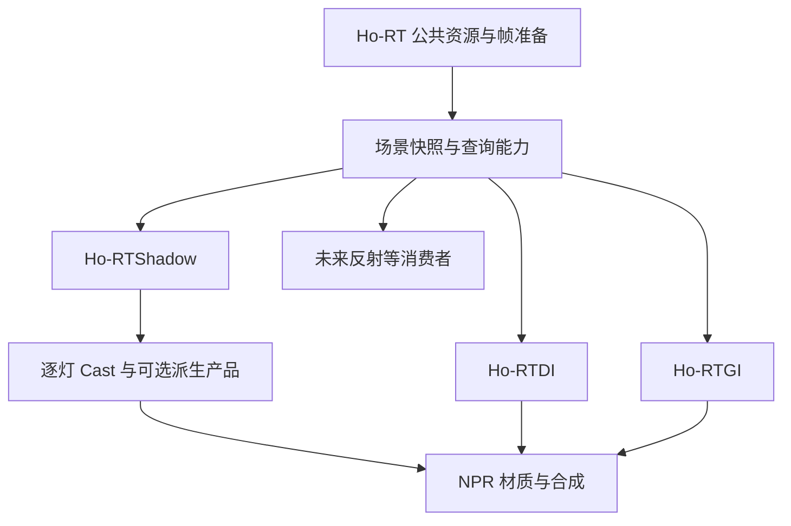

# Ho-RT：公共底座与 RTShadow

> 状态：**现行实现 / 设计总入口**，2026-10-29。按用户要求，生产代码已完整回到曲面修正前的 `c4840135` 行为：恢复 RTShadow 生产、接收及调试，撤出后加的主表面追踪、曲面位移与对应 UI / payload。保留此前数值自相交保护、逐灯 / SIGMA / UI / 排序检查。**这次回退不代表真实角色的面片感、细条和运动稳定性已经解决**；回退范围、验证和研究取舍见 §8.8、§9。实验分支不合入，用户场景及参数资产不改。旧阶段记录只证明当时受测范围。

## 0. 先确认实现状态

| 对象 | 当前状态 | 入口 |
| --- | --- | --- |
| 栅格化角色 CS | 已有 shadow map / PCF / PCSS，本轮完成勾选与滤波修复，仍有画质限制 | [当前 CS](Ho-CharacterShadow.md) |
| RTDI / RTGI | 两路均消费 host view；DI / GI 的有界迁移与生产组合已验收，GI Mono Player 及 DI 有界 Player 两路径通过。独立输出 / 历史 / NRD 保持；完整 DI proposal 旧失败保留 | [DI](Ho-RTDI.md)、[GI](Ho-RTGI.md) |
| 公共 NRD | 生产 DI/GI 保留 RELAX；新增 typed SIGMA ABI、格式与 9 个官方 pipeline，独立夹具及真实 Cast 的有界 GPU 接入已验，默认仍为 Raw | 本文 §11 的基线与证据 |
| Ho-RT host | R2 已有有界验收，生产 DI/GI 已接入并验证共享姿态与独立算法；DI/GI Player 已确认序列化和插件加载 | 本文 §8.5 |
| RTShadow / SIGMA | 已回到曲面修正前基线，保留逐灯产品、SIGMA、NPR、Volume / 调试。历史有界验收不等于真实角色终止线质量通过；当前问题与后续路径见 §8.8、§9 | 本文 §4–9 |

当前底层 helper 的实现契约见本文 §10。旧阶段的冻结 / 停止条件只约束当时任务，不自动阻止本轮经用户提出的公共底座工作；历史质量、F39、复杂动态和性能缺口也不会因此变成已解决。

## 1. 本轮的架构定位

此前 RTDI / RTGI 的公共层抽离已经完成公共 NRD 执行器与部分 RT 契约的解耦，基线及证据压缩保留在本文 §11。本轮继续解决 RT 场景的资源所有权、准备时序及公共查询能力；之前阶段已经完成的收益与明确保留的问题维持原结论。

建议采用两个独立功能模块：

- **Ho-RT**：公共场景资源、几何与材质查询能力、当前渲染请求的准备与生命周期。
- **Ho-RTShadow**：按光源与接收域生成 Cast 可见度产品，供 NPR 材质和其他系统按约定消费。

现有 DI / GI 先迁移为公共底座消费者，验证资源归属与行为不变。随后 RTShadow 的零角度、无历史模式提供新增阴影链路的几何基准，再接 SIGMA 与 NPR。各消费者直接使用公共查询能力，保留各自算法、输出和历史。

## 2. 行业中两条路线同时存在

### 2.1 独立 ray-traced shadows

Unreal 官方把 Ray Traced Shadows 明确列为 standalone feature，并允许灯覆盖项目级开关；它与 Lumen 的 GI / 反射并存。这里的 feature 表示功能模块，并不指 URP 的 `ScriptableRendererFeature` 类。[Epic Hardware Ray Tracing](https://dev.epicgames.com/documentation/en-us/unreal-engine/hardware-ray-tracing-in-unreal-engine)

HDRP 17.3 支持独立 RT 阴影并将结果放在屏幕空间 buffer。公开 Graphics master 源码还能看到逐灯生成、slot/channel 写入和 lighting 根据灯的 screen-space shadow index 读取的过程。master 源码与 17.3 手册分别作为证据，不假定它们是同一 pinned revision。[HDRP 17.3 手册](https://docs.unity3d.com/Packages/com.unity.render-pipelines.high-definition@17.3/manual/Ray-Traced-Shadows.html)、[ScreenSpaceShadows 源码](https://raw.githubusercontent.com/Unity-Technologies/Graphics/master/Packages/com.unity.render-pipelines.high-definition/Runtime/Lighting/Shadow/HDRenderPipeline.ScreenSpaceShadows.cs)、[LightEvaluation 源码](https://raw.githubusercontent.com/Unity-Technologies/Graphics/master/Packages/com.unity.render-pipelines.high-definition/Runtime/Lighting/LightEvaluation.hlsl)

AMD Hybrid Shadows 也单独组织阴影分类、射线与可选降噪。它说明可以局部替换 shadow 生成而保留混合渲染结构；不要求先重写整套 PBR 光照。[GPUOpen Hybrid Shadows](https://gpuopen.com/manuals/fidelityfx_sdk/samples/hybrid-shadows/)

### 2.2 联合直接光估计

用户对另一条行业路线的观察是成立的：MegaLights 使用固定数量的每像素光源样本，联合处理遮挡与直接光照，替换传统逐灯 shadowing / shading 的多个阶段。它通常不要求生成每个像素、每盏灯的完整 mask 集合。[Epic MegaLights](https://dev.epicgames.com/documentation/en-us/unreal-engine/megalights-in-unreal-engine)

RTXDI 集成同样是在最终选择的灯样本上执行 visibility ray，再执行材质 BRDF。其输出可直接是光照估计。[RTXDI Integration：Shade](https://github.com/NVIDIA-RTX/RTXDI/blob/main/Doc/Integration.md)

### 2.3 PBR 中仍有明确的遮挡含义

对固定表面，直接光可以概括为：

```text
直接光 = 对所有光源、所有入射方向积分 [可见性 × 入射光 × 材质响应 × 方向几何项]
```

阴影对应其中的可见性；完整路径的每段连接也受遮挡约束。联合估计改变了计算与存储方式，不能据此把“光照较弱”都叫成 cast：弱光、背光、材质吸收和几何遮挡是不同原因。[PBRT 的直接光采样实现](https://www.pbr-book.org/4ed/Light_Transport_I_Surface_Reflection/A_Simple_Path_Tracer)

## 3. 为什么 NPR 值得保留独立 Shadow 产品

这是针对本管线的设计判断：角色 toon 分层、主光选择、补光、轮廓光及多层接收规则，需要在最终着色前保留对遮挡来源的控制。逐灯可见性可以让材质选择“哪盏灯的遮挡影响哪一层”，而无需从最终 RGB 中猜测阴影。

需要保留三种语义的边界：

| 信号 | 表示什么 | 所属职责 |
| --- | --- | --- |
| 几何可见性 / 透射 | 表面到某个灯样本之间是否被挡 | Ho-RT 公共查询 |
| 某灯的 Cast 产品 | 该灯在约定采样、接收域上的阴影结果 | Ho-RTShadow |
| Toon 明暗、阴影色与分段 | 材质如何使用 Cast、法线和其他输入 | 材质 / NPR 光照消费者 |

RTShadow 输出不直接包含 albedo、toon 阴影色或最终 beauty。用户要的角色接收选择通过公共接收域声明传入；RTShadow 可以以后服务其他对象，不硬编码成只支持某个角色组件。

## 4. Ho-RT 应拥有的基础设施



公共底座包括：设备能力、世界几何登记、当前蒙皮姿态快照、材质身份与 alpha 语义、场景 view / AS 生命周期、revision、每次 camera/render view 请求的资源准备及调度依赖。现有公共灯结构可以继续形成中立的灯数据契约，避免新增第二套不一致的 light identity / 变换 / 强度来源。

公共查询至少分两类：

- `TraceOcclusion`：给定射线及查询规则，返回是否存在有效遮挡；alpha 裁切参与真实求交。
- `TraceClosestHit`：返回最近有效命中的距离、实例/primitive/material 身份、重心坐标等，供后续表面重建。

只判断遮挡时可以在找到有效遮挡物后提前终止。需要最近 blocker 距离时必须使用相应查询能力；遍历中首先接受的命中不保证是几何最近命中，不能把二值 occlusion 的快捷结果当成准确 blocker 距离。

按灯样本查询时，可使用中立的 `SampleVisibility(surface, lightSample, policy)` 适配到射线。函数命名只是设计说明；底层求交无需知道哪个灯是主光。

必须分开 miss、invalid ray、unsupported、unavailable 等状态。不可查询并不等于“完全可见”。初始范围为已支持的不透明 / cutout；未来彩色透射是显式能力扩展。

光源抽样、reservoir、bounce、NPR 响应、NRD 信号及历史仍由各消费者管理。Ho-RT 的启用不隐式打开 DI、GI、Shadow 或时域累计。

## 5. 公共代码、公共资源与查询策略

### 5.1 从代码公共层到资源宿主

抽离前 DI / GI 各自创建、同步和释放 HoRTScene 及 hit adapter。R3 将这些改成消费者 pre-cull 声明请求、host 准备、消费者借用有效 view；创建和释放由 host 负责。仍保留不同 native hit 能力对应的 AS view，光照 Context 和历史继续属于各消费者。资源宿主的验收范围见 §8.5，不能只用搬文件或减少字段数证明资源收益。

### 5.2 共享粒度

世界登记与当前姿态应有公共所有者。AS 可以按兼容的几何集合、排除规则和材质查询能力形成多个 view。当前 DI 的 visibility hit group 与 GI 的 secondary surface hit group 不同，不能直接把其中一个私有 AS 地址交给所有效果就声称完成了共享。

先建立共同资源宿主与不可变输入合约，再用验证证明哪些 view 可以合并。共享几何快照与共享整个 AS 分别计量，不能仅根据少了一个 C# 对象宣称显存或 GPU build 成本下降。

### 5.3 查询规则由用途决定

Cast Off 的表面仍可能需要参与 GI 或反射。单/双面、Shadows Only、灯/物体 linking、材质排除等必须作为明确策略保存，不能把 shadow caster 集合强制变成所有 RT 效果的世界集合。

现有 inline `HoRTTraceScene` 会跳过 non-opaque。R4 前置步骤已将 DI / GI native any-hit 的 alpha 运算收敛到 RT 公共 `HoRTCutoutAlpha.hlsl`，原支持域不变；DI 的轻量 material adapter 移到 RT，并保留 GUID。GI 的完整 surface evaluation 仍由 GI 自己持有。新增 native 最近命中与二值遮挡入口区分距离语义，验收见 §8.5。

### 5.4 帧准备与多相机

由 host 收集消费者声明，准备并冻结当前渲染的场景快照；查询输入声明可读资源与 build 完成依赖。Cast 可在 GB/SB 之后、opaque toon 之前运行，DI/GI 保持自己的后置阶段。初版沿用现有 [Feature 排序契约](Ho-RenderFeatureOrdering.md)：明确配置宿主准备与生产者 / 消费者的列表次序，同事件按入队顺序记录。校验缺失或顺序错误的依赖，不能依靠未声明的全局资源，也不能仅用相同 RenderPassEvent 假定资源已准备好。RenderGraph 不会替应用自动重排尚未生产的 ContextItem。

宿主的 CPU 请求准备、GPU AS build 和效果执行是三个时机。宿主应在消费者记录之前给出冻结输入，AS build 则在首个实际 trace 前有明确命令依赖；不因此把所有效果搬到同一个 pass，也不要求宿主拥有最早的屏幕绘制。具体注册 / 准备 hook 在 R0 核对现有 URP 生命周期后确定。

RenderGraph 对 AS 的真实访问和 build 依赖需要由公共实现显式处理。现有 [HoRTScene.Inputs](D:/Unity_Fork/lilToon-URP-Extensions/Runtime/RT/HoRTScene.cs:253) 的 revision 检查应保留并扩展到统一所有权；GPU 使用结束前不能更新或释放对应快照。

世界数据只在兼容域内复用；相机屏幕输入、接收域、输出、采样和历史按 render view 管理。GameView、SceneView、Prefab Stage、不同 RendererData 和过滤配置不能混用。有效性不能只看 `Time.frameCount`。

Ho-RT 缺失、禁用或设备不支持时，消费者报告明确状态，并按各自声明的 fallback 工作；不能隐式再创建自己的隐藏公共底座。

## 6. RTShadow 能否输出全部灯的 Cast

可以。必须先区分“全部灯各自的结果”和“把全部灯合成一个结果”。这里的全部指当前请求范围内、受支持且参与直接投影的灯集合；环境光、发光网格与间接光不自动归入第一版。

### 6.1 优先保留逐灯产品

输出应能够由稳定 `light ID` 查询到自己的可见度，而不是只靠每帧可重排的临时灯索引。可用 texture array、atlas 或稀疏 buffer；存储布局不改变逐灯语义。

每项同时携带有效性及必要域信息：灯身份/修订、camera / surface sample 域、接收域、场景快照、样本预算和过滤状态。第一版不必把所有这些都写成全屏纹理，但必须能验证消费者读取的是正确结果。

有限光源的整灯平均可见度还要注明抽样 measure / 权重。面积光不同方向的可见性与 BRDF、cosine、纹理发光相关；一个平均 V 通常不足以给任意材质精确重建整灯照明。需要严格积分的消费者仍查询自己的实际灯样本。

### 6.2 连续值与 NPR Ramp 合约

正式 NPR 接口必须保留**尚未经过 toon 阈值和着色的浮点可见度**。`V=0` 表示完全遮挡，`V=1` 表示完全可见；半影允许中间值。单灯硬投影只用于建立几何参考，不能凭此宣称生产接口已经满足连续 ramp 的需求。

这里有三种不同的连续量：

| 连续量 | 来源 | Ramp 的用途 |
| --- | --- | --- |
| 法线 / 光方向生成的明暗坐标 | `N·L`、half-Lambert 或已有 NPR 规则 | 物体自身的明暗分段 |
| 单灯有限光源可见比例 | 对同一表面点积分多个实际灯样本 | 对真实半影重新分段或着色 |
| 可选的美术边界坐标 | 约定范围的可见度重建、阴影边界距离等 | 独立于物理光源大小的边缘塑形 |

第一项由材质 / NPR 光照构造。第二项是 RTShadow 的核心生产信号。第三项只有在明确需要时才增加，标为派生美术信号，并注明单位、作用范围与表面关联规则，不冒充物理可见度。

零角度方向光照到一个确定的不透明表面点时，原始遮挡本来是 0/1。同一个点、同一个方向重复查询不会产生半影或连续梯度。有限光源的积分可以产生连续的可见比例；空间子像素积分则处理像素覆盖，两者作用不同。[PBRT：Area Lights](https://www.pbr-book.org/4ed/Light_Sources/Area_Lights)

即使接口使用 float，有限样本也不自动得到无台阶的信号。N 个等权二值灯样本的可见比例只有 N+1 个取值。需要用足够的同帧采样和适当的重建检查实际梯度质量；不能用 8-bit、先阈值、或强行拉高对比度来替代。中间累加使用足够精度，原始估计与重建产品有明确区分。重建需保留深度、法线和对象边界，避免跨表面污染。

建议每个实际空间着色样本的顺序为：

```text
NPR 明暗坐标 h + 该灯的连续可见度 V
    → 按材质各层的接收规则组合成 ramp 坐标 u
    → 材质执行 ramp / 阈值 / 阴影色
    → 当前帧各空间样本的最终颜色合成
```

RTShadow 不提前执行 ramp，也不将法线明暗烘进核心 V。`h` 与 `V` 维持独立输入；组合函数由 NPR 语义决定，不在底座中写死一种乘法。多层 toon 可以共享同一份 V，并分别设置接收强度、border 与 ramp。

当前 lilToon 确实在 [接收 Cast](D:/Unity_Fork/lilToon/Assets/lilToon/Shader/Includes/lil_common_frag.hlsl:963) 后，才执行各层 [toon 分段](D:/Unity_Fork/lilToon/Assets/lilToon/Shader/Includes/lil_common_frag.hlsl:1010)。新后端应保持这一输入边界；验证时也不能只看一张“黑白轮廓正确”的图。

如需在几乎零物理半影下仍用 ramp 大幅移动或扩展投影边，单纯的二值 V 信息不足，需要明确的美术边界信号或指定宽度的可见度重建。单张屏幕距离场会受分辨率、遮挡层和跨表面边界影响；最近 blocker 距离只描述深度间隔，也不等同于到投影轮廓的距离。此类扩展应单独设计与验证。

连续值验收至少包括：原始 V 灰度、细半影的数值剖面、不同 ramp threshold 的轮廓、窄 / 多层 ramp 下的 banding 与噪声、动画微动，以及最终空间抗锯齿。不能仅凭浮点格式或后置模糊就判定通过。

### 6.3 连续阴影重建采用 NRD SIGMA

按用户本轮收敛，正式阴影重建优先采用 NRD 的逐灯 shadow denoiser **SIGMA**，通过现有公共 NRD 层接入。SIGMA 负责阴影信号重建，NPR shader 负责 ramp；独立的美术距离场保持为以后确有需求时的扩展。

```text
RT 灯样本的真实遮挡与 blocker 距离
    + 光源大小 / 角度 + 当前表面 guides
    → SIGMA 官方前端编码
    → SIGMA 降噪
    → 官方后端解码得到浮点可见度 V
    → NPR 材质各层的接收与 ramp
```

这里不是把一张任意灰度图直接送进现有 RELAX。SIGMA 有自己的 penumbra / 距离编码与输入约定；需要遵守有效命中、miss、NoL、法线、深度及启用历史时的运动输入规则。需要 blocker 距离时，使用真实最近命中，不能沿用仅为二值遮挡提前结束的任意命中距离。NPR 的修改法线 / half-Lambert 接收域与 SIGMA 官方有效域之间的关系要明确验证，不能把域外数据误报为有效几何可见度。

后端必须使用 `SIGMA_BackEnd_UnpackShadow`。本地 pinned 版本该宏执行平方解码；直接把编码输出当作线性 ramp 坐标，会改变阴影过渡。[本地 NRD 前后端](D:/Unity_Fork/lilToon-URP-Extensions/Runtime/RTDI/ThirdParty/NRD/NRD.hlsli:941)

预览可以启用 SIGMA 时空稳定；单帧导出提供 `maxStabilizedFrameNum=0` 的无历史模式，单独验证其输入预算和 ramp 下的画质。本地 pinned `SigmaSettings` 也明确该参数为零时禁用 stabilization。[本地设置](D:/Unity_Fork/lilToon-URP-Extensions/Runtime/RTDI/ThirdParty/NRD/Include/NRDSettings.h:463)、[NRD 官方说明](https://github.com/NVIDIA-RTX/NRD/blob/master/README.md#best-practices)

逐灯保留 raw 与 denoised 的身份及状态。使用历史时按相机、灯身份及场景有效性隔离；多灯流式无历史处理与持久保存所有逐灯结果是不同资源方案。

公共执行器现已支持 typed SigmaSettings、9 个匹配版本的官方 shader wrappers / manifest，以及真实 Cast 的编码、guide、逐灯重建与官方解码；生产 DI/GI 保留原 RELAX 设置绑定和独立历史。实际 GPU / NPR / Player 范围见 §8.5。R0 对现用 DLL 实测为 NRD 4.17.3、normal encoding 2 / roughness 1，支持 `SIGMA_SHADOW`（16）及 `SIGMA_SHADOW_TRANSLUCENCY`（17），各有 9 pipelines、1 permanent、8 transient；当前使用 16，不声称透射阴影已验收。无需重编 pinned native 插件；其能力清单见 [R0 inventory](../Tests~/RT/R0/sigma-inventory.json) 和 [CPU probe](../Tests~/RT/R0/probe_sigma.py)，不能单凭 descriptor 成功替代生产图像证据。

### 6.4 派生输出按需求提供

| 可选产品 | 用途 | 明确限制 |
| --- | --- | --- |
| 指定灯的可见度 | 主光 Cast、角色分层 | 与该灯和表面采样域绑定 |
| 一组 / 全部请求灯的逐灯集合 | 多灯 NPR、后续按灯重组 | 样本与存储成本随请求量增长 |
| 主光 / 补光 / 轮廓光等灯组信号 | NPR 的灯组控制 | 分组规则及合并算子是显式美术约定 |
| 未遮挡与已遮挡的漫反射 irradiance 对 | 测量因直接遮挡损失的入射照明 | 包含选定法线、灯权重与光源域，不是通用几何可见度 |
| 基于上述对的归一化遮挡量 | 某个明确光照模型下的 NPR 遮挡驱动 | 无照明时无有效比值；不能替代各灯 / 各 BRDF 的结果 |

完整 direct diffuse/specular radiance 继续由 RTDI 或指定光照消费者生成，避免 RTShadow 再实现一套竞争的直接光积分器。

### 6.5 一张通用“全部灯 Shadow”没有唯一含义

假设两盏灯的未遮挡贡献分别为 100 和 1。挡住强灯与挡住弱灯时，逐灯 V 分别为 `(0,1)` 与 `(1,0)`；简单平均都得到 0.5，但保留光照分别为 1 与 100。

对**已经固定定义**的未遮挡贡献 `L_i`，可以构造：

```text
L0 = Σ L_i
Lv = Σ (L_i × V_i)
A  = Lv / L0                  // 分母有效时，分量除法
```

这个 A 只对生成它所使用的光照模型成立。漫反射、高光、不同法线或 toon 层换了一套权重，A 也可能改变。不同颜色的灯还可能需要 RGB，不能全部压成灰度而保留等价性。

NRD 官方 SIGMA 文档明确支持逐灯 shadow-only 处理，并讨论了类似的多灯加权合并，同时说明其过滤与适用限制。本轮优先逐灯 SIGMA；该合并方案作为以后有明确消费需求时的参考。[NVIDIA NRD README：SIGMA](https://github.com/NVIDIA-RTX/NRD/blob/master/README.md)

### 6.6 全灯能力不要求始终保存全屏全灯

消费者只请求所需灯、接收对象及空间域。只有要做后续逐灯调整时，才需要持久保存对应逐灯产品；只需要已定义的灯组或 irradiance 对时，可以逐灯流式计算并汇总。未查询到的灯必须有显式状态，不能伪装成无遮挡。

存储量也应如实记录：1920×1080、32 盏灯、每灯一张 R16F 已约 126.6 MiB；3840×2160 则约 506.3 MiB，均未包含历史、深度、元数据或其他临时量。全灯是语义能力，具体生产与存储应按需求配置。

## 7. 与 RTDI / RTGI 的关系

RTShadow、RTDI、RTGI 共享场景与查询能力，可以共享兼容的灯数据与采样工具。RTDI / GI 不强制读取 RTShadow 的屏幕 mask：它们可能查询不同灯样本、次级表面或反射中的表面。

已经包含 visibility 的 DI radiance 再乘同一 Cast，会重复衰减。需要复用结果时，必须证明灯样本、表面域、查询规则及权重完全匹配；不能仅凭“同一盏灯”就默认可用。

NPR 消费者应明确每条输入是未遮挡照明、已遮挡照明还是独立可见度，以及由哪个阶段应用一次。Cast、AO、GI 强弱与 toon 固有明暗保留不同通道。

现有 shadow map 与 RTShadow 可以生产同一种受约束的 Cast 接收合约。同一相机、灯与接收域的最终 Cast 要有明确来源选择，避免两路重复应用；具体通过替换还是额外叠加，必须由合成语义明确决定。

## 8. 实施路径与阶段验收

本轮按 **核对基线 → 纯目录迁移 → 建立宿主 → 迁移既有 DI/GI → 单灯 Cast → SIGMA 与 NPR 接收 → 多灯扩展** 推进。每阶段是可单独审查、验证和提交的边界；当前状态全部为待实施，不因本文写出接口就视为完成。

先让现有消费者证明公共资源宿主正确，再增加新阴影功能。SIGMA 的 DLL 能力探测提前做，正式信号接入则等待 Cast 提供真实、正确的距离与表面数据。

### 8.1 目标目录与模块归属

```text
Runtime/
  RT/                  # 由现有 RayTracing 整体迁入，加 HoRTRendererFeature
    Shaders/           # 通用 query / hit / primary / alpha 等公共实现
  RTShadow/            # 新增阴影 feature、采样、逐灯输出、SIGMA 信号适配
  RTDI/                # 保留直接光策略、输出、采样、合成与独立历史
  RTGI/                # 保留间接光策略、输出、采样、合成与独立历史
  NRD/                 # 通用 native ABI、执行器与插件，继续独立
Editor/
  RT/                  # 由现有 Editor/RayTracing 迁入
  RTShadow/            # 新阴影 Inspector 与验证入口
```

`Runtime/RayTracing` 与 `Editor/RayTracing` 迁移后不留平行目录或转发类。C# 公共命名空间同步由 `.RayTracing` 收敛到 `.RT`，`HoRTScene` 等类型名称保留。新 host 管资源，RTShadow 管阴影产品；公共 NRD 不并入某个效果。SIGMA 的通用执行支持进 `NRD`，阴影前后端输入、逐灯状态与 manifest 由 RTShadow 适配。

### 8.2 分阶段交付

| 阶段 | 工作与边界 | 完成条件 |
| --- | --- | --- |
| **R0 基线与能力核对** | 固定当前 DI/GI、CS 与资源基线；确认真实 URP 准备 hook；读取当前 NRD DLL 的支持列表及 SIGMA descriptors | 有可复现的支持 / 缺失结论、当前源与验证对应关系、资源所有权及调度合同；不改生产效果 |
| **R1 纯目录迁移** | RayTracing → RT，保留 `.meta` GUID，更新命名空间、include 和当前验证工具路径 | 源码差异限于迁移与引用；Runtime/Editor 编译及必要 shader / 求交回归通过，DI/GI 画面行为不变 |
| **R2 Ho-RT 宿主与共享场景数据** | 新建 HoRTRendererFeature，提供 renderer / render-view 域内的快照与查询 view；统一几何登记、姿态快照和生命周期 | 两个独立测试消费者取得正确输入，兼容姿态不重复 Bake，依赖 / 失效 / 释放 / 多相机隔离可验证 |
| **R3 DI/GI 资源迁移** | 先 DI、再 GI，从私有 new / Synchronize / Dispose 改为请求 host；保持各自光照算法、输出、材质求值和历史 | 单独与同时启用、开关 / 重建 / resize / 材质与姿态变化通过；匹配输入下 raw / filtered 与基线一致，没有隐藏私有场景回退 |
| **R4 单灯 RTShadow** | 新增独立 HoRTShadowRendererFeature，先做一个方向光的角色 Cast；提供逐灯身份、raw 可见度、真实 blocker 距离与明确有效性 | opaque / cutout / 离屏遮挡 / 投射规则正确，主光接收来源明确，未接 SIGMA 时可独立调试与作硬影参考 |
| **R5 SIGMA 与 NPR 正式接收** | 补通公共 NRD 的 SIGMA 支持，逐灯降噪、官方解码后进入现有 ramp；提供预览与无历史导出模式 | 连续 V、窄 / 多层 ramp、角色微动及冷启动单帧验收通过，历史不串灯，当前固定状态可独立导出 |
| **R6 多灯与派生输出** | 扩展点 / 聚光及经过单独验证的光源形状；按请求生成灯组 / 全部相关灯的逐灯产品 | Light ID / slot 重排、灯增删、不同接收域和逐灯采样正确；按需保存或流式汇总，成本和有效性明确 |

### 8.3 各阶段必须落实的内容

**R0：先消除接入不确定性。** 用当前 pinned NRD 4.17.3 的 DLL 读取 supported denoisers、创建 SIGMA 实例、检查实际资源格式与 pipelines。若当前 DLL 已包含 SIGMA，复用原插件；确实未包含时才设计匹配版本的构建，不为这一步顺带升级 SDK。确认 SIGMA 所需距离、NoL、guides、平方解码及禁用 stabilization 的合同。结果更新到本文 §6.3，不另开新的过程文档。

同时审计 `Create / AddRenderPasses / RecordRenderGraph / Dispose` 与当前 renderer / camera 作用域。确定消费者怎样声明需求、host 在何时冻结快照、何处验证顺序；不以一个跨所有 RendererData 的静态全局 AS 代替所有权设计。记录当前 DI/GI 配置、输出、历史和已知失败作为迁移基线，历史 run / SHA 保留原样。

**R1：迁移与渲染行为分开。** 使用保留文件和目录 `.meta` 的移动，更新当前 C# 引用、Shader include、资源加载及可执行测试 / 生成器路径；核查 `Shader.Find`，保留与目录无关的既有 Shader 名称。保留材质 Shader GUID、shader globals、native ABI 字符串和数值。历史源码快照、run、source-index 和旧 SHA 不批量改写；当前测试若硬编码旧路径，迁移执行入口并标注其与历史记录的关系。

**R2：公共所有权需要覆盖实际资源。** host 持有世界登记和可复用的几何 / 蒙皮快照，`HoRTScene` 继续是其内部实现。view 根据几何过滤、用途策略和 hit-material 能力确定；保留当前 DI / GI 不同 hit group，先允许相同姿态供多个 AS view 使用。此阶段不把所有材质求值重写成一个超级 shader，也不承诺一个 AS 能满足全部策略。

请求至少表达当前 renderer / 相机渲染域、所需集合与查询能力；返回值带可用性、lifetime / revision 与 GPU 使用期。只做遮挡和最近命中是不同能力。相同快照内的相同姿态由共享缓存提供；构建次数、Bake 次数、实际持有 Mesh / buffer 的计数证明复用，不能仅靠把两个 scene 字段包进 host 就算完成。场景 / Prefab Stage / Editor 同帧变化、多相机、重复 Create / Dispose、消费者中途停用和 GPU 使用期均需覆盖。

首版沿用显式 Feature 排序并检查依赖，见 §5.4。生产 host / GB / SB 需要先于相应消费者准备或记录；GPU build 在首次 trace 前建立顺序，消费者 pass 自己声明所有读写。缺 host、错误顺序或 unsupported 返回明确状态，不能读取上一次相机的全局资源。

**R3：一条消费者一条消费者迁移。** DI 与 GI 分别完成审查和提交，保留其几何 / 材质排除、采样参数、灯选择、合成方式、NRD profile、独立历史和失效条件。消费者提供用途与材质 adapter，host 拥有相应 view 及几何数据；消费者停止不释放别的效果仍在使用的共享资源。最终移除 DI/GI 对场景的私有创建、同步与释放，不提供缺 host 时静默重建原私有场景的路径。

资源共享不随意改变 revision 的语义：一个无关 view 的改变不应在没有输入变化时清掉另一效果历史，真实相关变化也不能漏报。DI 单灯精确路径、多灯 / 环境路径、GI raw / NRD / 合成均保留匹配输入的对照。原本失败的质量或 AS 增长夹具继续作为未解决项，不能因本轮迁移修改门槛或改写历史。

**R4：明确 Shadow 与公共几何查询之间的边界。** RTShadow 独立依赖 Ho-RT，先使用 native raygeneration 与现有已支持的 alpha 能力；公共 alpha 判定和支持域归入 RT，DI / GI 的完整材质与辐射求值仍由自身负责。接收集合限角色不代表 caster 只含角色，Cast Off、Shadows Only、单 / 双面与 layer / linking 是 Shadow 的显式用途策略。

零角度方向光验证精确二值遮挡；非零角度验证实际光源样本及正确距离，不能把硬影复制多次称为半影。为 SIGMA 准备的数据按最近有效命中计算，不能使用任意 first-hit 的距离。先保存 raw 数据；无效表面、无请求、未支持和 miss 分开。屏幕输入必须匹配 GB/SB 的相机、jitter、分辨率和 owner。

正式 Cast 通过现有材质接收位置进入，保留各层 receive / Mask / ramp。选定主光与接收域的来源在 RT、当前 CS / URP 回退间明确解析，不能重复叠乘；不影响其他附加灯的原通道。主光和接收域采用稳定身份，接口可表示多灯，但此阶段不预分配全灯全屏纹理。

**R5：SIGMA 作为生产链路，不把 RELAX 改名使用。** 公共 NRD 补类型独立的 settings 提交、匹配的 `SigmaSettings` ABI 及实际格式支持，RTShadow 补按当前 descriptors 生成的 manifest、原版 shader wrappers、输入绑定和官方前后端。原 RELAX 调度、参数和 shader 不因新增 SIGMA 改变。先验证一个独立 SIGMA 输入夹具，再连接真实角色 Cast，并保留 raw / denoised 对照。

预览允许逐相机、逐灯的时空稳定；导出验证 `maxStabilizedFrameNum=0`。同帧多样本若用于提高质量，必须明确匹配该 SDK 的输入统计和编码，不能把平均可见度或平均命中距离随意填进 `IN_PENUMBRA`。高预算无降噪图可作为独立参考。不同模式的 seed / frame index、reset、切镜头、灯移动与 slot 重用均有明确定义。

验收以 SIGMA **解码后的连续 V** 和实际窄 / 多层 ramp 为准，检查 banding、漏光、细发片丢失、拖尾和对象边界。完整本影仍允许为 0，不要求降噪凭空制造内部梯度。最终颜色的空间 AA 与物理半影分开评价。固定场景、时间及样本种子下，冷启动 / 任意帧序结果要符合无历史合同；其他 GI / TAA / 模拟的历史另行处理。

**R6：只在单灯质量闭环后扩展。** 用稳定 Light ID → 本次 slot 的元数据发布逐灯结果，维护灯增删 / 重排 / 类型变化和历史隔离。“全部灯”限定为当前支持且被请求的显式灯集合，不自动包含环境光、所有发光网格或间接光。灯组 / 加权遮挡是明确定义的可选派生输出，完整直接光积分继续属于 DI。只请求主光时不承担全灯存储与追踪成本。

### 8.4 里程碑、验证与停止边界

- **底座里程碑（R0–R3）**：目录归属明确，Ho-RT 是真实资源宿主，DI/GI 已迁入且保持各自行为；共享几何 / 姿态有可测证据，多 view 和多相机生命周期正确。
- **NPR 阴影里程碑（R4–R5）**：独立 RTShadow 可供角色材质使用，SIGMA 输出正确解码的连续 V，保留实际 ramp 语义，预览和无历史单帧分别验收。硬影参考通过不等于该里程碑完成。
- **多灯里程碑（R6）**：多个受支持灯的逐项可见度和按需输出稳定，身份、历史、采样及成本记录完整。

每步按影响范围运行 Runtime / Editor 分程序集编译、相关 shader 编译与 D3D12 RenderGraph / compatibility GPU 检查；涉及 unsupported 则保留 D3D11 安全分支，涉及资源迁移则检查实际 Player 加载和释放。只对必要变化扩大回归，不重复无关实验。验证使用独立工程或隐藏测试进程，遵守用户不操作桌面的约束。

每阶段先固定输入及当前源码，再审实现、检查数值 / 画质 / 生命周期，匹配证据通过后单独提交。新增结果写回本页对应状态及既有测试位置，不再建立多份计划、交接和收尾文档。失败保留原门槛与原因，不能用过程退出 0 或目录去重冒充正确性 / 性能收益。

### 8.5 目标模式进展与每步评价

用户已授权按本路径持续实施；各步骤独立过滤提交。设计和阶段评价只更新本页，任务证据统一置于 `Tests~/RT/`。未操作用户桌面或修改用户工程资产。下表及后续阶段段落按当时的交付时点记录；“后续”是当时安排，当前完成结论统一看 §8.7，不重复恢复已交付任务。

| 阶段 | 状态 | 正确性 / 收益 | 成本与偏航检查 | 后续 |
| --- | --- | --- | --- | --- |
| R0 | 已完成 | 637 项 RT 源码 / 资源基线 SHA 已固定；Runtime / Editor 编译 0 errors；现用 DLL 两 SIGMA 描述实例成功；真实 URP hook 已核对 | 生产源码及插件未改，无画质 / 显存收益声明；排除不必要的 native 重编和自动排序设计 | R1 纯迁移 |
| R1 | 已完成 | RayTracing→RT，2098 个产品文件规范化核对仅有允许的命名 / 引用变化，20 份移动 metadata 与基线字节一致；编译 0 errors；10 项真实 GPU / unsupported 回归通过 | 只统一模块归属，无画质 / 性能收益声明；旧验证源码 / SHA 未改，初次冷导入 stale-transform 失败保留，后续同条件原码与当前码通过但原因未证明 | R2 宿主与共享姿态 |
| R2 | 已完成有界验收 | host / 请求 epoch / cache 已实现；RG / compatibility 普通夹具各 93 checks / 11 请求，初始、骨骼和源 Mesh 编辑共 Bake=3，两个 view 均更新；各自退休专项 29 checks / 4 请求，profiles 完整释放；9 项组合回归通过 | 保留多 AS view，初版在 CPU 等待前一 fence 后再修改，无帧时间收益声明；缺失完成 fence 的异常 work 保守隔离，完整取消恢复仍未验收 | R3：先 DI，再 GI |
| R3-DI | 已完成有界迁移验收 | DI 不再私有创建 / 同步 / 释放场景；scene lifetime 变化清对应相机历史，profile 由 host 持有；247 个核心文件及全部 65 个 shader 文件未变，9 项宿主 / Cutout / RELAX / unsupported 回归通过 | 旧全量 core 原码与迁移版均出现同一 4 条 F39 scratch 诊断及 power-proposal 断言，继续拒绝该夹具；不扩称全量 core 或生产双模块共享通过，Player 在组合迁移后验证 | R3-GI |
| R3-GI | 已完成有界迁移验收 | GI 不再私有创建 / 扫描 / 释放场景；81 核心文件及全部 59 shader 文件未变；9 项回归、生产 DI/GI 共享姿态 / 独立历史 / 双 NRD dispatch 两路径、GI Mono Player 两路径通过 | 4 条退出 GC 警告与原 Backbuffer Player 日志 SHA / 精确数量一致，宿主显式退休域为 0；不是全管线退出清理或旧质量缺口通过 | R4 |
| R4 公共查询前置步骤 | 已完成有界验收 | native 最近 / occlusion 入口、共享 alpha 和 ShadowCasters 用途；两路径各 122 checks / 13 请求，另 4 项原回归通过 | 多用途可保留多 AS，不声称最终质量或性能提升 | R4 raw |
| R4 raw Cast | 已完成有界验收 | 独立 Ho-RTShadow、主方向灯全分辨率 32F raw / status / owner / 最近 blocker；OB 部件接收、同帧有限角度采样及消费资源 fence 释放；8 项组合回归通过 | 当时 NPR gate 失败记录保留，后续定位与接入见下行；不是最终质量验收 | R4 / R5 NPR 接收 |
| R5 独立 SIGMA | 已完成有界夹具 | 20-byte 独立 ABI、9 个原版 pipeline、官方编解码；连续灰阶 / MSE / 无历史重复 / 实际时域 pass 开关及原 RELAX 两路径通过 | 128×64 静态合成信号，不代表角色、NPR、动态、Player 或多灯画质 | 接真实 Cast 单样本、guides、按相机 / 灯状态与 reset |
| R5 真实 Cast 接入 | 已完成有界接入；R5 未完成 | 两路径各 34 请求 / 59 checks，真实单样本 blocker → 官方编码 → SIGMA → 解码；4096-spp 参考与保存信号复核，五项回归通过 | 尚非真实角色发片、复杂动态、coplanar owner 边界、Player 或最终窄 ramp 验收；相机 / 场景变化保守 reset | 完成实际 NPR 接收与 ramp 质量 |
| R4 / R5 NPR 接收 | 已完成有界实际材质检查；最终质量未完成 | 关闭 URP 主光 map，真实三层 receive / mask / strength / fallback；透视 / jitter 与窄 ramp 调阈值检查 | 默认 AO 无生产者曾掩盖测试；单样本重建仍可被窄 ramp 放大噪声，不能据此宣称最高清晰度 | 提高同帧导出质量并验角色薄片 / 微动 / Player |
| R5 同帧无历史估计 | 已完成有界验收 | 1–64 次独立 SIGMA 后线性平均，16 次改善真实 V / 窄 ramp MSE；六项回归通过 | 成本随次数增长，滤波偏差仍在，简单平面不是角色最终画质 | 薄蒙皮 cutout / 微动 / Player |
| R5 薄蒙皮 / 微动 | 已完成有界验收 | 十二张实际 rigged cutout 窄卡片及骨骼 / BlendShape 微动；同预算原始比例约束显著降低误差，四项回归通过 | 256 次成本高、约 88% 暗侧保留，未等于任意角色 / AA / Player | serialized Player，随后 R6 |
| R5 serialized Player | 已完成有界资格 | RG / compatibility 两个 Win64 Mono Player 各 21 Update / 34 checks，实际 SIGMA / NPR / 蒙皮，退出警告清零；原 CS 滤波与八片元变体通过 | 不代替 enabled-camera / backbuffer / XR / IL2CPP / 任意角色，冷构建成本高 | R6 |
| R6 逐灯集合 | 已完成有界 Editor / Player 验收 | Main / Declared / AllSupported、稳定 LightId、方向光 / delta 点聚光、逐灯接收域、当前 graph / compatibility 产品；六项 GPU 回归和两路径多灯 Player 各 121 checks 通过 | 不含未验证局部面积形状、cookie 或受限 caster linking；最终空间采样 / 总审计待验 | 最终图像采样与完整目标审计 |
| Volume / UI / 调试 | 已完成有界 GPU / Player 验收 | 相机覆盖与默认值隔离；Host / Shadow / Light / Volume 检查器；六种逐灯调试及 All 平铺，两路径各 51 checks / 26 请求、原多灯回归、两 Player 各 132 checks 通过 | 未操作桌面检查 GUI 排版；调试不提升采样精度，Raw 差值不是质量真值 | 最终颜色空间采样，随后审计原目标 |
| 最终空间采样 / 总审计 | 已完成有界验收 | 原 URP Render Scale 实际放大主表面 / Cast / ramp，再缩最终颜色；三硬影姿态和有限角 SIGMA 两路径逐字节一致；现行 Runtime / UI 与 Player 生产提交相同，R0–R6 证据与当前导航已审计 | 2×边长增加约 4×像素工作及屏幕资源；有限参考与受测夹具，不等于任意角色 / 平台 / 完美无锯齿 | 本轮交付收尾，原支持域外扩展另定 |

R0 采用的宿主准备合同：

1. Ho-RT 显式排在消费者前。host `OnCameraPreCull` 打开本次 epoch，消费者各自的 pre-cull 提交不可变请求；全部 pre-cull 先于 `context.Cull`，随后才是全部 `AddRenderPasses`，两后端共用此顺序。host 在 Add 聚合扫描与同步并冻结，consumer 在 Add 取得自己的 view；不以仅 compatibility 存在的 `SetupRenderPasses` 做公共 hook。
2. 定位与有效性键为 renderer 实例、camera 和单调 render epoch，不能仅比较 frameCount。Create 只创建宿主自有状态，不猜当前 renderer。迟到请求、缺 host、错 epoch 明确拒绝；定位表不拥有一个跨所有 renderer 的全局 AS。
3. 共享蒙皮快照用单调 PoseVersion，每个 AS view 保存已观察的版本。一次 Bake 后所有相关 view 都需要 UpdateInstanceGeometry；不能共享一个被首个同步消耗的 `changed` 布尔。
4. views 保留自己的相关 revision、材质适配能力和 GPU 使用期；场景或 adapter 的销毁不能破坏其他消费者或已记录输入。AS build 仍在明确的首个 trace 之前执行，保留 stale-input 拒绝与非 async unsafe 依赖。

源码依据与冻结基线见 [baseline.json](../Tests~/RT/R0/baseline.json)，复核入口 [verify_baseline.py](../Tests~/RT/R0/verify_baseline.py)，本次分程序集编译记录 [compile.json](../Tests~/RT/R0/compile.json)。旧 GPU 结果仅用于确定已有验证范围；R0 没有把历史 SHA guard 改成当前通过，也未声称进行了新的 GPU 画质验收。

R1 复核见 [migration.json](../Tests~/RT/R1/migration.json) 与 [review.json](../Tests~/RT/R1/review.json)，入口为 `python Tests~/RT/R1/verify_migration.py`、`python Tests~/RT/R1/verify_results.py`。10 项覆盖场景、主表面、蒙皮的 RG / compatibility，DI 两路径真实 Cutout、GI native Cutout 和 D3D11 unsupported。主表面既有夹具按原 Gamma 域断言 `[Gamma]` 参数；Linear 域运行被拒绝，未改断言。旧 A01 对照工程命名空间编译失败、空工程 ShaderGraph cache EPERM 和冷导入失败均保留；正式空 RT 工程通过后才接纳迁移。当前 runner 与初始化入口集中 `Tests~/RT/`，没有批量重写历史测试脚本。

R2 复核为 [review.json](../Tests~/RT/R2/review.json)，入口 `python Tests~/RT/R2/verify_results.py`；重跑 `Tests~/RT/run_validation.ps1 -Stage R2`。最终 9 项使用同一套 1937 个产品 / 验证资源指纹：宿主 RG / compatibility、两条 dispatch 后退休专项、D3D11 unsupported、原独立蒙皮两路径、DI Cutout 和 GI native Cutout。原始中间通过记录不覆盖，最终源码以 review 指定 run 为准。

R2 的实际收益是两个 AS view 共用同一份姿态 Mesh，并对每次相关编辑只 Bake 一次；不同 native hit 能力的 AS 尚未合并，未宣称显存 / 毫秒收益。初版 `LastPrepareWaitMilliseconds` 明示等待成本：CPU 看到前次尾 fence passed 后才修改 Mesh / material / AS，最长等待 5 秒后拒绝本次准备，不超时强行释放。GPU queue wait 不能代替 CPU 释放资格。资源退休由独立帧末 / Editor update 驱动；scene / AS 先释放，pose lease 随后，再释放 profile / cache。

提交前复核修正了两条接口风险并纳入最终测试：有 material factory 必须提供稳定 profile key；所有 scene Read 都通过宿主登记使用，不能从 `view.Scene` 绕过 GPU pin。源 Mesh 原地编辑必须走 host `MarkGeometryDirty(renderer)`，同时刷新所有 view 与共享 cache。已捕获但尾 fence 缺失的异常 / 取消路径仍可能隔离滞留，不冒称完整故障恢复已支持；后续若实际触发，需用真实完成证据恢复，不能靠超时清 pin。R3 迁移仍保持这个边界。

R3-DI 见 [review.json](../Tests~/RT/R3/DI/review.json)、[核心未改动审计](../Tests~/RT/R3/DI/migration.json)。宿主合同两路径各 16 项检查覆盖真实 temporal 执行、缺失依赖、重建 lifetime、profile 与 client 停用及解析能量；原 Cutout 与 RELAX 两路径、D3D11 unsupported、宿主及 GI native 回归合计 9 项通过，1939 项产品指纹未漂移。当前 DI 配置必须显式添加 Ho-RT 并放在消费者前，不自动编辑用户 Renderer 资产；独立测试和 Player 构建入口已补该依赖。

本步未更改光照 shader、NRD profile、Context 或输出算法。旧 `Run` 全量 core 被拒绝后，使用 Git `66a2bb80` 完整原包在同一隔离工程复现同一 4 条 scratch 诊断和 power-proposal 断言，控制记录保留；此旧失败不通过放宽门槛解决，也不反复调 AS flags。`Tests~/RT/run_validation.ps1 -Stage R3DI` 默认运行明确有界的 9 项；`-Case di-core-rg` / `di-core-compat` 仍可显式诊断旧全量路径，但不作为通过证据。收益为消除 DI 私有场景所有权，性能收益尚未测量；GI 和真实双模块 / Player 接入留待下一步骤。

R3-GI 当前证据见 [GI review](../Tests~/RT/R3/GI/review.json)、[核心未改动审计](../Tests~/RT/R3/GI/migration.json) 和 [Player review](../Tests~/RT/R3/Player/review.json)。组合夹具两路径各 18 项检查，真实 DI/GI 使用不同 native profile 与 AS view，同一姿态 Mesh 初始只 Bake 一次、骨骼编辑再 Bake 一次；两路 temporal 和各自 NRD 均实际执行，停用一路不破坏另一路，host lifetime 重建拒绝旧历史。环境和 RELAX 两路径、unsupported、native Cutout 与 DI Cutout 回归共同通过，1941 个产品指纹一致。旧 GI 夹具限定的独立工程名称已扩展允许新的空 RTValidation 工程，不改像素门槛；原专名拒绝运行保留。

两个 GI Win64 Mono / D3D12 Player 使用序列化 host、GI 与 RELAX，逐真实 Update 提交相机请求，原动态 / 能量 / 降噪 / 合成及开关检查通过；打包 native DLL 与当前 pinned DLL 字节一致。4 条 GraphicsBuffer GC 退出警告首次严格审查被拒绝后，查到原 Backbuffer Player 记录也有完全相同的 4 条，SHA 已核验。最终只按精确数量和原记录接纳该已知警告，另要求显式宿主清理与退休域 0；未改全管线 OB / 公共 fallback 清理，不将画面通过等同全部资源清理通过。中间的 `Application.quitting` 候选未改变这组警告、没有资格收益，已撤回；最终 host 生产改动仅新增有效 view 的 profile 借用入口，不重做 R2 生命周期。

本步收益是生产 GI 场景所有权收敛、实际两模块姿态共享；保留多 AS 与 fence 等待，没有 GPU 毫秒收益承诺。DI 的完整 Player 在 mixed diffuse/specular proposal（temporal=False）失败；同一隔离工程切换 Git `66a2bb80` 的迁移前完整原包后复现相同断言，控制记录与失败日志保留。没有更改 DI 算法或将完整测试改为通过。

R3 Player 收尾的两路径有界 DI 探针先执行原解析光 / specular、蒙皮及非 Read/Write Cutout 检查，再执行双灯实际 RELAX dispatch 与解析能量、显式 host 依赖和退休域 0；通过后退出，不执行已知失败的完整 proposal oracle。探针只在隔离工程的副本插入，原完整探针保持，注入源码与产品指纹均留 SHA。四个最终 Player（DI 有界 / GI × RG / compatibility）构建和执行退出 0，native 字节一致。此步收益为验证序列化、实际 Player 原生 / NRD 加载与 host 接入，成本为两组有界构建；不继续在既有 proposal / GC 问题上滞留。下一步进入 R4，不替代旧 GI filtered 质量、F39、完整 DI proposal 或复杂动态 / 1080 预算资格。

R4 公共查询前置步骤见 [Query review](../Tests~/RT/R4/Query/review.json)，执行 `Tests~/RT/run_validation.ps1 -Stage R4Query`。新增 `HoRTTraceClosestVisibility` 返回真实最近有效 blocker 的世界距离、RT 实例 / primitive、重心和正反面；`HoRTTraceOcclusion` 的快捷路径只公开 status，不把 traversal first-hit 距离暴露给 SIGMA。native `Inputs.BuildAndBind` 同时绑定实例 metadata，状态沿用 0 miss / 1 hit / 2 metadata 错配 / 3 invalid ray / 4 unavailable，失败 payload 清零。方向先归一化；mask 和有限区间显式校验。

`HoRTViewRequest.geometryPolicy` 默认 Surface，保留 DI / GI 原双面、Cast Off 仍在场景中的行为；ShadowCasters 用途排除 Cast Off、保留 Shadows Only，按材质 `_Cull` 的 Off / Front / Back 和 Renderer TwoSided 组织 AS culling。请求 layer / 排除材质与用途分开。新 native hit material 只求可见性，不借用 GI 的完整着色 payload；其 alpha 运算与原 DI / GI 两份实现逐操作核对一致，DI/GI 其余核心文件未变。

GPU 夹具在 `BeforeRenderingOpaques` 使用真实 host view，核最近遮挡物、透明洞后的远 blocker、离屏 caster、变换、用途与裁剪模式切换、mask、invalid、fresh generation；镜像缩放与实际 URP raster 的两个观察侧直接对照。RG / compatibility 各 122 checks / 13 请求，原 DI native Cutout 两路径、GI native alpha / mask / UV / backface、原 Surface 场景回归通过。首次缺失 native metadata 绑定、夹具初始反面前提及镜像预期错误都保留失败记录，未通过改像素门槛掩盖。

本步收益为去掉三路 alpha 判定分叉、提供 SIGMA 必需的正确距离与独立 caster 策略；成本为用途不兼容时额外 AS view。没有提高采样预算或增加 temporal 依赖，没有最终阴影清晰度收益声明。停止扩展公共层，下一步直接做独立 RTShadow 的单方向灯全分辨率 raw / 有效性 / 接收域产品；本步骤通过不代表 R4 或连续 ramp 里程碑完成。

R4 raw Cast 的限定验收见 [R4 review](../Tests~/RT/R4/review.json)，入口 `Tests~/RT/run_validation.ps1 -Stage R4`。新增 `Runtime/RTShadow/` 与 `Editor/RTShadow/`，Renderer 列表显式顺序为 Ho-RT、GB、SB、Ho-RTShadow，使用同一 `BeforeRenderingOpaques` 事件；用户 Renderer 资产不会自动改写。Feature 的 Shader 引用在编辑器补齐，需持久保存后打包。只有主方向灯、无 cookie、未限制 Light.cullingMask、Mono 全视口单采样请求被接受；设备或依赖缺失清当前激活，不偷偷创建私有 RT 场景。

场景添加 `Ho-RTShadow Receiver`，关联 OB 组，选择整组或勾选该组已有部件。它与 raster CS 声明独立，没有 shadow-map 接收盒限制；通用对象也可登记 OB 后接收。当前按 16-bit SB owner 请求，未请求状态是 invalid，而不是伪造完全可见。Raw RGBA32F 的四通道为 `[V, 最近实际 blocker 距离, status, owner]`：status 1 有效、0 未请求、2 主表面无效、10+native status 为查询错误；全部 miss 的距离为 65504。valid miss 的 V=1，有 blocker 的单样本 V=0。该阶段不将 N·L、阴影强度、灯颜色或 ramp 烘进核心 V。

非零光源角直径在实际方向圆锥内按均匀立体角抽样；1–4096 个同帧样本，固定 seed / pixel / sample，不依赖时域累计或等待稳定。角度很小时用 `2*sin(radius/2)^2` 保留精度。多样本 V 是等权可见比例，距离通道保存这些样本的最小实际 hit 距离，仅作参考 / 调试，**不能拿它和平均 V 直接填 SIGMA IN_PENUMBRA**。SIGMA 需要自己的官方单样本前端信号。真实空间子像素覆盖仍未实现；提高同帧光源采样不等于几何边缘 AA。

RG / compatibility raw 夹具各 52 checks / 19 请求，包含离屏 ShadowsOnly caster、透明洞后的远 blocker、精确距离、Cast Off、接收部件 / 空选区、GB 半分辨率失配、SB / host 缺失、开关、受限 light linking 拒绝、resize 与执行中 Feature.Create。256 spp 各产生 1244 个半影像素、199 个不同灰阶，固定种子重复结果逐分量一致；不是 SIGMA 或最终窄 ramp 的质量验收。主表面 raster/compute 两路径、host 退休两路径、生产 DI/GI 组合及 DI native Cutout 共 8 项通过，349 个原 DI/GI/CharacterShadow 文件的规范化字节不变。

资源成本为每 renderer / camera 16 B/像素 raw 和 8 KiB 接收位表，另有 shadow 用途 AS。输出按相机和 renderer 隔离；旧输出在 resize / Create / Dispose 时经 host 的实际完成 fence 延迟释放，包含宿主独立退休 pump。公共输入补齐所有 native raygeneration 已声明纹理槽的 fallback，缺少 SB 时安全返回 invalid。没有性能提升或整帧显存预算声明。

**NPR 接收仍未通过，不能关闭 R4。** 真实 lilToon 的 shadow / receive-off / lit 测量均停在 0.001041412，已有 raster-only `ValidateRendering` 在当前隔离环境也失败为 0/0；这只是当前对照，未证明迁移前就存在此问题。隔离诊断曾读到异常材质参数，原因尚不明确，不以猜测修生产材质或常量布局。错误日志、断言和异常进程退出均保留；诊断 Shader 仅写入独立工程且已清除。主光替换 hook 已撤回，原 CharacterShadow 采样算法保持；新增 `HoRTShadowSampling.hlsl` 是尚待接入验收的候选消费者。完整 `-Case shadow-rg` / `shadow-compat` 与 `raster-fallback` 仍是诊断 gate，不属于上述 raw 通过。此点反复调材质已无充分收益，因此停止局部试错，先做能独立验证的 SIGMA 前后端、再回到真实 NPR 接收；R4 / R5 / R6 与最终质量均保持未完成。

R5 独立 SIGMA 前置步骤见 [R5 review](../Tests~/RT/R5/review.json)，入口 `Tests~/RT/run_validation.ps1 -Stage R5Sigma`，匹配源与生成契约见 [generation](../Tests~/RT/R5/generation.json) / [generator](../Tests~/RT/R5/generate_sigma.py)。从相同 NRD 4.17.3 SDK 增补 14 个原版 SIGMA 文件，逐文件保留 SHA；现有 NRD.hlsli / Config / Common / 两份 ABI 头与来源逐字节匹配，DLL 不变。9 个 wrapper 的 pipeline identifiers 与资源顺序由实际 native descriptor 和带条件的官方 resource headers 生成，未改 SIGMA 算法；公共绑定保留旧 constant-buffer 名以不动 RELAX。

公共执行器增加独立 20 字节 SigmaSettings（方向、planeDistanceSensitivity、maxStabilizedFrameNum）提交，R32_UINT 与 RG8_UNORM 池格式；错误设置族在进入 native ABI 前拒绝，不能把 RELAX struct 地址交给 SIGMA 或反向使用。原 RELAX dispatch / 常量上传 / 资源绑定执行主体逐字节不变，原 DI/GI 文件保持，新增设置与历史均不混用。SIGMA 实例仍独立拥有 1 permanent / 8 transient 和自己的常量缓冲，不宣称与 DI/GI 共用历史或减少显存。

128×64 静态平面夹具由 compute 生成独立随机二值遮挡、实际 blocker 距离 / miss sentinel 和官方 PackPenumbra、法线、深度与零 motion，再执行真实 native 调度和 Unity SIGMA shaders。完全 lit / occluded 正确，后端严格使用官方平方解码，误差 0；测试半影得到 746 个不同解码灰阶，MSE 从 0.0391710 降到 0.00156130。`maxStabilizedFrameNum=0` 时实际 dispatch list 不含 temporal stabilization，固定 frame/seed/reset 重复输出逐分量一致；预览设为 5 时实际含该 pipeline。首次 URP 分配池未初始化和 probe 函数缺参失败均保留，没有改验收阈值。最后独立 SIGMA 加 DI/GI 各自两路径 RELAX 共 5 项通过，分程序集编译 0 错误。

本步收益是把“native 声称支持 SIGMA”推进到真实 GPU 连续可见度重建，同时证明 RELAX 回归仍通过；成本是 SIGMA 独立资源和新增 SDK wrapper，没有性能收益声明。该合成夹具只证明 ABI、编解码、调度与有界降噪效果，不证明真实角色 / 多层 ramp / 运动重投影 / 无历史导出画质 / Player。下一步将真实 RTShadow 的单个光源样本最近 blocker 与 guides 接上官方前端；高 spp raw 参考与 SIGMA 的统计输入保持区分。R4 的实际 NPR 接收 gate、R5 生产链及 R6 均未完成。

R5 真实 Cast 的有界接入见 [Production review](../Tests~/RT/R5/Production/review.json)，入口 `Tests~/RT/run_validation.ps1 -Stage R5Cast`。Feature 现在有 Raw、SIGMA 无历史、SIGMA 稳定预览三种重建模式；默认 Raw，未自动修改用户 Renderer 或场景。Raw 的 1–4096 spp 参考保留；SIGMA 严格只追一个实际灯样本，raw 仍保留二值 V 与该样本真实最近距离，不能把参考预算调高后将平均距离误塞进官方前端。`HoRTShadowRenderGraphResources` 同时发布 raw 和 visibility、mode、light ID、相机及场景信息；全局 visibility 与 raw 分开绑定。

`HoRTShadowSigmaContext` 拥有该 renderer / camera / light stream 的独立 NRD 实例、输入和输出；不同相机不共用历史，主灯身份变化也 reset。准备 pass 读取同一 PrimarySurface / SB owner，生成世界网格法线、线性 eye depth、零世界 motion 和官方 PackPenumbra；decode 只使用官方平方解码修改 V，raw 的距离、status、owner 三通道保持。未请求或无效表面不会变成有效灰度；SIGMA 的 N·L≤0 域外直接保留真实 raw V，不伪造半影。当前这种域外回退是原始单样本值，不能冒称已经满足所有 NPR 修改法线 / 半 Lambert 的连续质量需求。

无历史模式固定 frame index / seed，每请求 reset、maxStabilizedFrameNum=0；同输入、改变请求顺序后仍逐分量一致。预览会改变实际灯样本并稳定静止输入，按官方约 0.084 秒目标换算并钳制 0–7 历史帧。没有匹配 object motion 时，相机矩阵 / jitter、场景 revision、alpha / 材质签名、receiver 位表、灯方向 / 角度 / ID、射线参数、host lifetime 或生产中断都保守拒绝旧历史。它避免错误拖尾，但不是动画或移动相机的高效重投影方案；该画质 / 稳定性缺口仍保留。resize / 模式变化 / Create / Dispose 通过实际 host fence 退休整套 SIGMA 资源。

真实两片 receiver 与离屏遮挡物夹具中，先独立追 4096 spp 参考，再比较实际 1 spp raw 和解码 SIGMA。两路径各 34 请求 / 59 checks，SIGMA 1076 个不同灰阶，MSE 0.08489079 → 0.003425968。参考、raw、SIGMA 的完整 float32 信号与灰度预览保存在测试目录；Python verifier 从保存信号独立重算 MSE / 灰阶 / payload，RG 与 compatibility 三份数据分别逐字节相同。预览实际累计，几何、alpha、相机、host、接收域变化、缺失 SB、NoL 域外、resize 和执行中 Create 均检查；原 raw 两路径和独立 SIGMA 共 5 项通过，编译 0 错误，DI/GI/公共 NRD/CharacterShadow 本步骤未改。

此步增加 40 B/像素 SIGMA 外部纹理（normal、motion、viewZ、penumbra、encoded、RGBA32F visibility），另有原 16 B/像素 raw、8 KiB receiver 位表与 SDK 池 / 常量；资源成本与请求视图数增长，没有毫秒或节省声明。收益是从独立合成降噪推进到真实 RT 场景的一次请求即可生产连续 V；64² 简单夹具不能代替复杂角色、薄发片、coplanar owner 限域、最终空间 AA、真实窄 / 多层 ramp、动态或 Player 验收。NPR 主光 hook 仍未启用，下一步回到该明确失败点，用 ShaderData 的实际常量布局 / 编译信息定位，避免继续盲调材质。R4、R5 最终质量与 R6 均未关闭。

NPR 失败点的编译审计见 [NPR review](../Tests~/RT/R4/NPR/review.json)，诊断入口 [run_layout.ps1](../Tests~/RT/R4/NPR/run_layout.ps1)。显式选择 URP subshader 0，原 lilToon / Cutout 的 Forward（含主光 shadow keyword 两种）、SB、GB、ShadowCaster 共 20 个 vertex / fragment 阶段均编译和预处理成功；反射到的 323 个已使用材质字段，其 index / type / 形状在各阶段一致，UnityPerMaterial 均为 2800 字节，_Color=32、_AsUnlit=1552、_LightMinLimit=1576、_ShadowReceive=1772、_UseShadow=2412。因此没有证据支持修改材质常量布局。初次误选运行前的 builtin active subshader 得到 0 个变体，明确不作为通过。

三个有界渲染对照仍未通过 NPR 接收：预先启动 URP 后原 CS 验证改在 atlas debug 阶段失败；强制 Integer setter 和在已激活的 URP 下重导入 lilToon，均保留原 shadow / receive-off / lit 不响应断言。旧 `Int` ShaderLab 属性的 Unity 属性类型实际为 Float，不能凭源码标签假设必须改 setter。这些诊断没有修改生产 shader，也没有把对照失败扩大解释为确定的历史缺陷。完整日志、编译反射、预处理常量段和无损压缩的源码输出都保留；旧 wrapper 复制的上一轮 layout 报告明确标为共享旧副本，只接纳真正执行的 20 变体审计。收益是排除布局 / setter / 简单导入状态猜测，成本为一次受限编译审计和三个短对照；下一步检查实际前向 draw 的绑定字节 / keyword / 输出过程，继续保留原 gate，不再盲改布局。

本轮 NPR gate 的根因证据补充在 [NPR diagnosis](../Tests~/RT/R4/NPR/review.json)。独立隐藏 RenderDoc capture 中关闭 RT / caster 后，前向 draw 942 仍为约 0.001041；D3D12 capture 有 44 draws / 321 events、无 HIGH 诊断。匹配版本 MCP 的 pixel trace 确认白色主色与正确光照先形成约 0.92137 ramp 坐标，随后 `_UseRealtimeAO` 分支采到约 0.2158203 的实时 AO，在没有 AO 生产者的隔离夹具中将 ramp 压到约 0.19885。只在私有测试材质关闭 `_UseRealtimeAO`，原 shadow / receive-off / lit 对照即为 0 / 1 / 1；跨 update、setter 和 reimport 都没有解决，是保留的排除对照。用户材质及 AO 算法没有修改。它修正的是 Cast 夹具的无关输入，不能据此宣称管线里“AO 缺少生产者的 fallback”已修复。

捕获链首次系统 RenderDoc 与 MCP 回放版本不匹配被拒绝，改用 MCP 相同 runtime 后捕获成功；CLI 等待超时不等于 native capture 结束，补充终态与 capture SHA 后才用于回放。首次 shader replacement 的 64-bit ResourceId 被 JS Number 舍入、实际未替换，观察被丢弃；改用精确 raw JSON uint64 后确认材质白色参数已绑定，完成后全部 restore。`.rdc`、完整 pixel trace、反汇编 / pipeline snapshot 与 AO 单变量对照均留测试目录。此前单靠不匹配诊断 Shader 的异常读值猜测布局有误是不充分的，本轮没有改 UnityPerMaterial 布局。

接收实现将 RTShadow 置于 `HoCSResolveMainCast` 的有效域优先级：RT 有效则直接返回，其他表面继续 CS / URP，不重复相乘两个主光 Cast。RT V 保持浮点和线性，先按灯 shadowStrength 组合，再交给原 lilToon receive mask、三层嵌套 receive 和 ramp。lilToon 三处 source 条件增加独立 `LIL_USE_HO_CAST`，即使 URP 未启用 main shadow-map keyword，原 forward 仍可接收公共 Cast；没有强行定义全局 `LIL_USE_SHADOW`，不改 lightmap / DI / GI 分支。无 RT / CS 时原正常来源继续生效。跨仓改动仅 `lil_common_macro.hlsl`、`lil_common_frag.hlsl` 和 `lil_pass_forward_normal.hlsl`，已有 input_opt、preset、prefab 和 CurrentRP 改动不属于本提交。

实际 NPR 夹具刻意关闭 URP 主光 shadow-map 支持，Raw 下 shadow / receive-off / lit 为 0 / 1 / 1；保留接收 mask、灯强度一次应用、未请求 / disabled / 缺 SB 回退，二层红蓝及三层蓝绿切换符合原嵌套 ramp。透视与非对称 jitter 夹具检查真实阴影对应像素，稳定内区 maxError=0。SIGMA 无历史输出交给宽度 0.01 的原 ramp，border 0.2 → 0.8 时 body 暗区 234 → 1081，连续 V 像素 1639，两路径保存完整颜色信号与预览。此为实际接口和分层语义的有界验收；预览可见单样本重建噪声被窄 ramp 放大，尚不能作为最高精度清晰投影的最终质量。后续需要同帧多估计、薄发片和微动 / 单帧导出 / Player 验收，目标仍持续。

本轮实际接收验收见 [NPR results](../Tests~/RT/R5/NPR/review.json)，入口 `Tests~/RT/run_validation.ps1 -Stage R5Npr`：实际 NPR 两路径各 18 请求 / 32 checks，原 CS 部件接收的 D3D12 RG / compatibility 与 D3D11、真实 SIGMA 两路径、DI / GI native Cutout 共 9 项通过，分程序集编译 0 错误；完整源指纹包含相邻 lilToon 的 HLSL，三处 source patch / SHA / 依赖提交 `lilToon 24ae82d` 保存在同目录。旧完整 CS atlas-debug 失败不被这项部件专项替代。中间编译失败、错误的二层 ramp 前提、SIGMA 回归进程未出结果就退出 1 都保留；后一项没有 marker 即拒绝，未将上一请求的旧 report 冒充本次通过。补强 runner 只复制本进程启动后产生的报告，核对退出后单独重跑剩余四项通过。冷编译长达约 352 秒，有编译器实际 CPU 进展，不能用它宣称每帧性能退化或无成本；无 GPU 帧时收益承诺。

此阶段可接纳的收益是 NPR 接收语义、原有 mask / 三层 ramp / fallback 在真实 shader 上可用，且可在不生产 URP 主光 map 时单独使用 RT Cast。最终画质依然不满足“最高精度最清楚”的完整目标：单样本 SIGMA 的局部噪声会被窄 ramp 放大。因此下一步先提高同帧无历史质量并核薄片 / 微动、导出 / Player，再进入 R6；不能因为接口通过就提前把角色画质和多灯输出算完。

R5 无历史同帧质量步骤见 [Export review](../Tests~/RT/R5/Export/review.json)，入口 `Tests~/RT/run_validation.ps1 -Stage R5Export`。Feature 新增“无历史同帧估计数”1–64（默认 1，仅 SIGMA 无历史模式生效）。每次完整追踪一个真实灯样本、官方 PackPenumbra、执行 reset / maxStabilizedFrameNum=0 的原 SIGMA、平方解码，再累加线性 V；最后平均值交给原 NPR ramp。没有将平均 hit distance / V 填进 IN_PENUMBRA，也没有用 temporal stabilization 假扮同帧积分。Raw 调试输出仍为最后一次单样本及其真实最近距离；graph 同时携带 samples=1 与 estimates=N，不能把 Raw 当成 N spp 平均产品。所有估计在同一 render request 中完成，不需要等待后续应用帧稳定。

真实 GPU 核四次同请求估计与四次独立请求的解码平均，最大误差 0。16 次时连续 V MSE 0.003425968 → 0.0008341066，真实 blur=0.01 / border=0.5 的 NPR 颜色 MSE 0.02061673 → 0.004048179；参考为独立 Raw 4096 spp，完整浮点 V / beauty 与 PNG 留测试目录，verifier 重算两组误差，RG / compatibility 输出逐字节相同。固定状态重复、最大 64 次、alpha 改动立即响应、未请求身份、执行中重建释放，以及原 NPR 两路径 / 单样本 SIGMA / Raw 共 6 项回归通过；编译 0 错误，原 DI/GI/公共 NRD 与 CS 本步不改。

本步收益是减少窄 ramp 放大的单样本重建噪声，单帧导出不依赖等待历史；成本是 N 次完整 trace + prepare + SIGMA + decode，CPU 调度和 GPU 执行随 N 增长，N>1 额外一张 R32F sum（4 B/像素），SDK 历史池仍仅一份顺序复用。preview 固定只做一次，不悄悄乘预算；默认 1 保持既有行为。平均重建值会保留 SIGMA 的滤波偏差，不能靠 N 自动收敛到无偏高预算真值；64² 简单平面视觉仍非角色最终质量。下一步转向薄蒙皮 / cutout 发片、微动的每请求参考验证，而不是继续只优化这张平面；空间覆盖 AA、Player、R6 和总体完成仍待验收。

R5 薄蒙皮 Cutout 与微动步骤见 [Thin review](../Tests~/RT/R5/Thin/review.json)，入口 `Tests~/RT/run_validation.ps1 -Stage R5Thin`。测试换为 128²、十二张独立窄卡片的实际 SkinnedMeshRenderer，原生 alpha any-hit 使用不可 CPU Read/Write 的 4×1 alpha Texture2D；单骨骼和顶部 BlendShape 微弯都走生产 host 姿态快照。每个姿态另追 1024 spp Raw 参考，不用旧帧作为真值；骨骼平移 0.011 米（约三分之一像素）与顶部 0.03 米弯曲，均无需等历史稳定即可匹配当前姿态。回到精确原姿态后结果逐分量复现，alpha 改动立即打开射线，静止预览可保留历史而动骨骼 reset。

原同帧平均在 16 次预算的机械检查曾通过，但视觉只有 833/1341（约 62%）参考暗像素仍处于暗侧，明确不作为最终画质通过。新增 >85% 薄影保留 gate；原始比例约束的 16 / 64 预算仍被拒绝，另一次局部 Shader 变量放错作用域的编译失败也保留。没有重写旧 SHA / pass / 门槛来制造当前通过。最后在相同 256 预算读取解码累加值作未约束对照：V MSE 0.01400544 → 0.000604117，参考暗像素保留 826 → 1177 / 1341（约 87.77%），实际 blur=0.01 ramp 颜色 MSE 0.00221309；骨骼 / BlendShape 姿态 V MSE 分别 0.000629569 / 0.000633900。完整三姿态 reference / visibility / beauty、未约束 V 和 PNG 保留，verifier 重算 MSE / 暗像素，RG / compatibility 全部对应浮点信号逐字节一致。薄影两路径、同帧算术 / 原有宽影误差回归及实际 DI/GI host 组合共 4 项通过，编译 0 错误。

实现只改无历史多估计的 decode 合成：顺序累加两路数（SIGMA 官方解码 V 与每次真实二值 V），以原始同帧比例的 Wilson score 形状区间约束 SIGMA 平均，抑制多次实际射线一致时的空间滤波偏差。它是保护细节的约束，不声称对相关采样序列具备严格统计置信保证。每次 SIGMA 的输入仍是单个实际最近 blocker，原版算法 / ABI / 内部历史不改。最大同帧估计数由 64 扩到 256，默认 1、preview 单次保持；累计纹理由 R32F 改为 RG32F，N>1 额外占 8 B/像素（相比原平均再多 4 B/像素），GPU 和 CPU 调度仍随 N 线性增长。四次同请求输出与独立 SIGMA 解码平均加 CPU 同形状约束的最大误差约 5.96e-8，宽影 V 与窄 ramp 仍比单次更好。

收益是从简单平面转到真正蒙皮 / 不可读 cutout 窄卡片后保留更多薄影，并验证微动当前帧正确；当前仍只有约 88% 暗侧保留，不是完美轮廓恢复。此夹具不是任意生产角色、复杂自相交 / coplanar 身份边界、空间覆盖 AA 或 Player 资格，不能宣称最高精度已全部实现。下一步做独立 serialized Player / 同帧导出验证，再继续 R6；文档只在本入口维护，失败及数值证据留 Tests~/RT/。

R5 serialized Win64 Mono Player 有界资格见 [Player review](../Tests~/RT/R5/Player/review.json)，独立入口 `Tests~/RT/R5/Player/run_player.ps1`（另加 `-Compatibility`）。专用构建将 Ho-RT / GB / SB / RTShadow 和 9 个 SIGMA wrapper 引用写入隔离 Renderer 资产，原生 DLL 打包后 SHA 与 pinned DLL 一致；用户工程不改。两条路径各 21 个实际 Update、每 Update 一个显式相机请求，共 34 checks，原始 Cast / 原材质 ramp、连续 SIGMA、无历史重复、实际蒙皮 Cutout 的 alpha / bone 改变、静止 preview 历史与运动 reset、缺 host / 空 receiver、resize / Create 均通过；当前姿态 V 相对高预算 Raw MSE 均为 0.0008049865。最终构建 / Player 退出均 0，运行 diagnostics 为空，host domain / consumer retired 都为 0，退出无 GraphicsBuffer GC 警告，不使用旧 4 条警告额度。

初始 Player 已通过功能，但 8 条 OB GC 警告仍拒绝。该私有探针运行期创建 OB group 却没有 OB feature 管理全应用退出，因此退出前停止本探针的 receiver / group 声明，释放 OB 实表和四个占位 GraphicsBuffer；最后一次 ReadPixels 已等待该请求 GPU 完成，之后不再渲染。修正仅在独立探针，不冒称生产 OB 全局 shutdown 已修复。原有 GB fallback / MSAA resolve Shader 在此打包夹具未被引用，日志明确提示未找到；本夹具使用真实 lilToon GB writer、单采样，没有把 fallback writers / MSAA 说成通过。

严格 Player 构建还暴露原 CS helper 的 imaginary sqrt 与两条初始化警告。修复限平方根输入非负保护、显式局部向量初始化及 dense/sparse / PCSS 分支单一 return，不改有效有限输入的采样运算。前两轮不充分的候选和被拒绝构建保留；最后 8 个实际 Forward 片元变体无警告通过，原 CS GPU Filtering 完整专项通过（18601 灰阶、最大相邻跳变 0.020452、subtexelMotionDelta 0.001452），最终 Player 构建无这组警告。曾考虑退出此局部尝试，取消前恰好进程自行完成 PASS；identity lookup 与 Stop-Process 之间退出导致取消未执行，实际终态、完整日志和解释保留，未凭 timeout 重启。失败日志不改、新警告不白名单。

本步收益是把 Editor 内 RTShadow / SIGMA / NPR 链路推进到实际序列化与打包执行，清理诊断也完成；成本是冷材质编译曾持续数分钟，明确不是运行时帧耗时。范围限定 Mono Win64 / D3D12、64/96²显式请求，不等于 enabled-camera/backbuffer / XR / IL2CPP 或任意生产角色的完整资格。单灯已有原始、重建、原 ramp、同帧导出及薄蒙皮微动的有界闭环，下一步 R6 逐灯请求 / 稳定身份 / 点聚灯和多输出，完整目标仍活跃。

R6 逐灯产品有界 Editor 验收见 [R6 review](../Tests~/RT/R6/review.json)，入口 `Tests~/RT/run_validation.ps1 -Stage R6`。多灯 serialized Win64 Mono Player 证据见 [R6 Player review](../Tests~/RT/R6/Player/review.json)，入口 `Tests~/RT/R6/Player/run_player.ps1`（另加 `-Compatibility`）。两路径各 21 个实际 Update / 121 checks，主光、补方向灯、delta 点 / 聚光四个产品实际执行，公共借用接口的 LightId / 重建类型、接收域、范围 / 锥体、独立历史及无历史重复通过；与单灯相同当前姿态 MSE=0.0008049865。打包 native 字节一致，退出退休域 / 资源为 0，无 GC 警告额度。第一轮探针短路 out 变量的 C# 编译失败完整保留。收益为逐灯接口从 Editor 推进到实际序列化打包，成本仍是按请求灯数分配与追踪，不能代替最终空间 AA、任意角色或完整平台验收。新增用户要求将 Volume / Feature UI 与调试补齐，证据仍只集中 Tests~/RT/，不另开计划文档。

Feature 灯范围为 Main（默认，仅 URP 主方向灯）、Declared（场景 Light 上启用 `Ho-RTShadow Light`）或 AllSupported（请求层内启用且 active 的全部灯，包含相机外可能照到 receiver 的灯）；声明组件可逐方向灯设角直径。receiver 保持 OB 整组 / 指定部件，可选接收全部请求灯或显式 Light 集合。只请求主光时只创建一个产品，省去全灯贴图与追踪；没有自动在用户场景或 Renderer 资产添加声明。

`HoRTLightIdentity.Get(Light)` 是该运行期 Light 对象寿命的单调 long ID，不取决于可见灯 / reservoir / 临时 slot；停用重启保留，同对象类型改变保留，销毁重建分配新值，Unity InstanceID 重用也不继承旧历史。它不是跨程序存档 ID。每个 `(ScriptableRenderer, Camera, Light)` 独立拥有 raw / receiver 资源和必要 SIGMA 实例；兼容 caster 集合仍借同一个 host view / AS，不为每灯重复烘姿态。未再请求 / unsupported / 无 receiver 的旧资源通过 host fence 退休。不同方向灯历史独立，改一盏角度不会重置另一盏。

公共 `HoRTShadowRenderGraphResources.Products` / `TryGet(lightId, out product)` 提供该相机当前 graph 的逐灯 `HoRTShadowProduct`：Light / LightId、Slot、RenderSerial、尺寸、samples / estimates、scene lifetime / revision、实际 Reconstruction、Raw / Visibility 和 Status / Reason。Available、Unsupported 与 NoReceivers 不混淆；unsupported 没有假白纹理。下游在 Feature 列表中放生产者之后，同事件 `BeforeRenderingOpaques` 记录，从 ContextItem 取产品后对真正读取的 TextureHandle 声明 `UseTexture`，不可跨 graph 缓存句柄。compatibility pass 在当前 producer 后调用 Feature 的 `TryGetCompatibilityProduct(camera, light, out product)` 借 RTHandle / LightId / Slot / serial；该接口检查当前请求 view 和生产序列，不是 CPU / GPU 同步或跨相机历史缓存。`UnavailableProducts` 只属于当前相机请求；未请求灯不等于 unsupported。

目前形状支持：方向光原有均匀立体角有限角度样本，可选 SIGMA；点 / 聚光为 delta 灯，追向实际有限端点的单条射线，直接发布精确 Raw（metadata 实际 Reconstruction=Raw），不虚构面积光半影。范围按到灯中心的世界距离，聚光外锥体外的表面为 pixel status 3；射线预算小于所需端点为 status 4，不能因截短射线谎称全部可见。pixel status 0 未请求、1 有效（V=0 遮挡 / V=1 miss）、2 无效主表面、3 灯域外、4 射线预算不足，10+native 为 query error；只有 status 1 的 V 可消费。方向光和 local 的颜色 / 强度不烘入核心 V。零 radiance 请求仍可用于几何查询参考；灯能量与 BRDF / cosine 由后续系统处理。

cookie、baked-only、受限 Light.cullingMask caster linking，以及其他未验证灯形状都会显式 Unsupported；局部有限半径 / rect / disc / tube 的物理采样与降噪本阶段不假设支持。AllSupported 不自动包含环境或 emissive 网格，也不输出含义模糊的“全部灯平均灰度”；声明集合就是一组明确逐灯产品，后续若派生灯组 / 加权遮挡须另外说明算子与有效分母。NPR 主光 alias 只由实际 URP 主方向灯发布，其他产品不会覆盖或叠乘它；局部灯单独请求时 `_HoRTShadowActive` 保持 0，原主光来源回退。

实际夹具四灯（两方向、一点、一聚）使用下游 compute 真正读取每个 Raw / Visibility，RG / compatibility 各 54 checks / 21 请求。覆盖离屏有限 blocker、点光前后端点、range / spot cone 外、ray limit、灯增删 / 声明倒序 / 类型改变、能量不改 V、逐灯 receiver、main alias、单灯预算、AllSupported 发现无声明灯、unsupported cookie 元数据、Light 销毁重建及双 SIGMA 独立历史；原 NPR 两路径、真实 SIGMA 与无历史同帧质量共 6 项 GPU 回归通过，编译 0 错误。早期 helper 强制必须有主光、额外光能污染主光 beauty oracle、点光错误 cookie 贴图类型的测试失败保留，之后按真实 API 语义修夹具，未修改原画质门槛来通过。

本步收益是从只供主光的内部纹理变成有稳定身份、域与状态的可消费逐灯产品；几何 host 与各效果仍解耦。成本为每灯全分辨率 Raw / 位表，方向光按模式再增 SIGMA 外部纹理与独立池 / 历史，同帧估计预算乘在每盏相应方向灯上，没有“灯数无关成本”或毫秒收益声明。支持范围和无效性明确，不扩称全灯面积积分或完整 NPR 附加灯照明合成完成。接下来多灯 serialized Player、最终空间采样与整体 R0–R6 审计，目标继续。

Volume / UI / 调试步骤证据见 [Controls review](../Tests~/RT/Controls/review.json)，复核 `python Tests~/RT/Controls/verify_results.py`，GPU 入口 `Tests~/RT/run_validation.ps1 -Stage Controls`，Player 入口 `Tests~/RT/Controls/Player/run_player.ps1`（另加 `-Compatibility`）。两条实际 GPU 路径各 51 checks / 26 请求，验证逐相机覆盖、inactive / master switch、实际重建预算、逐灯角度优先、六种视图、附加灯选择、缺产品 / 主表面和图内 Create 生命周期；关闭调试后 beauty 与原图逐像素相同，七份调试浮点信号跨路径逐字节一致。原多灯两路径各 54 checks / 21 请求保持通过。两个序列化 Player 各 21 Update / 132 checks，额外验证打包 Volume 资产、debug Shader 引用、覆盖与附加灯切换；native 字节一致、退休计数 0、无额外运行诊断或 GC 警告额度。427 个 RT host / DI / GI / NRD / CS 既有运行资源与前一提交相同，分程序集编译 0 错误。

两项前期夹具断言和一次 executeMethod 名字错误保留为失败：standalone SingleCameraRequest 不自动更新 Volume 栈，调用者须按当前相机的 mask / trigger 更新；有限角度下的距离视图应对照实际 sampled ray，而非光源中心。没有通过放宽容差或重写旧 pass 消除失败。图内 Create 保留已经记录的诊断 pass / material，生产纹理仍由 host fence 退休；调试选择不改变主光 Cast alias。

本步收益是参数覆盖可见、逐灯结果与失效原因可诊断，降低后续把接收域 / 原始采样 / 重建混为一种锯齿的风险；不是画质提升。启用调试时增加一张全分辨率颜色附件和一次最终呈现，单视图一次绘制、All 六视图加标签；未启用不提交诊断绘制。配置快照 / Inspector 数据增加少量 CPU 工作，没有 GPU 毫秒收益声明。未操纵桌面或用户 Renderer / Volume 资产，未宣称手动验证 Inspector 排版；实测范围为独立工程 Mono Win64 / D3D12 显式请求。下一步转到最终颜色的空间积分，不继续堆叠调试入口。

最终颜色空间采样见 [Spatial review](../Tests~/RT/Spatial/review.json)，入口 `Tests~/RT/run_validation.ps1 -Stage Spatial`，复核 `python Tests~/RT/Spatial/verify_results.py`。没有新增生产 Feature 或修改既有 Runtime；利用原 URP Render Scale，把实际 GB / SB、原生 Cast 和非线性 NPR ramp 从 64² 提升到 128²，然后输出 64²最终颜色。独立 512²原始渲染按 8×8 box resolve 作有限参考；三个斜硬影当前姿态（含 +0.011 / -0.023 米微移）的最终 RGB MSE 分别为 0.002457721→0.000594291、0.002536024→0.000663078、0.002582520→0.000604059，降低约 74%–77%。8°有限光源、SIGMA 无历史 16 次、原 blur=0.01 窄 ramp 的 MSE 为 0.003180936→0.000655338，降低约 79%；这项检查实际执行完整的软影重建再做颜色缩小，没有把 V 先模糊后冒充非线性材质积分。

两条路径各 18 请求，15 项专门的采样 / 预算 / 帧检查及逐状态完全重复检查通过；十二份最终浮点图跨路径逐字节一致。全部请求在同一应用 frame 内完成，SIGMA 仍为 16 次且 stabilization=0。首轮新 partial 误重定义旧 helper 的 CS0111 编译失败保留，改为独立 beauty helper 后通过；未更改原断言门槛。Runtime 全部文件和四个自定义检查器共 1318 项与 Controls Player 所用提交 `c4b7d4ed` 保持一致，分程序集编译 0 错误，因此没有为此重跑或改写旧 Player SHA。

本步收益是把光源方向积分与最终像素覆盖分开闭环，确认原管线已有可用的同帧空间采样路径；成本为 2×边长约 4×着色像素、追踪工作及逐灯屏幕资源，单像素灯样本 / SIGMA 估计预算保持独立，不包含 GPU 整帧计时承诺。8×参考仍是有限采样，64²夹具和固定 shader 不代表任意动画、camera stack、XR / MSAA 或透明导出工具已验收；这些明确属于现行支持域外，不能把本轮验收扩成全场景绝对无锯齿。没有改动隔壁 QuickCapture 的时域预热流程。

### 8.6 当前配置与调试入口

Renderer 的顺序为 Ho-RT、GB / SB、Ho-RTShadow；接收角色根节点添加 `Ho-RTShadow Receiver` 并指定 OB 组，整组 / 部件和逐灯接收在这里选择。声明灯在 Unity Light 上添加 `Ho-RTShadow Light`，逐方向灯角直径优先于 Feature 和 Volume 的默认值。Ho-RT 只显示资源宿主状态，没有独立质量 Volume；质量属于消费者。

全管线推荐顺序与新 Feature 位置声明统一维护在 [管线总览 §2.1 / §7.1](Ho-管线总览.md)。GB / SB 与 RTShadow 默认同为 `BeforeRenderingOpaques`，所以列表上 GB / SB 必须在 RTShadow 上方；否则即使“生产 1”也只是已调度，raw 仍可能全为无效表面。Inspector 会指出缺失 / 停用生产者、GB 非 Full、Ho-RT pre-cull 列表错误，以及 GB / SB 的同事件排反或事件过晚。独立输入排序专项见 [InputOrder](../Tests~/RT/InputOrder/review.json)，双路径真实重现全红，并在把 SB 放到 RTShadow 前后恢复有效阴影。此前进程无终态的未完成 run 原样保留，不当作通过证据；没有修改用户 Renderer 资产。

Feature 检查器分为生产、灯与接收域、重建质量、调试、高级、运行状态。其生产总开关始终有效，关闭后 Volume 不能重新开启。`Add Override → Post-processing → Ho-RTShadow → 光追投影` 提供逐相机启用、重建方式、默认角度、Raw 样本数、无历史估计数、种子及调试覆盖；未勾覆盖使用 Feature 默认值，inactive 组件回退默认，Camera Volume layer mask / trigger 决定参与的 Volume。Raw 与无历史的两个预算只对相应模式有效，切模式时不把另一个预算乘进去。

“重建质量”中的**阴影终止线校正**原设计为 0–1 的几何近似强度；因真实角色斑点回归，当前可用性门禁为关闭，默认值和实际值均为 0，控件禁用并说明原因。已有 Feature / Volume 的非零设置保留，不修改用户资产，也不会绕过门禁重新启用。0 保留三角网格参考及现有数值起点保护。`HoRTShadowProduct` / compatibility 产品的 `TerminatorCorrection` 公开该请求实际采用的值；曲面位移重新接纳前不可将旧有界圆柱夹具当作真实角色质量通过。

运行状态显示当前相机、覆盖数量、实际重建参数、每灯名称 / 稳定 LightId / 当前 slot / 分辨率 / 样本与估计 / receiver 数量 / 历史 reset，以及不可用产品原因。Host Inspector 显示场景 View、累计共享 Bake、CPU fence 等待和待退休数量；这些不是整帧 GPU 耗时。调试默认仅允许 Scene View，Game View 须显式开启；所选 slot 从 0 开始，对应本次生产列表，灯集合改变可能重排，不能把 slot 当稳定 LightId。

| 调试视图 | 含义 |
| --- | --- |
| 重建可见度 | 官方 SIGMA 解码后的线性 V；Raw 模式与 Raw 相同 |
| 原始可见度 | 真实 raw V；多次 SIGMA 估计时仅为最后一个单样本，不是 N 次原始平均 |
| 差值 | `abs(重建 V - raw V)`，用于观察重建改动，不是真值误差 |
| 最近遮挡距离 | 当前实际采样射线的最近距离，按显示上限映射黑到白，无 blocker 为蓝色 |
| 接收对象身份 | OB owner 伪彩色；不表示额外的 RT instance / primitive ID |
| 像素状态 | 黑=未请求、绿=有效、红=主表面无效、蓝=灯域外、橙=射线预算不足、紫=查询错误 |
| 全部视图 | 六种视图平铺并标注，在最终 AA / blit 后呈现 |

整个所选槽无当前产品时为紫色，不沿用旧相机纹理或当成无遮挡；生产关闭 / 缺 host 时仍可通过调试观察这一状态。屏幕上有效的 `V=0` 才表示完全遮挡。多个 Feature 同时请求调试时沿用公共 HoDebugRenderPass 的确定性选择规则，当前只会最终呈现其中一个。

高精度出图的两个预算分别设置：灯的有限角度决定物理半影，Raw 样本数或 SIGMA 无历史估计数决定该表面点的光源积分；**URP Asset 的 Render Scale** 决定主表面和最终颜色的空间采样。Render Scale=2 是已验收的 2×边长路线，GB / SB 维持 Full / 同分辨率单采样，RTShadow 自动匹配内部域。不要只放大阴影纹理或先缩 V 再执行 ramp。需要无历史软影可使用 SIGMA 无历史并提高估计数；需要对照滤波偏差则使用 Raw 高样本参考。零角度硬影只需单方向查询，高 Raw spp 不会增加其半影。默认值不是自动最高质量预设；薄影当前约 88%暗侧保留的限制依然成立。

**2026-10-29 原始自遮挡修正。** 用户在接好接收域和顺序后看到 Raw / Visibility 同形的大块暗斑，运动时闪烁。独立解析自投影平面重现：只有沿射线 `TMin=0.0001m` 的旧生产代码，在 143131 个有效样本里误遮挡 64233 次，124889 组稳定接收像素比较中随子像素投影翻转 3096 次；最近错误 blocker 约 0.0001004m。这是 raster 深度重建与 AS 几何的舍入差异被掠射角放大的一种明确故障，不能靠 PCSS / SIGMA 调参消掉，也不证明用户场景中的所有块状阴影都只有这一个原因。

RTShadow 现在用已有 `rayBias` 同时沿出射侧网格法线偏移起点、设置沿射线最小距离，并以世界位置舍入量保留可表达位移；delta 点 / 聚光从新起点重新瞄准实际有限灯端点。使用 SB 的插值网格法线，不使用 normal-map 法线，没有跳过整个接收物体或丢弃任意近命中。取法线方向避免自相交的依据见 [NVIDIA DXR 自相交说明](https://developer.nvidia.com/blog/solving-self-intersection-artifacts-in-directx-raytracing/)；本实现是 raster 起点保护，**没有声称实现该文需要三角形重建 / 变换误差界的完整保证**。过大偏移仍会丢失贴面细影，不能用大 bias 把几何 / 姿态错配遮住；完整 motion 重投影和任意材质位移仍不在该修复范围。

专项见 [Self review](../Tests~/RT/Self/review.json)，GPU 入口 `Tests~/RT/run_validation.ps1 -Stage Self`，复核 `python Tests~/RT/Self/verify_results.py`；独立 Player 入口为 `Tests~/RT/Self/Player/run_player.ps1`（另加 `-Compatibility`）。修正后同一 143131 样本误遮挡与 jitter 翻转均为 0，2mm 真正遮挡片的 8448 遮挡像素保留，四个骨骼姿态共 33792 有效样本没有错误自影；原多灯双路径和 SIGMA 无历史同帧质量回归通过。三次失败原样保留：首次同时包含接触片参与 raster 的夹具错误，修正该夹具后旧生产代码仍以相同自影 / 翻转数量失败；补蒙皮时又错误地让接触片重新参与 raster，造成有效样本不足，禁用夹具接触片后恢复，而非降低有效样本门槛。两路径保存的原始信号一致；两个序列化 Player 各 21 Update / 148 checks，另验打包射线 Shader 的掠射自投影与八组 jitter，构建 / 运行均退出 0，原生插件字节一致，无新增运行诊断或 GC 警告额度；分程序集编译 0 错误。

**已撤回的曲面修正（历史记录）。** `c3c4c515` 曾通过局部相机查询取得 flat normal，再按顶点切平面移动起点并检查位移路径；新增 Feature / Volume 强度、实例 owner 表和公共 payload。解析平面、八边柱、2mm 遮挡片以及两个 Player 的有界数据保存在 [Curved review](../Tests~/RT/Curved/review.json)，但用户真实角色出现更多斑点 / 细条和运动闪烁，故不能据此宣称问题解决。该功能和专用编译探针现已完整撤回，原算法、测试与失败可从该提交追溯；旧 `-Stage Curved` 入口不再属于当前 runner。不要再根据这一历史段落恢复位移或把简化模型的通过当作角色验收，当前状态见 §8.8，研究取舍见 §9.5–9.7。

### 8.7 本轮交付审计与保留边界

[完整机器审计](../Tests~/RT/completion-audit.json) 及 `python Tests~/RT/verify_completion.py` 记录 R0–R6 收尾时点的生产版本：对应实现 / 源指纹 / 有界验证完整，Runtime / 检查器与当时 serialized Player 连续，native DLL 与 R0 字节一致，20 份迁移 metadata 保持原字节，无旧模块命名空间或平行 RayTracing 目录。后续排序诊断与上述自遮挡修正分别使用 InputOrder / Self 的新指纹和新回归，不重写旧审计来声称它们自动适用于后来源码。RTDI / RTGI 仍借 host，保留效果算法、adapter 能力、独立历史和 NRD；本次自遮挡改动只在独立 RTShadow 出射起点，未扩改两路光照算法。

审计同时核查现行主文档和导航的本地链接，修正仍宣称“host / RTShadow / SIGMA 未实现”的索引及旧 GI 私有 scene 生命周期说明；只保留一个 Ho-RT 架构 / 使用 / 阶段结论入口，没有再开计划或交接文档。历史交接正文、旧失败、来源 SHA 和当时的“下一项”保留为证据，不重新标成当前任务。

完成范围是当前已明确支持的 D3D12 / Win64 Mono、对齐单采样主表面、opaque / 有界 Cutout、受支持蒙皮快照、方向光有限角度和 delta 点聚光。局部面积形状、cookie / 受限 caster linking、全物体 motion 重投影、XR / IL2CPP / MSAA / 硬件动态分辨率、任意材质形变或完整高清帧时预算仍不作支持声明。旧 DI 完整 proposal / 能量失败和 native AS 增长 F39 对照未注销；本轮的有限夹具与独立阴影交付不替代这些旧问题修复。可选的加权灯组派生信号与附加灯 NPR BRDF 合成也未混入核心 V。后续扩展应由明确的新需求确定，不能把上述限制和旧历史变成无界自动实验。

### 8.8 真实角色回归、完整回退与隔离

**当前生产状态：恢复曲面修正前的功能基线。** 本次按用户要求撤回 `c3c4c515` 引入的整组改动及后续停用策略，受影响的 Runtime / Editor 文件与 `c4840135` 一致。删除终止线曲面位移、短相机射线匹配、实例 owner 查询表、扩展命中 payload 及对应控制项；保留此前的数值起点保护、逐灯产品、SIGMA、NPR 接收、Volume / 调试与排序诊断。只撤相关文件，不重置仓库，不改变用户模型、材质、Renderer、场景或 Volume 资产。现存用户射线偏移仍按保存值运行，不能把源码回退等同于参数恢复。

用户确认终止线强度调为 0 后斑点减少，且改变射线偏移会使图像成片改变。此前实现将偏移同时用于主表面匹配窗口、曲面位移门槛和保护路径，简化平面 / 圆柱并未覆盖这些真实角色情况。后续重心位置重建 / 误差界 / source primitive 实验又直接触发了用户 Unity 的包热重编译，用户报告进一步恶化。仅设置校正为 0 并没有撤掉其他新逻辑，因此不能视为回到原版本。这组修正未通过真实角色验收，本次完整撤回，不继续在其上叠补丁。

[SafePolicy](../Tests~/RT/SafePolicy/review.json) 是 `c3b63814` 的历史整条暂停证据，不是当前生产策略。`Curved` / `SafePolicy` 的专用 Editor 探针及 runner 入口随功能一起撤出；历史源码可由对应提交恢复，原始报告与失败记录保留。runner 保留包路径与受测 checkout 一致性检查，避免验证错误的副本。本次证据见 [Rollback review](../Tests~/RT/Rollback/review.json)，复核 `python Tests~/RT/Rollback/verify_results.py`：全部 Runtime / Editor 与 `c4840135` 一致，分程序集编译 0 错误，七个有界 GPU 检查完成（自影、多灯和共享 native 查询各两路径，以及 SIGMA 单帧导出）。解析自影每路径 143131 个有效样本无错误，2mm 遮挡片 8448 个遮挡像素保留；单帧 16 次估计的 narrow-ramp MSE 在该夹具中从 0.02061 降到 0.00411。保留一次私有工程遗留曲面 Player 探针导致的编译失败和一次未完成的 runner 记录；四个已完成项另经原始指纹复核，未完成的 export 独立重跑通过。本轮没有重新打包 Player，也没有获得真实角色画质验收，不覆盖旧报告或放宽断言。

未完成实验和原始证据已按 SHA 核对复制到托管隔离工作区的 `codex/rtshadow-origin-repair` 分支。角色 FBX 仅只读复制到独立验证工程，源模型 / 场景 / Renderer / Volume 资产不改，模型文件不纳入产品提交。后续必须检查真实身体三角网格、实际 FBX 骨骼层级、近贴多层表面及相机裁剪 / TMin 扫描；先确认收益、保留真实遮挡并完成回归，再决定是否回写生产目录。早期敏感度下降的实验数字不等于已接纳修复，不能为了旧 source guard 把历史报告改成当前通过。

<a id="quality-reference"></a>

## 9. 合并后的质量研究结论

正式主线为 **公共 RT 查询 → 逐灯 RTShadow → SIGMA 解码后的连续 V → NPR ramp**。零角度硬影检查几何正确性，有限光源检查半影重建，最终空间采样检查像素覆盖；三个阶段分别验收。

### 9.1 不再重复调查的结论

- 当前角色 CS 的已检查实际资源是 4096² D32、单 mip、未启用动态缩放，不能用 graph 结束后的 4×4 全局默认纹理反推实际资源被降采样。
- PCF 重建比较后的可见度，PCSS 用单深度图及 blocker 近似半影；扩大滤波核不能恢复已丢失的几何。紧投影和提高 map 密度仍有价值，但不是任意近景的精度保证。
- 本地 RTDI `singleDelta` 已有单灯 / 无环境时跳过 Temporal、Spatial 和 RELAX 的路径，清晰硬影不必来自跨帧累计。它目前没有方向光太阳圆盘积分，不能当成已验收的软影参考。
- 固定表面点的零角度硬影是二值；面积光的方向积分提供半影渐变，空间积分处理像素覆盖。SIGMA 的重建输入必须遵守其真实编码和 guide 规则。
- 最终 toon 是非线性操作。原始 V 与 ramp 后颜色都要保存对照；最终空间 AA 需在各子像素重新确定表面并执行材质，不能把中心 mask 放大冒充。
- 准确 RT 仍会暴露低模几何与平滑法线之间的 shadow terminator，也需要稳健的射线起点与 alpha / 双面语义。三角块不能仅凭形状统一归因。

### 9.2 候选技术的保留结论

| 路线 | 本项目结论 |
| --- | --- |
| 紧投影 shadow map + 当前滤波 | 保留作栅格化基线及兼容后端 |
| 多张抖动 map / 更高分辨率 + 最终空间采样 | 可用于无 RT 对照，仍要验证光空间细节与固定成本 |
| Moment / EVSM | 预滤波与宽软影有优势，仍有分布近似，不作为精确硬影上限 |
| Virtual Shadow Maps / SMRT | 世界级密度管理成本较高，不为少数角色优先搬整套分页系统 |
| Alias-Free / Sample-Based Visibility | 非 RT 也可改变采样结构来求精确遮挡，但需专门数据结构与光栅流程 |
| Deep Shadow Maps | 密集毛发、部分透射或体积需求出现后再评估 |
| 独立 RT visibility + SIGMA | 当前选定路线；保留单帧无历史与 raw 对照 |

### 9.3 必须覆盖的质量与导出场景

1. 细发片、亚像素间隙、alpha 洞、双面、Cast Off / Shadows Only 与离屏 caster。
2. 掠射面、近共面遮挡、低模曲面、镜像 / 非均匀缩放及骨骼 / BlendShape 当前姿态。
3. 原始 V、SIGMA 编码 / 解码值、窄 ramp、多层接收和最终颜色分别检查；包括 banding、漏光、轮廓位置、局部误差与细影覆盖。
4. 固定时间的冷启动单帧、随机帧顺序、相机切换及微动；无历史导出不依赖前一个输出帧。其他 GI、TAA、反射或模拟的历史另行处理。
5. 需要空间采样时冻结姿态和 shader 时间，共享该输出时刻的几何快照，完成所有子样本后推进时间。
6. CPU 蒙皮、AS build / update、射线、降噪、额外着色和完整导出成本分别测量；不以 batch 墙钟时间冒充 GPU 时间，也不预报尚未测得的毫秒数。

### 9.4 一手研究来源

- [PCF 与 shadow map 放大误差](https://developer.nvidia.com/gpugems/gpugems/part-ii-lighting-and-shadows/chapter-11-shadow-map-antialiasing)、[PCSS 原文](https://developer.download.nvidia.com/whitepapers/2008/PCSS_Integration.pdf)。
- [同帧高质量空间超采样](https://developer.nvidia.com/gpugems/gpugems2/part-iii-high-quality-rendering/chapter-21-high-quality-antialiased-rasterization)、[PBRT 方向光](https://www.pbr-book.org/4ed/Light_Sources/Distant_Lights)。
- [Alias-Free Shadow Maps](https://users.aalto.fi/~ailat1/publications/aila2004egsr_paper.pdf)、[Sample-Based Visibility](https://publications.graphics.tudelft.nl/papers/616)。
- [Moment Shadow Mapping 作者资料](https://momentsingraphics.de/GDCEurope2016.html)、[Deep Shadow Maps](https://graphics.stanford.edu/papers/deepshadows/)。
- [VSM 与 shadow terminator](https://dev.epicgames.com/documentation/en-us/unreal-engine/virtual-shadow-maps-in-unreal-engine)、[稳健射线自相交处理](https://developer.nvidia.com/blog/solving-self-intersection-artifacts-in-directx-raytracing/)。

旧研究、计划与阶段过程已从现行文件中移除；需要逐项追溯时从 Git `541d06f2` 取回，不按其中的旧“下一项”恢复任务。

### 9.5 曲面修正回退后的代码复核

以下是对 `c4840135` 基线代码的复核，不把截图上的所有三角形都预先认定为几何终止线：

| 位置 | 已确认的实现 / 缺口 | 对后续工作的意义 |
| --- | --- | --- |
| `HoRTPrimarySurface.hlsl` | `positionWS` 从 raster depth 与 inverse VP 重建；名为 `geometricNormalWS` 的 BA 值实际是插值网格法线，不是 `cross(edge1, edge2)` 的 flat normal；owner 也不是 primitive ID | 无法直接满足基于精确命中重建的完整误差界前提；后续契约应明确区分三种法线，不能只改名字就声称修复 |
| `HoRTShadow.raytrace` | 起点沿出射侧插值网格法线移动；同一个 `rayBias` 同时控制位移和 TMin；世界坐标项仅是可表达位移保护 | 已修解析平面的特定故障，但仍是启发式。`1e-6` 与 `1e-4` 的敏感度、贴面真遮挡和掠射三角形必须一起检查；大 bias 不能作为画质方案 |
| `HoSurfaceBufferPass.cs` | RenderGraph 深度显式 `Depth24`，兼容路径按 descriptor 选深度格式；RTShadow 输出为 full-resolution `R32G32B32A32_SFloat`，无中间降采样 | 精度不一致是待实测候选；不能只凭该格式认定所有细条来自深度，也不能为阴影问题盲改共享 SB / DI / GI |
| 光源采样 | 零角度直接返回同一中心方向；有限角度才遍历方向样本，样本 seed 无跨帧累计需求 | 零角度增加 Raw spp 会重复同一测试；有限角度增加 spp 才是在降低半影估计误差 |
| SIGMA 与消费 | guide 使用 SB 网格法线；NPR 背光域保留 Raw。先产生连续 V，再执行非线性 ramp | 错误命中不能交给降噪掩盖；需要分别检查 Raw、重建 V 和最终颜色，不能把 diffuse BRDF 校正直接塞进 Cast |

**当前收益判断：** 完整回退移除了失败的曲面近似和匹配耦合，恢复了可比基线；没有消除基线原有的三角感或全部细条。隔离分支中“完整主射线 + 重心起点 / 误差界”的早期改善只覆盖白材质身体与有限视角，且曾直接热改生产目录造成回归，现不合入。后续不能以“更接近论文”替代实际角色质量证据。

### 9.6 业内如何处理，以及多采样的作用

这些问题在离线路径追踪器中也存在，RT 硬件准确求交不等于自动得到平滑曲面的遮挡。需要按问题选择办法：

| 问题 | 业内做法及依据 | 本 NPR 管线的取舍 |
| --- | --- | --- |
| 数值自相交 / 假细条 | 从真实三角形命中重建位置，以 flat normal 和重建 / 变换误差界确定最小安全起点；只忽略源 primitive 仍无法处理邻接近共面面片。[NVIDIA DXR](https://developer.nvidia.com/blog/solving-self-intersection-artifacts-in-directx-raytracing/) | 优先保证受光查询本身正确。该文的误差界不包含 raster 深度重建误差，不能把现有 SB 位置直接代入就宣布稳健 |
| 平滑法线与粗三角形的终止线 | 真正增加几何细分；Iray 也有自动起点偏移，但明确提示近邻几何暗斑等副作用，仍推荐足够细分。[Iray §14.1.4](https://raytracing-docs.nvidia.com/iray/manual/manual.260601.LTR.pdf) | 性能不敏感使真实几何方案值得保留。平面线性一分四不会改变原曲面；需真正平滑细分，并处理硬边、UV / 法线缝、薄发片、骨骼姿态和 raster / AS 一致性 |
| 不改网格的终止线近似 | Hanika 以顶点切平面近似平滑起点；原文也讨论了偏离真实 Bézier 曲面及阴影边缘可能更晃的限制。[Ray Tracing Gems II 第 4 章](https://link.springer.com/content/pdf/10.1007/978-1-4842-7185-8_4.pdf) | 是有代价的近似，不是 RT 必需基础设施。本次已失败，不继续作为默认方案；若未来再评估，必须逐对象可选且由真实角色回归决定 |
| 材质 / normal-map 的终止线 | Disney Chiang / Imageworks Estevez 在 BSDF 响应上补偿 / 软化终止线，不是恢复原本被挡方向的几何可见度。[作者的 Takua 实践比较](https://blog.yiningkarlli.com/2020/02/shadow-terminator-in-takua.html) | 可作为未来材质受光策略研究，不能混入独立 Cast 的 V；NPR ramp 和自定义受光法线不应被一套 PBR 暗化项暗中改变 |
| 面积光半影噪声 | 对光源立体角 / 表面增加每像素每帧样本；HDRP 暴露独立 Sample Count 和 Denoise。[HDRP 17.3](https://docs.unity3d.com/Packages/com.unity.render-pipelines.high-definition@17.3/manual/Ray-Traced-Shadows.html)、[PBRT 光接口](https://www.pbr-book.org/4ed/Light_Sources/Light_Interface) | 适合本需求：固定时刻同帧多采样，不要求等待前几帧稳定；高样本 Raw 是 SIGMA 偏差的参照。增大光源会改变影形，不能把它冒充修错 |
| 像素边缘锯齿与运动闪变 | 改变像素内采样位置并重建最终图像。[PBRT 采样理论](https://www.pbr-book.org/4ed/Sampling_and_Reconstruction/Sampling_Theory) | 需要真实重新取得子像素表面并执行 NPR 着色；同一个中心表面多发光线不能替代最终颜色的空间 AA |

多采样应明确采哪个域。固定像素表面 `P` 的有限光源可见度是 `V(P) = mean_i visible(P, lightSample_i)`；角度为 0 时所有 light sample 相同，重复 4096 次也不会改变几何判定。最终颜色则需要 `mean_j Shade(P_j, normal_j, V(P_j))`。由于 ramp 非线性，先平均不同表面的 V 再过一次 ramp，通常不等于逐子样本着色再平均。

因此**高质量 Cast 可以使用无历史的同帧光源采样 + 最终颜色空间采样**，无需把“支持 RT”与“必须跨帧收敛”绑定。它能减少采样噪声与像素台阶，也会忠实保留真实低模几何的终止线。错误起点、错位姿态或粗几何的系统偏差不能靠增加相同分布的样本根治。这是基于上表来源与本地采样代码作出的工程判断，不是已经测得的本项目质量收益。

### 9.7 下一轮实施顺序与退出条件

1. **先固定真实角色对照。** 在独立工程保留原 FBX 骨骼层级、实际材质 / alpha / 双面语义、近贴多层几何，固定输出时间；同时保存基线 Raw / V / beauty，复现转灯和相机 / 角色运动。现有白材质身体实验只能作局部诊断。先做逐帧可重放对照，再改算法。
2. **单独解决数值错误。** 零角度、无历史、无曲面位移下审查 raster / AS 的姿态、相机、命中表面关联和起点误差；真实命中信息与 raster 精度的方案必须独立比较。只有错误细条减少、没有新增无效像素 / 贴面漏光，并在运动时保持收益，才提交生产修正。没有这些证据就停止该候选，不继续叠新参数。
3. **用同帧多采样评估画质上限。** 固定光源角度对比 1 / 16 / 64 / 256 个真实光源样本，分别测 Raw 与 SIGMA；空间域对比原分辨率与 Render Scale=2 的完整着色。这是待测矩阵，不是已验证推荐参数。随机序列、帧时间和姿态固定，不靠累计前帧；若只降低噪声而三角边界不变，就把后者归入几何 / 受光语义问题，停止加 spp。
4. **只有剩余问题确属几何终止线时才选曲面路线。** 优先在独立资产副本对比真实平滑细分后的 raster / AS 同源结果，测细影、接触、发片与动画边界；只细分 AS 而保留粗 raster 起点可能产生新错配，不能默认采用。材质终止线补偿和起点偏移另列为显式近似，不在基础数值修复中夹带。

每一步评价“实际减少了哪些错误、是否改变真遮挡 / ramp、付出多少完整帧成本、还有哪些未覆盖”，分别提交通过项；没有证据的代码留在隔离工作区。文档继续只维护本文和总览排序，机器证据放 `Tests~/RT/`；不再新增平行计划 / 交接文档。

<a id="current-helpers"></a>

## 10. 当前已实现的 RT Helper 契约

本节描述底层 helper 契约。HoRTRendererFeature 管理场景 view 和材质 adapter，生产 DI / GI 已改为借用；两者仍拥有自己的输出与历史。宿主不是全局 AS 单例，组合与 Player 的具体资格以 §8.5 为准。

<a id="scene-query"></a>

### 10.1 世界登记、身份与姿态

[HoRTScene](../Runtime/RT/HoRTScene.cs) 使用 Unity 原生 AS，条件为 D3D12 + `SystemInfo.supportsInlineRayTracing`；不支持时 `IsAvailable=false`，不创建 AS / metadata，没有软件 BVH 或屏幕空间回退。

`Synchronize(renderers, mask, excludedMaterials)` 接收与观察相机无关的世界集合；后两个参数可省略。每个 Renderer / submesh 单独登记，要求一材质对应一 submesh、三角形拓扑；支持 MeshRenderer 与 SkinnedMeshRenderer。disabled、inactive、forceRenderingOff、static batch、additional vertex stream、缺失材质等进入拒绝或排除路径。不要传相机 culling results，否则会丢失离屏遮挡物。

默认只登记 opaque；调用者传入共同的 `HoRTCutoutSupport` 和 native hit material 后，可登记有界 lilToon Cutout。要求 UV0、无 MPB，排除动画主 UV、dissolve、distance fade、dither、多主色、视差等复杂情况。DI / GI 的 Surface 用途仍关闭 triangle culling，并保留 `shadowCastingMode=Off` 的可见几何；RTShadow 的 ShadowCasters 用途排除 Cast Off，包含 ShadowsOnly，并按 TwoSided / 材质 `_Cull` 处理射线面向与 AS flags。alpha / surface 运算由 adapter 负责；任意 GPU 顶点位移、布料、Terrain、fur、描边壳不在自动支持域。支持范围见 [DI Cutout](RTDI/技术/Ho-RTDI-Cutout.md)、[GI](Ho-RTGI.md) 与本页 §8.5。

蒙皮通过 `BakeMesh(mesh, true)` 获取当前骨骼 / BlendShape 姿态，补偿 Renderer 缩放后由 AS 应用一次 localToWorld。姿态、源 Mesh 或蒙皮质量变化时更新快照及 BLAS，稳定姿态复用；缺失 / 非有限姿态会移除旧实例。源 Mesh 原地编辑必须调用 `MarkGeometryDirty()` 再同步；仅清 TLAS 后重新加入同一个 Mesh 不能保证旧 BLAS 刷新。CPU Bake 与完整 Mesh 副本仍有成本，兼容 pose 已由 host 共享；[场景支持](RTDI/技术/Ho-RTDI-SceneSupport.md) 中的双副本账本属于历史时点，不能用于推算现状。

R2 的 [HoRTGeometryCache](../Runtime/RT/HoRTGeometryCache.cs) 可由宿主注入 `HoRTScene` 第三个构造参数：宿主按本次 union 准备一次，scene views 只 acquire 对应 pose lease。每个 AS entry 比较单调 PoseVersion，所有相关 submesh 均更新；不用被首个 view 消耗的 changed 标记。未注入时 scene 自建缓存，既有独立查询验证保持可用。共享 Mesh 保持稳定，修改前由宿主确认 GPU fence；AS 移除 / 释放后才释放 pose lease。`SkinnedBakeCount` 在共享模式反映缓存实际累计 Bake，而非每个 view 重复计数。

身份契约：

- RT instance ID 从 1 分配，同一 `Lifetime` 内不复用；0 保留。变换、mask、仅更新 metadata 的材质替换可保留身份；移除重加、Mesh / hit material / cutout 分类变化或显式几何刷新会重新登记。
- Material ID 是场景服务内身份，不是 Unity InstanceID、OB ID 或材质参数索引。GPU metadata 为 `uint4(submesh, materialId, primitiveCount, valid)`；`TryResolve` 提供 CPU 关联。
- `Lifetime` 区分服务重建，`Revision` 标记当前输入变化，`StructureRevision` 另标结构 / 材质编辑。历史不能只比较新服务中可能重新从 1 开始的 ID。

### 10.2 场景调度与命中

同步和几何刷新在 Unity 主线程、graph recording 之前完成。RenderGraph 消费者使用非 async unsafe pass，通过 `scene.Read(graph, builder)` 声明 metadata 访问，再于执行回调中 `BuildAndBind(cmd, shader, ...)`。AS 没有原生 RenderGraph 句柄，build、上传和 trace 需要同一 graphics queue 的明确顺序；不能只依赖全局绑定。其他资源依赖由消费者另行声明。兼容路径为 `ReadCompatibility().BuildAndBind(...)`。

输入快照捕获 Revision，record 后修改场景会在执行时拒绝；执行结束前不能 Dispose 或偷偷更换映射。同一服务内仅 dirty 时记录 Build，`BuildCount` 是命令计数而非 GPU 计时；Dispose 可重复调用并释放自有资源。

| 查询路径 | 当前返回与边界 |
| --- | --- |
| 公共 inline `HoRTSceneQuery.hlsl` | opaque 最近命中，跳过 non-opaque；含距离、位置、实例 / submesh / 材质 / primitive 身份、重心坐标和 frontFace，不含 UV、法线或 radiance |
| 公共 native `HoRTNativeVisibility.hlsl` | 支持共享 Cutout any-hit 的真正最近 blocker 与独立 occlusion 入口；最近查询不使用 first-hit shortcut，返回 status / 距离 / 实例与 primitive / 重心 / 面向，失败 payload 不可作为 miss |
| DI native final visibility | 对支持的 Cutout 执行真实 alpha any-hit，查询所选灯样本的遮挡 |
| GI native secondary material | 从实际三角形读取 UV0～3、几何 / 插值 / normal-map 法线及支持域内材质组分、emission |
| GI native visibility adapter | 与 GI 相同的 alpha 规则，适配结果只保证 status / distance，不提供公共 inline 的 metadata 身份字段 |

公共 inline 调用 `HoRTTraceScene(originWS, directionWS, tMin, tMax, mask)`；需要 `#pragma require inlineraytracing`。方向被归一化，距离均以世界单位计。status 为 `0=miss`、`1=hit`、`2=metadata错配`、`3=无效射线`、`4=不可用`；失败 payload 清零，不能按 miss 消费。世界 miss 的天空响应由光照消费者负责。

native visibility 的 status=1 另携带 `triangleNormal`（世界空间 flat face normal，2×16-bit oct）和 `smoothOffset`（顶点切平面重建的世界位移）；miss / 失败仍清零。它们只描述命中几何，不内置接收域、终止线强度或光照；RTShadow 自己核 owner / 局部域并决定是否应用。共享 scene 的 `CopyInstances` 只提供本 view 当前登记实例的只读快照，消费者不得跨 scene lifetime / epoch 复用映射，也不接管几何和 AS 寿命。

<a id="primary-surface"></a>

### 10.3 主表面输入与有效域

[HoRTPrimarySurfaceInputs](../Runtime/RT/HoRTPrimarySurfaceInputs.cs) 与 [HLSL 读取](../Runtime/RT/Shaders/HoRTPrimarySurface.hlsl) 直接借用 GB / SB，不分配第二套 GBuffer，不写相机颜色，也不通过 AC。当前属性为：

| 数据 | 来源与含义 |
| --- | --- |
| positionWS / eyeDepth | SB raw depth + 当前实际逆 GPU VP；对应源像素中心，支持标准透视 / 正交、reversed-Z |
| geometricNormalWS | SB Normal.BA oct 解码的插值网格法线，无 normal map；不是 flat face normal 或 AS 命中法线 |
| shadingNormalWS | SB Normal.RG oct 解码，包含 normal map |
| baseColor / emission | SB 的原始线性 HDR 主色 / 独立自发光组分；主色不自动当物理反射率 |
| roughness / metallic / reflectance | SB Material.RG / Reflection.R；读取层不平方粗糙度或换算 F0 |
| viewDirectionWS / owner | 当前相机观察方向；按需请求 SB 的 16-bit owner，0 身份不使表面失效 |

Material.A 是 `meshNormalAvailable`，旧 / 自定义 writer 未提供时必须为 0 并拒绝读取。GB 的 lilToon 法线实际也经过 normal map / Tesion，不能代替 SB 的明确网格法线组分。DI / GI demand 会请求 SB Normal 高精度附件，优先 RGBA16 UNorm、其次 RGBA16F；无需求时保留紧凑格式，成本与回退见 [SB](Ho-SurfaceBuffer.md)。DI / GI 当前各自的主表面历史为 20 B/像素，两种法线按 2×16-bit oct 一致保存；不是公共共享历史。

在 GB / SB 生产之后调用 `HoRTPrimarySurfaceInputs.Read(graph, frame, builder, includeOwner)`，raster 使用 `Bind(cmd)`，compute 显式 `Bind(cmd, shader, kernel)`。兼容路径为 `BindCompatibility` / `BindCompatibilityCompute`，读取本相机生产记录，不用 CPU `Shader.GetGlobalTexture` 推测 GPU 绑定。Compute 每个已声明槽都要绑定资源；缺失时绑定已有默认资源并用状态拒绝，不能读取未请求的 owner。

HLSL 使用 `HoRTTryLoadPrimarySurface(pixel, surface)`；`AtUV` 包装会定位源像素并吸附中心，不双线性混合两个表面。先通过 GB / SB 深度关联，只有 status 5 成功；0～6 沿用关联层，7 为不支持的相机 / 投影，8 为属性或网格法线标记缺失，9 为非有限数据 / 无效法线。失败只保留 status，其余 payload 清零。

当前支持 Mono、Texture2D、同分辨率单采样域、标准透视 / 正交，可有 lens shift 和本帧 jitter；不支持 oblique / 非标准深度、XR / array，MSAA resolve 与异分辨率无法确认，硬件动态分辨率尚未验收。快照只用于当前相机当前 graph，不跨帧缓存 TextureHandle，也不提供 motion / temporal。生产 RTShadow 已借用此输入并核对相机、分辨率、jitter 与表面；中心吸附不能替代真正的子像素几何采样。

### 10.4 Helper 验证入口

- [HoRTSceneValidation](../Editor/RT/HoRTSceneValidation.cs)：`Run` / `RunCompatibility` / `RunUnsupported` 覆盖初版 inline 的身份、mask、离屏、重心、双面、更新、生命周期和无效输入；D3D12 两路径及 D3D11 unsupported 已验。其默认 Cutout 排除不代表 native 路径不支持 Cutout。
- [HoRTPrimarySurfaceValidation](../Editor/RT/HoRTPrimarySurfaceValidation.cs)：`Run` / `RunCompatibility` 同时检查 raster / compute、像素中心、投影、两种法线、HDR / emission、可选身份及失效清零；编译警告与错误都拦截。
- 初版隔离日志位于 `.codex-research/RTInputValidation`；蒙皮、native alpha、材质命中及 Player 的专项证据分别见 [DI 场景支持](RTDI/技术/Ho-RTDI-SceneSupport.md)、[DI Cutout](RTDI/技术/Ho-RTDI-Cutout.md)、[GI 总说明](Ho-RTGI.md)。这些通过不代表任意材质变形、复杂角色时域或整帧预算已验收。

<a id="baseline"></a>

## 11. 已接纳基线、必须保留的坑与证据

A01 / A02 / U01 是 2026-10-24 已收尾阶段，必要内容合并在这里；过程全文可从 Git `541d06f2` 找回。A02 当时为控制轻量优化范围而搁置共享 pose / primary 提交，这不是本轮 Ho-RT 底座的永久禁令；旧 U02/U03 和 047 的“下一项”也不是当前自动任务。

| 基线 | 已接纳内容与验证 | 限定 |
| --- | --- | --- |
| A01，`6d7d3dc6` | 中立 HoNrdContext / Native / Timing、公共灯 / Cutout / primary ABI；GI 不再依赖 DI C# 策略。新旧 33 帧共 540672 RGBA 分量逐位同，DI 64 组 native 调度逐字节同，固定实例 DI+GI 两路径及 Release 验证通过 | 代码解耦未减少 GPU 资源，显存收益为 0；DI 调度对照不是独立像素真值 |
| A02，`e73782f5` | GI 的 16F signal 在 NRD 消耗后复用为 filtered 发布，取消单独 filtered 分配。两路径各 1318912 RGBA 分量逐位同，原 GI 回归和 Release 304 请求 / 16 checks 通过 | 默认减少 8 B/像素，64² / 32² 实测省 32768 / 8192 B；1080 的约 15.82 MiB 只是布局推算，不是整帧显存 / FPS 实测 |
| U01，`77c49c0c` | GI Inspector 与文档整理，Runtime / Shader / 序列化合同不变，分程序集编译通过 | 仅展示整理；不等于 GI 完整画质、动态或性能验收 |

必须保持：

- 公共 NRD 不内置 DenseDI 策略；调用者提供自己的 profile。DI / GI 的 permanent 历史、信号单位、lobe、reset 与更新时间不能混用。未来共享 primary 历史须先读旧、统一帧末提交，不能由先执行的 Feature 覆写。
- A02 的 signal 在 Resolve 后已是发布单位；Editor 若要读旧 NRD 输入，须预先请求 `ValidationCaptureSignal` 并读取 `ValidationSignal`。启用快照多占 8 B/像素，当帧没有这项节省。raw / NRD32F / permanent 不与其混用；将来开启原生 NRD validation 要重审 IN_DIFF / OUT_VALIDATION 别名。
- 共享姿态需核 source Mesh、骨骼 / BlendShape 版本、同帧多请求、bounds、引用计数和 GPU 生命周期；共享代码、共享 pose、共享 AS 的收益分别证明。
- F39：动态增加 AS 实例时曾有 D3D12 scratch debug 错误，即使进程退出 0 也拒绝验收；固定初始实例夹具通过不能代替增长路径修复。旧静态非零 base 支持、GI filtered 局部 / 全域质量、正常应用帧物体 motion、复杂动态、半 GI 薄边、稳定 1080 整帧预算及完整平台矩阵仍未完整解决。
- 不为让旧 SHA guard 通过而重写 run / source-index / 门槛。A02 合法改变过 A01 源码，U01 又改变两个 Editor 文件，旧整包 SHA 拒绝不能冒称当前回归失败或改历史让它通过。保留原失败，新增变更使用匹配当前源码的验证。
- Shader ABI 字符串、原插件字节 / GUID 与受测参数不能因搬目录或改类型名一起替换。UI 的 InspectorName 可能覆盖 GUIContent，字段扫描通过不等于实际标签已验。

现行组合使用仍遵守各模块合同：同分辨率单采样 GB / SB 先生产，需要天空时启用 Atmosphere；DI 的 Feature 总开关与 Volume 启用覆盖均需生效，GI Volume 则可回退 Feature。DI / GI 同用时避免重复加入主表面直接天空；加法合成保留原照明，参考 PBR 替换按 DI 合同工作，尚未形成完整 lilToon NPR 接收。

证据保留在测试目录，未因本次压缩改写：

- [RenderingArchitecture](../Tests~/RenderingArchitecture/README.md)：A01 ABI、逐位对照、独立历史、固定实例组合与 Release 证据。
- [RenderingReuse](../Tests~/RenderingReuse/README.md)：A02 signal 生命周期、显式快照、资源账本、双路径逐位对照及 Release。
- [StageClosure U01](../Tests~/RenderingUI/StageClosure-20261024/README.md)：文档 / Inspector 字段复核、编译和与 A02 的源差异。
- [RTGI Backbuffer](../Tests~/RTGI/Backbuffer/README.md)：正常自动相机及 512²默认屏幕输出的受限验收；更多未通过项与专项入口看 [GI](Ho-RTGI.md) / [DI](Ho-RTDI.md)。
