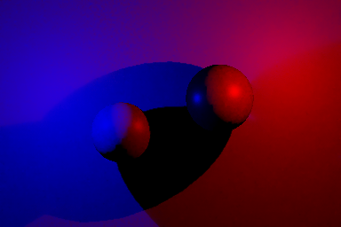

# Ho-RTDI：功能、接入与完成度

> 状态：现行总文档，更新于 **2026-10-18**。静止收敛基线：`f537c26`；其后已新增正常相机的参考 PBR 合成，复现与证据见 [Composite](../Tests~/RTDI/Composite/README.md)。本页统一说明当前行为；[专题与证据目录](RTDI/README.md)保存详细合同、审计和历史实验。

Ho-RTDI 生产世界空间直接光 diffuse/specular，支持解析灯、HDR 天空、真实世界遮挡、基础 lilToon Cutout，以及可选 NRD RELAX 降噪。**现在已能通过“合成到画面（参考 PBR）”把结果写入正常相机画面**，不必打开调试。有效不透明接收面使用参考 PBR 直接光＋SB 自发光替换旧照明，天空与无效面保留，透明物随后正常绘制。该开关默认关闭，升级资产不会自动改画面。

开启 NRD 后，已验证静止夹具的时间噪声方差约降至旧版的1/19。当前画面接入使用已有 Lambert＋GGX 响应，**尚未把 RTDI 改造成原 lilToon NPR ramp / 影色的受光源**；混合天空镜面偏差、严格遮挡阶跃、正常应用帧物体运动输入、复杂场景完整画质和有效 GPU 预算仍未完成。

## 1. 当前完成度与下一阶段

| 交付项 | 当前结论 | 实际边界 |
| --- | --- | --- |
| 独立 DI 与 raw 输出 | 已实现并验证 | RTXDI 初始/时间/空间/最终着色，两条渲染路径，逐相机资源与调试 |
| 解析灯和世界遮挡 | 受限支持域已交付 | Point / Spot / Directional，opaque 与基础 Cutout；不等于支持所有灯型、材质和灯光链接 |
| 动态灯历史 | 已实现并验证 | 实际前后灯快照、双向身份映射、移动/变色/换型/增删；不是动态物体运动重投影 |
| HDR 天空 | 采样与可见性已接入 | Ho-Atmosphere HDR、PDF/RIS、BRDF MIS；mixed 镜面 filtered 正式门槛仍失败 |
| 可选 NRD RELAX | 已接入，有静止收益 | 默认关闭；静止长历史修复已在 Editor 与真实 Player 部署；完整画质未验收 |
| 三最终样本 | 可选生产路径 | 降低已测动态多灯噪声；增加两次解析灯最终可见性查询，默认仍为 Single |
| Win64 Mono Player | 受控部署已验证 | D3D12 RenderGraph / compatibility、D3D11 inactive；不覆盖 IL2CPP / XR |
| 主表面运动与动态角色 | 未完成完整合同 | Cutout 遮挡变化有 confidence；NRD 物体 world-motion 输入仍为静态协议 |
| 目标场景性能 | 未完成 | 现有内存核算和同步总时长不等于有效 GPU 分段预算 |
| 正常相机参考 PBR 合成 | 已接入并验证 | 可控替换有效不透明面的旧照明，保留自发光、无效面与之后的透明物；有实际相机开关对照 |
| lilToon NPR 接收与 DI/GI 混合 | 尚未完成 | 原 ramp、影色、SSS、MatCap、探针与新光照的艺术接收/分层路由不由参考 PBR 替换代替 |

“只有独立纹理、正常画面没有消费者”的缺口现已补上。参考 PBR 模式以完整替换避免旧直接光、旧环境底色与探针重复相加；它没有保留原 NPR 照明再偷偷叠加一份物理响应。若目标是保留 lilToon 风格并由 RTDI 驱动 ramp，仍需建立对应的接收信号与分层路由；RTGI 也没有因此自动加入最终输出。

后续仍需真实场景与可信计时、镜面偏差及运动输入验收，以及独立的 NPR / GI 接收设计。历史实验中的“下一项”已归档，不再视作自动推进队列。

## 2. 启用与查看效果

1. 使用支持 D3D12 inline ray tracing 的环境。已验证 Unity `6000.3.15f1`、Windows x64 Mono、RTX 4060；D3D11 应保持 inactive。使用同分辨率、单采样 GB / SB，且 SB 已包含当前网格法线布局。
2. Renderer 上在 GB / SB 之后添加并启用 `Ho-RTDI`。若需要天空输入，前置启用 [Ho-Atmosphere](Ho-Atmosphere.md)；没有有效 HDR 输入时只运行解析灯。
3. 要查看累积降噪后的结果，打开 Feature 的 **NRD RELAX 降噪**。该开关默认关闭；Raw 调试始终保留随机样本，不能用 Raw 是否还有噪点判断 NRD 是否收敛。
4. 要影响正常画面，在 Renderer Feature 的运行设置打开 **“合成到画面（参考 PBR）”**，权重保持1；全局 Volume 的调试模式保持 **Off**。权重0恢复原画面，.5是原画面与替换结果的过渡，不是额外光照强度。
5. 排查时可临时在 Volume 选择 Diffuse / Specular / Combined 或 RawDiffuse / RawSpecular。调试在最终后处理后显示，All为网格；它与正常画面的合成是两条独立路径。
6. Receiver 中绿色是有效接收面，红色是无效输入。有效阴影允许 RGB=0、A=1；输入缺失或域不匹配为 A=0。先检查接收有效性，再比较噪声与能量。
7. 保持相机、几何与光源稳定至少半秒后，NRD 漫反射进入长历史；持续运动会保留响应优先的短历史。观察固定区域的跨帧变化，避免把材质纹理、空间渐变或高光形状当作时间噪声。

2026-10-18 补充：大画幅低帧率 Scene View 曾使 NRD 主历史降至1/1，并被大于1秒的帧间隔重启。现已对非播放 Scene View 保留长间隔下的有效历史，静止后两路至少30份历史，并在编辑器前台自动补足最多64次静止采样；补帧请求上限60次/秒，实际速度受场景渲染成本限制。Inspector新增实际历史与预览采样计数。不要把 `maxHistory` 调大来替代这项机制，它控制的是 ReSTIR 复用。

旧 renderer 若缺少 compute/debug/grid-label/composite 引用，`Create` 或打开 Feature Inspector 会补齐空位并标记待保存；保存 renderer asset 后再构建。既有 override 会保留。未实现构建时全工程批量资源迁移。部署步骤见 [Player 验证说明](../Tests~/Player/RTDI/README.md)。

### 默认设置及其含义

| 设置 | 当前默认 | 含义与取舍 |
| --- | --- | --- |
| `enabled` / `inSceneView` | true / true | 功能与 SceneView 开关，仍受平台和输入有效性限制 |
| `composite` / `compositeWeight` | false / 1 | 正常相机参考 PBR 替换及过渡权重；不改变独立输出合同 |
| `denoise` | **false** | 关闭时发布 raw；打开时发布 RELAX 恢复材质后的结果，另保留 raw |
| `useEnvironment` | true | 仅消费前置有效天空 HDR；不是另一套天空生产器 |
| `environmentSamples` / `environmentBrdfSamples` | 4 / 4 | 独立天空 PDF/RIS 候选与 BRDF 候选，通过 SDK MIS 合并 |
| `localSampling` | Uniform | Power 适合评估功率差异大的局部灯，但有固定预采样开销 |
| `initialSamples` | 8 | 局部灯初始候选；有方向灯时另取一个方向灯候选 |
| `finalSampling` | Single | TripleAnalytic 增加两个 fresh 解析灯最终样本 |
| `temporal` / `maxHistory` | true / 4 | **ReSTIR** 历史预算；不是 NRD 的历史帧数 |
| `spatial` / `spatialSamples` / `spatialRadius` | true / 4 / 16 | ReSTIR 空间复用，半径为像素 |
| `rayBias` | .001 | 世界可见性射线偏移 |
| `geometryLayers` / `lightLayers` | 全部 | 世界几何与灯收集过滤 |
| `excludedRayMaterials` | 空 | 指定材质的子网格不参与 DI 求交，仍正常 raster 绘制 |

不存在一个打开后即可保证所有场景无噪声的配置。Power、Triple、长历史分别改变提案分布、最终可见性预算和重建预算，必须区分收益来源与动态/资源代价。

## 3. 当前支持域

### 光源和环境

- 支持显式 point、spot、directional。Point / spot 使用参考 delta 点灯的 inverse-square 极限并适配 Unity range / cone；directional 当前为 delta 方向光。RT 遮挡遵循 RAB 世界可见性，独立于 raster `Light.shadows`。
- Local 与 infinite 分区独立候选，再由 SDK 合并。Cookie、非全局 `cullingMask`、baked-only 与其它灯型明确排除，状态显示排除数量。Rendering Layer / 艺术灯光链接、面灯和发光网格尚未接入。
- 天空从 Ho-Atmosphere 借用原始 HDR radiance、旋转和 tint，通过环境 PDF/RIS 与 cosine / GGX VNDF 提案的 MIS 估计。没有复制另一份天空或新增环境 Feature。输入版本变化使相关历史失效；无有效天空或关闭环境时不执行该域。
- 参考 PBR 合成在有效面完全替换原材质照明，所以旧直接光、环境底色与探针不会再完整叠加。独立 RTGI 尚未加入；在此 pass 之后运行的其它 GI/屏幕效果仍各自工作，需要按场景管理其天空来源。概率单位、世界可见性和验证见 [环境光专题](RTDI/技术/Ho-RTDI-Environment.md)。

### 几何、材质和 Cutout

世界遮挡支持 MeshRenderer 与 SkinnedMeshRenderer 的 opaque 当前姿态；蒙皮更新有 CPU 快照/自有网格成本。基础 lilToon Cutout 通过 Unity 材质射线 any-hit 读取原纹理与三角形 UV，透明 texel `IgnoreHit`，无需 CPU 纹理读取、UV atlas 或原纹理副本。

支持 MainTex tiling/offset、静态旋转、背面 UV 移动、Color.a、cutoff 和基础 AlphaMask 运算，纹理过滤/包裹跟随已支持路径。射线显式 LOD 0，尚无 ray-cone/mip 覆盖过滤；MSAA AlphaToMask 不当作物理透射。第二/第三主纹理、视差、dissolve、dither、distance-fade、动态 UV、RenderTexture alpha、property block 和任意自定义 vertex/alpha shader 不在支持域，未知情况明确排除。完整边界见 [Cutout](RTDI/技术/Ho-RTDI-Cutout.md)。

在存在 Cutout 的最终可见性路径，pose / transform 变化可保留 NRD 历史，并用同一个旧采样的真实最终可见性变化生成 confidence；ReSTIR 仍按完整 world revision 拒绝旧可见性历史。实例/材质/掩码、源 mesh 替换等结构变化硬重置，opaque-only 几何变化仍保守重置。这个能力处理遮挡变化，不能等同于动态接收面的运动向量重投影。见 [可见性 confidence](RTDI/技术/Ho-RTDI-VisibilityConfidence.md)。

合并模型中的天空壳可用“高级 → 不参与求交的材质”排除：相同材质的子网格不再遮挡 DI，其余子网格继续参与，主画面仍绘制。它会让灯穿过被排除部分，应按实际资产设置。血月古堡只完成了特殊合并网格、天空壳和局部静止稳定性审计，不能作为完整画质或无漏光验收。见 [材质排除](RTDI/技术/Ho-RTDI-MaterialExclusion.md)与[场景支持](RTDI/技术/Ho-RTDI-SceneSupport.md)。

### 接收响应

当前使用明确的 PBR 参考响应：主色映射至 0～1，按 metallic 分出 diffuse 与 F0，perceptual roughness 交给参考 GGX。BRDF 为 Lambert + Donut GGX。没有改变 SB 原值，也没有接入 NPR ramp、影色、分层接收路由或将 Emissive 作为 DI 自发光叠加。

## 4. 发布纹理与合成接入合同

| 接口 | 内容 |
| --- | --- |
| `HoRTDIRenderGraphResources.diffuse / specular` | 当前发布的直接光；NRD 开启且实际可用时为 filtered，关闭/回退时为 raw |
| `rawDiffuse / rawSpecular` | 始终保留同轮 raw，供诊断及显式消费 |
| `_HoRTDIDiffuseTexture` / `_HoRTDISpecularTexture` | 兼容全局发布纹理 |
| `_HoRTDIRawDiffuseTexture` / `_HoRTDIRawSpecularTexture` | raw 全局发布纹理 |
| `_HoRTDIActive` | 功能活动状态；不能只凭纹理绑定存在就判断本轮有效 |
| RGB | 线性 HDR、已经包含当前参考接收 BRDF 的光照贡献 |
| Alpha | 接收面有效性，不是阴影可见性或透射率 |

RenderGraph 消费者必须读取同轮资源并声明读依赖；不能依赖上一相机遗留全局。有效阴影可有零 RGB 和非零 alpha，无效输入则 alpha 为零。

当前 `diffuse` 已乘 diffuse albedo，`specular` 已含参考 GGX / Fresnel；正常合成直接相加，不再乘一次材质因子。若要改为 NPR 受光，仍须建立不同的接收信号合同。

### 正常画面的参考 PBR 替换

合成开关打开且权重大于0时，生产 DI / NRD 的 pass 移到 `BeforeRenderingTransparents`，紧接着在同一命名事件中按入队顺序执行合成；关闭时生产端保留原 `BeforeRenderingPostProcessing` 时序。此处没有隐藏的事件数值偏移。

有效像素的线性目标为 `diffuse.rgb + specular.rgb + SBEmission.rgb`，Gamma 项目先按 shader 的 sRGB 曲线编码，再施加一次 URP 相机雾。输出 RGB 为原相机颜色与该目标的权重插值，alpha保持原值。权重1替换旧照明，权重0跳过合成；不会将零光照误判无效，有效阴影可正确变黑，自发光仍保留。

合成还要求当前 GB/SB 主表面有效、DI 两路alpha有效，且SB深度与实际不透明相机深度一致。背景、无SB面、位于接收面之前的普通Unlit物体、sample-domain不匹配均保留原像素；透明物在合成后绘制，不被整屏替换覆盖。域限定全视口Mono、单采样2D；XR/MSAA/部分视口不启用该合成并显示状态。

RenderGraph 读取本轮DI、主表面、相机颜色及深度，写一个新颜色附件并更新 `cameraColor`；compatibility 使用一个持久scratch和两次blit。不复制一整套主表面，不请求额外opaque color拷贝。兼容SB的数值MRT现显式登记给URP，避免中间颜色目标启用后后续opaque绘制覆盖SB附件。

原 NPR ramp、影色、MatCap、SSS、原探针与原材质内部照明会被该像素替换，不能称作原风格接收已完成。该模式适合检查世界直接光实际进入场景的效果；没有加入GI填充，遮挡区域可能很暗。后续透明、后处理和独立屏幕效果仍按原事件顺序消费新颜色。

以下是调试Off时的真实正常相机目标，同一场景、同一显示映射（Reinhard＋sRGB），不是DI调试图：

关闭合成：


开启合成：



相关生产端接口见 [HoRTDIRenderGraphResources.cs](../Runtime/RTDI/HoRTDIRenderGraphResources.cs)，主表面输入见 [Ho-RT-PrimarySurface](Ho-RT-PrimarySurface.md)，世界求交见 [Ho-RTScene](Ho-RTScene.md)。

## 5. 采样来源与当前生产改进

本版沿用本机 `UnityPathTracing-6000.3.15` 的 RTXDI Unity 路径，复用固定 SDK 的 reservoir / 重采样，主要适配 RAB bridge、输入、世界可见性与 Unity 调度。

| 环节 | 固定来源与适配 |
| --- | --- |
| 初始候选 / streaming | `DI/InitialSampling.hlsl`，`RTXDI_SampleLightsForSurface` |
| reservoir 布局和存取 | `Reservoir.hlsl` / `ReservoirStorage.hlsl`，三份 block-linear reservoir |
| 时间 / 空间复用 | `RTXDI_DITemporalResampling` / `RTXDI_DISpatialResampling`，ray-traced correction |
| RNG / 邻域 | SDK RNG，参考 R2 / SNORM8 邻域序列 |
| 主表面 | `HoRTPrimarySurfaceInputs` 借用 GB / SB，不重绘当前 GBuffer |
| 世界可见性 | HoRTScene 真实求交，Cutout 最终可见性另走材质 any-hit |
| 灯历史 | current / previous 数值快照与双向 Light 身份映射，替代参考示例的静态 identity 假设 |
| 最终着色 | 参考物理 BRDF、最终可见性和 reservoir inverse PDF |

固定 SDK / Donut 共 29 份依赖文件的 provenance 记录在 [ThirdParty/provenance.json](../Runtime/RTDI/ThirdParty/provenance.json)。SDK 只适配 include 路径，原始算法与许可保留；NRD 的私有派生 shader 单独记录并可重建，不能把它们也称为完全未改的 vendor 算法。

### 局部灯 Power 提案

Power 沿参考 PDF texture → box-filter mip → SDK `RTXDI_PresampleLocalLights` → `POWER_RIS`。Point 权重为 4π × 强度亮度，Spot 加 cone 衰减积分。它仅描述全局功率，不包含接收点距离、BRDF 或遮挡，不能取代 ReGIR。

每相机有 64×256 个 uint2 RIS 条目（128 KiB）及按局部灯数扩展的 R32F mip PDF，每轮按真实灯参数更新。无局部灯或必要格式不支持时回退 Uniform；切回 Uniform 释放完整 PDF/RIS，仅保留必要 dummy 绑定。固定预采样有开销，所以默认仍是 Uniform。

同位置 1 强灯 + 63 弱灯、每像素单候选且关闭复用的历史基准中，Uniform 归一均值约 1.0033、方差 55.8132；Power 均值 .9995、方差在 F6 精度下为零。该提案恰好匹配此夹具，不能推广到任意空间灯域。

量化 F0 全零的 DI RGB 重要性类别，现以 RGB 贡献长度的平方根作为统一选样 target，缓和弱彩灯 rare 大权重；实际 BRDF、radiance、source PDF 和最终权重保持。非零 F0 分支及 GI 不采用该变更。固定 100:1 弱红灯序列 primary 相对时间方差约 165.87→15.01；当前 Triple 动态九阶段通过。见 [零 F0 弱彩灯修复](RTDI/技术/Ho-RTDI-TemperedTarget.md)。

### Single 与 TripleAnalytic

Single 保持默认。Triple 使用一个主 ReSTIR 估计和两个 fresh 解析灯辅助，解析贡献权重 .5 / .25 / .25，天空域仍保留一份完整估计。辅助 CDF 使用当前数值快照、15/16 功率 proxy + 1/16 均匀支持，inverse PDF 根据实际 FP32 区间计算，不能用全局功率直接代替实际选样概率。

两个辅助在 CDF 两半分别抽样并随机交换槽位，以降低辅助平均方差；每个槽位保留原边际分布的构造。它没有新增最终样本数、资源或用户设置，浮点离散与有限序列误差仍须由能量门槛检查。已测 native 四灯域 frame L1 约 .3244/.2029/.3110/.3086 → .2948/.1848/.2851/.2902。见 [辅助分层接入](RTDI/技术/Ho-RTDI-StratifiedAuxiliary.md)。

Opaque 在 shade 内局部消费第二辅助；Cutout 原生路径按相机保存每像素 8-byte 第二辅助 payload，1080p 容量约 15.82 MiB。两辅助各增加一次最终解析灯可见性查询。Sky-only / 零灯不分配无意义辅助；一盏解析 delta 且无有效环境走确定性路径，跳过无收益的复用与 RELAX，发布实际 raw 硬阴影。此时看到 raw 与 filtered 一致属于预期。完整资源与部署证据见 [三最终样本](RTDI/技术/Ho-RTDI-RuntimeMultiSamples.md)及[单灯精确路径](RTDI/技术/Ho-RTDI-SingleDelta.md)。

## 6. NRD 信号、重建与历史

可选 RELAX 使用固定 NRD **4.17.3** 核心 CPU DLL，由它选择 dispatch / 常量 / pool，Unity 持有并调度 GPU 资源。没有导入参考的 native renderer、DLSS/NIS、descriptor heap hook 或设备内存管理。固定库与参考 NRD DLL 的 SHA-256 相同，具体哈希与输入文件记录见[参考证据清单](../Tests~/RTDI/Reference/evidence.json)。

| 输入/输出 | 当前合同 |
| --- | --- |
| Diffuse NRD 信号 | 直接生成乘 albedo 前的 Lambert lighting，保留零颜色通道信息 |
| Specular NRD 信号 | 由固定 NRD material factors 解调参考 GGX，再 pack |
| Signal alpha | 已选灯距离；不是 receiver validity。有效暗面仍提供合法零信号与距离 |
| Guide | 正线性 viewZ、世界法线、roughness，固定 normal/roughness 编码 2/1 |
| Material class | active diffuse=0 / 全零 diffuse=3，不是完整材质资产 ID |
| Motion | 静态世界 world-motion=0，相机由真实前后矩阵重投影；未接入通用物体运动源 |
| 发布恢复 | 撤销共同线性尺度，恢复当前 diffuse albedo / specular factor，并写回接收有效性 alpha |

DenseDI 私有派生包含颜色/方差与 F0 条件处理，原始 vendor 和 CPU ABI 保持固定。漫反射历史使用非负约束及 fast→normal 线段的凸裁剪，避免 YCoCg 三轴独立 clip 主动制造两个端点都没有的 RGB 通道；镜面过滤问题仍独立保留。派生源码由 [generate_nrd_variance_adapter.py](../Tests~/RTDI/generate_nrd_variance_adapter.py) 的 `--check` 核对，不能用“接入 NRD”替代完整信号合同验证。

### 当前静止/变化预算

历史按相机真实提交的 unscaled sample time 与低通 FPS 换算，不把同一应用帧中的多次渲染请求当作真实高帧率。Diffuse fast 约 1/60 秒，specular 主/fast 约 .5/.1 秒；diffuse 主预算分两种状态：

| 状态 | Diffuse 主历史时长 | 60 Hz 示例 |
| --- | ---: | ---: |
| 相机/世界/实际灯快照变化，以及变化后的半秒窗口 | .05 秒 | 约 3 |
| 上述输入持续半秒稳定 | .5 秒 | 约 30 |

离开稳定状态时 NRD 重启一次，恢复响应优先短预算；持续运动不会因这一策略每帧重启。Fast / specular / 空间设置、射线和资源预算没有随本次静止修复增加。实际整数预算随 FPS 变化，主历史上限 255，时间回退/无效时间/长间隔按既有策略失效。

非播放 Scene View 使用补充规则：慢刷新不再被当成游戏暂停；静止主历史两路最低30，而不是 `.5秒×低FPS` 得到1。相机、几何或光源改变仍退出静止档并重启一次，时间回退/无效值仍失效。静止时只补一组有上限的真实渲染采样，不靠冻结尚未处理的画面冒充收敛，也不在编辑器后台无限强制重绘。播放模式和Player保留上面的按秒策略。

实际血月古堡视角的中央64²区域做了ReSTIR上限20/4配对观察（32帧预热、64帧统计，不保存资产参数）：4的combined时间方差为20的约1/10.7，8×8块平均后的波动方差约1/7.9；区域均值相差约2.4%，不是全场景解析能量认证。测试工程 `PC_Renderer.asset` 已仅将该项20恢复到默认4，其他设置保留。细节和证据见 [Scene View 验证](../Tests~/RTDI/SceneView/README.md)。

**稳定判定逐相机全局执行。** 持续移动的相机、灯或几何会让整个图像维持短预算，即使其中一些像素没有变化。这还不是逐像素区分静态环境与动态角色的长历史方案。

### DI、NRD 与世界历史的区别

DI 的分辨率、关键采样设置、几何/场景 revision、输入域与重新启用触发相关历史失效；每相机独立保存上一轮实际灯参数与身份映射。灯位置/颜色/强度等普通变化不再整份清 ReSTIR，SDK 读取真实旧 target，删除/替换返回 -1，而非误认数组槽位。

NRD 还根据时间、结构、采样域与稳定状态管理自身历史；灯集合增删或类型变化有保守降噪历史失效，普通数值变化通过同采样重算 confidence / antilag。Cutout pose 保留历史的条件如前所述。没有 previous TLAS，也没有动态接收面 world-motion 源，不能将可见性 confidence 等同于通用动态 temporal 支持。

完整 ABI、调度、历史设计和历次局部验证见 [NRD 技术专题](RTDI/技术/Ho-RTDI-NRD.md)。其中早期“3/1”等固定预算与资源表带有步骤语境，现行预算以本节和 2026-10-18 对照为准。

## 7. 收敛对照：本机参考也会稳定

本机参考实际跑通了 Unity DI raw / DLSS RR 与 Native DI raw / RELAX。启动阶段修复了插件依赖路径、固定 NRI 对旧设备缺少接口检查，以及 Native 合成缺少 `WITH_NRD` 导致仍读取 raw 的问题。修复限定隔离参考工程，没有改系统 D3D12、Unity.exe 或包内 HoRTDINRD.dll。

对照固定 128²、透视 FOV40、白色非金属接收面、roughness≈.5、F0≈.04、红蓝两点灯 `(±1.5,0,-1)`、强度4/range100；候选8、ReSTIR 历史4、空间4/半径16、最终单样本，关闭环境/GI/jitter/PT。还有在完全相同 Ho 输入上运行原版 RELAX 的控制组。参考与 Ho 的量化、RNG 和镜面 target 并非逐位相同。

统计固定 ROI 每像素 RGB 的时间方差，窗口为第257—512帧，以均值平方和归一。它衡量跨帧随机波动，不是空间纹理差异、完整图像误差或帧率。

| 实际输出 | Combined 归一化时间方差 |
| --- | ---: |
| 参考 Unity DI raw | 约 1.535 |
| 参考 Native DI raw | 约 1.529 |
| Ho-RTDI raw | 约 1.535 |
| Ho 旧响应优先 filtered | .0226155 |
| Ho 当前静止历史 filtered | **.00118284** |
| 参考 Native RELAX 最终输出 | .000570363 |
| 参考 Unity DLSS RR 最终输出 | .00020627 |

参考 raw 也有显著方差，稳定画面来自累积/重建。Ho 本次静止时间方差降低约94.8%，噪声标准差约为旧版1/4.4；raw 统计保持一致。两条 Ho 路径固定基准一致，512帧只有一次初始重置。残余时间方差仍约为参考 RELAX 的2倍、RR的5.7倍，所以仍存在重建差距；不能据此宣称所有 HDR、高光、遮挡或材质都达到参考画质。

SSGI 与 RTDI 的具体信号、候选和滤波预算不同，不能仅凭同用 ReSTIR 推断应该有相同收敛速度。这次直接参考对照已证明“参考也一直不收敛”不是依据；应继续按 raw 方差、输入合同、累积预算和最终重建分别衡量。

详细修复、原始数据与对照条件见 [2026-10-18 参考收敛审计](RTDI/审计/Ho-RTDI-ReferenceConvergence.md)。

## 8. 已知失败与尚未验收项

| 项目 | 当前证据 | 结论 |
| --- | --- | --- |
| 严格漫反射遮挡阶跃 | 固定60Hz变化区前三帧误差 .357736→.350414，原门槛 .35 | 仍失败；slow / rapid 通过，未放宽门槛 |
| Mixed 天空镜面 filtered | 两条生产路径各2/4，存在通道略超原5%能量门槛 | 仍失败；raw 同组接近参考，静止漫反射改善不等于此偏差修复 |
| 完整Core回归中的Power身份互换方差 | `Run` / `RunCompatibility` 在强灯身份交换后未过方差<.01门槛；同一隔离工程的 `f537c26` 包对照两路径也在同一断言失败 | 原门槛与生产采样保持，完整Core suite仍记失败；本轮合成验收和专项NRD通过不能覆盖此项 |
| 动态局部区域的长历史 | 稳定判定仍是逐相机全局 | 运动期间没有逐像素静态区域长累积保证 |
| 物体 motion / lobe hit-distance | NRD 仍为静态 world-motion 协议；guide 取主样本距离 | 正常应用帧物体运动、每 lobe 距离代表性未完成 |
| 实际复杂场景 | 古堡等只有几何/天空壳及局部稳定性检查 | 不是完整画质、无漏光、任意材质和目标帧率验收 |
| 性能 | 历史 GPU 预算报告无有效样本，另有同步 batch 时长 | 有效 DI/visibility/NRD GPU 分段预算未交付 |
| 平台与输入域 | Win64 Mono 受控验证 | IL2CPP、XR、TAA jitter、MSAA / 通用 GB fallback 等完整合同未验收 |
| NPR / GI 最终接收 | 参考 PBR 已进入正常画面；独立 RTGI 尚未加入 | 原 NPR ramp / 影色和物理光照的混合路由仍未交付 |

失败实验保留原始指标和门槛，归档文档中的一次通过不能覆盖另一协议下的失败。2026-10-15 的[完成度审计](RTDI/审计/Ho-RTDI-CompletionAudit-2026-10-15.md)是当时快照，最新静止修复和 Player 证据以本页及 10-18 审计为准。

## 9. 调度、资源与性能口径

DI 四阶段在一个 graphics-queue unsafe pass 内顺序执行，默认位于 `BeforeRenderingPostProcessing`，有效合成模式移到 `BeforeRenderingTransparents`，显式声明主表面、AS、灯和输出依赖。Initial 写 reservoir1，Temporal 写2，Spatial 回写1，Shade 保存历史0。Power 额外执行 PDF build / mip / presample，Cutout 增加原生最终可见性，NRD 开启时执行其信号准备、confidence、固定核心返回的 dispatch 与恢复。

当前不复制另一套主表面 GBuffer。SB 在 RT 消费需求下请求高精度 normal；current / previous 共用2×16-bit oct 法线编码。DI / GI 的20-byte主表面历史含 depth、shading/mesh normal、diffuse/validity、F0/roughness，各自逐相机拥有。

| 资源 | 可确认的量级/限制 |
| --- | --- |
| SDK reservoir | 单份24 B/像素，三份约72 B/像素，另有 block padding |
| 主表面 guide 历史 | 20 B/像素，DI / GI context 分别计入 |
| 两张 HDR diffuse/specular 发布图 | RGBA16F 约16 B/像素；NRD 开启另有 raw/信号/pool 等资源 |
| 灯历史 | 额外一份64 B/灯参数与双向4 B/索引，容量按2次幂，另有CPU快照 |
| Power | 128 KiB RIS + 随灯数扩展的 R32F mip PDF |
| Cutout 最终可见性 | R8 约1 B/像素，不支持时 R32 回退为四倍 |
| Triple native 第二辅助 | 8 B/像素；opaque 局部消费，无此全屏 sidecar |
| NRD | 信号暂存、两路输出、永久/临时 pool、confidence、三份64 KiB常量 buffer 等；仅实际启用时承担 |

上述不是可直接相加的完整峰值显存承诺：发布/raw/NRD输出存在选择与复用，输入、AS、driver、对齐、缓存和延迟释放还需独立统计。历史720p/1080p核算保存在技术专题，不能拿早期资源表代表当前所有配置。

已预热的 NRD `Record` 段曾将 GC.Alloc 事件15→0、命令记录 CPU 均值约54.5→11.0μs；它只说明该局部 CPU 调度改进，首次分配、Feature 扫描和全帧不在零分配承诺内。同步渲染请求加 GPU 读回的 batch 时长包含 CPU、raster、输入与同步，不能当作 NRD GPU 时间或生产帧率。[GPU 计时审计](RTDI/审计/Ho-RTDI-GpuTimingAudit.md)明确保留未获得有效预算的结论。

## 10. 验证与复现

最新收敛交付包含23份原始 JSON、源文件/二进制哈希、参考探针和 NRI 补丁，入口为 [Tests~/RTDI/Reference/README.md](../Tests~/RTDI/Reference/README.md)。在包根执行：

```powershell
python Tests~/RTDI/Reference/verify_convergence.py --source-commit f537c26
python Tests~/RTDI/generate_nrd_variance_adapter.py --check
```

第一项复核已有收敛证据、raw不变、静止收益、两路径一致性、动态与部署记录，并要求已知失败继续明确保留；指定源提交是因为合成接入后当前生产/验证入口已有变化，历史证据不改绑为新代码的测试。省略参数仍严格核对当前文件SHA。第二项核对固定NRD原SHA与四份派生源码重建一致性。当前合成验证的复现、实际相机截图与新报告见 [Composite](../Tests~/RTDI/Composite/README.md)。

最新实际运行证据包括：

- D3D12 RG / compatibility 固定512帧静止基准，两路径相同的时间噪声结果；原版 RELAX 同 Ho 输入及参考实际最终输出对照。
- 镜面运动3项、Triple动态每路径9/9、默认Single复用噪声16配置、primary motion6配置通过。
- 漫反射slow/rapid通过，严格casterStep仍失败；环境两路径各2/4仍失败。
- 两个Win64 Mono release成功构建，实际默认suite通过，D3D11实际inactive通过。
- 新Player `--convergence` 跨192个真实应用帧，进入长历史、变色后只重启一次回短历史，四帧后旧红色残留为0；没有Editor时间注入。

隔离验证入口 `HoRTDIValidation.Run / RunCompatibility / RunUnsupported` 覆盖 SDK、能量、遮挡、输入拒绝、debug与生命周期；更细入口、限定fixture和旧报告见技术/审计文档。历史步骤验证与本次重跑分开记载；不能将“诊断进程退出成功”当成全部产品质量通过。

新增正常相机合成在Gamma/Linear × RG/compat四组各18项检查通过，覆盖独立Lambert能量、非白材质、镜面、真实世界阴影、自发光、雾、背景与无效域、前景Unlit深度保护、透明绘制顺序、filtered消费和启停。两个Win64 Mono release实际Player在可见小窗口中各观察96个自动相机帧，filtered与最终相机颜色最大通道差约.000002；不使用该循环中的手动渲染请求。隐藏宿主没有提交自动渲染上下文，其失败保留，未冒充正常帧通过。

## 11. 文档导航

- [RTDI 专题与证据目录](RTDI/README.md)：全部技术专题、日期审计与历史实验检索。
- [NRD 技术专题](RTDI/技术/Ho-RTDI-NRD.md)、[环境光](RTDI/技术/Ho-RTDI-Environment.md)、[Cutout](RTDI/技术/Ho-RTDI-Cutout.md)、[三最终样本](RTDI/技术/Ho-RTDI-RuntimeMultiSamples.md)：接口、成本与详细接入证据。
- [最新参考收敛审计](RTDI/审计/Ho-RTDI-ReferenceConvergence.md)、[旧完成度快照](RTDI/审计/Ho-RTDI-CompletionAudit-2026-10-15.md)：有日期/协议边界的实际结论。
- [持续推进历史](RTDI/归档/Ho-RTDI-持续推进记录.md)、[最初 DI/GI 可行性调查](RTDI/归档/Ho-RTDI-RTGI-可行性调查.md)：保留研究过程，不作当前任务队列。
- [Ho-RTGI](Ho-RTGI.md)：独立一跳 diffuse GI 首版；次级环境NEE、specular GI、多跳与最终合成不能由 DI 验证替代。
- [总文档索引](文档索引.md)：包内其它功能与架构入口。
