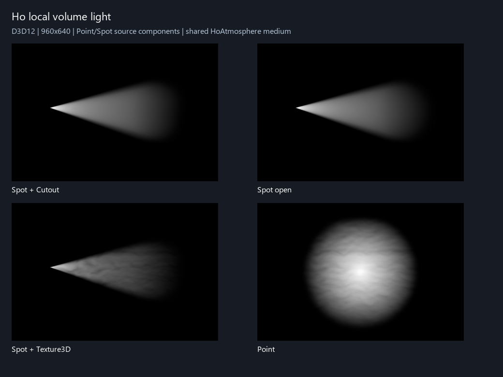

# Point / Spot 局部体积光

在已有 Point 或 Spot Light 的同一物体上添加 **Rendering → Ho-VolumeLight 局部体积光**（`HoVolumeLightSource`），保留 Renderer 中的 HoAtmosphere、Ho-VolumeLight 和场景中的 HoAtmosphere Region。无需再添加灯光或材质。没有太阳也能使用局部体积光。

组件实时读取同物体 Light 的开关、类型、位置/方向、颜色、强度、Range、Spot Angle / Inner Spot Angle 及阴影开关/强度。Transform 缩放不改变灯的范围。区域仅控制空气里的可见贡献，完整光球/光锥与上游遮挡不按区域裁掉。

| 设置 | 作用 |
| --- | --- |
| SD / HD | SD 只保留灯范围和相机深度截止；HD 另捕获光源深度，保留孔洞及光源到空气的遮挡 |
| 体积亮度 / 体积染色 | 乘在 Light 颜色强度之后的美术控制，不修改表面照明 |
| 采样步数 | 每灯 16–256，默认 64；薄孔洞、复杂硬阴影可以显式提高到 128–192 |
| 光源柔化半径 | 默认 0.25 米，抑制靠近光源的反平方亮斑，保留 Light.range |
| 范围软边 | 光源距离末端淡出比例；聚光侧边沿用 Light 内外锥角 |
| 采样抖动 | 固定蓝噪声打散规律采样条纹；局部版本没有时域累积，低步数时仍可能有颗粒 |
| HD 每面分辨率 | 128–2048，按二次幂取整，默认 512；点光有六面，聚光一面 |
| 阴影强度 | 额外乘 Light.shadowStrength；需要 Light.shadows 非 None 与有效 ShadowCaster |

全局 Feature / Volume 的启用、体积亮度倍率、最大照亮距离、散射方向性覆盖同时作用于局部光。太阳的采样步数与时域抗锯齿配置仍只控制太阳；局部步数在挂件上显式设置。共享区域的密度、动态 Texture3D、染色、散射反照率、方向性、激活软边和路径消光由同一入口读取。

## 遮挡与工程边界

HD 从光源完整范围执行独立场景剔除与阴影剔除，使用材质自己的 ShadowCaster，支持 Renderer 的投影开关和 Cutout；不将透明玻璃 Alpha 当连续透光率。聚光一面深度、点光六面 3×2 atlas 都是当前相机 RenderGraph 的临时资源，不写入 URP 的太阳/附加灯 atlas。每个采样点在自己的光源空间查遮挡，因此可见区域外的窗框仍能投影进来。相机深度仅停止观察射线，不能代替光源遮挡。

贡献调度要求灯的范围在当前相机可见灯集合内。HD 捕获另从光源范围建立独立剔除，不按相机画面、大气区域或 URP 附加灯 atlas 容量裁掉投影者；每个面显式选取对应阴影 split。Light.cullingMask、Renderer 阴影开关和管线 rendering layer 规则用于遮挡选择。

默认每灯一遍全分辨率积分，光源球/锥与区域的有效区间会先裁切。SD 不分配光源深度。HD 512 单面 D16 约 0.5 MiB，点光六面约 3 MiB，2048 六面约 48 MiB，均不含驱动开销；灯越多，深度捕获与积分次数越多。没有为局部光建立时域历史，光源移动或孔洞变化不复用旧阴影。

当前不处理 Light Cookie、IES、彩色/灰度玻璃透光、局部多重散射、自遮挡、局部光照亮独立灰尘簇片或 AC/AOV。现有太阳 HD、太阳照亮的灰尘簇片与其他系统保持原路径；不使用 SSGI。只支持 HoURP RenderGraph Base Game / SceneView，Overlay、XR、Reflection 与 compatibility 不在此阶段范围。

## API

`HoVolumeLightSource.quality / intensity / tint / stepCount / sourceRadius / edgeSoftness / jitter / shadowResolution / shadowStrength` 是显式设置；`Status` 显示当前是否参与、是否有可用 ShadowCaster。`HoVolumeLightRendererFeature.LocalLightCount` 返回最近处理相机安排的局部灯数量。

验证入口为 `lilToon.URP.Extensions.VolumeLight.HoVolumeLightValidation.RunLocal`，仅允许专用 `.codex-research/LocalVolumeValidation` 工程，生成 `VolumeLightValidation/local-metrics-<API>.json` 与 PNG/EXR。运行需要真实 GPU，不加 `-nographics`。验证结果在实现验收完成后归档。

## GPU 验证结果

2026-10-29，Unity 6000.3.15f1、HoURP 17.3.0、RTX 4060、D3D12 RenderGraph 实际 GPU readback 通过。测试明确关闭太阳后仍验证 Point / Spot；因此局部体积光不是借用太阳路径。结果归档在 `Tests~/VolumeLight/Local/Direct3D12.json`，侧视证据图在 `Documentation~/Images/VolumeLight-Local-Preview.png`。

| 检查 | 结果 |
| --- | --- |
| 聚光灯实际锥体、范围末端软边 | `spotMean=0.02255`，开启/关闭 Light range 后 `rangeRatio=0.2343` |
| Light 参数同步 | 强度线性误差 `1.65e-7`；颜色、Range、Spot Angle / Inner Spot Angle、启停均通过 |
| 多灯共享大气并叠加 | 两盏相同局部灯 `twoLightRatio=1.0`，没有复制介质或互相覆盖 |
| HD 外部遮挡 | 区域外实体投影使体积贡献降低 100%；HD 光源深度独立于主太阳 atlas |
| lilToon Cutout | `_MainTex` alpha 孔洞与实体部分对比度 `1.0`；ShadowCaster 进入局部 LightDepth |
| Point 六面 | 六个 CubemapFace 的实体遮挡降低均为 `1.0` |
| 相机深度 / SDF | 前景差值漏光 `0`；区域参与关闭后贡献为 `0` |
| 相机与采样路径 | 相机进入光锥、正交、半分辨率、MSAA4 均通过 |
| 动态大气 | Texture3D 密度流动已保存 `spot-side-flow.png`；局部片元读取共享世界介质 |

D3D11 专用复制工程在本机 Unity 启动导入阶段退出，未进入 `RunLocal`，因此没有伪造 D3D11 局部光结果；启动日志为 `Tests~/VolumeLight/Local/D3D11-startup-retry.log`。同一 worktree 的太阳 HD D3D11 历史验证仍可用，但不能替代局部光 API 的 D3D11 证明。

