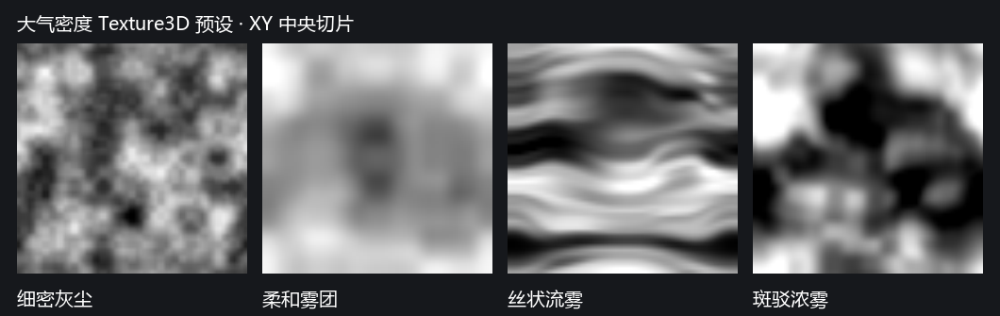

# Ho-VolumeLight v0.1：太阳 HD 丁达尔

面向 HoURP 17 RenderGraph。读取固定 HoAtmosphere 的空间介质输入与场景已有主方向光，在 SDF 激活区域内显示体积光；无需逐窗添加灯。

## 使用

1. 保持基础 `HoAtmosphereRendererFeature` 开启，在 Renderer Data 添加 `HoVolumeLightRendererFeature`。
2. 通过 `GameObject > Rendering > Ho-Atmosphere 大气区域` 创建区域，也可在对象上添加该组件。
3. 调整 Transform 和区域大小，覆盖房间/树林；选中区域可用场景手柄改大小。
4. 调节边缘淡出、介质密度/颜色、体积光参与权重；可选指定 Texture3D 密度纹理。
5. 使用场景已有太阳作为 URP 主方向光并启用所需阴影。VolumeLight 自动跟随其方向、颜色、色温解析结果和强度。
6. 在 Feature 兜底设置或 `Ho-VolumeLight/太阳 HD` Volume 中调体积亮度倍率、最大照亮距离、步数和抗锯齿。散射方向性默认读取区域，只有显式勾选覆盖时才使用 Feature/Volume 的值。默认“时域稳定”与 48 步；可先用 48–96 步观察，再按细光束与镜头运动增加预算。

默认 Shader 与线性采样噪声纹理位于本模块 Resources，随包保留，不要求修改项目的 Always Included Shaders。高级 Shader 覆盖的前两条 pass 保持效果/调试接口；抗锯齿还需要默认 Shader 的 Integrate、Resolve、Composite、Present 四条 pass。仅有旧接口的自定义 Shader 仍能绘制，运行状态会明确提示缺少抗锯齿 Pass。

## HD 抗锯齿

“采样步数”是每条视线的积分预算。旧实现把它均匀分布在相机工作距离内，固定取每步中心，细窗格很容易形成规律条纹。现在先求视线与当前 Box 大气区域的交段，并与相机近面、工作距离和不透明深度相交，再将预算分配到有效段。它只优化积分区间，不修改完整照亮范围或太阳阴影视图；区域外投影者仍有效。旋转、缩放和相机位于区域内/外均沿用同一求交。

| 抗锯齿 | 行为与使用场景 |
| --- | --- |
| 关闭 | 有效交段内固定中心采样，直接加到相机颜色；无效果历史 RT，适合诊断采样或阴影分辨率 |
| 单帧去噪 | 蓝噪声错开像素间的采样位置，使用深度感知的 3×3 空间重建；无历史，不会积累时间拖尾，仍可能有细颗粒 |
| 时域稳定（默认） | 每次渲染轮换采样偏移，重投影并累积当前相机的体积历史；稳定镜头收敛更好，刚切镜头时先使用单帧估计 |

介质的 Texture3D/风速继续使用共同世界坐标和时间。这里的 64×64 蓝噪声只是积分采样掩码，不改变介质属性；由本仓库的 `Tests~/VolumeLight/generate-blue-noise.py` 确定性生成，时间轮换使用低差异偏移，没有宣称它是专门优化的 STBN 序列。

历史重投影以介质可见交段为参考，检查前后视线区间和端点的视差；不使用背景表面的运动矢量代表整段空气。前景挡住介质时立即输出零；新暴露、视差过大或区间不匹配的像素回到单帧估计。历史按当前邻域均值/方差和范围裁切，以响应移动阴影。相机大幅跳变、投影/分辨率改变、太阳/采样参数/介质 revision 或阴影配置改变时拒绝旧历史；流动密度按时间和风速降低历史权重，长时间跳变重新估计。快速变化的镜头仍可能残留少量噪声/局部时间误差，可显式切到“单帧去噪”。

历史按相机独立保存。切场景、关闭效果、RendererFeature 停用/Dispose 会释放；被销毁的 Unity 纹理、RTHandle 释放或原生存储丢失会重建。脚本切镜头也可调用 `ResetHistory()`。已销毁或超过 10 秒未使用的相机记录会在下次准备历史时清理。

当前保持全分辨率。时域模式每台相机持有两张 RGBA16F 颜色/累积计数和两张 R32F 深度，约 24 字节/像素（1080p 约 47.5 MiB）；另有当前帧采样临时图和重建/合成开销。单帧模式只使用 graph 临时目标。它不是免费抗锯齿，但有效区间采样和跨帧复用让多数场景无需持续使用 256 步。具体 GPU 耗时需结合画面覆盖与设备测量。

抗锯齿无法恢复太阳 shadow atlas 已经丢失的窗格信息。若关闭抗锯齿后细节依然表现为稳定的阴影方块，应另外检查主光阴影距离、级联覆盖、分辨率和材质 ShadowCaster；不要把两类误差混为一谈。

## 两层职责

- **HoAtmosphere Region**：提供世界空间激活权重、介质属性与保守 Bounds。
- **VolumeLight**：保留自己的照亮范围、相机可见区间、照明与遮挡。每个采样点将大气激活权重乘到实际光束贡献上。

只在 SDF 区域内显示，区域不替代光源范围或改造太阳阴影视图。区域外屋檐/树枝仍能把阴影投射到区内。v0.1 太阳路径直接读取 URP 原始主光级联图，即使开启 Screen Space Shadows 也不使用表面屏幕阴影代替空气遮挡，并遵循太阳阴影距离淡出。

相机深度负责停止物体后方的视线积分；太阳阴影负责空气采样点是否被照亮。二者独立。输出为线性 HDR 稀薄介质加亮贡献，Bloom 可自然消费。

## 大气区域参数

| 参数 | 含义 |
| --- | --- |
| 区域大小 | 局部盒形尺寸，支持 Transform 旋转、缩放；Bounds 是保守世界包围盒 |
| 边缘淡出 | 区域内部距边界的世界距离（米），缩放后保持该距离语义 |
| 体积光参与 | 显示权重；0 时不产生效果，不改变光源或其阴影 |
| 介质密度/颜色 | 每米散射强度与介质 HDR 染色 |
| 空间密度纹理 | 可选 Texture3D，R 通道调制密度；为空使用均匀介质 |
| 纹理扰动强度 | 在均匀密度与纹理密度之间插值 |
| 纹理世界尺度 | 纹理重复长度（米）；采样坐标固定于世界 |
| 风速 | 纹理沿世界方向移动的米/秒速度 |

纹理循环采样，应使用可平铺的密度内容。灯光、相机或区域移动不会拖着噪声移动。编辑器与运行时使用共同世界时间；`HoAtmosphereMediumClock.TimeOverride` 可在脚本中指定确定的采样时间，默认留空。

### 内置密度纹理预设

在大气区域 Inspector 的“介质 > 密度纹理预设 > 选择…”中直接选择；也可以从包内 `Runtime/Atmosphere/Textures` 把 `.asset` 拖到“空间密度纹理”。选择只替换纹理，保留密度、颜色、扰动强度、世界尺度与风速，支持多选对象和 Undo/Redo。“均匀（无纹理）”清空引用，不创建其他对象或材质。

| 预设 | 内容 |
| --- | --- |
| 细密灰尘 | 较细密的连续密度起伏，适合轻微浮动的空气；不是独立亮点颗粒 |
| 柔和雾团 | 平缓的大块起伏，适合室内薄雾 |
| 丝状流雾 | 沿世界 X 拉长、带弯曲的雾丝 |
| 斑驳浓雾 | 对比更强的块状疏密，强调光束里的局部明暗 |

均为预先烘焙的 64³、线性 R8 Texture3D，XYZ Repeat、三线性空间插值、无 mip；每张 GPU 数据约 256 KiB，并保留一份可读 CPU 数据。放在普通资产目录，不通过 Resources 强制装入全部预设；场景只需引用所选纹理。密度值在 0–1 内，平均约 0.5。扰动强度为 1 时，平均散射通常比均匀介质低；可以显式调介质密度，不自动补偿亮度。

先试“柔和雾团”或“丝状流雾”，将扰动强度调到 0.4–0.7、世界尺度约 4–8 米、风速约 0.05–0.2 米/秒。再按场景尺寸调整；纹理越小、对比越强，体积积分需要解析的细节也越多。

预设只决定连续介质的疏密；当前流动仍是世界空间纹理随风平移。生成源为 `Tests~/Atmosphere/generate-density-presets.py`，没有使用第三方纹理；`HoAtmosphereDensityPresetBake.Run` 是仅供隔离批处理工程使用的维护入口，正常使用不需要运行生成器。

实际 GPU 验证入口为 `HoVolumeLightValidation.RunDensityPresets`；D3D11/D3D12 检查四张资产的原生格式、尺寸/取值、XYZ 循环接缝、密度采样，以及预设多选赋值与 Undo/Redo。记录见 `Tests~/Atmosphere/results`。

### 共享散射光学与可见尘粒

区域的“散射光学”提供 RGB 散射反照率和方向性 `g`，雾与尘粒读取同一份属性。反照率各通道限定 0–1，白色保持散射，低值减少对应通道的散射；`1−albedo` 描述吸收比例。原有 HDR“介质颜色”仍作为美术染色保留，不把它当作物理反照率。正 `g` 偏前向、负 `g` 偏后向，改变观察方向下的亮度分布，不产生额外能量。

默认保持原有稀薄加亮模式。勾选“路径消光”后，以激活后的密度作为每米消光系数，雾沿视线逐段累积透过率，再积分单次散射；尘粒使用八段介质采样估计观察路径透过率。它们仍输出加亮贡献，不乘暗背景表面，也没有实现光源到采样点的介质自阴影、多重散射或粒子折射率/色散。

旧 Feature 的方向性数值仍保留，但现在需要勾选“覆盖区域方向性”才生效；原有 Volume 方向性覆盖勾选保持有效。已有项目若依赖非默认 Feature 值，可显式开启覆盖，或把该值填入区域。默认区域 `g=0.3` 与最初默认一致。

在同一区域展开“可见灰尘”，勾选“启用尘粒”即可。无需新建 ParticleSystem、灯或 Feature。

| 参数 | 含义 |
| --- | --- |
| 每立方米数量 | 期望空间数量；实际还受区域裁切和数量上限影响 |
| 粒径范围 | 世界米，默认 0.008–0.025；小于像素时扩展覆盖并补偿亮度，减少闪烁 |
| 尘粒亮度 | 独立美术倍率；仍受介质密度、反照率、太阳颜色、方向性与阴影控制 |
| 漂浮幅度 | 确定性的小幅漂浮，与共同风速平移叠加 |
| 显示距离 | 逐相机距离淡出，仅控制绘制，不移动或复制世界粒子 |
| 数量上限 / 随机种子 | 限定单区域 GPU 种子数量、控制空间排列；超过预算时均匀稀疏并显示状态 |

默认关闭尘粒，启用后先试默认数量与粒径，再提高尘粒亮度观察。一个区域维护一个世界网格和只读种子缓冲；每个世界单元用稳定哈希确定粒子，位置由统一世界时间、风和漂浮解析求值。相机不推进模拟，移动观察者不会重建一套粒子；移动区域时重叠世界单元保持同样的粒子位置。该机制没有逐粒子碰撞、速度积分或真实湍流流体求解。

VolumeLight 以独立的透明加亮 draw 绘制这些粒子，读取原始太阳 shadow atlas，支持不透明与 lilToon Cutout 孔洞，并以相机深度消除前景后方的粒子。它不写入雾的时域历史，因此颗粒不会在雾的重建中被平均掉；相机自己的 TAA/Bloom 仍可能改变细点外观。当前只有主太阳照明，没有局部灯、环境/GI 受光、彩色透光或尘粒自阴影。

尘粒属于可调的视觉细节层：数量、粒径和亮度没有从同一个真实粒径分布自动推导，叠加连续雾后不保证总散射能量守恒。当前也没有微片 BRDF、高光闪点或真实折射率求解；共享反照率和相函数用于统一颜色与角度响应。

种子每个 16 字节，默认数量上限 8192，缓冲最多约 128 KiB；绘制过量主要取决于屏幕粒径和重叠。种子缓冲属于区域，效果停用后可以保留供共享消费者使用；关闭尘粒、禁用/销毁区域、切场景时释放。效果材质随 Feature 停用/Dispose 释放。修改颗粒数量、粒径和亮度不会改变连续 Medium revision，也不会触发天空重捕获。

使用入口、GPU 预览、解析消光对照与生命周期验证见 [共享尘粒与光学验证](计划/Ho-Atmosphere-共享尘粒与光学验证.md)。

## 调试与状态

- HoAtmosphere Volume 提供“介质密度切片”“介质激活切片”：查看区域局部 XY 中央切片。
- Ho-VolumeLight Volume 提供“体积贡献”“无阴影贡献”，在后处理后独立显示。
- 目前这两个调试视图显示连续雾，不包含独立绘制的可见尘粒。
- HoAtmosphere Feature 单独显示环境与空间介质状态，VolumeLight Feature 显示输入/太阳状态。
- HoAtmosphere Volume 的“环境输入启用”仅控制环境辐射，不关闭有效的区域介质。

## 数据接口

CPU 可从 `HoAtmosphereRegionRegistry.Capture()` 获取只读快照，读取 `valid / bounds / revision / sampleTime`，并通过 `ActivationAt(positionWS)` 查询空间权重。

RenderGraph 消费者读取 `HoAtmosphereMediumResources`，检查 `IsValid`，对实际采样的 `densityTexture` 声明 `UseTexture(Read)`；用 `HoAtmosphereMediumBindings.Bind` 绑定（声明全局状态修改）。资源句柄限当前相机 graph。HLSL 入口是 `Runtime/Atmosphere/Shaders/HoAtmosphereMedium.hlsl` 中的 `HoAtmosphereSampleMedium(positionWS,time)`，分别返回 activation、density、tint。

区域 revision 只描述静态数据/变换/纹理内容，时间单独发布。它不复用 `HoAtmosphereRenderGraphResources` 的环境 revision 或 `IsValid`。区域变化不会导致天空重捕获或 GI 的环境历史失效。

## v0.1 边界

### Cutout 与连续灰度透光

已额外 GPU 验证 lilToon Cutout 的 `_MainTex.a` 和独立 `_AlphaMask`：原 ShadowCaster 的孔洞能进入太阳 atlas，再影响体积光。二值 cutout 不依赖 SB/AC；Renderer 必须投射阴影，太阳阴影及采样距离/精度也需要有效。

这表示按 `_Cutoff` 判定孔洞/实心，并不表示 alpha=0.5 会按比例透过 50% 的光。细碎叶片在远端可能受纹理 mip、阴影分辨率、PCF 和体积步数影响；仅看到细节不明显不能认定贴图没有被读取。

用户确定后续需要连续灰度透光；彩色透光与高级玻璃实现先搁置。灰度需要光源空间的透光率与深度输入：只有光源到采样点之间的层参与，多个层的透光率相乘。当前尚未实现此输入。

建议通过 Renderer 挂件显式提供透光纹理/强度，避免要求所有材质增加新属性。原有 cutout 保留二值路径；参与灰度覆盖的对象不能先被二值 shadow map 当成全遮挡再尝试相乘，需要独立/分离的 opaque visibility 捕获或等价处理，避免 0 阴影无法恢复。SB/AC 可以提供对象选择/材质参数契约，实际遮挡仍在光源空间生产；主相机表面图不能覆盖画面外投影者或空气中任意点。具体接入在灰度透光阶段实现。

当前支持一个启用的 Box 区域与太阳 HD。没有区域发布空介质；多个启用区域明确报告 v0.1 容量限制并发布空介质，不随机选一个。

实际绘制是全分辨率视线采样，支持上述单帧/时域重建；还没有自适应步进、降采样上采样或 froxel。可调 8–256 步，默认 48；最细的硬阴影仍可能需要更高步数。关闭效果释放其材质、相机历史和调试资源；基础大气输入继续有效。

仅声明 HoURP 17 RenderGraph 的 Base Game/SceneView 相机路径。透视、正交、相机在区域内/外、半分辨率与 MSAA4 均有 GPU 验证；Overlay/Reflection/Preview/XR 和 Solar compatibility 未列入支持。大气原有环境输入 compatibility 路径保持原职责。

不透明/alpha cutout 提供场景深度截止与光源遮挡；路径消光限上述体积贡献，当前不模拟透明玻璃透射、完整背景雾合成或多重散射。局部灯 SD/HD、独立局部 LightDepth、多区域规则以及 AC/AOV 输出按后续阶段接入。

## 验证

隔离工程执行入口：`lilToon.URP.Extensions.VolumeLight.HoVolumeLightValidation.Run`，需有实际 GPU，不使用 `-nographics`。

验证直接在 graph 中采样/readback，覆盖：

- Region Inspector 类型、Undo/Redo、默认 Shader 资源。
- 中心/边缘/区域外权重、旋转缩放后世界米淡出、世界纹理流动与跨相机一致性。
- 环境/介质有效性与 revision 独立、区域变更不重捕获天空、空/禁用/多区域回退。
- 实际太阳强度/颜色、SDF 参与开关、动态噪声 RGB 变化。
- 实体窗框、alpha cutout、画面外/区域外投影者。
- SCREEN 阴影 keyword 确实执行，并与原 atlas 结果一致；阴影距离外恢复照明。
- 相机内部/外部、正交、中心及非中心前景深度、半分辨率、MSAA4。
- 调试贡献、关闭/重启效果、RendererFeature 禁用和 Dispose 的输出/材质释放。
- 细窗格的旧 256 步/有效区间/单帧/时域与 4096 步参考图的误差、规律条纹、稳态帧差和窄光束能量/峰值。
- 移动遮挡/相机、相机 TAA、动态世界噪声、跨相机历史独立，以及历史纹理损坏、尺寸/MSAA/投影切换和实际切场景后的重建。

结果与 EXR/PNG 位于隔离工程 `VolumeLightValidation`；日志与需求逐项证据见 [v0.1 验证记录](计划/Ho-VolumeLight-v0.1-验证记录.md)。

2026-10-19 抗锯齿的量化结果、复现命令与验收门槛见 [HD 抗锯齿验证记录](计划/Ho-VolumeLight-HD-抗锯齿验证.md)。
