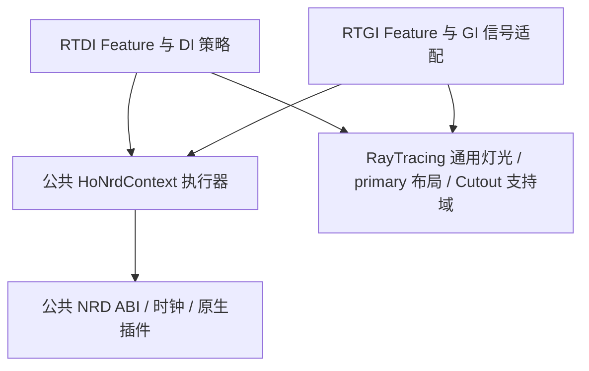

# DI / GI / NRD 公共层设计与交接

2026-10-24，A01已实现并验证。范围是公共NRD与C#基础契约解耦，不改变渲染/滤波算法、精度、采样、历史失效策略或公开Feature设置。

原C#依赖主要是GI→DI，没有查到DI→GI的运行时循环。重构后Runtime/RTGI的C#不引用DI类型，Runtime/NRD不引用DI/GI。公共执行器拥有native instance、常量和permanent/transient池；调用者显式提供denoiser类型、Shader manifest、参数和外部信号。公共层没有DenseDI默认策略。

DI的HoRTDINrdContext只保留DI外观/稳定历史/SceneView预算、Cutout策略与primary-guide绑定，继承公共执行器，原Prepare/Declare/SetRenderTime/Dispose不加转发。GI的HoRTGINrdContext直接使用HoNrdContext，负责GI自己的信号、单位64、独立RELAX_DIFFUSE配置和输出；它不经过DI策略对象。Shader/GPU资源生命周期保持原样。

通用HoRTAnalyticLight和HoRTPrimaryHistory.Stride=20、HoRTCutoutSupport位于Runtime/RayTracing，两路使用相同契约但分别拥有历史。NRD native DLL移到Runtime/NRD/Plugins/x86_64，原DLL字节/文件名和全部移动资产GUID保留；HoRTDINrdConstants等现存Shader ABI字符串也保留，不能作为类型名全局替换。第三方Shader/SDK及部分共享HLSL桥暂仍位于RTDI目录，属于下一步源码归属整理；本步没有宣称已拆成独立asmdef/可单独分发包。

## 实际验证

- 原Context/Native/Timing/Manifest冻结后独立编译对照。新旧33帧GPU全部RGBA共540672分量逐位一致；另一次仅重置一个实例确实出现差异，再共同reset恢复一致，证明历史隔离。
- DI 64组实际native dispatch/资源/上传常量及AppliedSettings逐字节相同，覆盖普通、Cutout、稳定、SceneView与显式供参；这部分是调度对照，不冒称独立DI GPU像素真值。
- 同输入NRD小矩阵64帧通过；GI真实场景RG/compat各243请求/41check通过。
- 新固定初始3实例的DI+GI真实场景RG/compat各42请求/10check通过：两NRD同时启用、正亮有限输出、独立native instance、world reset、alpha、分别关闭一模块、resize与释放。有效运行Shader/AS/fence错误和source drift均0。
- 旧合成夹具actual0/33check但有2条AS scratch debug错误，严格拒绝资格；其运行中增加实例触发既有F39条件。本步没有修改AS或用退出0遮盖debug失败，改用固定初始实例的架构回归。其原报告/日志/源码完整保留。

## 内存账本与优化顺序

| 项目 | 实测或布局值 | 结论 |
| --- | --- | --- |
| DI NRD池，64² | 327696 B | 新旧分配相同 |
| GI NRD池，64² | 307216 B | 新旧分配相同 |
| 两路可匹配格式的transient，64² | 4112 B | 尚未共享 |
| 对应1080p布局推算 | 2081760 B，约1.985 MiB | 非1080实测，直接共享这一部分收益有限 |

上述池数值不含各实例3×64KiB常量缓冲、外部signal/output/guide、reservoir、AS、pose/网格、驱动开销。抽公共代码没有删除GPU资源，本轮显存节省为0，不用文件数或转发减少冒充内存收益。

更有价值的后续候选：同相机primary guide的统一提交时机与历史归属、两路重复的骨骼姿态/网格上传、GI信号与发布纹理的非重叠生命周期。需要逐项核实语义和所有消费者后再复用。例如GI的RGBA16F signal只在NRD前后有不同用途，理论上可复用为最终RGBA16F发布（1080布局约15.82MiB），但现有输入审计/距离读取需要保留快照时机，尚未实现或接纳。不能混掉raw与filtered，也不能把两路不同信号的permanent历史合并。

共享primary history也不能简单让两个Feature写同一buffer：先执行的一路会覆盖另一路仍需的previous；应先设计统一的读旧/帧末提交边界。共享pose需验证source mesh、动画/BlendShape版本、同帧多请求、bounds、引用计数与GPU生命周期，不能直接共用整个RTAS或假定驱动BLAS重复。

## 接手与复现

先读本文件、过程与禁试记录，再读Tests~/RenderingArchitecture/README.md。执行`python Tests~/RenderingArchitecture/verify_validation.py`可核当前源码、历史失败、所有源/日志/输出SHA、依赖方向、原DLL/GUID和内存账本。

原GI研究目标仍暂停，047的过程预审与Tests~/RTGI/PlanarReference未修改、未混入本步提交。后续GI验证应使用中立HoNrdNative/HoNrdContext；旧证据/旧源SHA保留，旧runner硬编码的DI内部类型或旧DLL文件路径不是回退生产代码的理由。先迁移当前验证入口，历史归档按原版本读。

补充Release验证：13960构建actual0/PASS；原始通用runner因3条Shader warning拒绝，逐行比对既有Backbuffer/build-warning-review的历史白名单后确认全为原有SolarHD与lilToon重复keyword，无新增诊断，原run保留diagnostics3。42752隐藏D3D12/Linear Mono Player actual0、304 distinct-Update camera请求/16check全过，运行时Shader/AS/fence/动态链接错误0，NRD运行正常；打包后的HoRTDINRD.dll字节与公共目录原库一致。该项证明公共插件迁移后的Release打包/加载，不扩称自动enabled-camera或复杂Player矩阵完成。

可复现run_player.ps1已实际重跑47316，第二次隐藏Release同样actual0/304请求/16check、运行时diagnostics0；两次均未使用可见窗口授权。

A01已按精确白名单提交`6d7d3dc6`，提交后RenderingArchitecture verifier再次通过。仅保留原047的未提交过程预审与PlanarReference，index为空；未重启/完成GI目标，所有本步骤进程terminal。数值/格式/独立历史和reset保持，代码解耦与Release插件加载已验，显存收益仍为0。下一次资源优化必须作为独立步骤先审所有读写/帧边界与实际payload，再选可证明无损的复用，不能因本轮架构通过直接接纳共享history或盲降GI FP32。继续时从公共HoNrdContext/HoNrdNative和RayTracing契约入手，历史源/失败不改。

## A02轻量资源优化终态（2026-10-24，提交前）

GI的16F输入在NRD消费后复用为filtered发布，已省一张8B/像素纹理；默认64²/32²实测省32768/8192B，1080布局约15.82MiB/相机，非1080实跑/总显存测量。旧独立NRD+Resolve配对两路径每条1318912RGBA分量逐位同，输入快照/零albedo/曲面/HDR/弱信号/尺寸/独立开关/释放都过；原GI NRD两路径各243请求41check和隐藏Release304请求16check通过。见Tests~/RenderingReuse/README.md与verify_validation.py。

signal在Resolve之后的内容已是发布单位，Editor旧输入必须显式请求ValidationCaptureSignal并读取ValidationSignal。默认无快照分配；打开快照会额外占8B/像素，如实没有本项节省。raw、32F output、DI/公共NRD、参数/历史/reset、Shader均不变。今后如启用原生NRD validation需再审输入/OUT_VALIDATION别名。

按用户“重的可不做、助手定停止”授权，本阶段在此收尾：不重写共享pose或primary帧末提交，不做native heap alias/合并history/降精度，低收益scratch也搁置。原047过程草稿/PlanarReference保留，不恢复全GI画质研究。新目标的完成只指此有界轻量优化阶段，不能覆写原GI未完成的质量/动态/环境/预算缺口。提交后补实际hash及目标审计结果。

A02已按精确白名单提交`e73782f5`，提交后RenderingReuse verifier再次通过；index为空，仅保留任务开始前的原047过程预审与PlanarReference草稿。实际GPU两路径旧新数值逐位同、显式快照语义/释放与默认8B/像素收益、原GI回归和Release304请求均有权威证据。过程/禁试/交接和完整run/SHA齐备。完成审计已逐项核对本阶段目标，达到预先停止条件，结束本有界轻量优化阶段；不能据此声称原完整GI画质、复杂动态或1080整帧预算已完成。后续如重新请求资源优化，先读本交接和停止取舍，不重做已否定/搁置的重路线。
