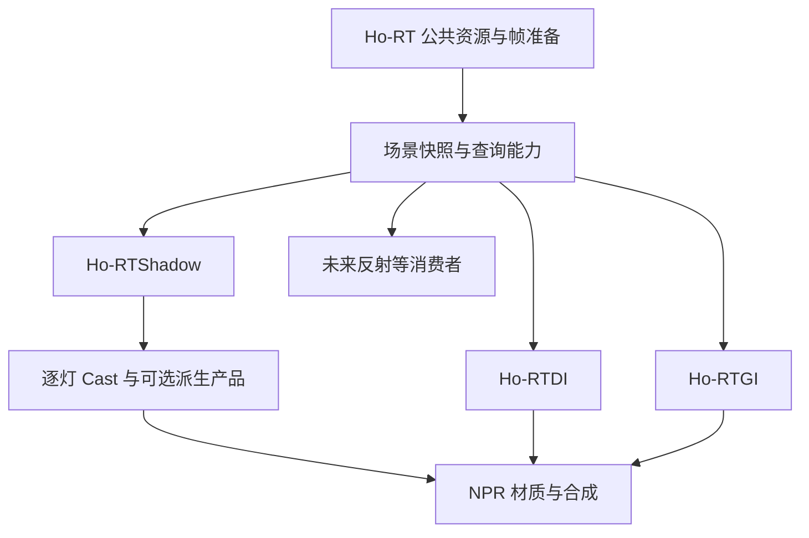

# Ho-RT 公共底座与 RTShadow 设计草案

日期：2026-10-28。状态：源码审计、行业实践研究与待实现设计。本轮没有新增运行时 Feature，也没有把下述接口名称当成已存在的 API。

## 1. 本轮的架构定位

此前 RTDI / RTGI 的公共层抽离已经完成公共 NRD 执行器与部分 RT 契约的解耦，见 [公共层交接](D:/Unity_Fork/lilToon-URP-Extensions/Documentation~/架构/Ho-RT-公共层-设计与交接.md)。本轮继续解决 RT 场景的资源所有权、准备时序及公共查询能力；之前阶段已经完成的收益与明确保留的问题维持原结论。

建议采用两个独立功能模块：

- **Ho-RT**：公共场景资源、几何与材质查询能力、当前渲染请求的准备与生命周期。
- **Ho-RTShadow**：按光源与接收域生成 Cast 可见度产品，供 NPR 材质和其他系统按约定消费。

RT 硬投影参考由 RTShadow 的零角度、无历史模式承担，作为公共查询链路的第一个可视验收。DI、GI、反射等直接使用公共查询能力，各自保留光照算法、输出和历史。

## 2. 行业中两条路线同时存在

### 2.1 独立 ray-traced shadows

Unreal 官方把 Ray Traced Shadows 明确列为 standalone feature，并允许灯覆盖项目级开关；它与 Lumen 的 GI / 反射并存。这里的 feature 表示功能模块，并不指 URP 的 `ScriptableRendererFeature` 类。[Epic Hardware Ray Tracing](https://dev.epicgames.com/documentation/en-us/unreal-engine/hardware-ray-tracing-in-unreal-engine)

HDRP 17.3 支持独立 RT 阴影并将结果放在屏幕空间 buffer。公开 Graphics master 源码还能看到逐灯生成、slot/channel 写入和 lighting 根据灯的 screen-space shadow index 读取的过程。master 源码与 17.3 手册分别作为证据，不假定它们是同一 pinned revision。[HDRP 17.3 手册](https://docs.unity3d.com/Packages/com.unity.render-pipelines.high-definition@17.3/manual/Ray-Traced-Shadows.html)、[ScreenSpaceShadows 源码](https://raw.githubusercontent.com/Unity-Technologies/Graphics/master/Packages/com.unity.render-pipelines.high-definition/Runtime/Lighting/Shadow/HDRenderPipeline.ScreenSpaceShadows.cs)、[LightEvaluation 源码](https://raw.githubusercontent.com/Unity-Technologies/Graphics/master/Packages/com.unity.render-pipelines.high-definition/Runtime/Lighting/LightEvaluation.hlsl)

AMD Hybrid Shadows 也单独组织阴影分类、射线与可选降噪。它说明可以局部替换 shadow 生成而保留混合渲染结构；不要求先重写整套 PBR 光照。[GPUOpen Hybrid Shadows](https://gpuopen.com/manuals/fidelityfx_sdk/samples/hybrid-shadows/)

### 2.2 联合直接光估计

用户对另一条行业路线的观察是成立的：MegaLights 使用固定数量的每像素光源样本，联合处理遮挡与直接光照，替换传统逐灯 shadowing / shading 的多个阶段。它通常不要求生成每个像素、每盏灯的完整 mask 集合。[Epic MegaLights](https://dev.epicgames.com/documentation/en-us/unreal-engine/megalights-in-unreal-engine)

RTXDI 集成同样是在最终选择的灯样本上执行 visibility ray，再执行材质 BRDF。其输出可直接是光照估计。[RTXDI Integration：Shade](https://github.com/NVIDIA-RTX/RTXDI/blob/main/Doc/Integration.md)

### 2.3 PBR 中仍有明确的遮挡含义

对固定表面，直接光可以概括为：

```text
直接光 = 对所有光源、所有入射方向积分 [可见性 × 入射光 × 材质响应 × 方向几何项]
```

阴影对应其中的可见性；完整路径的每段连接也受遮挡约束。联合估计改变了计算与存储方式，不能据此把“光照较弱”都叫成 cast：弱光、背光、材质吸收和几何遮挡是不同原因。[PBRT 的直接光采样实现](https://www.pbr-book.org/4ed/Light_Transport_I_Surface_Reflection/A_Simple_Path_Tracer)

## 3. 为什么 NPR 值得保留独立 Shadow 产品

这是针对本管线的设计判断：角色 toon 分层、主光选择、补光、轮廓光及多层接收规则，需要在最终着色前保留对遮挡来源的控制。逐灯可见性可以让材质选择“哪盏灯的遮挡影响哪一层”，而无需从最终 RGB 中猜测阴影。

需要保留三种语义的边界：

| 信号 | 表示什么 | 所属职责 |
| --- | --- | --- |
| 几何可见性 / 透射 | 表面到某个灯样本之间是否被挡 | Ho-RT 公共查询 |
| 某灯的 Cast 产品 | 该灯在约定采样、接收域上的阴影结果 | Ho-RTShadow |
| Toon 明暗、阴影色与分段 | 材质如何使用 Cast、法线和其他输入 | 材质 / NPR 光照消费者 |

RTShadow 输出不直接包含 albedo、toon 阴影色或最终 beauty。用户要的角色接收选择通过公共接收域声明传入；RTShadow 可以以后服务其他对象，不硬编码成只支持某个角色组件。

## 4. Ho-RT 应拥有的基础设施



公共底座包括：设备能力、世界几何登记、当前蒙皮姿态快照、材质身份与 alpha 语义、场景 view / AS 生命周期、revision、每次 camera/render view 请求的资源准备及调度依赖。现有公共灯结构可以继续形成中立的灯数据契约，避免新增第二套不一致的 light identity / 变换 / 强度来源。

公共查询至少分两类：

- `TraceOcclusion`：给定射线及查询规则，返回是否存在有效遮挡；alpha 裁切参与真实求交。
- `TraceClosestHit`：返回最近有效命中的距离、实例/primitive/material 身份、重心坐标等，供后续表面重建。

只判断遮挡时可以在找到有效遮挡物后提前终止。需要最近 blocker 距离时必须使用相应查询能力；遍历中首先接受的命中不保证是几何最近命中，不能把二值 occlusion 的快捷结果当成准确 blocker 距离。

按灯样本查询时，可使用中立的 `SampleVisibility(surface, lightSample, policy)` 适配到射线。函数命名只是设计说明；底层求交无需知道哪个灯是主光。

必须分开 miss、invalid ray、unsupported、unavailable 等状态。不可查询并不等于“完全可见”。初始范围为已支持的不透明 / cutout；未来彩色透射是显式能力扩展。

光源抽样、reservoir、bounce、NPR 响应、NRD 信号及历史仍由各消费者管理。Ho-RT 的启用不隐式打开 DI、GI、Shadow 或时域累计。

## 5. 公共代码、公共资源与查询策略

### 5.1 当前已经有代码公共层，还缺资源宿主

DI 和 GI 当前分别创建、同步、释放自己的 `HoRTScene`，分别持有 hit material adapter。见 [DI 创建](D:/Unity_Fork/lilToon-URP-Extensions/Runtime/RTDI/HoRTDIRendererFeature.cs:53)、[GI 创建](D:/Unity_Fork/lilToon-URP-Extensions/Runtime/RTGI/HoRTGIRendererFeature.cs:51)。因此这次不能只搬文件或改命名，还要明确谁准备场景、谁持有资源、消费者读哪次渲染的快照。

### 5.2 共享粒度

世界登记与当前姿态应有公共所有者。AS 可以按兼容的几何集合、排除规则和材质查询能力形成多个 view。当前 DI 的 visibility hit group 与 GI 的 secondary surface hit group 不同，不能直接把其中一个私有 AS 地址交给所有效果就声称完成了共享。

先建立共同资源宿主与不可变输入合约，再用验证证明哪些 view 可以合并。共享几何快照与共享整个 AS 分别计量，不能仅根据少了一个 C# 对象宣称显存或 GPU build 成本下降。

### 5.3 查询规则由用途决定

Cast Off 的表面仍可能需要参与 GI 或反射。单/双面、Shadows Only、灯/物体 linking、材质排除等必须作为明确策略保存，不能把 shadow caster 集合强制变成所有 RT 效果的世界集合。

现有 inline `HoRTTraceScene` 会跳过 non-opaque；DI/GI native 路径已有各自的 alpha any-hit。公共层应统一支持范围和可见性语义，同时保留 occlusion 与完整 surface evaluation 的成本差异。

### 5.4 帧准备与多相机

建议由 host 收集消费者声明，准备并冻结当前渲染的场景快照；查询输入声明可读资源与 build 完成依赖。Cast 可在 GB/SB 之后、opaque toon 之前运行，DI/GI 保持自己的后置阶段。不能依赖 RendererFeature Inspector 排列碰巧正确，也不能仅声明同一个 RenderPassEvent 就假定资源已准备好。

RenderGraph 对 AS 的真实访问和 build 依赖需要由公共实现显式处理。现有 [HoRTScene.Inputs](D:/Unity_Fork/lilToon-URP-Extensions/Runtime/RayTracing/HoRTScene.cs:253) 的 revision 检查应保留并扩展到统一所有权；GPU 使用结束前不能更新或释放对应快照。

世界数据只在兼容域内复用；相机屏幕输入、接收域、输出、采样和历史按 render view 管理。GameView、SceneView、Prefab Stage、不同 RendererData 和过滤配置不能混用。有效性不能只看 `Time.frameCount`。

Ho-RT 缺失、禁用或设备不支持时，消费者报告明确状态，并按各自声明的 fallback 工作；不能隐式再创建自己的隐藏公共底座。

## 6. RTShadow 能否输出全部灯的 Cast

可以。必须先区分“全部灯各自的结果”和“把全部灯合成一个结果”。这里的全部指当前请求范围内、受支持且参与直接投影的灯集合；环境光、发光网格与间接光不自动归入第一版。

### 6.1 优先保留逐灯产品

输出应能够由稳定 `light ID` 查询到自己的可见度，而不是只靠每帧可重排的临时灯索引。可用 texture array、atlas 或稀疏 buffer；存储布局不改变逐灯语义。

每项同时携带有效性及必要域信息：灯身份/修订、camera / surface sample 域、接收域、场景快照、样本预算和过滤状态。第一版不必把所有这些都写成全屏纹理，但必须能验证消费者读取的是正确结果。

有限光源的整灯平均可见度还要注明抽样 measure / 权重。面积光不同方向的可见性与 BRDF、cosine、纹理发光相关；一个平均 V 通常不足以给任意材质精确重建整灯照明。需要严格积分的消费者仍查询自己的实际灯样本。

### 6.2 连续值与 NPR Ramp 合约

正式 NPR 接口必须保留**尚未经过 toon 阈值和着色的浮点可见度**。`V=0` 表示完全遮挡，`V=1` 表示完全可见；半影允许中间值。单灯硬投影只用于建立几何参考，不能凭此宣称生产接口已经满足连续 ramp 的需求。

这里有三种不同的连续量：

| 连续量 | 来源 | Ramp 的用途 |
| --- | --- | --- |
| 法线 / 光方向生成的明暗坐标 | `N·L`、half-Lambert 或已有 NPR 规则 | 物体自身的明暗分段 |
| 单灯有限光源可见比例 | 对同一表面点积分多个实际灯样本 | 对真实半影重新分段或着色 |
| 可选的美术边界坐标 | 约定范围的可见度重建、阴影边界距离等 | 独立于物理光源大小的边缘塑形 |

第一项由材质 / NPR 光照构造。第二项是 RTShadow 的核心生产信号。第三项只有在明确需要时才增加，标为派生美术信号，并注明单位、作用范围与表面关联规则，不冒充物理可见度。

零角度方向光照到一个确定的不透明表面点时，原始遮挡本来是 0/1。同一个点、同一个方向重复查询不会产生半影或连续梯度。有限光源的积分可以产生连续的可见比例；空间子像素积分则处理像素覆盖，两者作用不同。[PBRT：Area Lights](https://www.pbr-book.org/4ed/Light_Sources/Area_Lights)

即使接口使用 float，有限样本也不自动得到无台阶的信号。N 个等权二值灯样本的可见比例只有 N+1 个取值。需要用足够的同帧采样和适当的重建检查实际梯度质量；不能用 8-bit、先阈值、或强行拉高对比度来替代。中间累加使用足够精度，原始估计与重建产品有明确区分。重建需保留深度、法线和对象边界，避免跨表面污染。

建议每个实际空间着色样本的顺序为：

```text
NPR 明暗坐标 h + 该灯的连续可见度 V
    → 按材质各层的接收规则组合成 ramp 坐标 u
    → 材质执行 ramp / 阈值 / 阴影色
    → 当前帧各空间样本的最终颜色合成
```

RTShadow 不提前执行 ramp，也不将法线明暗烘进核心 V。`h` 与 `V` 维持独立输入；组合函数由 NPR 语义决定，不在底座中写死一种乘法。多层 toon 可以共享同一份 V，并分别设置接收强度、border 与 ramp。

当前 lilToon 确实在 [接收 Cast](D:/Unity_Fork/lilToon/Assets/lilToon/Shader/Includes/lil_common_frag.hlsl:963) 后，才执行各层 [toon 分段](D:/Unity_Fork/lilToon/Assets/lilToon/Shader/Includes/lil_common_frag.hlsl:1010)。新后端应保持这一输入边界；验证时也不能只看一张“黑白轮廓正确”的图。

如需在几乎零物理半影下仍用 ramp 大幅移动或扩展投影边，单纯的二值 V 信息不足，需要明确的美术边界信号或指定宽度的可见度重建。单张屏幕距离场会受分辨率、遮挡层和跨表面边界影响；最近 blocker 距离只描述深度间隔，也不等同于到投影轮廓的距离。此类扩展应单独设计与验证。

连续值验收至少包括：原始 V 灰度、细半影的数值剖面、不同 ramp threshold 的轮廓、窄 / 多层 ramp 下的 banding 与噪声、动画微动，以及最终空间抗锯齿。不能仅凭浮点格式或后置模糊就判定通过。

### 6.3 连续阴影重建采用 NRD SIGMA

按用户本轮收敛，正式阴影重建优先采用 NRD 的逐灯 shadow denoiser **SIGMA**，通过现有公共 NRD 层接入。SIGMA 负责阴影信号重建，NPR shader 负责 ramp；独立的美术距离场保持为以后确有需求时的扩展。

```text
RT 灯样本的真实遮挡与 blocker 距离
    + 光源大小 / 角度 + 当前表面 guides
    → SIGMA 官方前端编码
    → SIGMA 降噪
    → 官方后端解码得到浮点可见度 V
    → NPR 材质各层的接收与 ramp
```

这里不是把一张任意灰度图直接送进现有 RELAX。SIGMA 有自己的 penumbra / 距离编码与输入约定；需要遵守有效命中、miss、NoL、法线、深度及启用历史时的运动输入规则。需要 blocker 距离时，使用真实最近命中，不能沿用仅为二值遮挡提前结束的任意命中距离。NPR 的修改法线 / half-Lambert 接收域与 SIGMA 官方有效域之间的关系要明确验证，不能把域外数据误报为有效几何可见度。

后端必须使用 `SIGMA_BackEnd_UnpackShadow`。本地 pinned 版本该宏执行平方解码；直接把编码输出当作线性 ramp 坐标，会改变阴影过渡。[本地 NRD 前后端](D:/Unity_Fork/lilToon-URP-Extensions/Runtime/RTDI/ThirdParty/NRD/NRD.hlsli:941)

预览可以启用 SIGMA 时空稳定；单帧导出提供 `maxStabilizedFrameNum=0` 的无历史模式，单独验证其输入预算和 ramp 下的画质。本地 pinned `SigmaSettings` 也明确该参数为零时禁用 stabilization。[本地设置](D:/Unity_Fork/lilToon-URP-Extensions/Runtime/RTDI/ThirdParty/NRD/Include/NRDSettings.h:463)、[NRD 官方说明](https://github.com/NVIDIA-RTX/NRD/blob/master/README.md#best-practices)

逐灯保留 raw 与 denoised 的身份及状态。使用历史时按相机、灯身份及场景有效性隔离；多灯流式无历史处理与持久保存所有逐灯结果是不同资源方案。

当前仓库的公共执行器与 native 调度 ABI 可以作为基础；生产代码目前只有 RELAX 设置绑定及 DI/GI 的 RELAX manifest。接入需补 SIGMA 的匹配版本参数 ABI、实际 pipeline descriptors、Unity shader wrappers、外部输入输出绑定及验收。本地固定版本为 4.17.3；不能拿上游 master 的设置布局直接覆盖，也不能因头文件存在 SIGMA 就宣称当前 DLL / 生产链已经完成支持。

### 6.4 派生输出按需求提供

| 可选产品 | 用途 | 明确限制 |
| --- | --- | --- |
| 指定灯的可见度 | 主光 Cast、角色分层 | 与该灯和表面采样域绑定 |
| 一组 / 全部请求灯的逐灯集合 | 多灯 NPR、后续按灯重组 | 样本与存储成本随请求量增长 |
| 主光 / 补光 / 轮廓光等灯组信号 | NPR 的灯组控制 | 分组规则及合并算子是显式美术约定 |
| 未遮挡与已遮挡的漫反射 irradiance 对 | 测量因直接遮挡损失的入射照明 | 包含选定法线、灯权重与光源域，不是通用几何可见度 |
| 基于上述对的归一化遮挡量 | 某个明确光照模型下的 NPR 遮挡驱动 | 无照明时无有效比值；不能替代各灯 / 各 BRDF 的结果 |

完整 direct diffuse/specular radiance 继续由 RTDI 或指定光照消费者生成，避免 RTShadow 再实现一套竞争的直接光积分器。

### 6.5 一张通用“全部灯 Shadow”没有唯一含义

假设两盏灯的未遮挡贡献分别为 100 和 1。挡住强灯与挡住弱灯时，逐灯 V 分别为 `(0,1)` 与 `(1,0)`；简单平均都得到 0.5，但保留光照分别为 1 与 100。

对**已经固定定义**的未遮挡贡献 `L_i`，可以构造：

```text
L0 = Σ L_i
Lv = Σ (L_i × V_i)
A  = Lv / L0                  // 分母有效时，分量除法
```

这个 A 只对生成它所使用的光照模型成立。漫反射、高光、不同法线或 toon 层换了一套权重，A 也可能改变。不同颜色的灯还可能需要 RGB，不能全部压成灰度而保留等价性。

NRD 官方 SIGMA 文档明确支持逐灯 shadow-only 处理，并讨论了类似的多灯加权合并，同时说明其过滤与适用限制。本轮优先逐灯 SIGMA；该合并方案作为以后有明确消费需求时的参考。[NVIDIA NRD README：SIGMA](https://github.com/NVIDIA-RTX/NRD/blob/master/README.md)

### 6.6 全灯能力不要求始终保存全屏全灯

消费者只请求所需灯、接收对象及空间域。只有要做后续逐灯调整时，才需要持久保存对应逐灯产品；只需要已定义的灯组或 irradiance 对时，可以逐灯流式计算并汇总。未查询到的灯必须有显式状态，不能伪装成无遮挡。

存储量也应如实记录：1920×1080、32 盏灯、每灯一张 R16F 已约 126.6 MiB；3840×2160 则约 506.3 MiB，均未包含历史、深度、元数据或其他临时量。全灯是语义能力，具体生产与存储应按需求配置。

## 7. 与 RTDI / RTGI 的关系

RTShadow、RTDI、RTGI 共享场景与查询能力，可以共享兼容的灯数据与采样工具。RTDI / GI 不强制读取 RTShadow 的屏幕 mask：它们可能查询不同灯样本、次级表面或反射中的表面。

已经包含 visibility 的 DI radiance 再乘同一 Cast，会重复衰减。需要复用结果时，必须证明灯样本、表面域、查询规则及权重完全匹配；不能仅凭“同一盏灯”就默认可用。

NPR 消费者应明确每条输入是未遮挡照明、已遮挡照明还是独立可见度，以及由哪个阶段应用一次。Cast、AO、GI 强弱与 toon 固有明暗保留不同通道。

现有 shadow map 与 RTShadow 可以生产同一种受约束的 Cast 接收合约。同一相机、灯与接收域的最终 Cast 要有明确来源选择，避免两路重复应用；具体通过替换还是额外叠加，必须由合成语义明确决定。

## 8. 实施顺序与第一阶段边界

1. 定义 Ho-RT host、scene snapshot、查询能力与 consumers 的需求声明，记录与现有公共 NRD 的边界。
2. 将真实 occlusion / alpha / hit identity 验证置于公共层；RTShadow 单灯、零角度、无历史作为最小几何参考，随后接入 SIGMA 并验证有限光源连续 V 与实际 NPR ramp 接收。
3. 有界迁移 DI/GI 的资源请求，验证行为不变、独立历史不串用、前后阶段和多相机生命周期正确。
4. 验证姿态复用及兼容 scene view 的 AS 复用，按实测记录收益，不强行把所有策略塞入一个 view。
5. 扩展 RTShadow 指定灯组与多灯逐项输出，再根据实际 NPR 消费需求加入派生聚合。

无历史与当前帧空间超采样仍按 [Cast 质量研究](D:/Unity_Fork/lilToon-URP-Extensions/Documentation~/计划/Ho-CharacterCast-Quality-Research-20261028.md) 验证。空间超采样属于最终图像采样/导出协调能力，不应成为 Ho-RT 启用所有效果时自动施加的固定成本。

第一阶段不以“全灯、所有材质、所有平台、所有派生输出都具备”为完成条件。完成条件是：公共底座有真实所有权和依赖合约，最小 RTShadow 可独立使用且能提供未经 toon 处理的连续半影估计给 NPR ramp，既有 DI/GI 在迁移范围内保持各自行为，错误状态与资源释放可验证。只有硬投影参考通过，不足以判定 NPR Cast 已完成。
