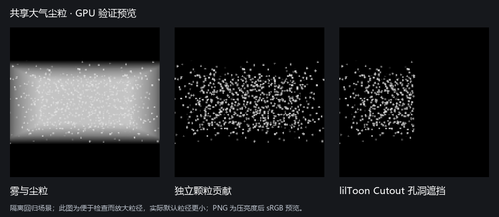

# HoAtmosphere 共享尘粒与介质光学

2026-10-20，Unity 6000.3.15f1，HoURP 17.3.0，Editor RenderGraph。

## 已交付

区域发布 RGB 散射反照率、方向性和可选观察路径消光；连续雾与可见尘粒共同读取。原有 HDR 染色保留。默认仍为稀薄加亮模式、区域方向性 0.3、白色反照率，尘粒默认关闭。已有非默认 Feature 方向性保留数值，需要显式勾选“覆盖区域方向性”；Volume 的已有覆盖勾选继续有效。

区域拥有一套世界单元哈希种子场，位置由共同世界时间、风速和小幅漂浮解析求值。没有按灯或相机实例化 ParticleSystem，没有逐相机推进模拟。VolumeLight 在独立 draw 中采样介质和太阳 shadow atlas；前景用相机深度截止，亚像素粒径使用约 2.5 像素最小覆盖并补偿能量。它不进入连续雾的时域历史。

上图为隔离回归场景，粒径 0.12–0.2 米用于在 160×160 图上明确检查颗粒与遮挡，不是默认效果截图。另用 640×640 目标验证实际默认粒径 0.008–0.025 米、数量 0.5/m³、尘粒亮度 20；`dust-defaults-on.png` / `dust-defaults-contribution.png` 保存了对应结果。PNG 为压亮度后转 sRGB 的预览，线性 EXR 和 float readback 用于判断数值。

## GPU 结果

入口：`lilToon.URP.Extensions.VolumeLight.HoVolumeLightValidation.RunDust`。D3D12 日志 `atmosphere-dust-subpixel-d3d12.log`，D3D11 日志 `atmosphere-dust-final-module-d3d11.log`，位于隔离工程 `.codex-research/RTInputValidation`。

| 检查 | 结果 |
| --- | --- |
| 可见的稀疏颗粒 | 1408 个候选点，160² 图中约 3026 个像素有显著颗粒贡献，平均红通道贡献约 0.05327 |
| 真正默认的小粒径 | 640² 图约 823 个像素的红通道颗粒贡献大于 0.001；不是只验证放大的粒子 |
| 亚像素稳定 | 隔离单颗粒扫过九个像素相位，最大/最小总能量约 1.17，门槛 <1.8，且不允许完全消失 |
| 共同世界时间 | 时间相同的输出一致；两台观察相机使用同一个 buffer，重建次数不增加 |
| 移动区域 | 平移 0.3 米后，超过 75% 的旧世界种子仍保留原坐标，没有整体随区域拖动 |
| 共同介质纹理 | 黑白 Texture3D 的疏密区域影响实际颗粒亮度，浓区贡献超过空区十倍 |
| 风与漂浮 | t=0 与 t=1 的实际颗粒图不同；不是只检查 CPU 参数 |
| 遮挡 | 区域外实体墙将测试尘粒贡献完全遮挡；真实 lilToon Cutout 主贴图 alpha 的孔位亮、实心位暗 |
| SCREEN 阴影 | 该 keyword 下颗粒结果与原始太阳 atlas 路径一致，不能以表面屏幕阴影代替空气遮挡 |
| 颜色与角度 | 蓝色反照率产生蓝色颗粒；g=0.6 的前/后向均值比约 43.5；显式 Volume 覆盖与相同区域 g 的结果一致 |
| 路径消光 | 连续雾启用消光后的平均贡献约为原来的 0.74975；中心像素相对独立 Beer–Lambert 解析参考误差约 0.000153，门槛 <0.003；尘粒贡献也随消光降低 |
| Revision | 改光学只改变 Medium revision；改颗粒亮度不使连续 Medium 历史失效；天空 revision 保持独立 |
| 数量预算 | 要求高密度、上限 128 时实际种子数量不超过上限，明确报告稀疏状态 |
| 生命周期 | 直接损坏 GraphicsBuffer 后重建；关闭区域释放种子/材质；Feature 停用释放材质；实际 Single 切场景销毁旧世界 buffer |

实现提交为 `4602a43`。结果提取和源码哈希保存在 `Tests~/Atmosphere/Dust`；源码包含硬断言，遇到渲染错误会失败。直接使用当前工作区，不依赖早期 AA 验证的包快照。另有其他任务的 RTGI shader 导入错误出现在过程日志中；本轮不修改那组代码，粒子/太阳测试实际执行的 Shader 均通过检查。

## 原有路径回归

`HoVolumeLightValidation.Run` 的 D3D12 日志 `atmosphere-dust-aa-regression-d3d12.log` 与 D3D11 日志 `atmosphere-dust-aa-regression-d3d11.log` 覆盖原有介质、太阳、多孔/画面外遮挡、前景深度、SCREEN、阴影距离、正交/MSAA/半分辨率、关闭/销毁和 HD 抗锯齿。仍以 4096 步参考验收，256 步时域 RMSE 约 0.004986，48 步约 0.010677；原有门槛全部通过。

天空独立入口 `HoAtmosphereValidation.Run` 的 D3D12 日志 `atmosphere-dust-sky-regression-d3d12.log` 通过：六面 HDR、来源与缓存、跨相机、RT 损坏恢复、连续切场景、Volume/调试和 Dispose。

## 使用与边界

在已有区域展开“可见灰尘”并启用，无需新增 Feature、灯或手工材质。默认粒径偏细；先调整尘粒亮度，再按镜头距离调整粒径与数量。共享风速在“介质”面板中显示，即使没有密度纹理也可调。

当前仍为一个启用的 Box 区域、主太阳照明。没有局部灯/GI 受光、多区域混合、粒子碰撞、真正流体湍流、微片 BRDF、光源路径介质自阴影、玻璃透光、IOR/色散或 AC/AOV 输出。粒子是加亮的视觉细节层，与连续雾叠加后不保证整体物理能量守恒。路径消光只衰减体积贡献，不修改背景表面。

种子每个 16 字节，默认上限 8192，即最多约 128 KiB GPU 数据；实际绘制开销随粒径/覆盖/重叠变化。区域持有世界场，效果关闭可以保留共享 buffer；关闭尘粒后由主线程 Update/绘制生命周期释放，区域禁用/销毁也释放，不在加载线程 OnValidate 调用 GPU 释放。
