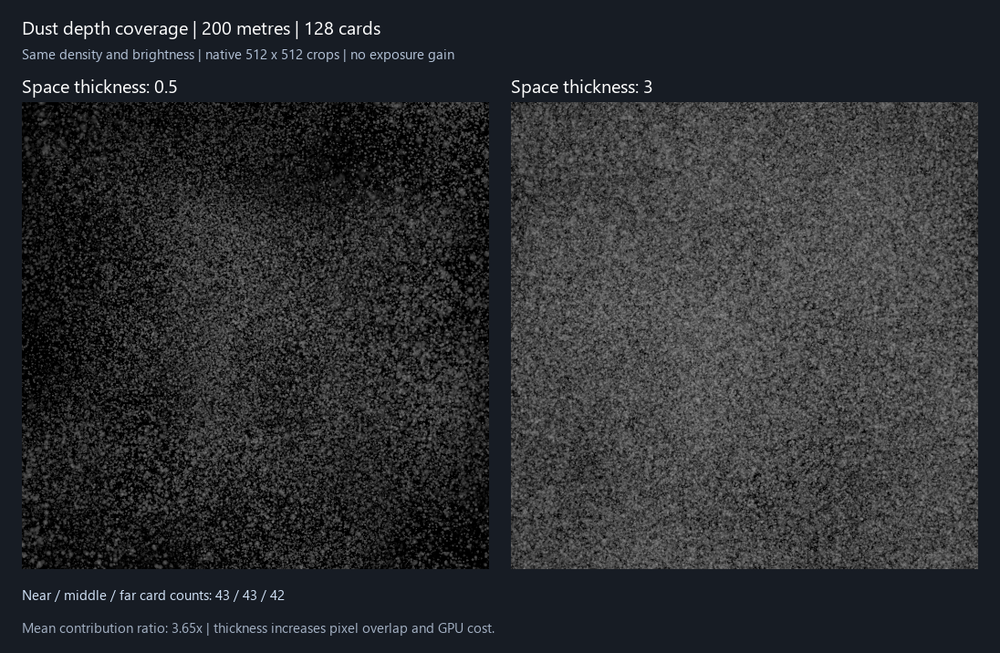

# HoAtmosphere 大场景灰尘覆盖

2026-10-20，Unity 6000.3.15f1、HoURP 17.3.0、Editor RenderGraph、RTX 4060。

## 问题与修正

初版簇片只证明“扩大区域不摊薄近处”，没有证明完整纵深的覆盖。预算不足时只取最近的种子，实际显示距离又被缩到最后一个保留种子，远处即使在显示距离内也可能完全没有片。提高显示距离还会整体粗化同一个世界网格，改变附近分布；远处仍按细小世界尘点采纹理，经过 mip 和阈值后容易消失。

现在按距离建立多个稳定世界网格。默认基础簇片 8 米，距离层边界约为 16、32、64、128、256 米；远层的网格、卡片和贴图世界尺度同步按二次幂放大。各层在边界交叠淡出。增加显示距离只添加远层，不换掉近层网格。只统计与区域、视野相交的有效层，片数预算在这些层间分配；每层内按投影覆盖权重稳定选择。预算不足也不自动截短显示距离。每层遍历范围有界，不枚举整座区域。

新增“空间厚度”，默认 2、范围 0.25–8。它扩大簇片覆盖面积，增加沿视线的颗粒叠层，不增加提交实例，也不直接乘亮度。面积增加意味着透明像素开销上升。它与“颗粒密度”的纹理尘点选择分开控制。近片背后的远片继续按自己的世界位置读取共同介质、太阳阴影与前景深度，不用近处光照代替远处。

UI 新增“大场景厚尘”预设：200 米、128 片、空间厚度 3、亮度 25。原预设也明确设置厚度：轻微 0.65、默认 2、浓密 4、大颗粒 1.5、低开销 1。使用入口仍为“大气区域 → 可见灰尘 → 灰尘效果预设”。

## GPU 功能验证

入口 `lilToon.URP.Extensions.VolumeLight.HoVolumeLightValidation.RunDust`。相机为透视、区域为 Box、共同时间固定，使用实际 RenderGraph 输出/float readback，PNG 只做相同的压亮度和 sRGB 预览。

| 验收项 | 结果 |
| --- | --- |
| 200 米、128 片的纵深分布 | 0–24 米 43 片、24–80 米 43 片、80 米外 42 片，三个范围都有预算 |
| 60 米增加到 200 米 | 仍保留 27 个完全相同的近层种子，不整体替换附近世界网格 |
| 8 片预算 | 提交数 ≤8，实际发布的显示距离仍为 200 米 |
| 只激活前方 80–160 米的空气，640² | 355,787 像素有 >0.001 的灰尘红通道贡献，均值约 0.02503；不存在近处区域贡献 |
| 厚度 0.5 → 3 | 相同密度/亮度/片数预算下，实际贡献均值约增为 3.65 倍 |
| 默认小区域，640² | 130,531 个显著像素；100 米区域扩大到 1000 米后，局部图像误差仍为 0 |
| 共同光学/遮挡 | 反照率、相函数、路径消光、密度 Texture3D、风、区域外遮挡、真实 lilToon Cutout、SCREEN、前景深度通过原有硬断言 |
| 资源 | 多观察者可见缓冲独立、损坏后恢复、关闭/重启、实际 Single 切场景释放通过 |

D3D11 / D3D12 均通过上述功能硬断言。原有太阳 HD 全量回归也分别通过：介质、太阳、真实 lilToon Cutout 主贴图与 AlphaMask、画面外遮挡、前景、正交/MSAA/半分辨率、时域历史与实际切场景。256 步时域 RMSE 约 0.004985、48 步约 0.010677，原门槛保持。对应结果为 `Regression-Direct3D*.json`。

原来逐点和簇片的小区域结果保留在 `Tests~/Atmosphere/Dust/Clusters`，本轮结果独立保存在 `Tests~/Atmosphere/Dust/Depth`。

图为 640² 输出的原生 512² 中心裁图；使用相同的压亮度与 sRGB 显示，没有额外曝光。生成器为 `Tests~/Atmosphere/make-depth-preview.py`。

## 计时修正与开销

计时仅包含灰尘 draw，不含连续雾、阴影生成、CPU 网格选择或整帧。旧测试可能混入其他相机和初始化阶段的 GPU 记录，原来的均值不足以作可靠的速度倍率结论。本轮只为目标相机记录对应 marker，其他相机使用独立 marker；每组至少预热 32 帧且经过 2 秒，再按 Profiler 帧编号去重收集 32 个有效样本，避免重复读取冻结计数器；32 个值完全不变的记录标为不确定。原始数组、帧编号以及均值、中位数、P95、最小/最大值一并保存，缺少足够样本时报告 -1，不以 CPU 时间代替。

本机 D3D12、1920×1080、500 米区域、太阳阴影/Cutout、无路径消光：

| 档位 | 中位数 | P95 | 均值 |
| --- | ---: | ---: | ---: |
| 默认，64 片、30 米、厚度 2 | 0.782 ms | 1.269 ms | 0.840 ms |
| 大场景，128 片、200 米、厚度 3 | 2.237 ms | 2.909 ms | 2.379 ms |

D3D11 同样采集到 32 个不同 Profiler 帧：默认档中位数 2.382 ms、P95 3.405 ms，大场景档中位数 3.687 ms、P95 4.974 ms。此前未完整开启 Editor Profiler 时，出现无样本或冻结计数器的情况，已保留旧记录；以上使用完整开启与帧去重后的记录。两 API 的测试时刻与桌面负载不同，不据此归因 API 本身的性能差异。

桌面其他应用仍在运行，GPU 时分调度和负载使样本有波动，这些数值是该夹具的成本参考，不承诺项目帧率。本次厚尘的屏幕覆盖远高于旧的稀疏点图，不能把两者当等画质速度对照。早期遇到约 101.66 ms 的异常均值，以及夹杂约 0.001 ms 初始化/空标记的记录，保留为 `Timing-Outlier-Direct3D12.json` / `Timing-Warmup-Direct3D12.json`，不删除异常，也不用于当前稳定成本结论。

Unity 官方说明 GPU Recorder 的读数有[三帧延迟](https://docs.unity.com/en-us/engine/6000.3/script-reference/unityengine/profiling/recorder/gpuelapsednanoseconds)；本轮增加了预热，并使用官方 [ProfilerDriver 帧索引接口](https://github.com/Unity-Technologies/UnityCsReference/blob/master/Modules/ProfilerEditor/Public/ProfilerAPI.bindings.cs)防止重复计数。隔离相机但尚未按帧去重的过程记录保存在 `Timing-BeforeFrameDedup-Direct3D*.json`，当前结论使用 `Direct3D*.json`。

独立复查大场景计时可用 `RunDustDepthTiming`，它仍先执行完整灰尘功能断言，再只计大场景档。常规 `RunDust` 包含四组计时，另外两组是旧逐点表示的 Editor 对照；其画面覆盖不同。

## 表现边界

远层同步增大纹理世界尺度，保持可见颗粒，属于视觉 LOD，不保持真实世界粒径恒定。簇内仍为相机朝向的二维纹理，不能逐颗追踪/碰撞或提供真实三维视差。提高厚度、片数和显示距离会增加重叠和阴影采样；开启路径消光还会增加八段介质读取。片数很低时预算会摊到各层，完整距离保留，但每层覆盖可能变薄。当前仍是一个 Box、主太阳受光，灰度/玻璃透光、局部灯及 AC/AOV 后续处理。
