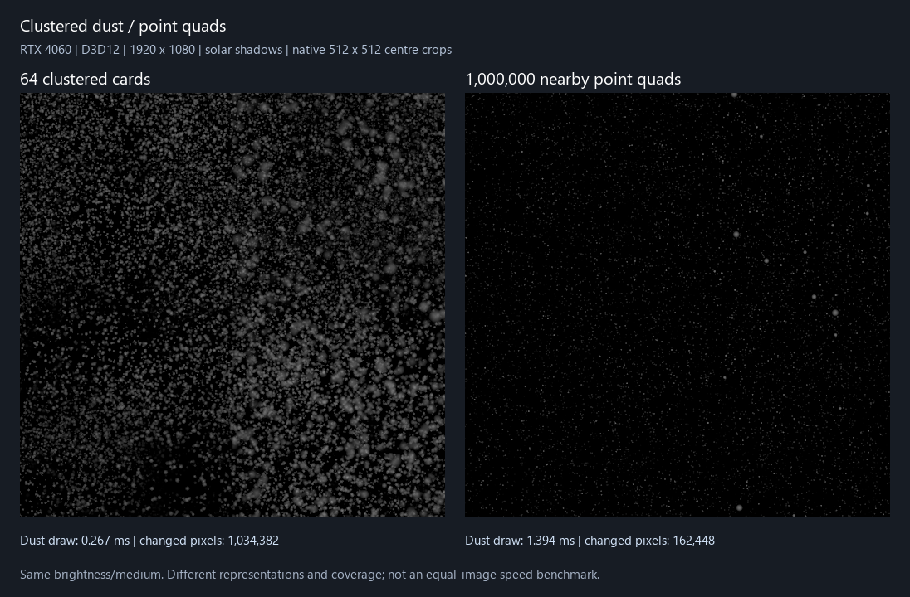

# HoAtmosphere 簇状灰尘

2026-10-20，Unity 6000.3.15f1、HoURP 17.3.0、RTX 4060、Editor RenderGraph。

## 改动及使用

此前每个尘点各提交一张小片，数量上限作用于整个区域，大区域把多数预算摊到视野和显示距离以外；提高到百万也不保证画面密度。现在默认改成少量世界簇片，每片用一张可平铺 Alpha 纹理表达大量尘点。CPU 只选择显示距离/视野附近的世界单元；区域扩大不重新稀释单元密度。默认最多 64 片，硬上限 256；只有一次实例化 draw、无透明排序。按距离选择预算的 CPU 排列与透明前后排序是不同职责。

在已有 HoAtmosphere Region 的“可见灰尘”中启用即可。默认簇片 8 米、贴图每 8 米重复、颗粒密度 1、显示距离 30 米、亮度 20。颗粒密度调纹理中的尘点选择，片数只控制绘制预算。减小贴图平铺大小可增加细小颗粒。可拖入自定义 Alpha 纹理，留空使用内置纹理。旧每立方米数量/粒径/点数量上限移除，改用新默认值；亮度等同名参数保留。

内置 512² RGBA32 纹理由 `Tests~/Atmosphere/generate-dust-clusters.py` 自行生成，含约 8000 次尘点烘焙及簇状分布，线性、Repeat、mip、无压缩。不使用 VLB 代码或纹理。一个贴图中的尘点会重叠、随 mip/阈值消失，不能把“片数 × 8000”当作实际可见三维粒子计数。

区域持有共同网格哈希和风/世界时间；每台相机仅持有小型可见种子列表，同一单元产生同样的世界簇中心，不重复推进模拟。每帧生成/筛选的候选数量由显示距离/固定网格 LOD 限定，与整座区域尺寸无关。每帧只上传保留的片，默认 GPU buffer 每相机 1 KiB，256 片时 4 KiB；共享纹理约 1.33 MiB。空白纹素先裁掉，保留的片元再读取介质、太阳 atlas 和前景深度。大卡片内部也能保留 Cutout 投影。

## 默认表现与大区域回归

入口：`lilToon.URP.Extensions.VolumeLight.HoVolumeLightValidation.RunDust`。运行于隔离工程 `.codex-research/RTInputValidation`；需真实 GPU，不使用 `-nographics`。方法先执行硬断言，再自动切换 1080p 三组计时。结果在 `Tests~/Atmosphere/Dust/Clusters`；源码哈希在同目录 manifest。

| 检查 | D3D12 / D3D11 结果 |
| --- | --- |
| 默认纹理、默认参数，640²、小区域 | 64,678 像素红通道灰尘贡献 >0.001，平均贡献 0.002504 |
| 已覆盖显示范围的区域从 100 米扩大到 1000 米 | 图像误差 0，仍不超过 64 片 |
| 世界时间/观察者/区域移动 | 同时刻输出一致；第二相机不替换第一相机 buffer；区域平移后重叠世界种子保留 |
| 动态风 | t0/t1 实际颗粒图变化，平均绝对差 0.01344 |
| 共同光学 | 蓝色反照率只产生蓝通道；g=0.6 前后向均值比约 43.6；Volume 显式 g 覆盖一致 |
| 路径消光 | 雾的中心值对 Beer–Lambert 解析参考误差约 0.000153；灰尘也随路径消光降低 |
| 不透明/真实 lilToon Cutout | 完整墙遮挡全部灰尘；MainTex Alpha 孔洞侧亮、实心侧暗，测试对比度 1 |
| SCREEN/前景/密度纹理 | SCREEN 保留原始 atlas 语义；前景深度截止；密度 Texture3D 影响实际尘点 |
| 参数和资源 | 调颗粒密度减少贡献；自定义全空 Alpha 图无贡献；8 片预算生效；损坏 buffer 后重建 |
| 生命周期/revision | 禁用/重启区域及 Feature、实际 Single 切场景释放旧 buffer；灰尘参数不使连续介质历史失效 |

## GPU 时间与覆盖

同一 1920×1080 相机、500 米区域、太阳阴影/Cutout、相同介质密度/散射方向/亮度、无路径消光。只计灰尘 draw 的 GPU 时间，**不包括**连续雾、阴影图生成、CPU 候选选取和整帧耗时。GPU marker 开启后每组预热至少 16 帧，收集 32 个有效时间样本，不用 CPU stopwatch 代替 GPU 时间。

| D3D12 表现 | 提交实例 | 灰尘 draw | 贡献 >0.001 的全图像素 |
| --- | ---: | ---: | ---: |
| 默认簇片 | 64 | 0.267 ms | 1,034,382 |
| 百万逐点，均匀铺满 500 米区域 | 1,000,000 | 1.374 ms | 313 |
| 百万逐点，集中在附近 60 米盒内 | 1,000,000 | 1.394 ms | 162,448 |

逐点对照使用旧版自有 shader，单独放在 Editor；测试人口改为固定随机种子的均匀位置分布，分别体现大区域浪费和把人口集中到相机附近后的情况。正式运行时没有保留百万粒子分支。两种表现的粒形和视差不同，输出图像也不相等，因此这不是同画质速度倍率。当前簇片画面更密，不能仅凭几何数量承诺所有场景固定加速。D3D11 功能全部通过，但前两组在 3600 帧内没有有效 GPU 时间样本，JSON 为 -1；只在最后的百万附近点组得到 0.561 ms，不据此推导 D3D11 加速比。

图为灰尘贡献隔离图，同样的压亮度+sRGB 显示，无额外曝光增益；512² 原生像素裁图，整体画面像素计数用于表格。生成器 `Tests~/Atmosphere/make-cluster-preview.py`。

## 限制

片内尘点是面向相机的纹理近似，会随相机方向变化，不是能逐颗追踪的三维粒子。不能逐点碰撞、投射自阴影或计算独立速度。大透明卡片仍有像素重叠成本；增加屏幕覆盖、片数、阴影过滤或开启八段路径消光会增加耗时。默认优先保留附近片并在预算半径淡出，预算不足时远处不继续保持原密度。显示距离很大时使用网格 LOD，可能显出较大的平面层次，需按镜头调簇片/平铺尺度。

仍为单个 Box、主太阳受光；局部灯、灰度透光、玻璃彩色透光、AC/AOV 另行推进。共享反照率、方向性与连续雾的积分契约保留。旧逐点测试保存在[历史光学记录](Ho-Atmosphere-共享尘粒与光学验证.md)，其中稀疏小区域的结果不再作为本阶段密度/性能验收。

原有 `HoVolumeLightValidation.Run` 另跑太阳/介质/4096 步参考的 HD 时域回归，结果存为 `Regression-Direct3D*.json`；包含 Cutout/画面外投影、前景、正交/MSAA/半分辨率、历史损坏与切场景。D3D12 / D3D11 均通过；256 步时域 RMSE 约 0.004985、48 步约 0.010677，原门槛通过。
