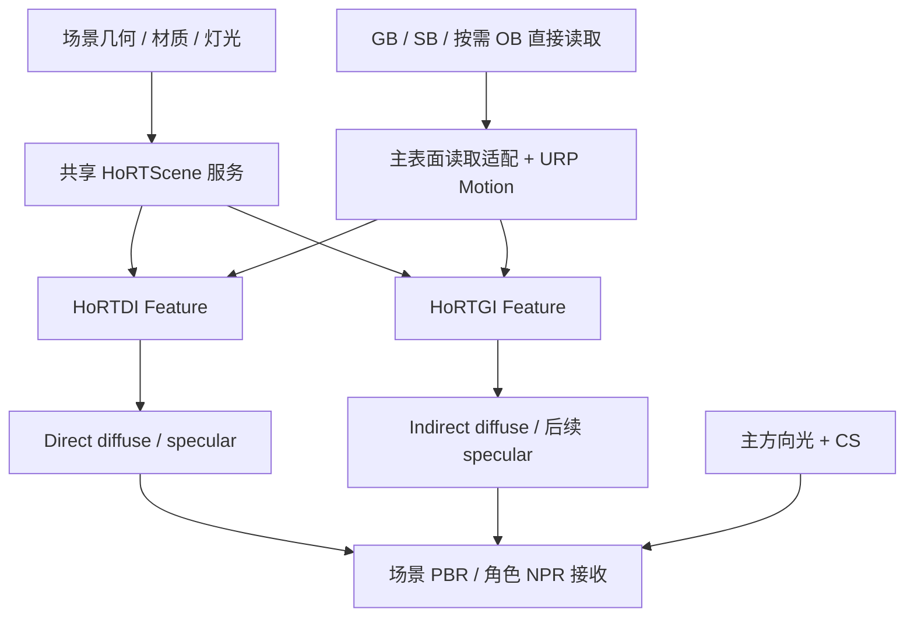

# Ho-RTDI / Ho-RTGI 可行性调查

日期：2026-10-07，更新于 2026-10-08。状态：输入与求交准备已通过 GPU 验证（§10～§14）；已沿用户参考工程实现 Ho-RTDI 初版及独立光照输出（§15）。GI 二次命中材质适配（§16）与参考 SDK 的一跳 diffuse GI 独立输出/重采样（§17）已通过真实 GPU 验证；最终材质接收/合成、降噪、生产性能与 Player 尚未交付。

## 判断

建议立项：把场景照明推进到世界空间的直接光可见性与间接光，分别提供 Ho-RTDI、Ho-RTGI Feature。它们共享光追场景、材质、灯光和资源生命周期，分别拥有采样、reservoir、历史与降噪。

这有望明显改善室内暗部、屏幕外反弹、多灯投影与发光物照明，减轻依靠额外灯和 ShadowCast 拼出空间关系的负担。但“已有 ReSTIR”不等于“已有光追渲染器”：目前缺口主要是世界空间几何、命中点材质与灯光求值，不是 reservoir 的存储和随机选择。

第一阶段建议瞄准 **Windows / D3D12 / 硬件 RT / 不透明静态场景 / 一跳 diffuse GI**。本机枚举到 RTX 4060，当前 Unity Editor.log 记录 D3D12；具备尝试条件。用户指定的 `UnityPathTracing-6000.3.15` 已包含较完整的 RTXDI / ReSTIR GI 链路，建议以它为首要代码基础，先恢复最小验证，再抽取模块。是否能在目标场景的预算内运行，需要独立原型验证。

新 DI/GI 默认通过后续 pass 合成，未来保留材质内接收模式。DI 接管的灯需与旧材质直接光明确分工。CS/ShadowCast 与 DI 的双重阴影混合策略暂缓，当前可先由用户手动关闭旧 cast 接收；几何仍参与 RT 遮挡。

用户确认的范围：复用现有 GB/SB/OB 的生产结果。AC 更面向合成与后处理，且尚未完善；当前 RT 照明计算直接读取所需数据，不以完善 AC、统一终端入口或再复制一套属性图为前置条件。AC 的具体物化与复制策略仍待斟酌。lilPBR 已废弃，不作为实现依赖、支持目标或验收对象。正式接入围绕当前 lilToon 与 Extensions 契约推进。

最新范围补充：**SSS 暂不接入**，用户仍在斟酌其设计。RT 首版不依赖 SSS profile、thickness、透射响应或 SSS 专用历史，不因现有 SB 中已有字段就要求消费或扩展它们。当前铺路重点是 SB emission、世界方向环境辐射，以及必要的数据有效性/读取约定。

**最新实施优先级**：用户决定先完成可独立验证的 DI/GI 与环境生产端，暂不处理 lilToon 怎么接收、暗部如何过渡、材质内/后处理的具体合成映射。后续 pass 合成保留为方向，具体 PBR/NPR 结合另设阶段；此前 §4.5/§6 的讨论作为约束与备选，不是当前实现要求。算法验证用最小 PBR 响应参考；当前不自动关闭或改写材质的旧光照、cast、CS 等。环境、主表面共享读取、刚性 opaque 世界求交及参考 RTXDI 的 DI 四阶段已有首版并通过验证；GI 的二次命中材质适配及参考 BrdfRayTracing / ShadeSecondarySurfaces / GI temporal/spatial/final 已有一跳 diffuse 初版（§16～§17）。当前优先推进 DI；已补静态世界的动态解析灯历史与索引映射（§18）。后续围绕 DI 的实际支持域、目标场景验证与性能/降噪推进，仍不提前设计最终 NPR 合成或通用 PT 框架。

## 1. ReSTIR、RTXDI、RTXGI 的职责

| 项目 | 提供什么 | 应用仍须提供什么 |
| --- | --- | --- |
| ReSTIR DI | 灯光样本的时空重采样 | 灯列表、灯光采样与 PDF、表面响应、遮挡查询、最终着色 |
| ReSTIR GI | 间接路径/次级表面样本的时空重采样 | 初始 GI 射线、二次表面位置和法线、采样 PDF、命中点 radiance、连接可见性 |
| RTXDI SDK | 包含 ReSTIR DI/GI 等算法的集成代码 | 引擎侧场景、材质、求交、GBuffer、资源调度与应用 bridge |
| RTXGI-DDGI | 世界空间探针的动态 diffuse GI | 探针射线的场景求交与命中点着色、探针布局和接收端采样 |
| RTXGI 2.x | NRC / SHaRC 世界空间 radiance cache | 光追路径和缓存的更新、查询与渲染器集成 |

RTXDI 是采样库，不是装入 URP 就能工作的完整照明插件；其官方集成要求应用实现相应 bridge。C++ host 侧参数和辅助逻辑需适配 Unity，可以评估移植为 C#；不必为了参考示例而把 Donut/NVRHI 整个渲染框架引入 Unity。[RTXDI 集成指南](https://github.com/NVIDIA-RTX/RTXDI/blob/main/Doc/Integration.md)

ReSTIR GI 的初始输入应来自能生成有效路径样本的追踪器，至少有二次表面、方向 PDF 和出射辐射。重采样仍可以按屏幕像素存储，**这不要求求交也局限于屏幕深度**。[ReSTIR GI 官方说明](https://github.com/NVIDIA-RTX/RTXDI/blob/main/Doc/RestirGI.md)

“RTXGI”需明确版本：DDGI 在独立的 RTXGI-DDGI 仓库；RTXGI 2.x 已转向 NRC/SHaRC。为当前工程选型时，不能把 DDGI、ReSTIR GI 和 radiance cache 当作同一项实现。[RTXGI 官方仓库](https://github.com/NVIDIA-RTX/RTXGI)、[RTXGI-DDGI 官方仓库](https://github.com/NVIDIAGameWorks/RTXGI-DDGI)

## 2. 本地已确认的基础

以下是源码事实，不代表功能经过本轮运行验证。

### 2.1 Ho-SSGI：复用了采样思想，尚未具备世界空间场景

- `Runtime/SSGI/HoSSGIRendererFeature.cs` 的 RecordRenderGraph 从 `resourceData.activeColorTexture` 取得 source；默认追踪在 AfterRenderingOpaques，合成在 BeforeRenderingPostProcessing。
- `Runtime/SSGI/Shaders/HoSSGI.shader` 的 reservoir 保存 color、Wsum、M、target、hit、distance、direction、originNormal。存在 temporal/spatial reuse、重验证与重建链路。
- 验证函数将预期命中点投影回屏幕，读取屏幕 geometry/source，并重新 march 深度；没有遍历世界空间三角形场景。
- Composite 直接把 `_HoGITexture.rgb * intensity` 加到 camera color；当前接口不是一个已完整定义物理单位、由所有材质共同消费的 irradiance/BRDF 契约。

可复用：RenderGraph 编排经验、逐相机 history/reset、motion/depth/normal validation、debug、降噪的部分结构。不能原样复用：GI 样本身份、重连权重、PDF/Jacobian、动态表面跟踪和世界空间 visibility。

SSGI 的改进仍有价值，可作为较低成本的近场补充或回退；不应把完成其全部 HTrace 对齐作为世界空间原型的前置条件。

### 2.2 GB / SB / OB / AC：已有拆分生产体系，主表面输入应复用

此前只检查 GB 就推断“管线缺材质输入”，不准确。用户确认当前生产体系拆为 GB、SB、OB、AC；复核现行文档、资源集、查询 API 与 lilToon 材质 pass 后，职责如下：

| 模块 | 当前职责与已有产出 | DI/GI 接入价值 |
| --- | --- | --- |
| GB | 基础表面法线/深度、几何与描边 coverage、outline owner、sky；lilToon 法线含 normal map/Tesion | 深度关联与几何有效性；不能将 RGB 统一当作无扰动网格法线 |
| SB | linear HDR 主色、贴图后 shading normal、Normal.BA 未扰动网格法线、perceptual roughness、metallic、thickness、reflectance、分类与 surface owner/语义 | 主表面主要字段已具备，不应另造重复 PBR GBuffer；两种法线显式区分 |
| OB | 身份、ranked coverage、物体/部件语义事实 | 接收域、排除规则、身份关联；具体 RT instance/submesh 键仍需独立映射 |
| AC | 面向合成与后处理；已实现部分 typed 查询、属性/语义合成、owner validity 与资源引用，整体仍未完善 | RT 照明计算不经它中转；后续合成/后处理确需其属性或遮罩时按需消费 |

直接代码依据：`Runtime/SurfaceBuffer/HoSurfaceBufferShaderConstants.cs`、`Runtime/AttributeComposite/HoAttributeCompositeRenderGraphResources.cs`、`Runtime/AttributeComposite/Shaders/HoACQuery.hlsl`，以及 lilToon 的 `lil_pass_surface_buffer.hlsl`。后者实际输出 Color/Normal/Material/Reflection/Classification/Emission + owner 七个 MRT，不只是规划。`HoAC_Attribute(uv,1)` 返回 perceptualRoughness/metallic/thickness，`(uv,2)` 返回 reflectance/plrStrength；`HoAC_SurfaceValid` 检查 SB owner 与 OB 层 0 身份一致。RT 共享读取不经过该 AC 门面。

因此主表面工作应是 **直接读取所需 GB/SB/OB 资源，适配到 RTXDI 的 Surface/Material bridge**：区分几何法线与着色法线；按契约转换 roughness、F0、颜色及 packing。复用生产端已有共享编解码函数，不在每个 Feature 重写 packing。RenderGraph 按实际采样逐项声明 `UseTexture(Read)`。这是一层数据读取与求值适配，默认不落新的主表面 RT，也不需要先补齐 AC。当前 AC 资源集并未覆盖所有主表面字段；用户最新决策优先于旧文档中的“只吃 AC”接入方向，当前 RT 不按该方向增加前置工作。

当前 SB Emission 已接通，主表面 writer 通过其 A 通道与 OB 身份解耦。后续仍需核对 RTXDI motion/history 的坐标约定、与 GB 前表面对齐及完整 PBR/NPR 响应参数；屏幕外材质求值仍待接入。不能把零值兜底当作有效的黑色金属/零粗糙度表面。

这套生产结果描述主相机可见表面。**屏幕外二次命中的材质、几何更新和 visibility** 仍需世界空间路径，建议复用 SB 材质求值的语义与可共享函数，使 raster 与 ray-hit 结果一致。AC 的屏幕查询不能直接替代任意世界空间命中着色。

沿用现有拆分职责；不将 SB 数据搬入 GB，不把 reservoir 塞进 GB/SB/OB/AC，也不要求四个模块合成一张传统 GBuffer。

### 2.3 HoURP 的 SurfaceCacheGI：旁证参考，当前不能直接打开交付

入口：`D:/Unity_Fork/HoUrp17.3.0/Runtime/RendererFeatures/SurfaceCacheGI/SurfaceCacheGlobalIlluminationRendererFeature.cs`。

已找到：world adapter、场景更新、材质转换、UnifiedRayTracing、世界空间 patch cache、ReSTIR candidate/temporal/spatial、SH irradiance 输出、RenderGraph 调度。

已确认的限制：

1. Feature 及若干配套代码由 `#if SURFACE_CACHE` 保护；本轮检查的 BREAK_URP 与 Break_HORP ProjectSettings 未配置该 symbol。
2. Create 固定 `RayTracingBackend.Compute`，并没有按本机能力自动走 Hardware。
3. `SurfaceCacheCore/PathTracing.hlsl` 的 `SampleOutgoingRadianceAssumingLambertianBrdf` 只读取 `lightList[0]`，注释明确当前假设单方向光。WorldAdapter 也筛选 sunlight；不是任意多灯 DI。
4. 已读取的 instance 增量接口接受 `List<MeshRenderer>`；不能据此认定已有角色 SkinnedMeshRenderer、布料和顶点变形支持。
5. 依赖 `UnityEngine.PathTracing.Core`、`UnityEngine.Rendering.LiveGI`、MaterialPool/SceneTracker 等。本轮检查的工程 PackageCache 未检出对应定义文件；启用宏前要先解决依赖来源和版本，不能把这些视作稳定公开 API。
6. 输出接入 `UniversalResourceData.irradianceTexture`，URP DrawObjectsPass/GBufferPass 读取后发布屏幕 irradiance；这与 Ho-SSGI 的后处理叠加路径不同。

用户确认 HoURP 是 URP17 的小改 fork；这些文件的存在不能视为 Ho 自有成熟 RTGI。它们可以参考场景同步、cache 和调度结构，但优先级低于用户指定的 UnityPathTracing，不作为本项目的主实现路线。不要通过打开宏、切换 backend 就认定可以获得 RTXDI/完整 RTGI。

### 2.4 lilToon 与 CS

- lilToon 的 SB 材质 pass 已生产主色、着色法线、perceptual roughness、metallic、reflectance 等，主表面适配复用该体系；具体 BRDF/NPR 接收与 ray-hit 材质求值在 lilToon/Extensions 侧建立。
- lilToon 多个 shader 声明了 `_SCREEN_SPACE_IRRADIANCE` variant；本轮在其 Includes 中未检出对应显式采样分支。声明 variant 不能证明实际接收链路已经接通。
- lilToon 目前通过 `lil_common_macro.hlsl` 对接 ShadowCast 和 `HoCSResolveMainCast`。CS 的现行文档明确它服务主方向光的角色局部高精度 cast。

CS 不覆盖任意点灯/面灯，也不计算反弹光。保留 CS 有意义，但不能据此省略新灯光在角色上的遮挡查询。

### 2.5 用户指定的 UnityPathTracing：首要代码基础

用户确认目标路径为 `D:/Unity_Fork/lilToon-URP-Extensions/.codex-research/UnityPathTracing-6000.3.15`。旁边 `.codex-research/UnityPathTracing` 是带源码和 native build tree 的仓库，remote 为 `https://github.com/Kuan-Mi/UnityPathTracing`；指定的 `-6000.3.15` 目录本身没有独立 Git 根，不能用其 `git status` 误判上游变更。

DanBaiDongRP 按用户说明不再作为需要移植的候选。

**这里已经实现的内容远超过 SSGI reservoir**：

| 本地模块 | 已确认的实现 | 对我们有什么用 |
| --- | --- | --- |
| `Assets/RTXDI/Scripts/UnityRtxdiFeature.cs` | Unity DXR 自动 AS、DI/GI pass 调度、逐相机资源与 history | 首选的较小集成路径参考 |
| `Assets/RTXDI/Scripts/NativeRtxdiFeature.cs` | 原生 D3D12 路径、DI/GI/PT、预采样与降噪/输出调度 | 更完整的功能与性能参考，接入成本更高 |
| `Assets/RTXDI/Scripts/Rtxdi/` | C# DI/GI/ReGIR/PT context、参数与工具 | 不必从 C++ host 参数层重新移植 |
| `Assets/Shaders/RTXDI/` | DI/GI/PT shader library | 已有 SDK 算法来源，移植时固定版本 |
| `Assets/Shaders/RayTracing/RtxdiApplicationBridge/` | RAB surface/material/light/visibility bridge | 应重点改造成 Ho 场景、PBR/NPR 契约 |
| `Assets/RTXDI/Scripts/Passes/UnityRtxdi/DI/` | 初始灯光采样、temporal、spatial、最终着色 | 可逐阶段提取为 Ho-RTDI |
| `Assets/RTXDI/Scripts/Passes/UnityRtxdi/GI/` | BRDF trace、二次表面着色、GI temporal/spatial、最终着色 | 可逐阶段提取为 Ho-RTGI |
| `Assets/RTXDI/Scripts/PrepareLight/LightScene.cs` | point/spot/rectangle/disc/directional/environment 分类、mesh light、PDF 资源 | 已有多灯基础，仍需核对单位、cookie/layer、动态稳定 ID |
| `Assets/NRD-Sample/` 与 `Assets/Shaders/Sharc/` | NRD 示例与 SHaRC 更新路径 | 后续比较降噪与多跳缓存，不要求首版全接入 |

**它并不是现有材质无感接入的独立照明插件。**

- `GBufferRasterPass` 要求材质提供 `GBufferRaster` pass，写 7 个 MRT：view depth、diffuse albedo、specular/roughness、shading normal、geometry normal、emission、motion。应按字段直接映射 GB/SB/按需 OB + URP motion，并补齐缺项；不应因为外部示例使用一套 GBuffer，就重新生产已有主表面数据。
- 自带 `Assets/Shaders/Surface/Lit.shader` 名称为 `RayTracing/Lit`，包含 GBufferRaster、RayTracing 与 `SecondSurface` 等专用 pass。Unity GI trace 通过 `SetRayTracingShaderPass(..., "SecondSurface")` 选择命中着色；现有 lilToon 不能仅靠同名 albedo 贴图自动获得这些 pass。
- 最终 OutputBlit 向 active camera color 写入独立渲染结果。原样接入会把自己的完整画面输出引入当前 forward 流程，需改成 lighting producer/材质接收接口，避免覆盖 NPR、OIT 和后续效果的正确合成关系。
- `UnityRtxdiFeature` 仍实例化 DlrrDenoiser 并调度 DLSS RR；相关代码调用 `Denoiser.dll`。名称中的 Unity 表示求交/dispatch 路径，不等于已脱离全部 native 依赖。
- `.compute` 中 `#pragma require inlineraytracing`、USE_RAY_QUERY 表明这里的 compute 选项仍使用硬件 ray query；它不是无 RT 硬件的软件 BVH fallback。
- Unity bridge 的 temporal visibility 函数目前回用 currentSurface 与当前场景查询；不能从参数里的 `enablePreviousTLAS` 推断所有路径都有上一帧场景可见性。动态门、角色与历史偏差需要专门验证。
- 有 SkinnedMeshRenderer 搜索和 AS 更新代码，说明考虑了动态角色；这仍不能证明 MagicaCloth、lilToon 顶点变形、alpha clip 与光追几何已经一致。

**配置故障证据需要分开看**：

1. 指定目录 `unity-batch-6000.3.15.log` 记录过 `DllNotFoundException: ShaderCompilerPlugin` 和 native shader 导入失败；但当前 package 目录已经存在 ShaderCompilerPlugin.dll、NativeRenderPlugin.dll、dxcompiler.dll、dxil.dll 等。不能直接得出“现在仍缺 DLL”，需要验证其依赖、加载与实际 runtime pipeline 创建。
2. 旁边源码工程的 `native-shader-probe.log` 记录 `[NativeShaderProbe] computeshaders=102 null=0 compiled=102`。这是现存的 shader asset 编译证据，不是本轮测试，也不是 GPU 渲染成功；其 probe 仅检查 compute asset，并没有覆盖所有 ray/hit shader 和 native pipeline。
3. `nativecheck-6000.3.15.log` 另有 XRI PackageCache rename 的 EPERM，属于包解析/文件状态问题，不应混同成 RTXDI 算法或 GPU 不支持。
4. 模型导入故障有当前文件证据：Bistro 的 `bistro.gltf` 引用 `bistro.bin`（95,660,264 B），指定目录中该 bin 不存在。可先用自建小场景验证算法，避免把恢复大型演示资源作为所有验证的前置条件。
5. 当前 `Assets/Settings/RPAsset.asset` 指向 `Assets/RTXPT/RtxptRenderer.asset`，包含 NativeRtxdi/NativeNrd/NativeRtxpt 序列化 feature。需要核对实际启用组合与 scene/renderer 对应，不能仅打开 Arcade 就假设走 UnityRtxdi 路径。
6. 上游 readme 要求 Unity 6000.3.17，并介绍修改 Unity 可执行文件及 D3D12 runtime 以使用 Agility 1.619.1；本地指定工程是 6000.3.15。原生源码中也有 lib_6_9/SM6.9 相关代码。这是完整 native 高级路径的环境成本，不能泛化为 ReSTIR 数学或所有 Unity DXR 路径都需要修改 Unity.exe。本轮没有执行这种修改。[上游运行说明](https://github.com/Kuan-Mi/UnityPathTracing)

结论：**优先恢复它的最小 Unity RTXDI DI/GI 链路，并提取模块；完整 native RTXPT/SER/OMM 路线保留作后续选择。** 首先需要验证“专用测试材质 + 单一 Feature + 小场景”的成功输出，而非把所有样例、shader importer、DLSS、PT 和 native 优化一起调通后才开始 Ho 集成。

## 3. 为什么世界空间 RT 改善很大，仍可能漏光

当前 SSGI 只能观察一层屏幕深度和可见表面颜色。相机外的墙、背面、被挡住的光源或反弹面不在这份表示中；ReSTIR 复用再多样本，也不能构造缺失的几何。

世界空间三角形求交可以保留屏幕外遮挡和反弹面，这是主要质量提升来源。仍需处理三类误差：

- **场景一致性**：漏注册 mesh、蒙皮/布料未更新、alpha clip 或双面规则不一致、LOD/实例 transform 不一致。
- **求交与重采样**：ray origin bias 过大、旧样本跨墙连接、历史遮挡未失效、重连 PDF/Jacobian 错误。
- **信号重建**：降噪跨越墙边或材质边界、低分辨率上采样混合前后景、cache/probe 插值越墙。

所以目标应是“摆脱屏幕表示带来的系统性缺失，并使误差可观测”，不是承诺光追自动消除所有漏光。RTXDI 官方也明确讨论 visibility reuse 与时空重采样的偏差。[RTXDI Noise and Bias](https://github.com/NVIDIA-RTX/RTXDI/blob/main/Doc/NoiseAndBias.md)

DDGI 能提供稳定的世界空间 diffuse 底光，但仍须处理探针可见性与插值，薄墙、探针布局和动态更新仍是质量变量。生产研究中的 probe relocation/classification 等工作正是在处理这些问题。[DDGI 生产研究](https://arxiv.org/abs/2009.10796)

## 4. 建议的 Feature 和数据边界

共享 HoRTScene 可以先作为内部服务，由消费者请求准备一次；不一定另做用户必须手工排序的 Feature。

| 共享数据 | 必须明确的契约 |
| --- | --- |
| Geometry / AS | instance、submesh、三角形、世界变换、mask、双面与 alpha clip；动态更新和销毁 |
| 主表面属性 | 直接复用 GB/SB/按需 OB 的生产结果；借用已有句柄、共享解码，不复制已有属性图 |
| Ray-hit Material | 复用现有材质语义，提供屏幕外 base color、emission、normal、roughness、metallic、裁切与 shading model 求值；与 raster 一致 |
| Light | 稳定 ID、类型、光强单位、shape、range、cookie/layer；前后帧索引映射 |
| Camera / history | 相机切换、分辨率、投影、jitter、motion、camera stack、SceneView、reset |
| Resource scheduling | AS build、trace、reservoir、denoise 的依赖；共享 AS 的 GPU 生命周期 |

DI reservoir 保存灯光身份与采样点等；GI reservoir 保存二次表面/路径信息、辐射与权重等。二者各自管理 history，不能共用 Ho-SSGI 现有 payload。

应在第一版确定输出是 irradiance、BRDF 前的 lighting component，还是已着色 radiance。间接光若已乘 receiver albedo，就不能进入材质再乘一次；若输出 irradiance，则原来的直接叠加 composite 也不能原样套用。`_HoGITexture` 名称可以保留为兼容出口，但需要语义明确的内部结果与适配层。

Ho-RTGI 可以复用共享的 direct-light evaluator 给二次命中着色；不应强依赖主相机 Ho-RTDI 结果图。关闭 DI Feature 时，GI 仍可生成合法的候选路径。

### 4.1 RT 输入清单：先按实际使用登记

这里的“必需”按首版 opaque/cutout、漫反射 GI、可选直接高光定义；不要求每个 Feature 无条件读取全部生产物。以下是接入清单，尚未实现新 RT 消费代码。

| 输入 | 当前来源/状态 | DI 用途 | GI 用途 | 接入处理 |
| --- | --- | --- | --- | --- |
| 主表面深度/世界位置 | GB normalDepth/depth + 相机矩阵，已有 | 起点、方向、几何项 | 初始射线起点、重连几何项 | 直接读，统一 depth/坐标约定 |
| 无 normal map 的网格法线 | SB Normal.BA，已补齐；Material.A 可用标记 | 主表面参考法线 | 主表面几何验证参考 | 共享 octa 解码；不是 AS primitive flat face normal，也不使用受扰动 GB.RGB 冒充 |
| 几何 coverage / 深度 | GB，已有 | 有效面与深度关联 | 同左 | 直接读；描边视觉壳默认不作 RT 几何 |
| 着色法线 | SB Normal.RG，已有 | 最终响应与 target PDF | BRDF 方向采样、主表面响应 | 复用 SB octa 解码，与未扰动网格法线分别保存语义 |
| 主色 | SB Color，已有 | 漫反射/金属 F0 的输入 | 主表面接收响应 | 直接读；HDR 主色与物理反射率的映射另定义 |
| perceptual roughness / metallic | SB Material.rg，已有 | BRDF、target PDF | BRDF/PDF、GI 接收与反射分流 | 按契约平方转换 roughness，避免重复转换 |
| reflectance | SB Reflection.r，已有 | 非金属 F0 近似 | 主表面反射响应 | 只读需要的通道；PLR strength 不作为 RT 能量参数 |
| 表面 writer/owner | Emission.a 独立 writer、已发布 SB depth、SB Owner | 判断材质值是否有效 | 同左，防止跨物体取错值 | 不能用 owner/颜色/roughness 为 0 判断没写；先验证深度关联，按需检查 OB 身份 |
| 身份/覆盖率/对象语义 | OB，已有，按需求读取 | 接收/排除规则、可选历史拒绝 | 同左 | 不要求为所有 RT 像素制造 OB 身份；未登记对象的有效性路径仍需明确定义 |
| SSS profile/thickness/透射响应 | SB 中有部分现存字段；用户仍在设计 | 本轮不接入 | 本轮不接入 | 不增加 RT 依赖、不改 SSS 设计或现有消费链 |
| Emission | SB 已追加独立 HDR 输出（实现进展见 §10） | 发光面的自发光输出、mesh light 关联 | 次级命中 radiance、发光反弹 | 主表面直接读；屏幕外发光材质及三角形采样仍需世界空间登记 |
| Motion / 相机 / jitter | URP motion + 相机状态，已有基础 | temporal reprojection | temporal reprojection | 核对单位、方向、jitter、动态分辨率与蒙皮运动 |
| 主表面历史 | RT 自己维护，待实现 | 前帧深度/法线/必要材质信息 | 同左 | 只保存算法实际需要的历史，不保存整套无关 SB/OB 图 |
| 世界空间 AS 与几何 | HoRTScene 已实现刚性 opaque mesh 的 Editor 硬件求交 | 光源遮挡 | 二次命中与重连遮挡 | 已有 instance/submesh/material 关联、变换与显式几何刷新；裁切、变形、Player 待接 |
| 任意命中材质 | UnityPathTracing 专用材质参考，Ho 待接入 | alpha visibility；需要时更多响应 | 二次表面 albedo/normal/emission/BRDF | 不能用主相机 SB 查屏幕外表面；复用材质语义/函数 |
| 灯列表与采样分布 | UnityPathTracing LightScene/PDF/ReGIR 有参考 | 灯候选、PDF、稳定前后帧身份 | 二次表面 direct evaluation | 与 URP 灯单位/layer/cookie 对齐；预采样按规模引入 |
| 世界方向天空 radiance | Ho-Atmosphere 已实现 | 环境采样（启用时） | ray miss（启用时） | 使用共享求值与 revision；重要性采样 PDF 后续再接 |
| DI/GI reservoir | RT 各自拥有，参考代码已有 | 灯样本、权重、历史 | 次级表面/路径样本、权重、历史 | 是算法状态，不能由 AC 属性副本替代 |
| 降噪 guide | 借用上述输入 + RT trace 输出 | depth/normal/albedo、hit distance 等 | 同左及置信度/响应分类 | 按选定 denoiser 取最小集合；raw 验证可关闭降噪 |

最小 DI 原型先用 GB + SB 的必要通道、相机数据、AS 和少量灯；启用 temporal 后再加入 motion/历史，启用对象规则后再读 OB。GI 进一步需要次级命中材质与辐射求值。APV、radiance cache、多跳缓存、AC 合成语义均不是这套最小验证的强制输入。

### 4.2 AC 与复制成本的当前决策

当前先按直接读取推进，不为预计较少的 RT 消费者提前增加完整属性复制、额外 Feature 或框架迁移。AC 定位于合成与后处理的属性、遮罩及语义整理；RT 的光照积分、求交、候选生成与重采样直接消费所需生产结果。后续合成或后处理确需 AC 的结果时再接入，不据此要求 RT 输入统一经过 AC。本次不决定删除或重写现有 AC。

需要区分三种成本：**传已有句柄**不复制图像；**在 shader 中读后解码**不要求新纹理；**写另一张 RT/buffer**才有额外的存储与读写成本。当前 AC 代码也同时存在引用发布、读取时合成和实际 Selection RT，不能把它统称为复制一遍全部 GB/SB/OB。

只有实际存在跨来源合成结果、多消费者重复计算的可测成本，或 native/denoiser 确需不同格式时，才考虑物化新结果。格式桥接也先比较直接读取/寄存器转换的可行性。ReSTIR reservoir、必要前帧信息、降噪历史属于算法自己的状态，与额外复制一套当前属性是不同需求。

### 4.3 接口铺路的优先级

以下是根据现有源码得到的准备清单，实施状态见 §10。SB Emission 已落地；其余接口按实际消费者推进，不提前增加 RT 算法框架。

| 优先级 | 项目 | 应先确定/补齐的内容 |
| --- | --- | --- |
| P0（已完成） | SB Emission | 线性 HDR 组分、独立 writer、材质采样求值、RG/兼容路径发布/回收/黑色回退、独立调试 |
| P0（已完成） | 世界方向环境辐射 | Ho-Atmosphere 已生产原始 HDR 环境资源、世界方向采样、朝向/强度、revision/更新与无天空回退 |
| P0（首版实现） | 主表面有效性 | SB 已有独立 writer；发布自身深度并验证与 GB 深度关联，不能把 OB 未登记视为无表面；MSAA/异分辨率关联仍待扩展 |
| P1（首版实现） | 主表面读取函数 | 直接读 GB/SB，输出位置、两种法线、原始 HDR 主色、perceptual roughness/metallic/reflectance/emission；不落副本，不在读取层定义 F0/BRDF 响应 |
| P1 | 相机与失效约定 | motion、jitter、坐标与曝光域、相机切换/重置；material/light/environment 版本用于后续 history 拒绝 |
| 随最小原型 | Ray-hit 材质与灯光 bridge | 与 SB 同语义的屏幕外求值、裁切/双面、稳定 instance/light 键；在真实求交路径中验证 |
| 暂缓 | SSS、完整 AC 迁移、ReGIR、NRC/SHaRC、多跳缓存 | 不属于当前低耦合铺路范围 |

**SB emission 是当前材质输出侧最明确的缺项，但仅用显式灯的最小 DI 并不依赖它。** 求交/单灯验证可以独立推进，不必等待所有材质效果完成。

用户进一步明确：**只考虑 lilToon 专用的自发光组分**，第一/第二层 Emission 是此次 SB 输出的范围。复用该组分的颜色、贴图、mask、UV 动画、blink/gradation 及组内参数求值，抽取可共享的求值逻辑；不将重新解释全部材质效果或另建物理发光模型作为前置条件。

Emission 输出的契约：RGB 为该专用组分的独立线性 HDR 结果，位于曝光、tone-map 与 Bloom 之前；黑色是合法的零自发光，不能表示没写。第一/第二层结果应与它们混入最终表面颜色的操作分开，不能直接把 `lilEmission` 修改后的整个 `fd.col` 当作独立组分，也不能从 camera color 反推。组内求值所需输入显式传递并记录支持范围，保持现有 forward 的显示行为。Rim、MatCap、高光、溶解边缘等其他组分不纳入此次发光源，不从“画面上很亮”推导其参与 GI。

现有 SB 数值 pass 是五张数值图 + owner，共 6 MRT。追加独立 HDR emission 会达到 7 MRT：附件数量门槛、RenderGraph/兼容路径、调试、shader variants 和生命周期都要一起调整；不需要通过 AC 再复制。是否常驻分配应根据真实消费者和调试需求确定。当前 Color.a 写 1、clear 为 0，但字段尚未正式定义为 writer-validity；补有效性时应显式冻结语义，不能偷换为透明覆盖率，也不要求每个场景面先登记 OB。

### 4.4 天空盒：先补环境辐射输入，再做重要性采样

**最新归属决策**：用户确定独立 Feature 名称为 **`HoAtmosphere`**。此前“先挂 GB Sky 分支”的临时方向由本条替代。GB 二维 screen sky 保留其屏幕背景职责，DI/GI 共同读取 HoAtmosphere 的全方向环境输入。

**本轮实施范围仅为全方向 HDR 环境输入**。用户关于丁达尔光的讨论是未来职责确认，不是要求当前实现体积光、雾、大气散射或云。体积光在逻辑上可以归 HoAtmosphere：环境辐射与空气介质中的散射/消光属于相邻职责。未来接入时保持独立模块、开关、资源与更新节奏；仅启用环境输入时不分配体积网格/历史或执行体积积分。是否实施及具体算法另行确定。

世界方向环境按来源/参数变化维护缓存与 revision，不随每个观察相机重复捕获。环境准备与逐相机体积积分分别调度，确保 opaque 前的 RT 消费能拿到有效环境资源；同一个 Feature 可以拥有多个 pass，不将它们塞入同一个执行时机。当前仅冻结 HoAtmosphere 的环境输入职责，体积模块的最终 Feature 归属与合成位置保持待定，不能因名称相近提前绑定依赖。

丁达尔光在这里指雾/尘等参与介质中的可见光束。它需要介质密度、散射/消光、相函数，以及光源在介质采样点的照明和遮挡。首版可以使用现有 URP 方向光与阴影图，不依赖 RTXDI/RTGI 完成；后续再接局部灯、局部介质和可选 RT visibility。体积点上的响应与表面 BRDF 不同，不直接使用表面 DI 颜色或 reservoir 作为体积光答案。[Unity HDRP 灯光的体积光与阴影参数](https://github.com/Unity-Technologies/Graphics/blob/master/Packages/com.unity.render-pipelines.high-definition/Documentation~/reference-light-component.md)

模块应区分两类输出：①供 DI/GI 使用的全方向 HDR 环境辐射；②供画面合成使用的逐相机体积散射与透射。主相机局部雾、光束、Bloom 等不烘入环境辐射图，避免重复积分。体积输出按 `Lscatter + T * sceneRadiance` 的语义组织；OIT/透明的深度与合成位置需要单独接入，不能无条件给最终图加亮。角色 SSS 继续暂缓，与本轮体积介质规划分别推进。

已确认 `HoGeometryBufferSkyPass` 在 AfterRenderingSkybox 读取 camera color，并由 `HoGeometryBufferSkyCapture.shader` 根据几何覆盖剔除前景。它提供的是**当前视角二维背景**，不能查询相机背后的天空；也不能提供被房顶挡住、但从二次射线出口可见的天空方向。RT 环境输入要有独立的全方向表示。

拟议的最小环境契约：

- **资源**：全方向线性 HDR radiance（例如 cubemap），配合 `valid / revision`；先支持一份全局远场环境，不提前做局部天空体积。
- **求值**：`EvaluateEnvironment(directionWS)` 的语义，包括方向轴、旋转、天空自身强度与 tint。曝光/tone-map 属于输出显示，不应再次写进路径能量。
- **来源**：已有合适 HDR cubemap 可直接引用并匹配材质 decode/rotation；panorama、6-sided、procedural 或自定义 skybox 应评估 sky-only 的全方向捕获。不能用一张相机截图或已卷积的漫反射 SH 替代原始环境辐射。
- **更新**：天空材质/参数、环境贴图、旋转/强度变化需要可见的 revision；先提供显式 refresh/dirty 接口，再补自动检测。动态 procedural 天空的更新成本单独测量，不默认每帧捕获六面。
- **回退**：无有效天空时返回黑色或显式配置的环境色；相机 clear/background 与用于照明的全局环境分别定义，避免 SceneView/反射相机意外改写全局环境。
- **太阳**：核对 HDRI/程序天空是否已有亮太阳盘，以及显式方向光的能量是否意图叠加；不将天空图里的太阳自动另算一遍，也不盲目删除 HDRI 中的太阳。给用户明确的来源约定。

环境可先用于 ray miss 的方向查询。等环境灯 DI 或更有效的 GI 采样真正使用时，再增加环境 PDF/采样接口；权重按亮度与立体角构造，采样与方向 PDF 保持一致。反射用的预滤波环境、漫反射 SH/APV、天空背景和 RT 原始 radiance 可以来自同一来源，但用途与积分不能混在一起重复相加。

### 4.5 调度与 NPR 接收：分别确定数据契约

> 当前状态：本节为后续接入讨论记录。用户已明确先不做 lilToon 接收与合成设计，先验证光照生产端；不据本节提前实现材质路由、影色映射、旧光照旁路或双重阴影策略。

**用户确定的默认方向**：DI/GI 均通过后续 pass 合成到画面，保留未来材质内接收的能力。本轮不同时实现两套消费路线，也不展开双重阴影的混合策略。HoAtmosphere 的全方向环境输入可以独立实施；未来体积后处理的合成位置另定。

**NPR 基底澄清**：用户所说的初始状态是 lilToon 的暗部表现（影色、层次与材质感），不是物理全黑或把材质本色清零。默认后合成应保留这份明确的艺术基底，由 DI 提供受光/高光变化、GI 提供受控间接光。新增贡献/响应要与暗部基底匹配，不能直接假定完整 PBR 着色结果与任意暗部底图相加就得到目标 NPR 表现；也不保留已接管灯的旧亮部后再重复提亮。具体受光过渡与控制接口待小场景验证，不将“全黑起步”写成实现要求。

首版接收域为不透明/cutout（与当前 SB 生产范围一致），主路相对顺序为：环境/RT 场景准备 → GB/SB 等主表面输入 → opaque 基础画面及必要 motion/depth 就绪 → DI/GI 求值、重采样与降噪 → DI/GI 合成 → 透明/OIT → 常规后处理。具体 URP 注入点按资源就绪情况确定；透明本身的 RT 接收另行设计。世界空间 GI 的二次命中着色独立于主相机合成结果，不隐式从已叠加 GI 的 camera color 回灌。

**直接光归属仍须明确**：用户可以先手动关闭材质里的旧 cast 接收；DI 接管的灯还须从材质旧直接光路径排除，避免双份直射。关闭投影不会自动移除灯光贡献，正值 DI 叠加也无法压暗底图里已经存在的无阴影直射。此项是能量与路径归属，不要求本轮设计双重阴影混合。关闭材质旧投影接收也不等于让几何退出 RT AS/遮挡查询；后者必须保留。

| 环节 | 需要的数据 / 输出 | 时序与边界 |
| --- | --- | --- |
| 环境输入准备 | 天空来源、参数 → 全方向 HDR radiance + revision | 在 RT 消费前可用，不读取本帧主相机着色结果 |
| 可见天空背景 | 天空渲染与主相机 depth/coverage | 可按常规背景时机绘制；不要求为环境输入而提前绘制进 camera color |
| RT 照明求值 | AS、灯、材质、主表面、环境 → 样本/光照分量 | 默认后续 pass 求值/降噪；材质内接收模式需要另行提前生产 |
| 材质响应 | SB/所需响应参数 → 后合成可用的受控贡献 | 后处理主路仍需定义响应与光照归属；未来保留 forward 接收能力 |
| 降噪与画面合成 | 独立贡献与 guide → 可显示结果 | 与材质负责响应可以同时成立，不等于只能二选一 |
| 未来体积积分/合成 | 介质、灯、遮挡、场景深度/颜色 → 散射与透射 | 逐相机晚阶段；透明/OIT 的处理与最终归属另定 |

RTDI 的离散性来自灯光/灯上位置的采样；最终估计的仍是给定着色模型下的直接光贡献。若 NPR 把光照总量再送入非线性 ramp、明暗层混合或钳制，事后加一张 RGB 图不自动等价于材质内响应。若某项已明确为可加补光，独立求值后合成是可选路径，但最终响应与采样 target 的支持范围仍需一致。不能把随机选中灯的方向直接替换稳定的角色主光方向。

默认后处理输出需明确为已经计入当前支持材质响应的线性 HDR DI/GI 贡献，再进行合成；不能拿任意 incident irradiance 当作最终颜色直接相加。材质控制可以通过所需的表面数据/接收参数提供，不因此把全部积分放回 forward。未来材质内接收作为互斥消费模式保留：若要在当帧 forward 采样，相关 producer 必须提前，不能读取本帧 opaque 之后才生成的图；该模式也必须避免再走同一份后合成。当前不为预留能力提前分配无人消费的额外输出或历史。

GI 也应明确输出是入射 irradiance、含接收材质的 radiance，还是更具体的间接光分量，避免重复乘 albedo、重复叠加 APV/SH 或绕过材质的接收控制。当前 Ho-SSGI 的后处理契约不直接约束新世界空间 RTGI。若需要当帧材质采样 GI，候选的二次表面 radiance 求值应摆脱对本帧 opaque camera color 的依赖。

HoAtmosphere 的环境资源与未来体积输出分开：前者供光照采样，后者供视图合成。不要将主相机的体积合成结果回灌环境图或基础 GI source，形成重复积分/反馈。共享 Feature 只影响配置和调度归属，数据读写依赖仍须逐 pass 声明；跨阶段共享内容应是明确的参数/资源，不是一份反复改写的 camera color。

## 5. Unity 技术路线

本地目标工程是 Unity 6000.3.15f1 / URP 17.3.0；Core 包已提供 UnifiedRayTracing。它支持 Hardware 与 Compute 两种 backend。URP 没有现成的 RTXDI Feature，不妨碍自行通过渲染 pass 集成求交与采样。[Core 17.3 UnifiedRayTracing](https://docs.unity3d.com/Packages/com.unity.render-pipelines.core@17.3/manual/UnifiedRayTracing/unified-ray-tracing-api.html)

结合已找到的 UnityPathTracing，建议先沿它的 **Unity DXR** 路径恢复最小 DI/GI 验证，复用已有 C# context 与 bridge，再决定是否为 HoRTScene 抽求交后端。UnifiedRayTracing Hardware 是另一条可评估路线：有共用 geometry/求交接口，若需要 Compute fallback 或手工材质 buffer，可以做独立尖峰比较。不要为了抽象而先把已存在的 DXR 实现全部改写为 UnifiedRT，也不要在没有编译证据时承诺 RTXDI bridge 与所有后端直接兼容。

本地 Core 17.3 文档说明场景更新需要应用显式管理，只支持 mesh geometry，着色逻辑由 ray generation 侧实现。因此以下工作仍然存在：场景登记、材质纹理/几何 buffer、Terrain 转换、蒙皮和顶点变形更新、alpha clip。API 源码有非 opaque geometry 的 AnyHitExecute 扩展点，但具体裁切和材质访问仍需实现与验证。

Compute backend 可以保留接口上的可能性，性能和图像一致性单独验收；不以“有 fallback”推导出无 RT 硬件也能以相同预算跑同质量场景。

## 6. 场景 PBR 与角色 NPR 的接入

> 延后阶段：当前先用参考材质响应验证 producer，以下 lilToon/PBR/NPR 接入考虑不作为环境或 DI/GI 原型的前置任务。

正式场景接收在当前 lilToon/Extensions 上实现，主表面直接复用 GB/SB/按需 OB，不以 AC 完善为前置。隔离原型可使用 UnityPathTracing 自带材质作为算法参考，但它不是正式管线的新材质依赖。把 direct diffuse/specular、indirect diffuse、IBL/reflection 分开输出和调试，明确替代哪些旧贡献，避免原 additional lights、SH/APV/IBL 与新结果重复相加。

角色需要稳定的主光方向来维持脸部 ramp/高光等表现；ReSTIR 随机选中的灯不直接替换这一方向。当前按用户决定采用后合成主路，不展开 CS 与 DI 的双重投影策略，旧 cast 接收可先手动关闭。后合成贡献仍须匹配当前支持的材质响应，候选 target 与最终 NPR 响应保持足够一致；可加补光也属于可选受控贡献。

GI 的二次命中首版可使用明确记录的 diffuse 材质代理（albedo + emission + 物理遮挡），再决定是否复现 toon ramp。这样得到的反弹与完整 toon forward 不完全相同，属于可控的表现选择；不能把任意屏幕最终颜色继续当作屏幕外材质模型。

CS 是主接收面的角色表现控制；光追 GI 内的二次可见性先用世界空间几何。若之后需要角色反弹也遵循特殊投影，需另定义规则，避免将相机局部 CS 直接塞进所有路径求值。

DI+diffuse GI 不等于完整 PBR。低粗糙度金属、镜面多次反射、折射、毛发/皮肤、透明 OIT 等仍需相应材质和路径。ReSTIR GI 官方特别讨论了低粗糙度表面的局限；首版承诺应止于动态直接光与 diffuse 间接光。[ReSTIR GI 说明](https://github.com/NVIDIA-RTX/RTXDI/blob/main/Doc/RestirGI.md)

## 7. 分阶段推进与验收

按“能独立验证的输出”划分阶段，不估算未经原型支撑的工期。

| 阶段 | 交付 | 通过标准 |
| --- | --- | --- |
| 0：恢复最小参考 | 从 UnityPathTracing 提取/隔离单一 UnityRtxdi 路径、小场景与专用材质、raw 输出；梳理 DLL 和 shader 依赖 | 能明确定位当前配置失败；DI/GI raw 均有输出；关闭 DLSS/降噪不影响 raw 验证 |
| 0b：求交尖峰 | Hardware trace、命中 ID/距离/法线调试 | 屏幕外墙仍挡光；旋转相机不改变真实可见性；静态 mesh 注册/注销正确；Player 内可运行 |
| 1：直接光参考 | 少量 point/spot/directional 的显式着色与 RT visibility | 单灯/多灯与高采样参考一致；关灯/移动灯及时响应；无重复叠光；按灯检查 shadow |
| 2：ReSTIR DI | 稳定 light ID、PDF、DI temporal/spatial、最终可见性、降噪 | 对比阶段 1 的参考能量；灯数增加后有实际收益；新增/删除灯和开门无残留投影 |
| 3：一跳 GI 参考 | hemisphere/BRDF ray、二次命中 albedo/emission/direct evaluation | 红墙反弹到白地；遮住光源反弹减弱；相机外反弹面仍贡献；关重采样可核对积分 |
| 4：ReSTIR GI | GI reservoir、重连验证、重建/降噪、材质接收 | 与阶段 3 的高采样参考对照；转角/薄墙/动态遮挡不过度漏光；关历史也能得到合理单帧结果 |
| 5：生产接入 | 动态角色/蒙皮/裁切、area/emissive、资源恢复、回退 | 角色与场景互相投影；alpha cutout 一致；camera stack/多相机/Feature 开关/Player 生命周期通过 |
| 6：大场景与多跳 | cache/DDGI/SHaRC 等比较、更新预算与灯光预采样 | 以真实场景的耗时、显存、稳定性和美术工作量决定方案 |

阶段 1 的少量灯可以直接逐灯求值，不必马上 ReSTIR 化。ReSTIR 的回报主要在多灯、面积灯和大量 emissive triangle 等采样复杂的场景；只有几盏灯时，额外时空管理可能更贵。

若先要改善整体场景底光，可在阶段 3 之后比较“简单 RTGI + 降噪”和 DDGI；若追求每像素细节与视图变化下的响应，则继续 ReSTIR GI。两条路共享同一套几何/材质/灯光基础，不应现在同时实现两个完整后端。

候选参考项目 [SanYue-TechArt/RTXGI-DDGI-URP](https://github.com/SanYue-TechArt/RTXGI-DDGI-URP) 是 Unity 2022.3 / URP 14 示例，作者列出 Windows DX12、单 probe volume、透明未测试等限制。可参考 DDGI 数据流；移植到当前 6000.3 / RenderGraph / lilToon 需要实际适配，不是拷贝 RendererFeature。

## 8. 必须记录的质量与性能证据

固定分辨率与相机轨迹，分别记录 AS build/update、candidate trace、二次着色、temporal、spatial、visibility validation、denoise、composite 的 GPU 时间与显存。GPU 总成本还包括材质 prepass、纹理 atlas 和动态 geometry，不能只报 reservoir pass。

推荐验证场景：封闭室内、相邻两间房与薄墙、相机外强光、红墙白地、移动门、数十/数百局部灯、发光网格、动态角色与头发裁切。逐项区分几何漏光、旧 visibility、降噪越界和 cache 插值。

reservoir 的内存要按真实 stride 与份数估算。例如仅为示意，32 B/像素 × 1920×1080 × 2 份约 126.6 MiB；DI/GI 两套及其他历史还会增加。半分辨率可降低规模，但边界重建成本必须纳入质量验收。这个例子不是对当前或 RTXDI 实际布局的测量。

决定是否替代 ShadowCast 的证据，应是受支持灯型/材质域上的一致性与成本，而不是“已经画出了 RT 阴影”。不支持的透明、艺术投影或平台继续使用现有路径。

## 9. 本轮边界与下一步

调查阶段只新增此报告；随后按用户指示实施 SB Emission，见 §10。本次筛选提交不纳入已有 SSGI 修改；GPU 验证使用独立工程，不保存用户场景或修改用户工程的 API/编译宏。未拉取新的 RT SDK 或修改 Unity 可执行文件。

下一项最有价值的实现任务：**以现有 UnityPathTracing 的 Unity RTXDI 为基础，恢复一个小场景的 raw DI/GI，关闭或移除不必要的输出/降噪耦合，再提取 Ho 的 visibility + 单灯/一跳 diffuse 原型**。按 §4.1 清单直接读取 GB/SB/按需 OB 的生产结果；补齐 emission 等具体缺项，并建立屏幕外 ray-hit 材质求值，提供命中与可见性调试。不等待 AC 完善，不默认复制当前主表面属性。它已有 ReSTIR 链路，可对照关闭重采样的参考结果，而不必重新造一份完整算法。

待补充：目标灯数与场景规模、主要接收材质、分辨率/帧率预算、动态角色是否首版进入 GI caster。fork 路径已确认；接下来应依其已有代码推进，不预设重写。

若直接引入 NVIDIA SDK 源码，需保留其自己的授权与第三方标注；本仓库 package 的 MIT 标识不能自动覆盖 vendor 代码。[RTXDI-Library 当前许可文件](https://github.com/NVIDIA-RTX/RTXDI-Library/blob/main/LICENSE.txt)

## 10. 实现进展：SB Emission

2026-10-07 开始实施接口准备，未启动 RT 算法移植。

- 从 lilToon 第一/第二层自发光中抽出组分求值；forward 继续执行原 blend mode。SB 分别累加 `sampledColor * blendWeight`，不混入底色或其他发亮效果。
- SB 新增 `_HoSurfaceBufferEmissionTexture`，旧 MRT 索引不变，追加 SV_Target6。RGB 为线性 HDR，A 为 writer-validity；未登记 OB 的表面也能输出，有效黑色与未写可区分。
- 接通 RenderGraph/兼容路径分配、发布、回收与关闭时黑色绑定；保持 HDR 格式，容量要求变为 7 MRT。
- 修正 SB RenderGraph 的部分写入声明，保留各附件的初始清屏；cutout 后的 Emission 不再残留上一帧值。兼容路径显式清全部 MRT。
- 新增 `Emission` Volume 调试与 `surface.emission` DebugTile 入口，显式声明读依赖；不增加 AC 副本、不接 SSS。
- 修正全屏 SB 调试的 `_BlitScaleBias` 初始化，避免独立场景中全部采样到背景角落。Feature 销毁时也复位全局有效性与黑色绑定。
- SB 使用材质侧中性入射光门控提取组分，荧光 gate=1；原 forward 的荧光 gate 保持不变。未来 ray-hit 需要使用一致语义并处理相应采样接口。
- 独立验证入口：`HoSurfaceBufferEmissionValidation.Run`；兼容模式入口 `RunCompatibility` 要求隔离工程启用 `URP_COMPATIBILITY_MODE`。验证范围包括 HDR 两层、遮罩、混色分离、writer/零值、cutout 与关闭回退。

验证记录：Unity 6000.3.15f1，D3D12 RenderGraph、D3D11 RenderGraph、D3D11 compatibility 均通过。包含直接七 MRT 绘制、RG 帧内持久目标读回、全屏/DebugTile 输出、关闭/恢复/销毁。两层 HDR 合计参考值为 `(2.25, 2, 1)`。RG 临时资源在帧内复制后读回，不能把 CPU 的 `Shader.GetGlobalTexture` 当作 command buffer 发布资源的读回接口。

C# 编译检查通过。全库 shader reachability 脚本仍报告 4 处既有项，位于 AC correlated 与 GD vertex/outline 的调用可达性；本轮未修改这些模块。本轮相关材质与调试 shader 由实际 GPU 验证覆盖。

天空环境按 §4.4 的全方向辐射契约进入实施，见 §11。

## 11. 实现进展：HoAtmosphere

2026-10-08 继续实施环境输入基建。新增独立 HoAtmosphere，默认读取 Unity 场景天空盒材质；还提供显式材质、原始 HDR Cubemap 和常量来源。天空捕获不读取主相机 color，不包含场景几何，提前发布全方向 HDR radiance、有效性和 revision。

提供 RenderGraph 上下文资源和共享 HLSL 方向查询；强度、染色、旋转只影响求值，不强制重捕获。默认按来源变化更新，同时提供每帧、手动刷新与显式 dirty 接口。缺失来源、禁用、跳过相机和销毁均清有效性；有效的黑色环境仍可区分。

当前没有迁移旧 feature 的输入。SSGI 与 SkyTyndall 使用的是带几何遮罩的屏幕天空，直接把它们的 miss 改成全方向天空会改变遮挡语义并引入漏光；应先保留屏幕可见性，再逐项接方向查询。GB 可见背景、平面反射、预滤波 IBL、SH/APV 也不能用裸 radiance 一次性替换。详细契约和迁移表见 [HoAtmosphere](../Ho-Atmosphere.md)。

未启动 RTDI/RTGI 算法移植；未加入 AC 副本、SSS、lilPBR、lilToon 接收/合成或体积后处理。

验证完成：Unity 6000.3.15f1，D3D12 RenderGraph、D3D11 RenderGraph、D3D11 compatibility 均通过。覆盖六面中心/斜向/角点方向、HDR、主相机正常绘制（含半分辨率）、跨相机缓存、显式刷新、材质/纹理内容变化、原生 cube 存储丢失恢复、Unity Cubemap/Panoramic/Procedural 来源、Volume 覆盖、缺失/关闭/销毁回退与调试输出。

实际验证修正了六面绘制矩阵与 cubemap Y 轴方向；本地 D3D11 的 RG raster attachment 面选择不完整，捕获改用声明写依赖的 unsafe pass 显式绑定 CubemapFace，D3D12 与兼容模式共用相同面语义。兼容模式显式恢复主相机目标、视口和矩阵。未增加每帧的屏幕颜色副本。

C# Runtime/Editor 分程序集编译通过。新增两个 Inspector 的 HelpBox 数量符合现行 UI 预算；全库 UI 预算检查仍有 GD 的两个既有超预算面板，本轮未改动。

## 12. 实现进展：SB 深度发布与主表面关联

2026-10-08，用户确认先完成主表面关联这一项前提。

源码复查发现：SB 只绘制支持 `HoSurfaceBuffer` pass 的材质，并使用自己的深度；GB 有 fallback、独立过滤范围与可配置分辨率。GB 最前面可能是一堵不支持 SB 的墙，SB 则写入墙后的材质。独立 writer 不能解决这个错配，owner=0 也不能作为无 writer 的判断。

已发布 SB 原有单采样深度附件（RG 句柄与兼容模式全局绑定），不新增 MRT/深度分配或属性副本。增加共享 `HoSurfaceAssociationInputs` / `HoSurfaceAssociation.hlsl`，直接读取 SB depth/Emission writer、GB raw depth/normalDepth；不要求 OB 身份，不改 SB/GB 的生产集合。

检查区分缺失输入、无 writer、无 GB 几何、取样域不匹配、深度错配、深度一致与 UV 越界。Depth 和 Geometry Association 调试均接入 SB Volume、模块 All 与视图登记。关联只确认数值深度一致，不作为 primitive 身份或完整相机可见性的证明。

**首版保守边界**：相同分辨率、维度/层数且单采样中心域可检查。GB MSAA resolve 的最近 sample 与 SB 中心 sample 不可默认等同；异分辨率和 MSAA 域当前明确返回“不匹配/无法确认”，不通过插值或大容差接受。未来主表面读取适配须继续处理该支持域，不据此宣布所有 MSAA 接入准备已完成。

验证：Unity 6000.3.15f1，D3D12 RG、D3D11 RG、D3D11 compatibility 均通过。包括正交/透视深度、未登记/黑色/零参数 writer、GB-only 前景拒绝后方 SB、两表面深度胜出、cutout 显露/清空、缺少几何/生产者、GB Half/Quarter 与 MSAA 域拒绝、共同 render scale、2mm 前景间隔、斜视角、UV 越界、禁用/恢复/销毁、单视图与 All。旧 SB Emission 验证另在 D3D12 RG 回归通过。

下一项是直接读取已有输入的主表面适配；随后验证内部 HoRTScene 的静态世界空间求交与实例/材质关联。motion 的符号、UV/像素单位和深度差在 temporal 接入前适配；目前不另生产 motion、不加入 reservoir/降噪/合成、SSS 或 AC 副本。

## 13. 实现进展：共享主表面读取

2026-10-08，新增 `HoRTPrimarySurfaceInputs` / `HoRTPrimarySurface.hlsl` 内部读取适配，直接借用现有纹理，无新增 Runtime Feature、GBuffer 或属性复制。光栅、Compute 与兼容模式均提供绑定；Compute 显式绑定 shader/kernel 的纹理、矩阵与向量，缺失资源/未请求 owner 使用已有黑色默认资源占位。缺失必需资源时表面无效，未请求 owner 仅标记该字段不可用。

**纠正旧法线判断**：法线贴图 GPU 用例暴露 GB 的 lilToon 法线实际也应用 normal map/Tesion。保持 GB 行为，改用 SB Normal 原预留 BA 输出未扰动的插值网格法线，Material.A 写可用标记；RGBA8 / MRT 数量不变。原 Normal.RG 与 Material.RGB 保留。旧 writer 不提供标记时读取失败，避免将旧预留值误解为网格法线。该法线不是三角形 flat face normal，世界空间 primitive 法线仍待真实求交接入。

读取先检查深度关联，再解码 position、两种 normal、view direction、eye depth、HDR 主色、perceptual roughness、metallic、reflectance、专用 emission。可选读取 SB owner，不依赖 OB 登记。粗糙度不在读取层平方，主色不钳制为反射率，reflectance 不提前换算 F0；BRDF/NPR 响应仍留给后续消费者设计。

位置按源像素中心重建，UV 入口先定位像素再吸附；逐相机快照保留实际投影/视图、逆 GPU VP 与深度参数。支持 Mono 标准透视/正交及偏移投影；XR/array、oblique/非标准深度投影、MSAA resolve 与异分辨率关联暂不支持，明确拒绝。失败只保留 status，其余 payload 清零。没有引入 motion/history。

验证：Unity 6000.3.15f1，D3D12 RG、D3D11 RG、D3D11 compatibility 均通过；每个路径同时验 raster 与 compute。覆盖双轴离心像素、正交/透视、偏移投影、相机移动/旋转、两种法线与 Geometry Normal 单视图/All、HDR 主色与 emission、原始 roughness/reflectance、可选身份、旧布局标记、cutout/遮挡/缺失/越界/域不匹配/不支持投影以及关闭/恢复后的 payload 清零。已有深度关联与 Emission 用例在 D3D12 RG 回归通过。

读取契约见 [RT 主表面读取](../Ho-RT-PrimarySurface.md)。下一项为 **HoRTScene 的静态求交、实例/submesh/材质关联与命中调试**；不立即引入 ReSTIR、完整 native fork、降噪和最终合成。

## 14. 实现进展：HoRTScene 硬件求交尖峰

2026-10-08，新增 Runtime 内部 `HoRTScene` 与共享 `HoRTSceneQuery.hlsl`，采用 Unity 原生 D3D12 inline ray query。没有添加用户必须排序的新 Feature，没有复制屏幕属性、引入 native 插件或改动 Unity 可执行文件。UnityPathTracing 继续作为后续 SDK/bridge 参考；首个求交用例先独立于其配置、DLSS 与输出依赖。

显式登记世界集合而非相机 culling results，一个 Renderer/submesh 对应一个 RT instance。提供稳定 instance/material ID、CPU Renderer/Mesh/submesh/Material 关联、GPU `uint4` metadata、8-bit mask、Revision/Lifetime、dirty Build 与显式 Mesh 更新。保留 native handle 的不透明 token 语义，不把有符号返回值误当成正数组下标。

返回真实硬件命中距离、位置、instance/submesh/material ID、primitiveIndex、重心与 frontFace。CPU 用 Mesh 三角形和 GPU 重心重建世界命中点，已核对一致。没有命中点 UV/法线或材质 radiance 求值；Material ID 当前仅是对象关联，不是完整 GPU 材质池。

实际验证发现静态 BLAS 会复用 Mesh 修改前的数据；改用 `DynamicGeometryManualUpdate` 并明确通知几何 dirty，显式刷新后命中新位置。初版仍只支持刚性网格，不支持蒙皮/顶点 shader 变形/布料/裁切。已知 cutout/透明被排除且有诊断，不应据此替代生产 ShadowCast。

RenderGraph 使用 graphics queue 上的 unsafe pass，记录 metadata 上传、AS Build 与 query 顺序；Read 禁止 async，并固定全局状态修改/不可裁剪。record 后的 CPU 变更会使输入快照失效；禁用/移除/销毁、空集合和服务销毁后重建均有验证。

验证：Unity 6000.3.15f1，D3D12 RenderGraph 与 D3D12 compatibility 均通过真实 GPU 测试；D3D11 能力不足分支不创建 RT 资源并返回原因。覆盖相机不绘制的屏幕外几何、多 submesh/材质、双面、mask、非单位/无效方向、变换与材质更新、移除重加、cutout 排除、Mesh 修改/非 readable、空场景、资源销毁/重建、过期快照。尚未完成 Player、GPU 性能、动态角色或完整材质可见性验收，§7 的 0b 阶段不能整体标记完成。

本轮同时修复主表面 UV 包装函数的 FXC `out surface` 初始化警告（`c6e4fd4`）；D3D11 RG / compatibility 重跑通过，验证现在将 Compute 警告和错误都作为失败条件。此前 GPU 输出通过没有覆盖编译警告，已补齐验收。

详细接口与支持域见 [HoRTScene](../Ho-RTScene.md)。下一项是 **世界空间命中的顶点属性读取与材质组分求值**，补上 UV、法线、base color、专用 emission 等 GI 必需输入；少量灯的参考求值随后接入，暂不启动 ReSTIR/降噪/最终合成。

## 15. 按用户参考工程移植 DI

**用户纠偏后的实施原则**：只做 DI/GI，优先移植已提供的 UnityPathTracing 成熟链路；不继续自行铺开通用 RT/路径追踪框架，也不另写一套单灯 DI 算法。单灯只是移植后的验证场景。§14 结尾的旧“下一项”已由本节取代：已有输入/求交仅作为 RAB 适配层，后续按 GI 的实际需要补接口。

本轮新增 `Ho-RTDI`，参考 `UnityRtxdiFeature` 的 GenerateInitialSamples → TemporalResampling → SpatialResampling → ShadeSamples。直接引入 SDK shader 最小依赖闭包，调用 `RTXDI_SampleLightsForSurface`、`RTXDI_DITemporalResampling`、`RTXDI_DISpatialResampling` 和 reservoir storage。SDK/Donut 共 22 个源码文件仅改 include 路径，逐一核对源 SHA-256 与算法正文；保留 NVIDIA/MIT 原始声明、NVIDIA LICENSE 与 provenance。

RAB surface 直接读取 Ho 的已有 GB/SB 适配，visibility 接 HoRTScene；灯光、参考 PBR 响应与输出按应用接口适配。支持 point/spot/directional 解析灯，初版禁用 environment/mesh/BRDF light candidates、ReGIR 和 presampling。未引入 native/DLSS/NRD/PT 依赖，未复制一套当前 GBuffer。

独立输出 direct diffuse/specular，已含参考接收 BRDF；A 表示 receiver-validity。默认不写 camera color，不自动旁路材质旧灯光/投影。Volume 提供 Diffuse/Specular/Combined/Receiver/All 调试。PBR 参考响应不等于已完成 NPR 接收，GI/SSS/lilPBR 不在本轮实现中。

逐相机三份 SDK reservoir（24 B/份/像素）和一份必要的上一帧 guide（16 B/像素）。静态世界相机运动按前后矩阵生成像素 motion/depth delta；场景/灯变更保守清历史。未接动态角色 motion、previous TLAS、完整灯索引重映射或降噪。当前保持 Mono、同分辨率单采样及 HoRTScene 刚性 opaque 支持域。

验证：C# 分程序集编译通过；D3D12 RenderGraph / compatibility 的 SDK 四阶段、多灯统计能量、真实遮挡、spot/方向光、specular、历史累积/失效、相机重投影、receiver 域拒绝、无自动合成、调试/关闭/销毁通过；D3D11 禁用分支通过，Compute 无警告/错误。单灯与逐灯数学参考核对，多灯比较跨像素/帧的统计均值；不以 raw 单像素波动判断算法有偏。

使用与当前限制见 [Ho-RTDI](../Ho-RTDI.md)。下一步沿用参考工程的 BrdfRayTracing / ShadeSecondarySurfaces / GI temporal/spatial/final passes，只为这条 GI 链路补必要的命中材质适配。

## 16. GI 二次命中材质接入

按参考工程 BrdfRayTracing / SurfaceRayTracingCommon 的实际 hit 路径接入 Unity 顶点属性读取与材质着色，为后续 ShadeSecondarySurfaces 提供真实屏幕外命中。HoRTScene 增加可选的 hit-material 适配与 RayTracingShader 绑定；DI 默认仍使用原来的 inline query 路径。

GI 专用材质副本调用 lilToon 现有两组 emission component，不采样 Forward 画面，不把额外亮色当 emission；源材质不改动。不支持的 opaque 命中明确返回 unsupported 并继续遮挡，避免变成环境 miss。当前接收标准 opaque lilToon 的第一主色链/normal map/两组 emission，Main2nd/Main3rd、parallax 位移与其他 shader 尚未接入；LOD 0，无 ray cone/GSAA。

隔离 D3D12 验证（Gamma / Linear 均通过）：真实 DXR 离屏命中、材质参数、两组 HDR emission、main-strength、UV1/贴图 alpha/ST、mask RGB/alpha、禁用、shader 切换、unsupported 遮挡、镜像非均匀变换、源材质保持原样。现有 DI 的 D3D12 RG / compatibility、D3D11 不支持分支回归通过。此时还没有 GI Renderer Feature 或间接光输出，下一步接参考 GI 的采样与重采样链路。详见 [Ho-RTGI](../Ho-RTGI.md)。

## 17. 参考 ReSTIR GI 链路与独立输出

新增 Ho-RTGI Renderer Feature / Volume，接参考工程的二次射线、次级 RTXDI 灯光着色、GI 时间/空间重采样与最终 diffuse 着色。SDK 新增的 6 个 GI/packing/color 头文件只改 include，依赖闭包共 28 个原文件，逐一核对 SHA-256 与算法正文。直接借用 GB/SB，未复制当前 GBuffer，未引入 PT/native/DLSS/NRD/ReGIR。

天空 miss 从 Ho-Atmosphere 全方向 HDR 输入生成 distant GI sample；兼容路径补借用快照，RenderGraph 显式声明依赖，GI shader-local 绑定不会清掉其他天空消费者。二次命中目前计算解析灯与专用 emission，未计算该点的天空照明、多跳、主表面 specular GI 或发光网格重要性采样。输出已含参考 Lambert BRDF/albedo，alpha 表示 receiver-validity，默认不合成 camera color，不改旧材质光照/CS/ShadowCast。

逐相机 32 B × 3 SDK GI reservoir、48 B 二次数据、16 B 历史 guide 与 8 B HDR 输出，1080p 约 332 MiB（不含 padding/AS/输入）。几何/灯/材质/纹理/天空变化保守清历史，静态世界相机矩阵重投影；无动态角色 motion 或 previous TLAS。当前 DI/GI 各自拥有 AS 生命周期，生产预算与降噪仍待完成。

隔离 D3D12 RG / compatibility、Gamma / Linear 验证通过，覆盖完整五阶段、实际 HDR cube/Unity 天空盒捕获积分、离屏发光、次级解析灯能量、空间与时间单独复用/age、遮挡、历史失效、相机运动、输入拒绝与调试/关闭。D3D11 禁用分支通过；DI/GI 同时启用独立输出及已有 DI 两条路径回归通过。详见 [Ho-RTGI](../Ho-RTGI.md)。

## 18. DI 动态解析灯的历史与双向索引映射

本轮按用户要求优先推进 DI。参考 Unity 示例的 RAB_TranslateLightIndex 只返回静态同索引；在不改 SDK 初始/时间/空间重采样算法的前提下，补齐应用侧 current/previous 灯数据快照与双向索引表。灯移动、变色、强度/delta 类型改变、增删/启停与容量扩展不再清整份历史；另一轮不存在的灯映射为 -1，SDK 丢弃相应样本，按 Light 托管引用区分身份，避免删除后数组槽或 native ID 复用造成串灯。

快照逐相机、按实际渲染轮推进；RenderGraph 与兼容路径都显式上传旧灯参数和映射。世界几何未变才允许复用，可用当前 AS 从旧表面查询旧灯 visibility；几何变化仍清历史，不扩大为动态角色/previous TLAS 支持。GI 二次点的 DI 初始采样显式关闭新增的 DI light-history 分支，GI 本身的历史策略保持原样。

GPU 验证核对连续移动/灯属性变化能量的区域统计均值、增删/替换/空集合、容量增长、旧参数与双向映射、空间复用关闭时的时间阶段 M/age。最终 shading 刷新 visibility 会重置 SDK visibility age，不能用最终历史槽的 age 推断是否复用。仍保留 raw 采样方差，没有提前加入降噪或材质合成。详见 [Ho-RTDI](../Ho-RTDI.md)。

## 19. 持续推进目标与方向灯分区

2026-10-09 用户授权开启持续推进 DI 的目标：每步独立评审、找参考、实现验证、复查并过滤提交。后续逐步记录在 [Ho-RTDI 持续推进记录](Ho-RTDI-持续推进记录.md)，不把每一步的选择默认为永久优先级。

第一步按参考 LightScene / ReSTIRDIContext 与 SDK SampleInfiniteLights，接入 local / infinite 连续分区。point/spot 使用原局部预算，方向灯独立取一个候选；不增加 pass/buffer，不改 SDK。64 盏无贡献局部灯加太阳、局部预算 1 且关闭时空复用时，首帧出光正确；混合灯统计均值 0.36409，参考 0.36480。D3D12 两条路径及 Gamma/Linear、D3D11 禁用与 GI 回归通过。下一项先量化局部功率提案的收益；NRD 先审输入契约和本地 native 接入路线，不提前搬入完整框架或合成。
