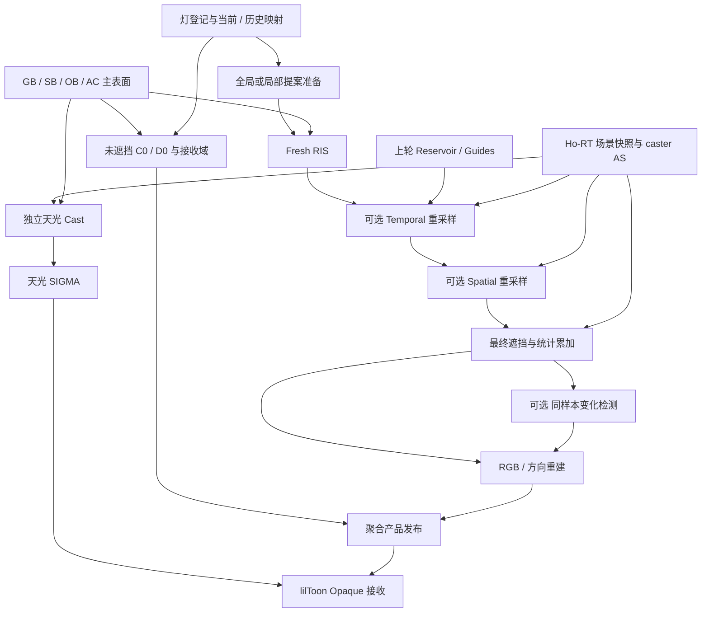

# Ho-RTShadow：无限灯光研究与长期架构规划

> 状态：**研究 / 规划，尚未实施**。研究日期：2026-10-31。
> 用户方向：**天光独立一路，其余请求灯聚合为一个产品**；停止继续扩展固定 4 灯材质接入，生产画面以已回退的主天光接收为基线。
> “无限灯光”表示不以少量固定灯槽限制可参与的灯集合，并允许用可控采样预算估计其聚合结果；不是无限内存、零灯表维护成本，也不是固定预算下任意场景都能无噪声。
> 本轮只研究、设计和建立验收路线，不启动 Runtime / Shader 改造，不修改用户场景或重新启用多灯接收。

## 阅读导航

- §1–3：决策摘要、现状与证据等级
- §4–5：业内实现与论文证据
- §6–8：产品信号、估计器与灯选择
- §9–10：双通道架构与动态历史
- §11–13：NPR 接收、重建、资源与支持域
- §14–16：分阶段研究、实验、验收与风险
- §17–18：启动入口、决策记录与参考文献

## 1. 已确定的产品方向

### 1.1 两个对外产品

```text
Ho-RT 公共场景 / AS / 材质可见性 / 表面与身份输入
                         |
             +-----------+-----------+
             |                       |
       主天光独立 Cast           其余请求灯集合
       光源内采样 / SIGMA        灯选择 / 光源内采样
             |                  固定预算遮挡查询
             |                       |
         SunCast              聚合信号与专用重建
             |                       |
             +-----------+-----------+
                         |
                lilToon / NPR 消费
              接收、分层、Ramp 与影色
```

“天光”在本规划中暂指独立指定的主方向光 / 太阳。整个天空环境的方向积分不自动等同于该 Cast，见后续支持域和研究分支。

“一整块”首先是产品和资源归属的一整块，不预先强制压成单张灰度图。内部允许保存遮挡前后 RGB、方向统计量、有效性和方差；是否全部发布取决于实际材质消费。

### 1.2 当前回退基线的精确含义

源码检查基准：仓库 `HEAD = 13a303126e7c8802cda4fa9a3c6b20518286ec14`，2026-10-31 工作区现场。

- `HoRTShadowSampling.hlsl` 当前只提供 `HoRTShadowTryMainVisibility` / `HoRTShadowTryMainCast`；固定 4 灯采样接口已撤回。
- `HoRTShadowRendererFeature` 仍存在 `Main / Declared / AllSupported` 请求枚举、逐灯 `Output`、稳定灯身份及逐灯产品发布。这些存量生产 / 诊断接口不等于材质已经接收所有灯。
- 主天光画面接收、逐灯原始查询能力、完整多灯产品三者必须分别描述，不能用某一项推定另外两项已经完成。
- 当前 `Output` 按 `(renderer, camera, light)` 分配，不能直接作为大量灯的持久全屏资源架构。
- 本地 NRD 头文件为 **4.17.3**；外部资料的新版本能力不能直接记为本地 pinned ABI 已支持。
- 工作区另有测试脚本、Bootstrap 和历史 R6 证据的未提交改动，本次不修改或整理。

本地主要入口：

| 入口 | 本规划关注点 |
| --- | --- |
| `Runtime/RTShadow/HoRTShadowRendererFeature.cs` | 逐相机调度、逐灯资源、主天光发布 |
| `Runtime/RTShadow/HoRTShadowProducts.cs` | 产品身份、有效性、RenderGraph 借用合同 |
| `Runtime/RTShadow/Shaders/HoRTShadow.raytrace` | 原始可见性、真实最近 blocker、光源内采样 |
| `Runtime/RTShadow/HoRTShadowSigmaContext.cs` | 当前独立灯 SIGMA 与历史失效 |
| `Runtime/RT/HoRTLightIdentity.cs` | 稳定灯生命周期身份 |
| `Runtime/RT/HoRTSharedData.cs` | 公共解析灯数据 ABI |
| `Runtime/RT/Shaders/HoRTNativeVisibility.hlsl` | 最近命中与仅遮挡查询的语义边界 |
| `Runtime/RTDI/Shaders/HoRTDIApplicationBridge.hlsl` | 现有 RTXDI bridge，可借鉴机制但不能沿用 PBR target |
| `Documentation~/Ho-RT.md` §6–7 | 逐灯与聚合、连续 V、NPR 和 DI 边界 |

## 2. 决策摘要

以下是基于本次调查提出的工程建议，不是已实现功能或已获实测保证：

1. **长期接口采用 `SunCast + OtherLightsCast`。** 主天光保留独立采样、连续 V、SIGMA 和 NPR 接收；其余灯按统一语义聚合，不继续建设固定数量的全屏逐灯材质槽。
2. **第一版聚合语义对齐当前 lilToon，而非重新定义物理材质。** 先重现附加灯 RGB 和未归一化方向累加，再决定聚合 Cast 如何影响各层 ramp。
3. **先有全灯参考，再有随机求和，再有 ReSTIR。** 用无历史、可独立复现的估计器证明能量、颜色、灯域正确；不能直接用“看起来平滑”的时空降噪结果证明算法成立。
4. **优先研究“精确未遮挡基线 + 随机阴影修正”。** 它和当前 raster / NPR 接收更接近，但仍需保留直接估计已遮挡信号的对照，不能预先认定前者在所有阴影域方差更低。
5. **RTXDI 作为采样数学与调度参考。** 抽取灯身份映射、RIS / ReSTIR、confidence 和诊断机制；不直接复用当前 RTDI 的 PBR target、最终 radiance 或其完整历史。
6. **聚合重建与单灯 SIGMA 分开立项。** 优先建立能重建 RGB 修正量及方向统计的简单参考，再评估 NRD 信号适配。多灯加权 SIGMA 只作为受限实验分支。
7. **“固定预算”必须统计所有射线。** 包括初始可见性、重用校正、最终可见性、confidence 和 fallback；不以“最终只发一条射线”掩盖额外追踪。
8. **大量动态灯、动态角色、无历史单帧是三个不同门槛。** 每项分别通过，不能用静止长历史结果替代。

### 2.1 本轮不会自动启动的工作

不恢复 4 灯扩展，不调整生产参数，不替换主天光算法，不升级 vendor SDK，不实现面灯 / 发光网格，不改动现有场景。后文阶段是未来实施顺序，不是当前正在执行的任务清单。

## 3. 研究方法与证据等级

资料核查时间为 **2026-10-31**。仅使用论文作者 / 出版机构、厂商官方文档和官方公开源码作为外部依据。

| 等级 | 本文含义 | 允许支持的结论 |
| --- | --- | --- |
| A：源码 / 正文 | 阅读了相关实现或论文方法章节 | 具体 pass、输入、偏差来源、资源和算法机制 |
| B：官方文档 | 厂商明确描述的行为、限制、配置 | 产品支持域和公开的工程设计 |
| C：摘要 / 项目页 | 核对作者、标题、日期和摘要 | 研究方向及其声称解决的问题；不推定代码可直接移植 |
| P：本项目提案 | 将证据映射到 Ho 管线后的设计 | 候选方案、实验预算和实施顺序；必须再验证 |

本次读到的外部版本：

- RTXDI 官方仓库 README 标为 **3.1.0**；检查的仓库快照为 `a6efab966b7c3b272da0461578eb56ac61c7cbff`，其 `Libraries/Rtxdi` 子模块为 `f12037fa8e97ebc08e9e3edfd2de528ed1772a4b`。[S01]
- NRD 官方 README 检查时标为 **4.18.0**，仓库快照 `8f12a22fc90e6a3c7f5da4c9c3103633c842963a`；本地仍为 **4.17.3**，不得混用能力与 ABI。[S06]
- MegaLights 同时检查 **UE 5.6 固定版本页**和访问时标题为 **UE 5.8** 的文档页，后者另以 `application_version=5.8` 核对。两者支持域不同，不把较早版本的限制写成永久事实，也不据文档页面推定某版本已部署到本项目。[S07]、[S08]
- Unity 参考使用 **HDRP 17.0 文档**；另读 Graphics `master` 的 `HDDiffuseShadowDenoiser.cs`，该源码只作机制参考，不冒充 HDRP 17.0 的同一源码快照。[S09]、[S10]

**证据范围：** 本次没有运行 RTXDI Sample、Unreal MegaLights、HDRP 或论文代码，没有做这些系统在本机的性能横评。引用性能数字若出现，只能属于原文设备与场景，不能作为 Ho 的预算承诺。本规划主要比较机制，不搬运跨项目毫秒数。

## 4. 业内实现：哪些可以借鉴

### 4.1 NVIDIA RTXDI / ReSTIR DI：最直接的采样骨架

官方接入将灯表与索引映射、候选采样、时间 / 空间重采样、最终遮挡与着色、confidence、降噪分开。实际阅读 FullSample 的 `GenerateInitialSamples.hlsl`、`TemporalResampling.hlsl`、`SpatialResampling.hlsl`、`ShadeSamples.hlsl` 和 `ComputeGradients.hlsl`：初始与重采样阶段保存的是带权灯样本，梯度阶段把同一个灯样本映射到另一帧再评价。最终着色还显式区分重用的 visibility 与本轮真实 visibility，避免把旧结果当新变化证据。[S01]、[S02]、[S03]、[S04]、[S05]

适合本项目：

- 从公共灯数据建立稳定身份 → 紧凑索引 → 前后帧映射；
- 用较便宜的候选评分把最终遮挡预算集中到重要灯；
- 用当前真实表面、灯数据及必要的可见性验证重用样本；
- 把“灯样本历史”和“最终图像历史”分开；
- 用相同样本的重新评价检测灯光变化，避免把随机噪声误当变化。

移植边界：RTXDI 的数学需要应用定义 target 与最终贡献。当前 Ho RTDI 的 Lambert / GGX target、背光剔除和 PBR radiance 不符合所有 NPR 受光规则。新通道应有自己的 bridge，而不是读取 RTDI 输出再乘一次 Cast。**公开资料也不保证任意带历史、截断和可见性重用的组合都无偏。**[S03]、[S04]

### 4.2 Unreal MegaLights：产品形态最接近

官方把 MegaLights 定义为随机直接照明：每像素固定数量射线，重要性选择灯，累积后统一重建。其范围同时涉及阴影和未遮挡灯光求值；文档强调 guide 仍需定期探索被遮挡的灯，灯越密集，重建越可能出现模糊、噪声或拖影。[S07]、[S08]

与本项目的对应关系：

| MegaLights 的公开经验 | Ho 的候选对应 |
| --- | --- |
| 局部灯统一处理 | `OtherLightsCast` 一个逻辑产品 |
| 固定像素采样预算 | 候选与真实遮挡预算独立设置 |
| 重要性 / 可见性 guide | 可见性仅改变提案，保留探索概率 |
| 累积照明统一重建 | RGB 修正量与方向统计重建 |
| AS 表示和裁剪决定阴影真值 | 原始 RT 结果必须先验证几何 / alpha / pose |

版本区别也支持主天光独立：5.6 页写方向光不支持；检查时的滚动页已有需手动启用的方向光路径，同时建议强太阳使用单独的 deferred / VSM 路径。**这支持“强主光与其余灯分预算”的工程选择，但不是本项目必须采用 VSM 的理由。**两版文档均说明 Forward Renderer 不兼容，因此不能把 MegaLights 当成一个可直接插入 lilToon Forward 的插件。

官方上述页面没有给出足以核实其具体 reservoir 实现的源码证据；本文不把 MegaLights 直接等同于 RTXDI / 某一版 ReSTIR。[S07]、[S08]

### 4.3 Unity HDRP：有限逐灯缓存的对照

HDRP 17.0 将 RT 阴影存入屏幕空间缓冲，配置每帧最多计算多少盏灯，超出部分使用 shadow map。单灯采样数增加也会增加执行成本。Graphics 的公开阴影滤波器可参考方向光 / 局部灯的距离和光源形状输入，但这仍是逐灯阴影思路。[S09]、[S10]

结论：texture array、atlas、有限槽位解决的是绑定与缓存组织；它们本身不会把逐灯追踪改成大量灯随机积分。HDRP 可作为有限灯正确性 / 美术质量对照，不作为无限灯路线的核心。

### 4.4 NRD SIGMA / RELAX：必须按信号选

NRD 将 SIGMA 定位为逐灯 shadow-only 降噪，将 RELAX 定位为适合 RTXDI 的 radiance 重建。官方也讨论多灯的加权归一化 shadow / pseudo-translucency 合并，但明确列出重叠阴影、半影权重和过滤偏差的困难，并建议强太阳等独立处理。[S06]

需要区分两个完全不同的“内存不随灯数增长”：

1. **逐灯无历史流式 SIGMA：** 共用临时资源，每灯仍各追踪和降噪，最后立即消费或累加；省存储，不省总逐灯工作。
2. **随机灯聚合：** 每像素只选少量灯追踪并重建聚合量；改变的是估计器，才可能降低主要像素遮挡成本。

本项目采第二条作为长期方向；第一条保留为中小灯数参考和画质上界。

### 4.5 AMD FidelityFX Shadow Denoiser：输入合同的反例

官方文档把 shadow denoiser 的目标输入限定为单光源抖动射线得到的 mask，典型预算不超过每像素一条；利用 tile 分类、运动 / 深度 / 法线和历史稳定结果。它提供很好的带宽、分类和历史钳制参考，但“都是阴影图”不代表能直接接受随机灯的加权 HDR 聚合量。[S11]

### 4.6 ReSTIR-Sampled Shadow Maps：跨后端研究分支

2025 论文选少数重要灯生成高质量 shadow map，其余用 imperfect shadow maps 保留近似遮挡。它针对的是阴影图生成预算，不是简单把未选中灯当无遮挡。[S20]

正文还把“给灯排名、决定哪些灯生成高质量图”和“像素最终着色”的 ReSTIR 分开；直接合并会让排名与着色互相影响，产生闪烁。这提醒后续混合后端 / 自学习 guide：提案统计和最终质量切换要有明确的帧快照与更新策略，不能构成未受控的反馈环。

适合后续缺少硬件 RT 或某些几何更适合 raster 的混合路径研究；当前优先使用已有 native RT。采样器和遮挡后端应可分离，但暂不承诺低质量 shadow map 的误差能靠 Monte Carlo 自动消失。

## 5. 论文脉络与选择

| 文献 / 年份 | 阅读深度 | 本项目获得的设计依据 | 暂不引入的复杂度 |
| --- | --- | --- | --- |
| Lightcuts，2005 [S12] | C | 灯树与误差 / 成本权衡是长期候选 | 不先建设复杂动态误差界 |
| ReSTIR DI，2020 [S13] | C，官方摘要与工程资料交叉核查 | 对灯集合求和可通过重要性重采样和时空重用估计 | 原论文展示不等于 Unity / NPR 无偏保证 |
| Rearchitecting ReSTIR，2021 [S14] | A，相关方法章节 | 预采样、内存一致性、复用与最终着色解耦、质量预算 | 可见性复用的偏差不能省略不报 |
| ReGIR，2021 [S15] | C，结合 SDK 接口 | 世界空间 grid 可改善初始候选的局部性 | 网格维护、内存、边界和漏采风险 |
| GRIS，2022 [S16] | A，相关理论章节 | 重用造成相关性；需要正确权重及满足条件的 fresh / canonical 样本 | 不把 M 当独立样本数，不无条件声称收敛 |
| Spatiotemporal Blue Noise Masks，2022 [S17] | C | fresh 样本序列与重建友好性是独立研究轴 | 蓝噪声不能修复错误 PDF 或重用权重 |
| A Gentle Introduction to ReSTIR，2023 [S18] | B，课程入口与资源 | 统一团队对 RIS、reservoir、重用和偏差的术语 | 课程不是 SDK 版本合同 |
| ReSTIR MCMC，2024 [S19] | C | 重用相关斑块、重复样本与 sample impoverishment 值得单独测 | 仅在基础实现证明相关性是瓶颈后再试 mutation |
| ReSTIR-Sampled Shadow Maps，2025 [S20] | A，相关方法章节 | 阴影后端可按重要性分预算；低质量后端误差独立存在 | 不把它作为首版 native RT 的依赖 |
| Area ReSTIR，2024 [S21] | C | 光选择、光源内采样和像素 / 镜头采样是不同积分维度 | 首版不扩成完整 film / lens reservoir |
| Stochastic Pairwise MIS，2026 [S22] | C | 大范围邻域重用与 disocclusion 是后续改进轴 | 不在第一版自改 MIS 推导 |
| Compatibility-Guided Neighbor Selection，2026 [S23] | C | 邻居的样本兼容性会影响误差和相关性 | 不只凭深度 / 法线相近就假定灯域兼容 |

原始 ReSTIR、ReGIR 等部分 PDF 抓取未完整成功；本文相应项仅按已读官方项目页 / 摘要及 SDK 资料定级，不声称阅读全文。GRIS、2021 工程化论文、2025 阴影图论文已取得完整 PDF 并检查相关方法章节。2026 两项只作为研究清单，不列为首版依赖。

## 6. 首先定义要估计什么

### 6.1 灯域、投影接收与照明链接分开

令 `Lother` 为被本产品处理的灯集合，显式排除 `SunLightId`。每个表面点 x、每灯 i 定义：

- `C_i(x)`：沿用既定 NPR 灯评价规则的未遮挡 RGB 基础贡献；通常包含灯颜色、强度、距离 / 聚光衰减，不包含主纹理、toon ramp 或最终 beauty。
- `d_i(x)`：指向该灯的方向；有限光源时来自具体光源样本。
- `r_i(x)`：该接收对象是否接收此灯 RT Cast，0 或 1。
- `s_i`：该灯的阴影强度。
- `V_i(x)`：原始 0/1 遮挡或按明确 measure 积分的光源可见度。
- `T_i(x) = 1 - r_i(x) s_i [1 - V_i(x)]`：最终 Cast 保留量。

照明 linking 决定 `C_i` 是否存在；阴影接收 `r_i=0` 表示该灯仍照亮对象，只是不接收本产品的阴影。不能把两者混用。

若某灯类型、cookie、linking 或几何不受支持，必须预先路由到显式 fallback / 排除域。**“未抽中”不是“不支持”，不能 fallback 成无遮挡；“无有效接收面”也不是合法的零照明。**

### 6.2 推荐保留的聚合量

```text
C0(x) = Σ C_i(x)                       未遮挡 RGB
ΔC(x) = Σ C_i(x) r_i(x) s_i [1 - V_i]  阴影损失 RGB
Cv(x) = C0(x) - ΔC(x)                  应用 Cast 后 RGB

b(C)  = (C.r + C.g + C.b) / 3          当前 lilToon 方向权重约定
D0(x) = Σ b(C_i) d_i
ΔD(x) = Σ b(C_i) d_i r_i s_i [1 - V_i]
Dv(x) = D0(x) - ΔD(x)                  未归一化方向一阶量
```

`b` 暂按当前 `lilGetAdditionalLights` 的 RGB 均值复现；若以后改用 luminance，必须作为受光外观变更单独验收。`D` 是带符号向量，不是法线、单位向量或 RGB；必须保持相消关系，零长度时在消费端采用显式回退。

`GroupCastRGB = Cv / C0` 只在对应 RGB 分量分母有效时才有定义。零照明分量另发有效性，不使用一个 epsilon 除法伪造可见度。可另提供按已声明标量权重求得的 `GroupCastScalar` 给美术驱动，但不得把它当成 RGB 等价的全部灯阴影。

这里的 `C0 / Cv` 是 **NPR 基础灯统计**，不是任意 BRDF 的 irradiance，更不是当前 RTDI 的完整直接光 radiance。

### 6.3 为什么聚合产品仍可保留分层控制

若某层只给整个灯组共同的接收系数 `k`，则：

```text
C_layer = C0 - k * ΔC
D_layer = D0 - k * ΔD
```

这允许层与层共享原始产品，并各自控制整组阴影接收。材质仍负责把选定的信号与自身明暗坐标组合后执行 ramp。

但以下需求无法从一对聚合量精确恢复：

- 每一层对每一盏灯使用不同的独立权重；
- 任意查询某盏灯的 Cast，或删去单灯后重组；
- 任意 BRDF / 法线变化后的完整 per-light 积分；
- 不保留对应方向矩却要精确恢复受光方向。

如未来确实需要，增加少量有明确定义的统计基 / 灯组，或离线逐灯 AOV；不悄悄退回“所有灯全屏存一份”。

### 6.4 需要明确冻结的两种 NPR 语义

**A. 聚合后执行现有 toon 流程：** 先估计 `Cv / Dv` 或组 Cast，再进入现有 ramp。最贴合当前附加灯先累加的结构，建议作为首版。

**B. 每灯各自执行完整 toon 响应，再求和：** 定义了不同的着色模型。对于 delta 灯，可在抽中灯时评价完整单灯响应；对于先求有限光源平均 V 再执行非线性 ramp，会出现嵌套估计问题，不能把单次 0/1 遮挡的 ramp 平均当作 `ramp(E[V])`。

一般 `E[F(X)] ≠ F(E[X])`。因此 raw 统计估计器的无偏性不自动传递给最终 toon 颜色；窄 ramp 放大噪声也不能只靠后置滤波掩盖。

## 7. 估计器：从正确参考逐步走向固定预算

### 7.1 三种必须保留的对照

| 路径 | 计算内容 | 适合用途 |
| --- | --- | --- |
| 全灯枚举参考 | 每个有效灯 / 光源样本真实追踪后累加 | 正确性、统计期望、颜色与方向基准 |
| 直接估计 `Cv / Dv` | 从灯域随机抽样，贡献除以完整 proposal | 固定预算聚合照明 / 遮挡对照 |
| 精确 `C0 / D0` + 估计 `ΔC / ΔD` | 保留便宜的无阴影求和，只随机查询遮挡损失 | 与现有 NPR 接入最直接的首选候选 |

第三条是控制变量式重组的候选：完全无遮挡时，每条准确射线都得到零损失，基线可以保持无随机阴影修正噪声；完全本影时却不一定比直接估计 `Cv` 更好，后者每次可直接得到零。必须用相同总预算实测，不能把一条路径宣称为全面优越。

### 7.2 独立重要性采样参考

先只考虑 delta 灯。定义目标向量 `g_i` 为 `C_i T_i` 或 `C_i r_i s_i (1-V_i)`。从已知离散概率 `p_i > 0` 抽 K 个独立灯：

```text
I_hat = (1/K) Σ_k g_i(k) / p_i(k)
```

在采样支持域覆盖所有非零贡献、权重和有效性正确的条件下，该形式用于建立无偏 raw 参考。灯数上升影响方差及采样结构成本，不要求每像素访问所有灯才能做一次遮挡估计。[S13]、[S16]、[S24]

光照域外的灯若已确定 `C_i=0`，可以合法贡献零；追踪失败、表面失配或射线过短则是查询无效，不能混成 `V=0 / 1`。遇到无效查询时应标记产品 / 像素不可用或使用预先定义的完整 fallback。若选择重新抽样，必须核对实际条件分布与权重；不能丢掉失败样本后仍沿用旧 PDF。

有限光源时，采样对象扩展为 `y = (LightId, emitterUV / direction)`：

```text
q(y) = p(light) * p(sample | light)
```

离散灯概率、面积 / 立体角 measure、几何变换 Jacobian 和 delta 灯规则需要写入合同；不能把两个不同 measure 的 PDF 直接相加。现有方向光“对灯盘角域平均 V”的约定与完整 radiance 加权积分也必须区分。

### 7.3 RIS 的最小可审查形式

对 M 个独立候选 `y_j ~ q`，给定非负、可不归一化的 target `τ(y)`：

```text
w_j = τ(y_j) / q(y_j)
S   = Σ_j w_j
按 w_j / S 选择一个 y*
I_hat = g(y*) * S / [M * τ(y*)]
```

这是独立 fresh RIS 参考，不是可直接套到任意历史合并的最终公式。target 必须覆盖 `g` 的非零域；无有效候选、零 target、NaN 和无效光源都要有显式状态。不能把 reservoir 选中概率误当成最初的灯 proposal，也不能选灯后直接输出它的 V 或颜色而丢掉权重。[S03]、[S16]

### 7.4 ReSTIR 增加的是重用机制和证明义务

- 合并邻居 / 历史 reservoir 前，在目标表面重新评价 target 和资格；
- 使用匹配 SDK / GRIS 推导的归一化及 bias correction，不自行把 `M` 相加后平均；
- 保留非零 fresh / canonical 预算，测量样本重复与相关性；
- 初始、时间、空间、校正阶段必须使用同一 target 定义与匹配数据；
- 旧灯索引通过身份映射；灯删除或类型改变不能继承旧样本；
- 可见性重用、历史 M 截断、boiling filter、clamping 均作为显式质量 / 偏差策略单独开关。

GRIS 特别指出相关样本下的收敛需要条件，不能把 reservoir 中的大 `M` 解释成等量独立射线。新实现的声称分三级：独立 raw 参考的统计正确性、特定重用配置的偏差验证、最终过滤外观；分别报告。[S14]、[S16]

### 7.5 有限预算值不一定处于物理区间

对 RGB 重要性加权，有限样本可能出现 `ΔC_hat > C0`、`Cv_hat < 0` 或比值超出 `[0,1]`；两个随机量的比值通常也有有限样本偏差。不能在 raw 累加时直接 `saturate` 再声称仍是原估计器。

候选处理：

1. raw FP32 保留真实估计与越界计数，供收敛验收；
2. 先重建加法统计量，再生成消费信号；
3. 对显示端必要的限幅明确记录其偏差，单独测能量 / 颜色；
4. 同时研究以标量权重精确归一化、RGB 分层或共享样本等减方差策略，不能假定单个 proposal 能同时匹配所有 RGB 分量和有符号方向量。

## 8. 灯选择与预算：分阶段而非一次上满

| 提案 | 构建 / 更新 | 每次抽样 | 优点 | 主要风险 | 定位 |
| --- | --- | --- | --- | --- | --- |
| Uniform | 简单灯数组 | 近似 O(1) | 最易验证、无功率盲区 | 强弱差距大时方差高 | 必须保留的基线 |
| Power CDF | 全局 / 增量更新，简单实现 O(L) | O(log L) | 实现与 PDF 易审查 | 全局强灯不一定局部重要 | 第一版候选 |
| Alias table | 通常 O(L) 重建 | O(1) | 抽样便宜 | 高频变灯时维护成本 | 与 CDF 做总成本对照 |
| Tile / cluster proposal | 空间列表 / 分布 | 取决于局部结构 | 剔除局部无影响灯 | 列表溢出、边界、被截断灯丢支持域 | 进阶候选 |
| ReGIR | 世界 grid 中预采样 | 读取少量局部代表 | 改善多房间 / 局部性 | 网格内存、空域浪费、动态更新、fallback PDF | 后续扩展 [S15] |
| 灯树 / Lightcuts 类 | 灯层级构建 / refit | 层级遍历 | 适合大规模空间 / 功率差异 | 动态维护、错误近似界 | 长期对照 [S12] |
| 可见性引导 | 从历史 / 探针学习 | 读取 guide | 少采明显无贡献灯 | 新可见灯饥饿、旧遮挡过期 | 最后增加 |

首版建议从 Uniform + Power CDF 对照开始；为数千至更多灯的目标保留替换提案结构的接口，但不预先把 ReGIR 设为必需依赖。

### 8.1 Target 需要同时考虑 RGB 与方向

初版 target 可基于本产品的 `C_i` 强度，并用保守近似提高局部性；方向量若需要独立保证精度，可以采用多统计量的联合评分或分层预算。不得照搬 PBR 中的 `max(N·L,0)`，因为当前 NPR 灯颜色累加并不保证在该域外为零。

对可见性引导，使用可审查的混合提案：

```text
p = (1 - ε) * p_guided + ε * p_exploration
```

`ε` 不在研究阶段拍成生产常数；先扫描并测量弱灯、解遮挡和新灯的发现延迟。探索分布必须覆盖整个有效域，最终权重使用实际混合概率，不能只用被选中的分支概率。

### 8.2 “有界预算”与“完全不随灯数增长”分开

```text
总成本 =
  AS / pose / 材质准备
  + 灯登记与变化收集
  + 提案构建 / 更新
  + 表面与接收域准备
  + 未遮挡基线求和（若选用）
  + fresh 候选与重用
  + 所有类别的真实射线
  + confidence / RGB 与方向重建
  + 材质消费
```

精确 `C0 / D0` 若仍循环每像素全部相关灯，则保留相应 O(局部灯数) 算术成本；采样阴影只消除了主要逐灯可见性成本。后续若连无遮挡求值也采样，就更接近完整 sampled lighting，必须重新处理基线噪声、材质接入和产品边界。

不以“把总射线数固定”推导整帧成本 O(1)。场景总灯数、单像素有效灯数、灯域变化率、AS 复杂度和输出分辨率分别记录。

2021 工程化论文还观察到固定数量的随机灯读取依然可能因 cache / 内存访问模式而有很不同的成本，因此研究了共享的预采样灯子集，把部分非一致访问移出像素内循环。本项目后续需要同时测 global random gather、tile 共享预采样和相关性；论文中的 subset 尺寸不是 Ho 的默认参数。[S14]

## 9. 双通道运行架构

### 9.1 所有权与建议模块

以下名称均为拟议职责，不要求一一新增同名 Feature：

| 模块 | 所有者 / 生命周期 | 主要职责 |
| --- | --- | --- |
| 公共灯登记 / 快照 | Ho-RT 公共数据层 | 稳定身份、参数变化、当前灯表；共享数据而非共享全部算法状态 |
| `SunShadowContext` | renderer + camera + 独立天光 | 复用当前主光 raw / SIGMA / 接收合同 |
| `OtherLightsContext` | renderer + camera + 灯域 / 产品语义 | 固定数量 reservoir、聚合统计、重建历史、诊断 |
| Light proposal service | 数据可共享，视图选择按需隔离 | Uniform、CDF / alias、未来 cluster / ReGIR |
| Receiver domain service | 接收声明与 OB / AC 身份 | 照明资格和 Cast 接收资格分开评价 |
| Visibility backend | Ho-RT 按请求借用 | native RT、alpha 与 caster 策略；未来可研究 shadow-map 后端 |
| NPR signal evaluator | RTShadow 的明确适配层 | 评价 `C / D / target`，不执行最终材质 ramp |
| Material consumer | lilToon | 按对象与有效性读取、应用层接收、执行 ramp 与材质颜色 |

同一个 Light 只属于其中一条主路径。Sun 的选择、消失、替换和类型变化必须同步更新 other 域，不能同时计入，也不能在身份切换的一帧遗漏。

### 9.2 RenderGraph 候选帧序



图中 Temporal / Spatial 到 AS 的依赖只在所选校正策略确实追踪时存在；实际 graph 要精确声明，不能用全局绑定代替依赖。

生产时序延续已有 **表面输入准备完成 → RTShadow → opaque NPR** 合同。RenderGraph 的资源借用仅对当前 camera / render request 有效，跨帧只保留由 context 拥有的历史资源。compatibility 路径若未来支持，必须实现同一数学与产品合同，不能只是绑定上一轮全局纹理。

### 9.3 和 RTDI / RTGI 的边界

可共享：

- 灯数据的来源、色彩空间 / 温度转换、稳定身份与参数快照；
- 中立的 emitter 采样工具和概率 measure 定义；
- 场景 / AS 借用、alpha 判定、材质和 pose 输入合同；
- 经过独立抽离验证的 reservoir 工具、随机序列工具。

不能默认共享：

- PBR 与 NPR 的 target、最终贡献、receiver 域；
- reservoir 历史、图像历史及 reset 条件；
- 当前主相机 Cast 和次级反射 / GI 表面的可见性；
- 一个效果专用的 geometry policy、材料排除或 trace distance。

公共 host 的“共享”不要求所有效果共用同一 caster 集合。RTShadow 继续请求 ShadowCasters 策略，GI / 反射保留自己的世界几何请求。

### 9.4 接收资格的规模化

现状按每灯生成 2048 个 uint 的 receiver bitset，适合逐灯请求，不能在 L 很大时继续逐灯重复扫描全部组件。

候选重组：

1. 每次声明变化时编译对象 / 部件的 receiver policy；
2. 常见 `receiveAllLights` 使用共享默认策略；
3. 显式灯列表保存稀疏 ID 集合或经过验证的索引结构；
4. 在 fresh 候选、重用目标和最终评价时使用同一资格规则；
5. 把 policy revision 纳入对应产品域，不因无关对象变化重置所有相机。

邻居拥有同样法线和深度，也可能使用不同灯链接或阴影接收策略；兼容性判断必须考虑 policy，不能跨对象无条件搬运统计。

## 10. 历史、动态世界与响应

### 10.1 至少区分四类状态

| 状态 | 保存的东西 | 常见失效原因 |
| --- | --- | --- |
| 灯 / proposal 状态 | 当前灯、前灯、映射、概率结构 | 增删、类型 / 形状、位置 / 功率、采样域 |
| Reservoir 历史 | 所选样本、权重、target、M、可见性年龄 | 无重投影对应、域不匹配、无法正确评价历史 |
| 图像重建历史 | RGB / 方向、moments、history length | disocclusion、灯光变化、材质信号变化 |
| Confidence 历史 | 经短时稳定的变化证据 | 采样域变化、重建重启或变化事件 |

Reservoir M、图像历史长度、可见性 cache age 是三种不同量，Inspector / 报告不得共用“历史帧数”一个名字。

### 10.2 动态失效矩阵

| 变化 | 立即要求 | 首版保守行为 | 后续优化方向 |
| --- | --- | --- | --- |
| 灯数组重排 | 正确 ID 映射 | 保留可映射样本 | 无需全清 |
| 灯增删 / Sun 切换 | 域与 proposal 同步，删除样本失效 | 相关域重启 | 局部域更新与 confidence |
| 灯改色 / 改强度 | 用当前参数重评分、响应 | 相关历史重启 | 同样本梯度 |
| 灯移动 / 形状变化 | 重建 emitter 样本和 PDF | 重启相关流 | 经过推导的 sample 映射 |
| caster transform / pose | 当前 AS 更新、旧遮挡过期 | 拒绝不安全历史 | 变化验证与局部置信度 |
| Cutout alpha / UV 变化 | 与 ray material 同步 | 材质域重启 | 明确的旧材质快照合同 |
| receiver policy 变化 | 新资格立即生效 | 对应产品域重启 | 细粒度失效 |
| 相机移动 | 对应表面重投影 | 未验证 motion 时清历史 | 完整 jitter / motion / guides 合同 |
| 蒙皮接收面运动 | 当前和上帧真实表面对应 | 清历史 | 可信的前姿态 / motion |
| 分辨率、投影、相机切换 | 上下文 / 资源正确 | 重建 / 隔离 | 经验证的重采样 |
| trace policy / 产品语义变化 | 不能复用旧量 | 全部相关历史清理 | 无需强行保留 |

当前主天光 SIGMA 将 motion 置零，并对相机矩阵或相关 revision 变化保守 reset；该实现不等于已经具备多灯动态角色的重投影条件。必须先完善表面对应，再讨论长历史收益。

### 10.3 当前 AS 不等于上一帧 AS

严格时间校正可能需要旧表面、旧灯、旧可见性，甚至旧 alpha / UV / pose。SDK 文档明确说明，错误的旧数据会造成动态场景偏差。[S03]

本地公共 host 目前主要借用当前冻结场景。可选择：

- **首版：** 世界相关变化时拒绝时间重用，保留 fresh / 空间路径；
- **工程近似：** 用当前世界验证旧样本，明确承认与严格旧世界评价不同，量化偏差；
- **严格研究：** 设计旧场景快照或满足推导条件的重用方式，另算内存和 AS 成本。

只在最终阶段重新追一条当前射线，不能自动证明此前时间合并使用了正确概率。不能用 confidence 把错误权重“修复”为无偏。

### 10.4 Confidence 的正确比较对象

不直接以相邻两帧独立随机 RGB 的差值判断灯光变化。优先用稳定身份和 emitter UV 对应的同一代表样本，在匹配的表面 / 灯 / 世界条件下重新评价；没法恢复所需旧条件时，降低置信度或清理相关历史。[S04]、[S05]

强度突变、新可见灯、快速小遮挡物、细发片分别测量。为了减少拖影而缩短历史可能增加噪声；二者的交换需以响应时间曲线展示，不只看静止截图。

## 11. 聚合重建路线

### 11.1 建议顺序

| 候选 | 输入与性质 | 决策 |
| --- | --- | --- |
| 无历史多样本 raw | FP32 聚合统计 | 必须先成立的参考 |
| 简单 edge-aware / variance-guided 重建 | 明确的 `ΔC / ΔD` 或 `Cv / Dv` | 首个可审计原型；raw 保留 |
| 专门的 temporal + spatial 聚合滤波 | 对象 / 深度 / 法线 / policy guides | 在 motion 合同成立后评价 |
| NRD RELAX / REBLUR 信号适配 | 需证明输入满足目标 denoiser 定义 | 候选，不因已有 NRD 就直接使用 |
| SIGMA 多灯 pseudo-translucency | `Cv/C0` 与有效半影输入 | 独立受限实验 |
| 逐灯无历史 SIGMA 后流式汇总 | 每灯满足单灯输入 | 参考质量路径，计算量仍随灯数增长 |

重建器不是采样器的替代。候选灯漏采、错误 receiver、错误几何或 PDF，不能交给降噪补齐。

### 11.2 三个特别容易误用的地方

**随机切换灯的 blocker 距离不能直接作为单灯 SIGMA 的连续输入。** 不同灯方向、大小和半影域不同；“最近 blocker”也不能在跨灯求 min 后假装具有统一光源的几何意义。[S06]

**RGB 和有符号方向量不是同一种信号。** `ΔD` 含负分量和相消，不能当作非负 radiance 塞进 RELAX。候选是共用几何权重的专用向量滤波、正负拆分，或定义低阶方向基并单独验证；每条路线都需算带宽和角度误差。

**先求比值再滤波不等于先滤分子 / 分母再求比值。** 优先保留加法统计 raw，分别记录所用操作顺序；`C0` 近零的区域必须显式无效，不把任意 clamp 当物理结果。

### 11.3 NPR 的额外质量门槛

- 在原始 `Cv / ΔC` 数值域和最终 ramp 域都验证；
- 测试窄阈值、三层阴影色、阴影接收 mask、背光和自定义 shading normal；
- 滤波不得跨 owner、深度、mesh normal 或不兼容接收域搬运；
- 不将当前存在的自相交、曲面面片感、alpha 几何问题记为多灯采样已经解决；
- 输出 `raw / reconstructed / final-ramp` 三套图和剖面，定位问题在哪一层；
- 若相消后 `Dv` 接近零，方向角本身不稳定，应降低该角度指标权重并验证显式回退；
- 首版只替换明确的附加灯贡献入口，不对最终 beauty 做总乘法。

### 11.4 材质入口的具体迁移点

检查的 lilToon 文件是相邻仓库 `Assets/lilToon/Shader/Includes/lil_common_macro.hlsl`，不是只读 RTShadow Feature 就推定材质已经支持。

| 现有位置 | 现在的职责 | 聚合接入要验证的行为 |
| --- | --- | --- |
| `lilGetAdditionalLights` | 累加灯 RGB 与颜色均值加权方向 | 使用匹配的 `Cv / Dv`，不再额外跑被替换域求和 |
| `lilGetAdditionalLightHDR` | HDR 附加灯 RGB | 使用聚合 RGB；材质 albedo / 强度仍在原位置应用 |
| `LIL_USE_ADDITIONALLIGHT_MAINDIR_PS` | PS 中把附加灯并入主方向 / 颜色 | 聚合统计在 pixel domain 消费，主天光只计一次 |
| `LIL_APPLY_ADDITIONALLIGHT_TO_MAIN` 等 VS 分支 | 顶点级累加后插值 | 屏幕空间 Cast 不能仅在 VS 读取；需显式迁到 PS 或保留已说明的兼容模式 |
| `lil_common_frag.hlsl` 的 receive / ramp | 分层阈值、Mask 与影色 | 证明组级共同接收符合合同，不能默认为逐灯 ramp |

这里不是增加一个全局 RGB texture 读取就结束。尤其 VS 与 PS 的旧光照路径若同时运行，会把相同灯算两次，或让屏幕阴影无法正确影响方向。M0 必须逐模式追踪，M5 再逐模式接入。

## 12. 产品合同与资源预算

### 12.1 拟议产品元数据

```text
OtherLightsProduct
  Camera / Renderer / RenderSerial / SurfaceDomain
  SunLightIdExcluded
  LightDomainRevision / ReceiverPolicyRevision
  SceneLifetime / GeometryRevision / MaterialPolicySignature
  SignalSemanticVersion / SamplingMeasureVersion
  Width / Height / ResolutionScale
  EstimatorMode / ProposalMode / ReconstructionMode
  CandidateCount / FinalVisibilityBudget / ActualRayCounts
  RawSignalHandles / ReconstructedSignalHandles / ValidityHandle
  OptionalUnshadowedRGB / OptionalDirectionMoments / Diagnostics
```

名字是设计示意，不是已冻结 ABI。最小发布集由消费试验决定；内部 state 不能为了“只要两张输出”就被省略。

建议有效状态至少能区分 `Available`、`NoEligibleLights`、`NoReceiver`、`UnsupportedSurface`、`MissingInputs`、`UnavailableBackend`、`BudgetFallback`。集合为空可有合法零贡献；表面不匹配不能借用邻居的零值或上一相机结果。

### 12.2 灯身份与存储

- CPU 稳定 ID 沿用 `HoRTLightIdentity`，GPU 使用有校验的紧凑索引 / generation 映射；不要把 64 位身份塞入 float。
- reservoir 里存 light sample 和重采样权重，不为每灯持久保存一张全屏纹理。
- 当前 / 历史灯表、前后映射、proposal 及 alias / CDF 均按需增长，有容量与溢出诊断。
- 采样器不能只能从 URP 已上传的少量 additional-light 索引取灯；灯域应来自公共 registry / snapshot，材质消费聚合产品。
- Unity 6.0 官方文档对普通 Forward 列出逐对象 / 逐相机灯数限制，并将更多灯的需求指向 Forward+ / Deferred。即便更换 raster 路径，仍需核对本项目实际配置和 buffer 容量；本规划不把“用了 Forward+”等同于灯域已经无限。[S25]、[S26]
- `Object.FindObjectsByType<Light>` 可用于对照原型，长期高频全场枚举应改为登记与 dirty 更新；真实 Unity Light 组件管理成本和 GPU 程序化灯表成本分别统计。

### 12.3 容量估算，不是目标分配清单

本地 `RTXDI_PackedDIReservoir` 有 6 个 32-bit 字段，基础 stride **24 B**。若原型保留三份全屏 reservoir，则仅这一项为 `24 × 3 × pixelCount`。GPU ABI、分块 padding、额外字段和实际 buffer 数仍需在实现时重新核对。

| 独立估算项 | 每像素字节 | 1920×1080 | 3840×2160 |
| --- | ---: | ---: | ---: |
| 三份 24 B reservoir | 72 | 142.38 MiB | 569.53 MiB |
| 两张 RGBA16F 统计图，各含当前 / 历史一份 | 32 | 63.28 MiB | 253.13 MiB |
| 一份当前共享 primary-history ABI 的参考量 | 20 | 39.55 MiB | 158.20 MiB |
| 一张 RGBA16F 输出 | 8 | 15.82 MiB | 63.28 MiB |
| 一张 RGBA32F raw | 16 | 31.64 MiB | 126.56 MiB |

表格各行只是独立项，**不能无条件相加当成最终总额**；实际可能共享、别名、按需分配或需更多 ping-pong、moments 和 guides。半宽半高资源像素数为四分之一，但降采样 / 升采样的表面关联与薄影质量必须额外验证。

公共解析灯当前 payload 为 4 个 Vector4，即 64 B；100 万条仅当前 payload 就约 **61.04 MiB**，还不含上一轮、ID、索引映射和 proposal。由此再次明确：“灯数不增加全屏阴影纹理数”不等于内存完全不随 L 增长。

### 12.4 资源生命周期

- 每 renderer / camera 单独保有聚合状态，避免 SceneView / GameView 交替污染；
- 同相机同帧重复渲染使用独立 render serial 与明确采样序列，不只依赖 `Time.frameCount`；
- Resize、禁用、Feature 重建与中途 retire 继续遵守公共 GPU fence；
- 关闭 other 通道时不准备其 reservoir / proposal / 图像历史；
- GPU 峰值和持久 / transient 资源分别记录，不只报告最终输出纹理大小。

## 13. 首版支持域与长期扩展

| 维度 | 第一个可实施闭环 | 长期研究，不作首版承诺 |
| --- | --- | --- |
| 天光 | 当前独立方向光、既有角域与 SIGMA | 与环境天空 / 月光选择的完整产品定义 |
| Other 灯 | delta point / spot；经验证的额外 directional 另列子域 | 面积 rect / disk、纹理 emitter、发光网格 |
| 灯集合 | 显式登记的受支持 realtime 灯，Sun 唯一排除 | 大规模 GPU 程序化灯 |
| 颜色 / 强度 | 复现既定 Linear / Gamma 与色温规则 | 广域光谱或负光等非当前合同 |
| 遮挡 | 现有 native RT 支持的 opaque / 基础 Cutout | 透射、彩色阴影、任意材质 any-hit |
| 接收面 | 当前主表面身份正确的 opaque / 已支持 Cutout 域 | 多层透明、毛发专用表面、多次散射 |
| 摄像机 | 当前支持的 Mono、全视口、单采样 | XR、MSAA、多视口和透明层 |
| 动态 | 先正确 fresh / 保守 reset | 可信 motion 后的高效长历史 |
| 运行平台 | 当前 D3D12 native RT | shadow map / software backend |
| 渲染路径 | 先 RenderGraph | 有实际需求后再支持等价 compatibility |
| NPR | 当前颜色 / 方向聚合后的材质流程 | 完整逐灯 toon、多 BRDF 高光 |

有限光源一旦加入，必须同时解决形状 / 权重、光源内抽样、可见性与 NPR “整灯平均 V”的定义。增加一个 radius 参数不能代表这些工作已经完成。

天空环境若以后加入，建议定义独立的环境采样域 / 产品：环境方向 PDF 与太阳灯可能重叠，需要明确能量归属；不会因本规划用了“天光”一词就自动包含 IBL、AO、GI 或所有发光网格。

## 14. 分阶段研究与实施路线

### M0：冻结基线和信号合同

交付：

- 当前主天光 raw / SIGMA / NPR 的可复现基准与源码 SHA；
- 当前附加灯 RGB / 方向和各模式的入口追踪；
- `C0 / Cv / ΔC / D0 / Dv / ΔD` 的单位、权重、接收与有效性定义；
- Sun 与 other 的唯一灯域拆分，以及显式 unsupported / fallback 列表。

Gate：零 other 灯时不影响当前画面；所有灯无遮挡 / 全遮挡 / receiver 不接收的精确小场景符合定义。若信号合同仍有歧义，停在 M0，不开始 ReSTIR。

### M1：全灯聚合参考

交付：

- 不接生产 beauty 的独立 debug / validation 路径；
- delta 灯逐灯真实遮挡求和，与现有 CPU 解析 / 小场景 GPU 参考交叉核对；
- RGB 和方向同时输出；有限光源另以高 spp 参考验收；
- source-of-truth 的全灯和 per-light AOV，仅供参考 / 调试。

Gate：主天光不重复计入；两盏不同颜色 / 方向灯被分别遮挡时 RGB 与方向均正确；灯重排结果不变；不同 receiver 域不串灯。资源暂时可慢，但不把慢参考当生产方案。

### M2：无历史随机聚合

交付：

- Uniform / Power，直接 `Cv` 与阴影损失 `ΔC` 两条估计器；
- 正确联合 PDF、独立 fresh RIS，预算和随机种子可复现；
- raw 统计、越界 / 非有限值与每类实际射线计数；
- 相同像素 / 场景的独立种子均值、方差与收敛图。

Gate：期望正确性通过；扩大候选 / 最终样本预算能解释误差变化；完全无遮挡 / 本影 / 强弱和彩灯案例有明确优劣。若仍存在系统性能量漂移，不进入历史阶段。

### M3：有限空间重用与首个聚合重建

交付：

- 正确目标再评价和兼容性判断；
- 独立 raw / spatial-only / reconstructed 消融；
- 不依赖历史的产品消费试验，验证颜色、方向和窄 ramp。

Gate：空间重用不造成 owner / policy 跨域污染；相同真实射线预算下优于或清楚解释不优于 M2；过滤偏差单独登记。暂不把 SIGMA 多灯适配设为通过条件。

### M4：动态时间重用

交付：

- 表面 motion / jitter / 相机与旧灯数据合同；
- 世界变化时的明确保守路径；
- reservoir / 图像 / confidence 分离的状态机；
- 灯增删、运动遮挡、蒙皮接收面、多相机隔离场景。

Gate：不存在旧灯索引复活、旧遮挡永久保留和相机串历史；严格配置与近似配置分别报告偏差 / 响应；静止长历史不能替代动态 gate。

### M5：lilToon 正式接收和美术闭环

交付：

- `SunCast + OtherLightsCast` 两个正式产品，others 替换既定的附加灯输入；
- aggregate 读取失败时，对整个被替换域执行明确 fallback，避免部分重复；
- 颜色、方向、共同层接收、Mask / Ramp、HDR 附加光模式的实际材质验证；
- AOV / debug 可看到 raw 与重建差异，不能只有最终 beauty。

Gate：灯光只应用一次；未由该域处理的 legacy 灯保留明确路径；各层控制符合 M0，方向在遮挡后正确改变。

### M6：规模化与成本优化

交付：

- registry / dirty update、alias / CDF 对照，按需研究 cluster / ReGIR；
- 半分辨率与 full-res 对照、资源别名、wave / tile 组织；
- 同画质和同成本两套横评；
- Player GPU 计时、VRAM、CPU、每类射线和输出质量报告。

Gate：总灯数增加不会线性增加全屏逐灯资源；总成本增长能由各项计数解释；超预算行为显式。不得通过静默丢灯、缩短到不正确的射线距离或删除 Cutout 来达标。

### M7：高级研究分支

优先级由 M6 实测瓶颈决定：

1. 相关斑块明显：邻居兼容性、stochastic pairwise MIS、MCMC；
2. fresh 灯选择差：ReGIR、灯树、可见性引导；
3. 薄几何 / 亚像素问题：coverage 与 Area ReSTIR 相关方向；
4. 面灯 / emissive mesh：新 emitter measure、采样与资产数据；
5. RT 平台不适用：ReSTIR-Sampled Shadow Maps / 其他可见性后端；
6. 单帧导出：无历史自适应采样、可复现批次、严格误差和最终 ramp 验证。

没有证据证明瓶颈前，不把所有论文技巧同时堆入主干。

## 15. 验证矩阵与建议门槛

以下数值是**初始研究 gate 提案**，不是现行验收结果、业内标准或性能承诺。建立首轮基线后可书面修订，修订必须保留旧门槛和失败证据。

### 15.1 正确性与统计场景

| 维度 | 最少覆盖 | 要检查的失败 |
| --- | --- | --- |
| 灯数 | 0 / 1 / 2 / 4 / 16 / 64 / 256 / 1024；条件允许再到 4096 | 隐含固定槽、数组溢出、静默截断 |
| 强度 | 等功率、100:1、10000:1 | 弱灯饥饿、极端权重、偏色 |
| 颜色 | 红蓝反向、弱彩灯、暖冷混合 | 灰度合并损色、luminance target 丢色 |
| 遮挡 | 全亮、全黑、半遮、重叠阴影、窄缝、离屏 caster | unknown 伪装 V=1、边界漏光 |
| receiver | 全接收、只接某灯、不接收、相邻不同 policy | 误删照明、跨域重用 |
| 灯变化 | 重排、删除重建、快速切色、开关、Sun 切换 | 旧身份 / 历史污染 |
| 几何 | 静态、transform、skinned、cloth、基础 Cutout | AS / pose 过期、自交和 alpha 错误 |
| 表面 | 平面、曲面、掠射、细发片、背光 | mesh / shading normal 混用 |
| 相机 | 静止、移动、正交、Scene/Game 交替、同帧重复请求 | 重投影错、资源串用 |
| NPR | 窄 / 多层 ramp、共同接收强度、Mask、HDR 附加光 | 后非线性放大、重复阴影 |
| 世界预算 | proposal 更新、AS 更新、重建和所有额外射线 | 只报最终 shadow ray 的假节省 |

高达数万 / 百万条灯数据的试验可以用 GPU 合成表衡量采样器容量，但必须标成 **synthetic light-table benchmark**；不能当作同数量 Unity Light 组件、真实场景几何和材质已经通过。

### 15.2 Raw 估计器 gate

- delta 小场景以全灯求和建立解析 / GPU 双参考；
- 每个静态场景先做至少 32 个独立种子批次；高方差案例增加样本，报告均值的置信区间，而不是只挑一个 seed；
- 对明显非零的 ROI，初始目标为 RGB 均值相对误差不高于 1%，且参考应落在合理的统计区间；低能量区域使用预先定义的绝对误差门槛；
- 零参考场景单独检查漏光和状态，禁止用相对误差除零；
- 记录 K = 1 / 2 / 4 / 8 / 16 / 64 的曲线，不强求每个 seed 单调改善；独立 MC 的 RMSE 应在足够样本下展现符合理论的趋势，相关 ReSTIR 单独评价；
- 报告每通道误差、RGB / 方向残差、raw 越界频率、有效样本率和最大权重；
- 每个 reuse / clamp / cache 选项做消融，不能只测一套最终组合。

同一历史序列中的相邻帧有相关性，不能直接当作 32 个独立实验。以独立初始化、独立随机流或经过说明的分块统计估计不确定性。

### 15.3 动态与 NPR gate

- 独立记录灯开关 / 突变达到新值 90% 的帧数 / 毫秒和峰值残影；首轮可用“普通变化 2–4 帧、明显旧阴影残留不超过 100 ms”作为讨论起点，低 FPS 下按时间另判；
- 快速移动 Cutout、发丝和薄条必须看连续视频及固定 ROI，不能只取静止最优帧；
- RGB 指标使用线性域 MSE / 相对能量；显示域指标可补充，但不能替代；
- 方向同时测向量残差和按幅值加权的夹角；相消域检查稳定回退；
- 最终 toon ramp 检查阈值边界的抖动、层级跳变、颜色污染与轮廓漂移；
- 无历史模式第一帧即评价；不允许暗中预热多帧后宣称单帧通过；
- SceneView 静止补帧、Game 实时和离线 batch 分别记录采样数与真实耗时。

若 2–4 帧目标与现有 denoiser 合同冲突，应公开比较更短历史 / 更多 fresh 的成本，不降低响应目标来美化静态图。

### 15.4 性能与资源 gate

建议首轮固定 720p / 1080p，再做 1440p / 4K，记录真实 GPU / VRAM / 驱动 / Unity 版本和运行模式，不预先承诺某张卡的毫秒数。

报告必须包含：

```text
CPU:
  light registry / dirty update / proposal upload / render preparation
GPU:
  AS build/refit / proposal / baseline / initial / temporal / spatial
  final visibility / confidence / reconstruction / material consumption
Rays:
  initial + temporal correction + spatial correction + final
  confidence + fallback + Sun
Memory:
  lights + previous lights + mappings + proposals
  reservoirs + guides + raw + history + transient + peak
Quality:
  fixed ray budget + equal GPU time + equal error 三种比较口径
```

每场景预热与观察窗口单独记录；不用 Editor CPU 时间或异步 dispatch 提交时间代替 GPU 完成时间。平台不支持时应 inactive / 明确 fallback，不留下上轮有效纹理。

## 16. 研究风险与停止条件

| 风险 | 早期征兆 | 处理 / 停止条件 |
| --- | --- | --- |
| 产品语义不清 | 一会儿要任意逐灯，一会儿只要组灰度 | 回到 M0 冻结合同 |
| 错误支持域 | NPR 背光 / 弱彩灯永远不被抽中 | target / proposal 修正前不加历史 |
| 逐帧全清历史 | 动态角色下永远 fresh | 完善 motion；保留无历史质量路线 |
| 相关样本斑块 | raw 很“稳”却不收敛 | 缩短 reuse、增加 fresh、独立样本对照 |
| 比值或限幅偏差 | 强灯阴影稳定偏暗 / 偏色 | 回 raw 加法统计，审计操作顺序 |
| 方向重建失败 | 遮挡后颜色正确但脸部方向跳 | 独立 D 指标与有符号滤波 |
| AS / alpha 真值错误 | 枚举参考同样漏光 / 面片 | 修公共几何输入，不调采样器掩盖 |
| 局部灯过密 | 固定预算高噪声 / 长拖影 | 优化 proposal、局部预算和内容边界 |
| 总成本隐藏 | shadow rays 少了但总 GPU 变慢 | 逐项计数，拒绝只展示局部加速 |
| 维护分叉 | RTDI / RTShadow 灯参数解释不一致 | 提取中立数据合同，独立消费算法 |

以下情况不能宣告“无限灯已完成”：

- 只去掉 4 灯上限或改用 texture array；
- 只在 1–4 灯静态场景看过最终图；
- 全部灯仅主相机可见、遮挡物不动、历史预热充分；
- GPU 灯表可容纳很多灯，但有效 sampler / receiver 被截成少量；
- 忽略弱灯、未抽中灯被当无遮挡，或非有限 raw 被清成零；
- 只用聚合灰度却声称保留任意彩灯 / 任意逐灯控制；
- 用全局后置阴影乘法同时压暗 GI、发光和未被该域处理的灯。

## 17. 决策记录与下一次启动入口

| 决策 | 当前建议 | 依据 / 待验证点 |
| --- | --- | --- |
| 对外产品数量 | Sun 一路、other 一路 | 用户确定的方向 |
| 默认推进顺序 | M0 → M1 → M2；通过后再逐步 M3–M6 | 先建立可审查参考 |
| 聚合语义 | 对齐当前 lilToon RGB / 方向累加 | 避免先把项目改成另一套材质 |
| 首个生产候选 | 精确基线 + 随机阴影损失 | 必须和直接 `Cv` 做相同成本比较 |
| 第一种重要性结构 | Uniform / Power CDF 对照 | 容易核查 proposal，数据规模后再选 alias / ReGIR |
| 初期历史政策 | 默认保守，不能恢复旧条件就拒绝 | 保正确性，明确性能代价 |
| 聚合降噪器 | 暂不冻结具体 vendor / 算法 | RGB + 有符号方向 + NPR 域需先试 |
| 固定逐灯槽 | 不继续作为长期主路线 | 只解决有限绑定，不改变积分成本 |
| 原逐灯产品 | 保留调试 / 参考 / 特殊 AOV 价值 | 不作为全灯持久资源合同 |
| 单帧导出 | 单独品质档和 gate | 不用跨帧收敛替代 |

仍需通过 M0–M2 解决的开放问题：

1. other 产品是否必须影响所有现有附加灯参与主方向的材质模式，还是首个闭环只处理 HDR 附加光入口？
2. RGB / D 的最小发布集及共同层接收语义，哪些材质必须同时读取方向？
3. 第一批目标场景的总灯数、单像素重叠灯数和 Cutout / 动态占比是多少？
4. 主天光现有面片感 / 细影质量问题如何与新模块隔离统计？
5. 参考配置是否需要严格旧世界校正，实时配置允许哪些被量化的近似？
6. 在当前设备上，未遮挡灯循环、AS 更新、ray traversal 或重建究竟哪个先成为瓶颈？

这些是未来研究任务，不是要求用户当前逐项作答。重新启动实施时先读取本文、`Ho-RT.md` 当前状态与届时真实工作区，再从 M0 / M1 建立隔离参考，不根据历史 R6 报告直接恢复生产多灯。

## 18. 参考资料与复核入口

### 18.1 实现与厂商文档

| 编号 | 一手来源 | 版本 / 阅读范围 | 主要用途 |
| --- | --- | --- | --- |
| S01 | [RTXDI README][S01] | 官方 3.1.0，固定仓库 SHA | SDK 组织与当前公开版本 |
| S02 | [RTXDI Integration][S02] | 固定 SHA，资源、帧序与应用 bridge | 把采样数学和引擎求值分离 |
| S03 | [RTXDI Noise and Bias][S03] | 固定 SHA，target、bias correction、旧世界条件、visibility reuse | 正确性 / 方差 / 偏差边界 |
| S04 | [RTXDI Confidence][S04] | 固定 SHA，同样本梯度、confidence 和历史 | 动态灯 / 遮挡响应 |
| S05 | [FullSample 初始采样][S05]，另见下列源码 | 固定 SHA，5 个相关 shader | 核实文档对应的 pass 和实际数据流 |
| S06 | [NRD README][S06] | 官方 4.18.0 固定 SHA，SIGMA / RELAX 与 best practices | 单灯与聚合重建区别 |
| S07 | [Epic MegaLights UE 5.6][S07] | 版本固定页，技术概览、灯复杂度与限制 | 有限预算聚合照明的工程经验 |
| S08 | [Epic MegaLights UE 5.8][S08] | 版本参数核对，技术概览、方向光与限制 | 对比公开支持域的演进 |
| S09 | [Unity HDRP 17.0 Ray-Traced Shadows][S09] | 屏幕阴影容量、采样与灯设置 | 有限逐灯方案对照 |
| S10 | [Unity Graphics 阴影滤波器源码][S10] | `master`，仅机制参考 | 形状 / 距离输入和 filter 组织 |
| S11 | [AMD FidelityFX Denoiser 1.3][S11] | Shadow denoiser 输入、分类与历史 | shadow mask 输入适用域 |
| S25 | [Unity 6.0 URP Light Limits][S25] | 普通 Forward 的限制与渲染路径建议 | 避免把 RT 灯域绑在有限 raster 列表 |
| S26 | [Unity 6.0 URP Forward+][S26] | Forward+ 路径说明 | 区分 raster 灯组织和随机阴影积分 |

S05 对应的实际源码：

- [GenerateInitialSamples.hlsl][S05]
- [TemporalResampling.hlsl](https://github.com/NVIDIA-RTX/RTXDI/blob/a6efab966b7c3b272da0461578eb56ac61c7cbff/Samples/FullSample/Shaders/LightingPasses/DI/TemporalResampling.hlsl)
- [SpatialResampling.hlsl](https://github.com/NVIDIA-RTX/RTXDI/blob/a6efab966b7c3b272da0461578eb56ac61c7cbff/Samples/FullSample/Shaders/LightingPasses/DI/SpatialResampling.hlsl)
- [ShadeSamples.hlsl](https://github.com/NVIDIA-RTX/RTXDI/blob/a6efab966b7c3b272da0461578eb56ac61c7cbff/Samples/FullSample/Shaders/LightingPasses/DI/ShadeSamples.hlsl)
- [ComputeGradients.hlsl](https://github.com/NVIDIA-RTX/RTXDI/blob/a6efab966b7c3b272da0461578eb56ac61c7cbff/Samples/FullSample/Shaders/DenoisingPasses/ComputeGradients.hlsl)
- [固定 RTXDI-Library Reservoir 实现](https://github.com/NVIDIA-RTX/RTXDI-Library/blob/f12037fa8e97ebc08e9e3edfd2de528ed1772a4b/Include/Rtxdi/DI/Reservoir.hlsli)

### 18.2 论文与教材

| 编号 | 文献 | 已核查范围 / 后续阅读重点 |
| --- | --- | --- |
| S12 | [Lightcuts: a Scalable Approach to Illumination，2005][S12] | 作者项目页 / 摘要；灯树和近似误差路线 |
| S13 | [Spatiotemporal Reservoir Resampling for Real-time Ray Tracing with Dynamic Direct Lighting，2020][S13] | 作者官方页 / 摘要；正文机制结合 S02 / S14 交叉核查 |
| S14 | [Rearchitecting Spatiotemporal Resampling for Production，2021][S14] | [完整 PDF](https://d1qx31qr3h6wln.cloudfront.net/publications/hpg21_rearchitectingReSTIR.pdf)，重点 §4–7：偏差、预采样、重用 / 着色解耦 |
| S15 | [Rendering Many Lights with Grid-Based Reservoirs，2021][S15] | 官方项目页；后续核查完整 ReGIR 构建 / 查询 / PDF |
| S16 | [Generalized Resampled Importance Sampling: Foundations of ReSTIR，2022][S16] | [完整 PDF](https://d1qx31qr3h6wln.cloudfront.net/publications/sig22_GRIS.pdf)，重点 §4–5：相关性、权重与收敛条件 |
| S17 | [Spatiotemporal Blue Noise Masks，2022][S17] | Eurographics 出版页 / 摘要；随机序列而非 PDF 修复 |
| S18 | [A Gentle Introduction to ReSTIR: Path Reuse in Real-time，2023][S18] | 作者课程入口，含 2024-03-04 更新的 notes |
| S19 | [Decorrelating ReSTIR Samplers via MCMC Mutations，2024][S19] | 作者官方页 / 摘要；相关性和重复样本 |
| S20 | [Many-Light Rendering Using ReSTIR-Sampled Shadow Maps，2025][S20] | [完整 PDF](https://research.nvidia.com/labs/rtr/publication/zhang2025many-light/zhang2025many-light.pdf)，重点 §2–4：选灯、阴影图预算与 ISM |
| S21 | [Area ReSTIR: Resampling for Real-Time Defocus and Antialiasing，2024][S21] | 作者官方页 / 摘要；像素与镜头积分域 |
| S22 | [Stochastic Pairwise MIS for Unbiased Large-Kernel Reuse in Real Time，2026][S22] | 作者官方页 / 摘要；大邻域和新显露区域 |
| S23 | [Compatibility-Guided Neighbor Selection for ReSTIR，2026][S23] | 作者官方页 / 摘要；兼容性、误差与相关性权衡 |
| S24 | [PBRT 4e：Light Sampling][S24] | 灯采样与层级选择章节；独立 MC 参考和 proposal 设计 |

### 18.3 本地复核入口

- [当前公共 RT / RTShadow 总入口](../Ho-RT.md)，重点 §6–7 的独立 V、聚合和 DI 边界。
- [现有 RTDI 总文档](../Ho-RTDI.md)，不要把 PBR radiance 当成 NPR Cast。
- [RTDI NRD 专题](../RTDI/技术/Ho-RTDI-NRD.md)，注意既有失败候选、初始样本 / reservoir 对应验证与动态历史经验。
- [RTShadow Feature](../../Runtime/RTShadow/HoRTShadowRendererFeature.cs)、[产品](../../Runtime/RTShadow/HoRTShadowProducts.cs)、[采样接口](../../Runtime/RTShadow/Shaders/HoRTShadowSampling.hlsl)。
- [SIGMA 上下文](../../Runtime/RTShadow/HoRTShadowSigmaContext.cs)、[原始 Cast](../../Runtime/RTShadow/Shaders/HoRTShadow.raytrace)、[主表面 ABI](../../Runtime/RT/Shaders/HoRTPrimarySurface.hlsl)。
- [公共灯身份](../../Runtime/RT/HoRTLightIdentity.cs)、[解析灯 ABI](../../Runtime/RT/HoRTSharedData.cs)、[RTDI bridge](../../Runtime/RTDI/Shaders/HoRTDIApplicationBridge.hlsl)。
- 相邻 lilToon 仓库的 `lil_common_macro.hlsl` / `lil_common_frag.hlsl`；路径属于外部工作区，后续启动需重新确认版本和实际入口。
- [研究来源清单](Ho-RTShadow-ManyLight-Sources.json)：访问日期、来源 URL、已读范围、源字节哈希、外部版本与本地源码快照。

引用以研究日快照为准。厂商滚动网页、仓库 `master`、论文代码和本地工作区以后都可能变化；再次启动时先核对版本，再决定复用或升级。公开可读源码不等于没有许可约束，实际引入第三方实现时按仓库既有依赖管理检查许可、保留声明并固定版本。

[S01]: https://github.com/NVIDIA-RTX/RTXDI/blob/a6efab966b7c3b272da0461578eb56ac61c7cbff/README.md
[S02]: https://github.com/NVIDIA-RTX/RTXDI/blob/a6efab966b7c3b272da0461578eb56ac61c7cbff/Doc/Integration.md
[S03]: https://github.com/NVIDIA-RTX/RTXDI/blob/a6efab966b7c3b272da0461578eb56ac61c7cbff/Doc/NoiseAndBias.md
[S04]: https://github.com/NVIDIA-RTX/RTXDI/blob/a6efab966b7c3b272da0461578eb56ac61c7cbff/Doc/Confidence.md
[S05]: https://github.com/NVIDIA-RTX/RTXDI/blob/a6efab966b7c3b272da0461578eb56ac61c7cbff/Samples/FullSample/Shaders/LightingPasses/DI/GenerateInitialSamples.hlsl
[S06]: https://github.com/NVIDIA-RTX/NRD/blob/8f12a22fc90e6a3c7f5da4c9c3103633c842963a/README.md
[S07]: https://dev.epicgames.com/documentation/en-us/unreal-engine/megalights-in-unreal-engine?application_version=5.6
[S08]: https://dev.epicgames.com/documentation/en-us/unreal-engine/megalights-in-unreal-engine?application_version=5.8
[S09]: https://docs.unity3d.com/Packages/com.unity.render-pipelines.high-definition@17.0/manual/Ray-Traced-Shadows.html
[S10]: https://github.com/Unity-Technologies/Graphics/blob/master/Packages/com.unity.render-pipelines.high-definition/Runtime/RenderPipeline/Raytracing/HDDiffuseShadowDenoiser.cs
[S11]: https://gpuopen.com/manuals/fidelityfx_sdk/techniques/denoiser/
[S12]: https://www.cs.cornell.edu/~kb/projects/lightcuts/
[S13]: https://research.nvidia.com/labs/rtr/publication/bitterli2020spatiotemporal/
[S14]: https://research.nvidia.com/labs/rtr/publication/wyman2021rearchitecting/
[S15]: https://research.nvidia.com/labs/rtr/publication/boksansky2021rendering/
[S16]: https://research.nvidia.com/labs/rtr/publication/lin2022generalized/
[S17]: https://diglib.eg.org/handle/10.2312/sr20221161
[S18]: https://intro-to-restir.cwyman.org/
[S19]: https://research.nvidia.com/labs/rtr/publication/sawhney2024decorrelating/
[S20]: https://research.nvidia.com/labs/rtr/publication/zhang2025many-light/
[S21]: https://research.nvidia.com/labs/rtr/publication/zhang2024area/
[S22]: https://research.nvidia.com/labs/rtr/publication/hedstrom2026stochastic/
[S23]: https://research.nvidia.com/labs/rtr/publication/junkins2026compatibility/
[S24]: https://pbr-book.org/4ed/Light_Sources/Light_Sampling
[S25]: https://docs.unity3d.com/6000.0/Documentation/Manual/urp/lighting/light-limits-in-urp.html
[S26]: https://docs.unity3d.com/6000.0/Documentation/Manual/urp/rendering/forward-plus-rendering-path.html
