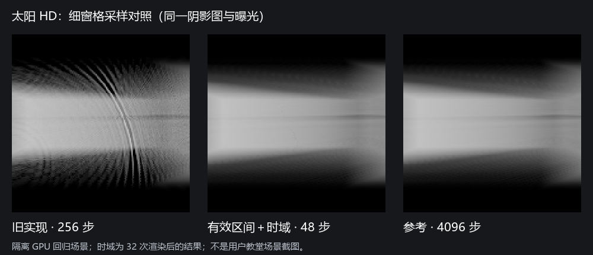

# Ho-VolumeLight 太阳 HD 抗锯齿验证

日期：2026-10-19–20。Unity 6000.3.15f1，HoURP 17.3.0，Editor RenderGraph，实际 D3D11/D3D12 GPU 读回。

本轮完成太阳 HD 的有效介质交段采样、蓝噪声抖动、深度感知单帧重建与按相机保存的时域重建。局部 SD/HD、独立光源深度、玻璃透光、灰尘颗粒和 AC 导出仍按原后续计划推进。

## 对照与结果



图来自隔离 GPU 验证场景；旧 256 步、时域 48 步和 4096 步参考使用相同的细窗格 alpha 遮挡、太阳阴影图、相机、介质和曝光。时域结果为 32 次渲染后。它证明可复现的步进条纹被抑制，没有替代用户实际教堂场景的视觉验收。

| GPU 测量（线性 HDR） | D3D12 | D3D11 |
| --- | ---: | ---: |
| 旧整段固定采样 256 步 RMSE | 0.146007 | 0.146007 |
| 有效交段固定采样 256 步 RMSE | 0.012151 | 0.012151 |
| 单帧去噪 256 步 RMSE | 0.012693 | 0.012693 |
| 时域 256 步 RMSE | 0.004986 | 0.004985 |
| 有效交段固定采样 48 步 RMSE | 0.121704 | 0.121704 |
| 单帧去噪 48 步 RMSE | 0.041573 | 0.041573 |
| 时域 48 步 RMSE | 0.010677 | 0.010677 |
| 旧 256 步规律条纹误差 | 0.025293 | 0.025293 |
| 时域 256 步规律条纹误差 | 0.004843 | 0.004842 |
| 时域 48 步规律条纹误差 | 0.006322 | 0.006322 |
| 时域 48 步相邻稳态帧 RMSE | 0.010648 | 0.010648 |
| 窄光束总能量 / 参考 | 99.77% | 99.77% |
| 窄光束峰值 / 参考 | 99.81% | 99.81% |
| 前景阻挡像素的体积泄漏 | 0 | 0 |
| GPU 历史最大累积计数 | 32 | 32 |
| 开启相机 TAA 后的体积历史最大计数 | 9 | 9 |

RMSE 在中央 136×136 区域计算，与同姿态 4096 步参考逐像素比较；规律条纹指标是误差经过 5×5 均值后的 RMS，用来区分相关条纹与随机颗粒。两项一起验收，避免仅把条纹变为更大的噪声。当前测试以正交/透视、无阴影、区域权重、世界密度与常见 CSM 行为的独立断言补充参考图，未将高步数参考宣称为精确物理解。

门槛写入 `HoVolumeLightAntialiasingValidation.cs`：256 步相对旧实现的 RMSE 至少下降 75%、条纹误差至少下降 60%；同预算时域相对固定采样 RMSE 至少改善 20%；时域 48 步的条纹误差至少小于旧 256 步一半；稳态帧差小于参考平均亮度的 2.5%；总能量误差小于 2%。另用独立窄光束断言总能量在 90%–110%、峰值至少保留 85%。

移动遮挡第一帧 RMSE 约 0.02467，相机小幅旋转/平移最坏约 0.04126；均低于相应验收阈值。这不是完全无拖影的保证：视差较大时主动拒绝历史、回到带颗粒的单帧估计；需无时间拖尾时可显式选“单帧去噪”。

## 回归范围

| 要求 | 实际验证 |
| --- | --- |
| 完整光源遮挡与区域激活分离 | 介质外窗格/画面外遮挡继续影响体积；权重为零不改变光源 shadow probe |
| 多孔材质 | 原有 URP cutout 与真实 lilToon Cutout 的主贴图 alpha、独立 AlphaMask 均通过 |
| 空气阴影 | 开启 SCREEN shadow keyword 后，重建结果与原 atlas 路径一致；既有阴影距离淡出回归通过 |
| 动态响应 | 前景移入、阴影 caster 移动、相机旋转/平移、大幅跳变、介质染色、太阳强度/方向、阴影距离/强度变化 |
| 共同世界密度 | 时间推进不修改 Medium 静态 revision；流动 Texture3D 在时域模式下仍改变输出 |
| 相机历史归属 | 两观察者持有独立历史；关闭一台观察者的 Volume 覆盖不会删除另一台的历史 |
| 相机配置 | renderScale=0.5 时历史变为 80 像素宽；MSAA4、透视/正交切换与实际相机 TAA 共存 |
| 资源恢复 | 直接销毁历史 RenderTexture、释放其原生存储后仍恢复 HDR 输出 |
| 切场景与关闭 | 实际 Single 新场景销毁旧相机并释放历史；新场景重新创建；设置关闭、Feature SetActive(false) 与 Dispose 回归 |
| 基础输入与工具 | Medium GPU/revision、环境独立性、区域 Undo/Redo、默认 Shader 与线性无压缩噪声资源、贡献调试 |

完整入口为 `lilToon.URP.Extensions.VolumeLight.HoVolumeLightValidation.Run`。D3D11/D3D12 最终日志分别为隔离工程根目录的 `volumelight-aa-final-d3d11.log` / `volumelight-aa-final-d3d12.log`；结果为 `VolumeLightValidation/result-Direct3D11.json` / `result-Direct3D12.json`。保存线性 EXR 和预览 PNG；发生渲染日志错误会使验证失败，避免旧目标残留被算作通过。

实现提交为 `76210e7`。两份终验结果与源文件哈希保存在 `Tests~/VolumeLight/results`，核对 GPU 验证快照与交付源码一致；大型 Unity 缓存、过程失败日志及 EXR 不提交。

原有天空环境入口 `lilToon.URP.Extensions.Atmosphere.HoAtmosphereValidation.Run` 另行回归，日志为 `volumelight-aa-atmosphere-d3d12.log`；覆盖天空六面 HDR、来源/缓存/跨相机、纹理原生存储与对象损坏、连续切场景、Volume 和禁用/Dispose。

## 复现与开销边界

使用本地包的独立 Unity 工程，执行（路径按本机安装调整）：

```powershell
& 'C:/Program Files/Unity/Hub/Editor/6000.3.15f1/Editor/Unity.exe' `
  -batchmode -force-d3d12 -projectPath '<隔离 Unity 工程>' `
  -executeMethod lilToon.URP.Extensions.VolumeLight.HoVolumeLightValidation.Run `
  -logFile '<验证日志>'
```

不要加 `-nographics`；异步 Editor 验证自行退出，无需 `-quit`。换用 `-force-d3d11` 运行另一 API。参考 shader 放在 Editor，仅用于验证，4096 步不会进入正常运行路径。

当时工作区另有未完成的 RTGI/NRD 编译改动，故 GPU 验证使用 `82df540` 已提交基线的隔离包快照，并覆盖本轮完整 `Runtime/VolumeLight` / `Editor/VolumeLight`。天空/大气及 HoURP 依赖保持同一版本；没有修改或提交其他任务的工作。交付前核对快照与工作区的生产/验证源文件一致。

新增设置只有一个抗锯齿枚举，保持已有步数参数。面板说明预算检查中 VolumeLight 文件为 4 个 HelpBox、40 个汉字，符合预算；全仓库既有 RTDI Volume、GD Volume、AC Volume 的三个超预算项不属于本轮。

全分辨率时域历史为 24 字节/像素，两张 RGBA16F 与两张 R32F；1080p 约 47.5 MiB/相机，另有 graph 临时采样图。关闭与单帧模式不持有历史 RT。没有声称整帧 GPU 时间必然下降，也没有用 CPU 提交耗时冒充 GPU Pass 耗时；具体性能应在实际镜头与设备上测量。支持边界保持 Base Game/SceneView、HoURP RenderGraph，XR 明确跳过；局部光、froxel、低分辨率上采样与彩色透光不在本轮内。
