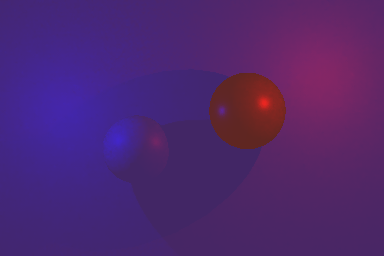

# Switchable RTDI composition

This folder preserves the blend qualification at `94c9128`. The current
**合成到画面** and **混合模式** controls live in Ho-RTDI Volume; migration and
current camera-override evidence are in [VolumeControls](../../VolumeControls/README.md).

| Mode | Controls | Behaviour |
| --- | --- | --- |
| 参考 PBR 替换 / Replace | 合成过渡权重, default1 | Existing interpolation from original to reference direct light + emission |
| 加法叠加 / Additive | 叠加强度, default.25 | Preserve original and add scaled direct light; emission stays in original |

Composition still defaults off. Existing serialized renderers keep Replace.
Both amounts are retained separately. Gain0 preserves the original camera;
additive gain can exceed1, and negative/non-finite gains are treated as0.
Only valid, depth-matched primary receivers are affected. The existing full
viewport/Mono/2D/single-sample limits remain. Raw DI output and NRD sampling are
unchanged by blend mode or amount; switching the mode does not reset history.

For a quick existing-scene integration, use Additive at.25, then adjust the
separate sky illumination gain for the desired sky/local-light balance.
The additive formula in linear HDR is:

```text
output = original + additiveIntensity * (diffuse + specular) * fogTransmission
```

Original emission and fog colour must not be added again. Gamma projects decode
the original to linear, add the new radiance, then encode the result. The
original alpha is preserved. Transparent rendering follows the composite.

Additive deliberately retains the original direct light and can double-count
that energy. It is an artistic integration option. It cannot darken existing
pixels: RTDI shadowing means less added light, not removal of old unshadowed
lighting. Existing scene shadows can remain enabled. Replace is useful for a
full RTDI shadow/lighting comparison; neither mode implements NPR ramp reception.

## Actual normal-camera captures

Same controlled scene, final camera target, debug Off, Linear project. All three
384x256 images use the same Reinhard followed by sRGB presentation. These are
isolated validation-scene captures, not new captures of the user's castle.

Original:


Reference replacement:


Additive, gain.25:



## Qualification

Unity6000.3.15f1, D3D12, isolated `.codex-research/RTInputValidation` project:

- Gamma/Linear x RG/compatibility:4 `RunCompositeBlend` cases,18 named checks
  each, plus assertions for unchanged raw output and alpha.
- Same4 combinations rerun original `RunComposite` replacement regression:
  18 checks each. All8 GPU processes exited0.
- Linear configuration and restoration to Gamma also exited0. The isolated
  project was restored; no user scene, renderer, lights or shadow settings changed.

Blend tests cover gains0/.25/1/2, independent replacement weight, HDR emission
without duplication, zero world visibility, partial/full fog, background and
invalid primary domains, foreground Unlit depth protection, transparency order,
actual filtered publication, mode switching without NRD reset, volume disable,
and defaults loaded from an old serialized renderer with no blend fields.
No thresholds were relaxed. Sources and raw reports are fingerprinted separately
from the original parent replacement evidence.

Run these entries with prefix
`lilToon.URP.Extensions.Editor.RTDI.HoRTDIValidation.`:

```text
ConfigureCompositeGamma
RunCompositeBlend
RunCompositeBlendCompatibility
RunComposite
RunCompositeCompatibility
ConfigureCompositeLinear
RunCompositeBlend
RunCompositeBlendCompatibility
RunComposite
RunCompositeCompatibility
ConfigureCompositeGamma
```

Use Unity `-batchmode -force-d3d12 -projectPath <isolated project>
-executeMethod <entry> -logFile <log>`, one process per entry/project. Copy each
fresh report before the next colour-space case overwrites its output name.
The blend fixture requires the existing `Assets/RTDIPlayerProbe/LegacyPartialRenderer.asset`
from the Player preparation flow, still missing the new fields.

```powershell
python Tests~/RTDI/Composite/Blend/verify.py --source-commit 94c9128
python Tests~/RTDI/EnvironmentIntensity/verify.py --source-commit 1ea7d4f
python Tests~/RTDI/SceneView/FastHistory/verify.py --source-commit 7360367
```

These verify preserved evidence, not a fresh Unity rerun. No new Player build,
full castle acceptance, or resolution of the older quality/performance gaps is
claimed by this blend qualification.
