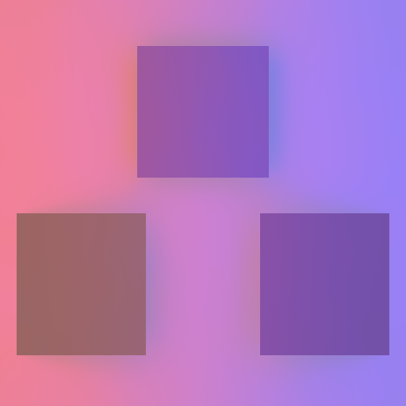
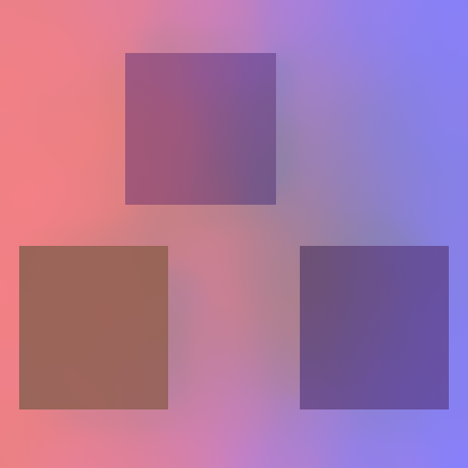

# 040 — 多接收面持续运动：两条自动相机 Release Player 通过，确认历史重置瓶颈

2026-10-23。生产GI算法/参数、Runtime/Shader/DI/vendor未改。新增Editor可选构建入口和独立probe；旧构建参数默认行为保持。F39静态增长支持仍未通过。

## 实际 Player 覆盖

RG build36184/Player10356、compat build35500/Player40688，均actual0。serialized Camera.enabled=true、targetTexture=null、真实512²默认屏幕；原生endCameraRendering和WaitForEndOfFrame截图帧号逐帧对应，无Camera.Render/SubmitRenderRequest/手动Volume更新。沿用户短暂可见窗口授权，build隐藏，Player受10秒外部/8秒Start后内部限制；采样生命周期分别4.384/4.331秒，不把它当完整process时长或GPU预算。

场景初始固定8个ray instance、3个owned skin snapshot、1个Cutout：三块额外可见倾斜/移动接收面，骨骼+blendshape蓝发光面持续运动，ray-only遮挡移动；沿017已验证base4构建/canonical0代码，本轮不声称重新遍历证明所有mesh metadata。没有实例增删、triangle-layout增长或F39绕过验收。

各240个连续原生相机帧，Volume-off16帧，**实际GI更新224帧**。48运动帧实际Bake48次、structure revision恒2，恢复静止Bake增量0并恢复temporal。三ROI全部RGB的合成误差：强度1最大RG.007227/compat.007213，强度.5均.005216，低于原.015；Volume关16帧screen恢复raster误差0。Cutout封闭首帧raw/filtered全部RGB0；蓝发光关首帧旧蓝最大.0002688<.005，红关首帧旧红0，另一颜色保留；Volume重新启用首帧reset。每后端22checks，8instance/3skin/1Cutout整个序列保持。

RG/compat报告raw三ROI逐帧float值相同；filtered最大差.0006831、screen最大差.0004029，完整差异保留，不称两后端全部bitexact。D3D12/Shader/绑定/UAV/fence/source drift0；build只原五条精确旧warning。两者保留原GeometryBuffer fallback shader缺省提示（本场景全lilToon路径未用fallback），不宣称覆盖普通材质fallback。

18张实际屏幕PNG按后端保存。已查看RG合成和compat运动截图，多接收面、红蓝GI渐变及接收面位移符合控制场景。以下是实际Player截图，不是参考真值或生成图：




## 新发现与下一步约束

两个运动段均**48/48帧NRD reset，raw GI temporal使用0帧**，geometry结构没有变。当前全scene.Revision同时控制GI reservoir和NRD历史，持续运动因此不能获得稳定的NRD时间累积。蓝raw ROI范围.05494～.51272证明响应，不把几何运动信号方差当噪声/MSE，也不把本次功能通过称为复杂动态画质通过。

已读并冻结DI31/32过程片段、VisibilityConfidence和当前DI代码：DI直接忽略world reset虽降低平均噪声，却使阶跃变化像素L1 .5709>.35失败；它的生产保留历史依赖真实同reservoir/light采样在当前TLAS重求可见性和confidence。移动primary还需当前匹配表面起点，见其PrimaryMotion文档。GI目前IN_MV为黑、IN_DIFF_CONFIDENCE为白，未接同类动态历史confidence；固定RTXDI FullSample设置CONTINUE不是可无条件照搬的许可。

041应先按DI过程和固定参考GI链路审查GI同采样重求的信号/元数据可用性，建立不掺新RNG的动态confidence契约、独立oracle/同源对照，再选限域生命周期候选。**保留GI reservoir原保守失效，不直接将NRD的scene.Revision替换StructureRevision或硬设CONTINUE。** 不重开局部phi/归一化/迭代公式扫描。参考文件原字节/SHA见reference-review.json与reference/。

## F39有限审计

当前6000.3.15f1/RTX4060/617.42与018同。旧最小入口Add后确实Build；initial5干净、原Ho/纯Unity3→5 scratch范围错，owned mirror/base0已试过。本轮没有找到可行动新修复，未重跑旧matrix/flags。

[Unity RTAS API](https://docs.unity.com/en-us/engine/6000.3/script-reference/unityengine/rendering/raytracingaccelerationstructure)要求修改后Build；[Microsoft scratch契约](https://learn.microsoft.com/en-us/windows/win32/api/d3d12/ns-d3d12-d3d12_build_raytracing_acceleration_structure_desc)将需求与build inputs对应。[Unity内存文章](https://discussions.unity.com/t/graphics-memory-optimizations-for-dx12-vulkan-and-metal/1689618)只是一般分配器优化；有限核查[本版release notes](https://unity.com/releases/editor/whats-new/6000.3.15f1)没有找到Ray/scratch文字，不能据此断言所有后续版本/上游issue均无修复。审计依据/边界见native-audit.json，固定实例动测不关闭F39。

## 复核、归档和成本

```powershell
python Tests~/RTGI/ComplexMotion/verify_validation.py
python Tests~/RTGI/ComplexMotion/analyze.py
pwsh -NoProfile -File Tests~/RTGI/ComplexMotion/run_players.ps1 -Mode rg
pwsh -NoProfile -File Tests~/RTGI/ComplexMotion/run_players.ps1 -Mode compat
```

1163源对象按原SHA去重（包含全部Runtime选定文本/meta与NativeDLL），4完整build/player logs，两套完整最终payload逐文件SHA核验、无HoGIGpuProbe.dll；2原JSON lossless gzip/18实际PNG/分析/审查/原metadata均保留。初RG wrapper把同一个ordered record持久化后又追加，原双entry JSON和源码保留initial-metadata，修正为一次实际build/一次Player；不是重复执行。compat修正wrapper且独立snapshot/source，current-source看compat，历史RG按原源。verifier起初误将JsonUtility空error字符串当null，已按无错误文本核验，原report未变。

截图/ReadPixels/反射/JSON记录为诊断开销，约4.4秒生命周期不代表产品全帧GPU时间。本步没证明实际大场景动态MC/残影/噪声、环境混合、1080完整预算或静态增长支持；全部目标缺口继续active。每步前后review/过滤提交/踩坑/交接保持，Ho-GD计划不纳入。
