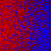

# 步骤006：Mono Player真实应用帧与空间质量

两个Win64 Mono release构建/实际D3D12 Player均exit0：Linear RenderGraph与compatibility，各304次相机请求、299条有效帧记录、16项runtime检查。`formal-run.json`保留真实PID/exit/marker/fresh/SHA，`evidence.json`补完整Player文件树SHA、源码和离线能量复审。

**这是每个真实Update只一次SubmitRenderRequest**，frameCount和unscaledTime严格递增。它证明真实应用时间、序列化shader/native/合成可达及对应历史响应；没有宣称正常enabled-camera自动呈现。DI已有隐藏宿主自动camera零事件的失败，本步不重复该条件冒称自动相机通过。

## 结果与收益

非均匀夹具：白色接收面，离屏红/蓝emission面；无DI、环境或其他解析灯，ReSTIR temporal/spatial与独立原版RELAX均开启。52～179样本统计中央32² ROI，共128个实际应用帧。

| 指标 | RG | compatibility |
| --- | --- | --- |
| 时间均值空间图相对L1（raw作为同次对照） | .103438 | .103524 |
| raw红通道逐像素时间方差 | .0724847 | .0724847 |
| filtered同指标 | .0000772085 | .0000776809 |
| filtered/raw 方差比 | .00106517 | .00107169 |
| 红通道均值比 | .970421 | .970174 |
| 蓝通道均值比 | .969658 | .969198 |
| camera color合成最大通道误差 | .00007272 | .00006962 |
| 可保留重投影的camera运动帧 | 59 | 59 |
| 移动几何导致保守reset的帧 | 24/24 | 24/24 |

均值红/蓝约-3%，通过原5%正常亮度门槛；接近黑的绿通道raw约.000230、filtered约.000162，按绝对误差<.001检查，不将其相对变化当能量结论。方差降低约99.89%，空间L1通过事前15%形状门槛。raw有限采样均值不是高精度真值，未据此声称严格无偏。

首次关闭红emission的实际帧，raw/filtered红均为0；Volume off/on、denoise off/on、独立新历史均通过。合成以实际未合成camera color为基准，只加同帧filtered，不假设lilToon白材质的raster RGB必为1。已实际验证原版NRD DLL加载/调度与所有15个serialized wrapper的运行链路。

 

这两张64² PNG是compatibility最后一张静态raw/filtered，不是128帧均值图；均值图L1由runtime逐像素积累。真实时间不同导致两路径NRD结果略有差别，没有使用合成的60Hz验证时钟。

## 可复现

本机Unity6000.3.15f1、RTX4060，专用工程`.codex-research/RTGIValidation`。manifest现指向实时工作区，已提交base为`a525c3677ddc4426ce3704579b21205593f0e849`，GI生产代码是步骤005 `95120a4`；本步只新增Editor构建helper和Tests~探针。固定NRD DLL SHA与步骤005相同，报告记录完整payload树；两EXE bootstrap相同不等于两个Player payload相同。

```powershell
& Tests~/RTGI/Dynamic/run_validation.ps1
python Tests~/RTGI/Dynamic/verify_validation.py
```

runner复制Tests~探针到专用Assets，再生成其私有scene/pipeline/material/Volume资产，检查MonoScript绑定及GI/NRD/composite序列化引用，分别构建/启动。只启动隐藏Player，每个应用Update显式渲染一次并按DI既有request helper显式更新Volume；不占用用户场景或DI工程。日志名含时间戳，当前所有进程结束。

## 保留的失败与限制

- 初始隔离包build exit0但Player的m_Script空/布局错误。GI/GB/SB/Volume CLR可创建，MonoScript.GetClass却全空；单次全脚本强制重导入无收益。改回实时工作树映射恢复，加入构建前强制检查；快照导入唯一根因搁置，不继续原样重建。初始report在`results/initial-linear-rg.json`，核对路径后人为结束挂住的PID34808，真实exit=-1。
- 探针清理对null Feature再次Dispose导致挂住，已修为null安全，并在入口明确拒绝缺失序列化依赖。
- `results/rejected-raster-basis-assumption.json`：原夹具把白色unlit raster假定为1；实测.2158203，导致错误合成门槛。改读此前实际未合成帧作为基准；未改产品增益。
- `results/rejected-volume-update.json`：前268帧空间/响应已通过，Volume off失败；disabled-camera的请求路径缺少显式Volume更新。沿DI `HoRTDIPlayerProbe.Render`补同样更新，未改生产Volume策略。
- 重复报告已按字节SHA去重；历史run里旧路径到当前保留文件的对应关系在`historical-report-aliases.json`，未删除任何独有失败内容。
- 构建保留三条非GI警告：VolumeLight SolarHD在D3D11的除零、lilToon两条重复keyword。实际Player另有GB fallback/resolve shader不可达警告和退出时四条GraphicsBuffer GC清理警告。本夹具lilToon primary已有有效输入，但不能称全部GB支持域或完整生命周期验收。
- 仍未完成正常自动相机呈现、目标复杂场景/薄墙/小高亮源、骨骼/Cutout专门支持、Gamma Player/D3D11 Player、GPU毫秒/预算。保守几何变化24帧全部reset会影响动态收敛；没有把它包装成动态表面motion。报告通过不等于完整goal完成。

事后review：接纳本步作为部署/应用帧证据，没有新增产品算法调参。原版降噪有明确噪声收益和约3%均值差，复杂细节与稳态精度仍应继续评估。后续先补实际场景支持和预算，再按证据决定是否需要调整重建。
