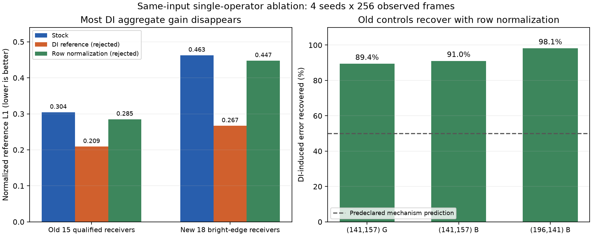

# 039 — 单归一化算子消融：收回旧退化，也丢掉大部分总体收益

2026-10-23。结论：**变体拒绝/撤回，局部归一化/DI公式试验线暂搁置**。原生产stock5/scale64/GI32F保持；038合格观察工具保留，不接纳037 DI策略。

## 设计、同源性和真实验证

main stock；branch0固定037 DI-derived参考；branch1仅将后4轮diffuse output的固定Gaussian rejected mass留center恢复stock行归一化。RGB/variance传播一起恢复原表达式，Smem temporal-var/w²、min-pair/RGB及其它数学/设置均不动。两个body逆替换逐byte核对；wrapper仅include body名变。三输出same actual GI input/common/settings/time，独立pool/constants/OUT。物理GPU校准独立读取main NRD输出，绝不把DI branch0当stock。

四个自有Unity进程均actual0、终态/active=null：34400初局部资格98请求/32观察帧；19860补强资格98请求/32帧；39728正式1314请求/1024帧；25112过滤038模式98请求/32帧。API/D3D12 debug/Shader/CS/绑定/UAV/fence/source drift0。

初资格只有28点的stage9一致，不补写整图资格。补强后每帧将两实验支首Atrous输出copy到独立F32 RT并比较完整262144 RGBA分量及双SHA，正式1024帧共268435456分量全部bitexact；差异从第一次后轮归一化产生。112 tiny/negative/large F32 gather分量自检过；主输出和固定DI参考的完整NRD逐帧SHA对038逐bit同，参考全部28点九stage/物理mean map同，新增196141 guide max9.336e−7。第一后轮输入整图一致和源码仅一个block改变，支持本次算子干预因果；后续包含variance反馈，不能称只改变某个RGB系数或证明唯一原因。

## 收益、失败与取舍

固定4seed0/104729/5347609/6396185，各64warm256观察。旧141157 G/B、196141 B相对固定DI参考的误差分别收回89.386%/91.025%/98.145%，满足预先声明一半恢复的机制预测；相对stock无新合格点硬退化。

但新18 weighted reference L1 stock.462545、DI.266596、变体.447479：变体仅改善3.257%，低于原20%筛选；旧15合格点.304146/.208852/.284750，仅改善6.377%。full仍2/4通过（DI为4/4），pooledRGB−4.483/−4.809/−4.548%，phase失败7/11/11/7→7/8/10/6，无stock pass→fail，pooled仍6失败。filtered方差×1.77/2.34/7.17/2.01，filtered/raw .00299～.00628；过静态噪声筛选不等于动态资格。



机制预测通过与产品拒绝并存：单归一化算子足以解释旧点大部分损失，也承载新18大部分收益，不能用“恢复旧点”接纳收益不足的变体。全部34点（旧dark未合格保持）/原硬门槛/全部full/16phase/noise、三输出原数据保留，四seed经验SE不是正式CI；同漫反射模型不是独立真值/全图MC。无需继续8seed/HDR/Player/GPU。

## 过滤与复核

已保存原候选完整源码/生成7文件/SHA、272源对象、4完整logs、72份report/二进制lossless gzip。新增ExchangeAudit类/meta和exchange模式/入口/覆盖均移除，3个Editor文件精确恢复1cb030f版本，Runtime/DI/vendor一直未改。过滤后038观察实跑32帧通过。原始、补强、正式各按自己的归档源重建，不给初局部资格补证明；当前source对应filtered-run。

```powershell
python Tests~/RTGI/ExchangeOperator/verify_validation.py
python Tests~/RTGI/ExchangeOperator/compare_scope.py --mode matrix
python Tests~/RTGI/ExchangeOperator/analyze.py
pwsh -NoProfile -File Tests~/RTGI/ExchangeOperator/run_filtered.ps1
```

历史run_validation.ps1保留但启动前拒绝已移除的入口。不能回滚当前产品凑旧SHA。图表复用038隔离Matplotlib依赖，无新安装，源JSON/图SHA见figure.json；图是四seed描述性数据而非场景截图。新两个F32整图输入copy约2MiB、第三物理RT及读回/2NRD都是诊断成本，不作产品VRAM或GPU预算。

## 接手：停止局部公式试验，推进其余实际交付缺口

自029起局部降噪公式多次试验没有可保留生产改进，按用户“长期无收益要搁置”要求暂搁置本试验线；保留所有质量缺口，不能标记目标完成。禁止在固定交换/行归一化间扫插值、再扫phi/epsilon/迭代/ratio或位置特判。新结构性机制或参考链路证据以后才重开，不继续凭现有两端数据排下一个公式。

040先核F39原生scratch证据、最小入口和引擎/host状态/官方诊断，确定是否有新的可行动机制。018已实现过owned静态mirror/baseVertex0，原Ho和纯Unity原生入口3→5也错、初始5干净；**重新抄017 canonical indices不是新方案**。旧flags/Static/recreate/delay/capacity盲试禁止。没有新证据就不重跑旧15矩阵，把static缺口明确保留，推进固定实例复杂动态Player/全帧成本等独立必要验证；固定实例动测不能被冒称F39解决。原全质量/F39/static/复杂动态/1080完整预算和总目标active。
