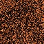

# 步骤005：独立GI原版RELAX_DIFFUSE

固定NRD4.17.3 native库实查为RELAX_DIFFUSE enum10：15个pipeline，6个permanent池、4个transient池。`probe_nrd.py`从固定头文件解析枚举、读取实际DLL descriptor；`generate_nrd.py`结合原始resource header产生manifest及Unity wrapper。原vendor body不改，不使用DenseDI的Temporal/Clamping/Atrous替换。许可见`Runtime/RTDI/ThirdParty/NRD/LICENSE.txt`。

## 实际结果

`results/run.json`汇总7项实际exit0、marker成功、shader/C# error诊断0；原始分组为`run-matrix.json`与`run-regressions.json`。四组Linear/Gamma × RG/compat各243请求/41检查，数值一致。

| 测量 | raw | filtered |
| --- | --- | --- |
| 白色接收面RGB均值 | (.360382,.180422,.088747) | (.364358,.182411,.089711) |
| 每像素红通道时间方差 | .1141095684 | .00000390791 |
| HDR天空1000对应RGB均值 | (725.783,363.355,178.733) | (730.820,365.878,179.948) |

均值差约+1.1%，方差比约.00003425（减少约99.9966%）。没有ReSTIR复用，先48帧warmup，再统计64帧的中央32² ROI；这是同次生产raw/filtered的局部时间方差，并非目标场景质量排名。固定64倍信号单位转换只在NRD前后成对应用，不调整GI能量。

已覆盖实际输入正viewZ/有限GI距离、零albedo通道的demodulated信号保留、静态世界相机矩阵重投影、天空突变首帧清旧历史、HDR有限性/均值、正常camera color消费filtered、invalid背景、Volume开关/不回写、开关释放/重建、两台相机独立instance以及分辨率重建。另三项为既有DI RunDenoise实际能量/噪声/相机/生命周期门槛、raw GI合成与未合成环境回归。

 

64²原始PNG只用于检查本夹具噪声外观；完整EXR/PNG在专用工程`ho-gi-nrd-{rg,compat}`。没有自动应用帧动态、复杂空间细节/薄遮挡、运动角色、场景GPU毫秒或Player结论。保守几何revision重置不等于动态表面motion已实现；固定HDR单位转换也不保证任意HDR强度。

## 可复现与隔离来源

Unity6000.3.15f1 / RTX4060 / D3D12，专用工程`.codex-research/RTGIValidation`，不占用DI工程。共享工作区VolumeLight施工曾导致C#编译失败，因此本轮用隔离package：base `82df540c9d204b2afef9a5eae101d2e4170439df`，只覆盖`Runtime/RTGI`、`Editor/RTGI`及两份共享NRD API文件。95个覆盖文件SHA分别记录于`snapshot-matrix.json`与`snapshot.json`，两组内容一致，已核对当前源码。`git archive`把旧ShadowCast合同头输出为CRLF，其既有解析器只匹配LF；只在快照归一化该头的换行，路径/最终SHA明确记录，没有修改生产文件。

专用工程manifest目前引用`.codex-research/RTGIValidationPackage`，更新源码后必须重新同步；不要误把该快照当实时工作树。新机器首次使用`snapshot_validation.ps1 -Initialize`，已有快照运行`run_validation.ps1`会同步上述覆盖。生成器需要Python与pcpp1.30（本机`.codex-research/python-nrd`），无需新native构建。

```powershell
python Tests~/RTGI/NRD/probe_nrd.py
python Tests~/RTGI/NRD/generate_nrd.py --check
& Tests~/RTGI/NRD/run_validation.ps1
```

runner逐项记录PID、实际退出、fresh report、完成marker与log/report SHA，最后恢复色彩空间设置。当前所有进程结束，`activeProcess=null`。后续日志名带时间戳，防止重复实验覆盖历史。

## 保留的失败

- `rejected-import.json`：首轮新增meta误用33位GUID导致Context不导入、CS0246、退出1；已修正GUID并实际重新编译。第二轮还发现GI缺少URP using及并行VolumeLight两项编译错误，前者修正，后者通过隔离快照避开，没有改他人文件。原log仍在本机`.codex-research/rtgi-step005-{initial,smoke}.log`。
- `results/rejected-snapshot-line-endings*.json`：快照传输换行触发旧ShadowCast宏校验，保留report。旧smoke log路径后来被成功smoke覆盖，历史SHA仅表示当次文件，不能对当前同名log验真。
- `results/rejected-run-marker.json`：误给DI RunConvergence使用通用PASS marker，实际exit0并完成capture，runner仍拒绝。完成报告保留为`di-convergence-capture.json`；没有降低门槛，改跑已有RunDenoise完整门槛。该旧log路径后来被RunDenoise覆盖，历史SHA不能对当前同名log验真。

本步review接纳为可选原版降噪基线：raw可随时对照，DI默认调用未变且实际回归通过；后续优先验证正常帧/空间质量与预算，有证据再调整策略，不能仅靠延长历史掩盖拖影。
