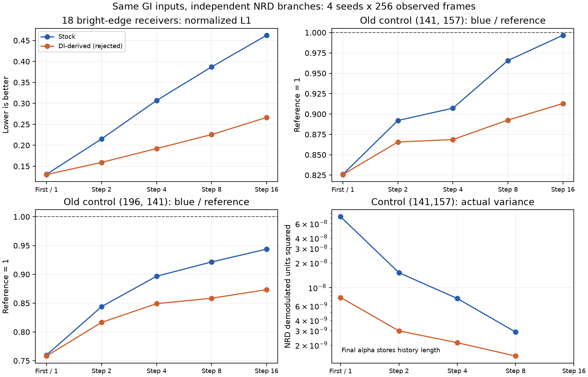

# 038 — GI同源两分支逐轮观察：旧反例损失来自后续恢复减弱

2026-10-23。本轮只新增合格Editor诊断，不改Runtime/vendor/DI/生产参数，不接纳037已拒绝的策略。原stock5/scale64/GI32F继续。

## 资格与真实数据

1108短资格actual0，98请求/32观察帧（2seed16warm16）；18596正式actual0，1314请求/1024观察帧（原4seed0/104729/5347609/6396185，64warm256）。D3D12 debug/编译/绑定/UAV/fence/source drift0、全部自有进程终态/active=null。原main stock、branch0 stock、branch1 exact037 DI-derived策略，同实际IN/common/settings/time，独立历史/OUT/pools/constants。037五个Shader原字节只在隔离项目Assets生成，源SHA/manifest核对，非新增生产Shader。

独立Gather shader读取真实pool输出，不给滤波body插debug UAV：28点（原27+196141）×2branch×9stage，GPU结构化values8064B、坐标224B。112个tiny/negative/large F32分量自检bitexact；稀疏读取的原27点全部9stage，重调制后对main原有F32整图stage copy逐帧bitexact。新增196141实际full/RAB/history/ray/reference guide最大误差9.336e−7。两branch原完整raw/pub mean map和候选原27点逐帧物理pub，对037同模式逐bit同；branch0每帧demod RGBA对main bitexact、1024物理GPU发布校准0差。因此观察没有改变旧比较，仍不等于策略接纳。

HGB1：magic+6int(width,height,seed,branches2,stages9,points28)，9stageId和28×int2坐标；每观察帧shader/application两int+2×6writer int+2×9×28float4（8120B/frame）。stageIds 3/4/5/6/9/101/102/103/104。完整原流/mean maps/report lossless gzip，264源对象复用原SHA，2完整logs/38captures。

## 发现及限制

两支在Pre/Temporal/HistoryFix/Clamp的28点全部RGB和alpha逐位同；差异从首Atrous开始。新18 reference L1：stock .130687→.215150→.306872→.386896→.462370；DI-derived .130145→.159167→.192195→.225485→.266351。总体收益主要在后四轮。

旧141157 G/B在首轮几乎同，B/reference .82590/.82572；后四轮stock恢复到.99666，DI仅.91288。196141 B首轮.75986/.75822，末.94380/.87350。物理RGBA16F发布的原三通道硬退化与037相同，F58继续拒绝。图中末点是NRD RGB重调制、尚未F16量化，与实际publication有小差，不能混为精确同一数。



首轮实际variance：141157 stock7.276e−8/DI7.588e−9，196141 stock3.004e−7/DI8.064e−8。但196141在step4/8的DI variance反而约3.3/5.6倍stock，恢复仍弱，不能笼统说都是variance太小。141157实际Clamp3×3 moments离线重构：原spatial+temporal blur mean7.456e−8、DI temporal-only6.673e−8，phi2带宽mean.0005026/.0004760、两者floor激活0；首轮RGB几乎不变，不支持只恢复首轮blur作为完整修复。此只定位，不证明w²/min-pair/RGB距离/交换各自独立因果。

Alpha必须按stage解释：Pre是hit distance；Temporal/Clamp是二阶矩，离线以luma重构variance仅近似，使用原NRD单位；本轮settled HistoryFix fast/responsive alpha全0，不当variance；9/101/102/103才是实际GPU variance；104是historyLength，禁止当variance。方差不能逐通道乘albedo平方冒充物理variance。参考仍同漫反射模型/4seed经验估计，不是独立真值/全图MC/动态资格。

## 接手与下一步

```powershell
python Tests~/RTGI/PairedStages/verify_validation.py
python Tests~/RTGI/PairedStages/compare_observer.py --mode matrix
python Tests~/RTGI/PairedStages/analyze.py
pwsh -NoProfile -File Tests~/RTGI/PairedStages/run_validation.ps1 -Mode qualification
```

图表用Matplotlib。默认和bundled Python均缺库，隔离安装`.codex-research/rtgi-plot-deps`（显式--no-user --target避免user配置冲突），只plot进程插入sys.path，不改全局包；版本/失败/图SHA见plot-attempt.json。科学图是数据图，不是实际场景截图。

保留新Editor观察类/Gather和三个既有Editor可选接线，默认路径仍stock/noop；仅测试入口激活，项目路径/原源SHA/资源所有权检查并finally恢复释放。额外2NRD/RT/读回只诊断，不是产品GPU预算。没有新MC/算法变体/8seed/HDR/Player/GPU，原全质量/F39/static/复杂动态/1080预算与总目标active。

039可依据新的逐轮机制证据，做一个预先声明的单算子消融：只将后四轮“被拒权重留center”恢复stock行归一化，保留037 Smem temporal-var/w²、min-pair/RGB和其它settings。目的是分辨交换算子是否压制有益恢复；不能预称修复或扫描常量。宜保持mainstock，把现有两独立branch设为固定037参考和单算子变体，以同源三种输出比较，物理校准改用main输出，不能误用旧branch0==stock断言。先短资格确保stage9两实验支RGB/variance bitexact、第一后续轮在同输入处出现算子差，再同4seed旧15/新18/暗控制/full/phase/noise原门槛。若失败保留消融证据并撤回，不用额外seed/改门槛救回F58；有收益才后续部署资格。
