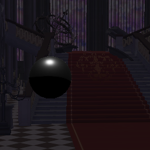
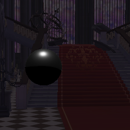
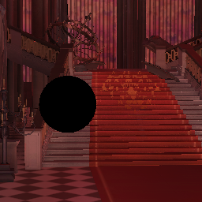

# 步骤010：实际古堡接入，以及保留的RELAX能量失败

**场景可运行，filtered质量尚未验收。** `evidence.json`的`qualityQualified=false`是有意保留的结论，不能因四组接入成功把质量门槛改绿。

## 实际接入

只读复用DI隔离工程的血月古堡依赖，GUID/URI闭包54文件、49,941,388 bytes及私有UnityGLTF2.19.5包复制到GI工程。源/目标/包文件SHA记录于`dependencies.json`，运行后两端未变；只在自有工程生成import缓存。原SceneSkybox、MainCamera、18灯与材质不改，临时pipeline只加GB/SB/Atmosphere/GI，按既有接口排除“天空”材质，未拆源mesh/保存场景。

128²/256²×RG/compat四个实际进程exit0、fresh/marker/SHA成功、shader/C#诊断0。15个RT submesh、12 Cutout、1个skinned snapshot；无次级材质拒绝，唯一几何排除为天空壳。四组静态后续请求无额外Bake，history/environment/nativeCutout实际运行。

| 尺寸 | 有效像素 | filtered非零像素 | .25合成实际变化像素 |
| --- | --- | --- | --- |
| 128² | 16384 | 15340 | 11692 |
| 256² | 65536 | 61390 | 46793 |

两路径相同。实际GI较弱，默认.25的变化轻微；不据“变化像素>0”声称最终画质达标。

 

以下仅是独立GI的**显示曝光×100**，原EXR和场景强度未乘100，不能和正常camera图按同曝光比较：



## 被拒绝的质量结果

原版固定RELAX，64额外预热后64帧，256²每4像素取样；raw/filtered均为RGB通道均值，而非max-channel均值。filtered低约9%，原5%门槛失败并实际exit1。延长到256额外预热/256观察帧仍低5.95%/6.54%/7.03%，不是简单冷启动。

阶段取证按原primary albedo重新调制后统计，零通道不反除：

| 阶段 | 红通道均值 |
| --- | --- |
| raw | .001492383 |
| NRD输入（还原单位/主色） | .001492365 |
| Prepass | .001478197 |
| Temporal | .001384652 |
| HistoryFix | .001463385 |
| HistoryClamping | .001383324 |
| Atrous最终 | .001353189 |

输入量化基本保持，Prepass约-1%；主要下降位于时间/色盒历史链。原版长窗raw方差约3.522e-6、filtered2.307e-8，噪声收益明显，但不能代替能量门槛。

沿DI稀疏可见样本经验做两轮单变量`fastSigma`诊断：4与6。长窗相对误差分别为(-4.41%,-5.18%,-5.68%)、(-4.13%,-4.95%,-5.42%)，仍失败。边际收益趋小、噪声略增，**不再试8/更大/补偿gain**。生产Runtime未改，固定原版fastSigma=2保留；不是已接纳的GI新预设。原版、长窗、stage、4/6五份失败报告/真实退出与SHA在`rejected-runs.json`。

重开需要新的阶段/输入/局部时空误差证据及动态/细节对照，而不是把5%放到6%或不断加长历史。整体goal保持active。

## 复现

```powershell
python Tests~/RTGI/Scene/prepare_scene.py
& Tests~/RTGI/Scene/run_validation.ps1
& Tests~/RTGI/Scene/run_validation.ps1 -Stability # 当前原版应失败，不能期待绿色
python Tests~/RTGI/Scene/verify_validation.py
```

阶段入口`HoRTGICastleValidation.RunNrdStages`，长窗原版/实验分别`RunLongStability/RunLongWideClamp/RunLongWideClampSix`。只有Editor诊断使用已有ValidationSettings/Stage回调，无产品shader/NRD变更。都是受控请求/合成时钟，不标称真实漫游或正常自动camera。

当前GPU毫秒仍缺失。DI隐藏宿主零duration/零自动camera及RenderDoc无文件经验已读；已找到本机CLI，但其事件/资源统计不等于GPU duration。下一阶段以官方Unity D3D12命令记录/时间戳接口等新测量条件作限定诊断，先验空区间/已知负载/fence/频率，不复刻旧零样本路径，也不以CPU等待代GPU。
